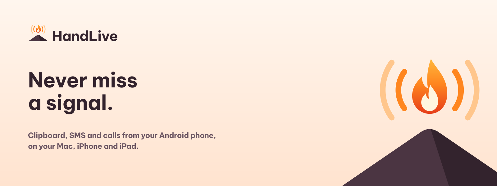
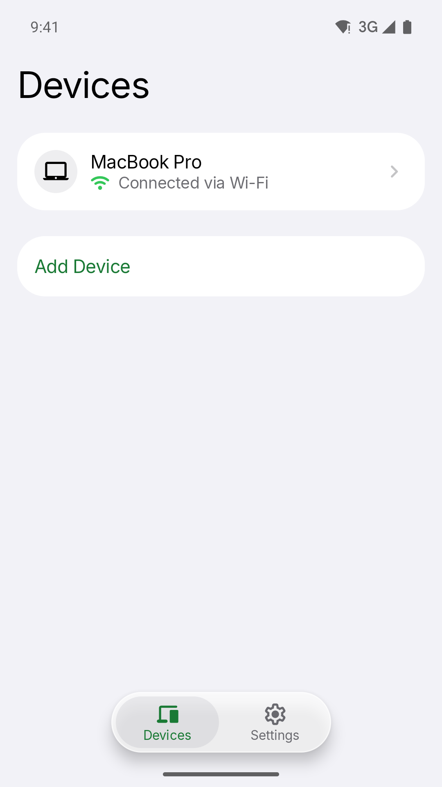
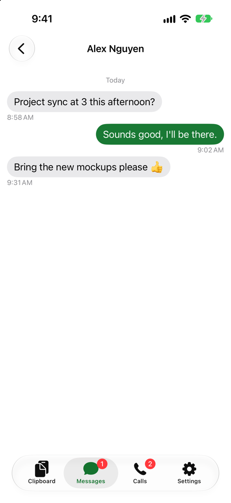
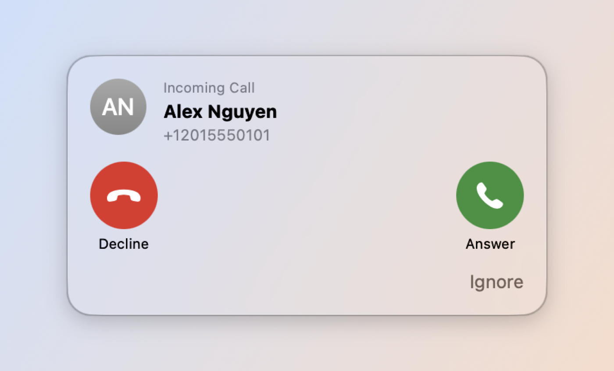

English | [Tiếng Việt](README.vi.md)

# HandLive



> **Never miss a signal.** Your Android phone's clipboard, SMS, and call notifications, on your Mac, iPhone, and iPad.

[](https://github.com/HandLive/handlive/actions/workflows/ci-docs.yml)
[](LICENSE)
[](https://github.com/HandLive/handlive/releases/tag/v0.1.1)

HandLive connects Android devices with macOS, iOS, and iPadOS. It syncs your clipboard, bridges SMS conversations, and delivers call notifications with action controls—without cloud lock-in. End-to-end encryption is always on, and the entire project is open source under Apache-2.0.

## Get the beta

Download the latest release [`v0.1.1`](https://github.com/HandLive/handlive/releases/tag/v0.1.1) (2026-10-22):
- **macOS:** Ad-hoc signed DMG (choose *Open Anyway* on first run).
- **Android:** Signed `foss` APK. Its application id is new (`com.handlive.android`): remove a beta install first, then pair again.
- **iOS / iPadOS:** Unsigned IPA for sideloading. A beta install updated to this build must pair again (new App Group).

Beta builds are intended for early testers and are not yet on the App Store or Google Play. See the [Deployment Guide](docs/deployment-guide.md) for installation and packaging details.

Hub docs are bilingual, English and Vietnamese. The WordPress site and blog in `website/` run locally and are not deployed yet ([guide](docs/website.md)).

## Features

| Feature | macOS | iOS / iPadOS |
|---------|:-----:|:------------:|
| Two-way clipboard (text keeps its HTML, one image at a time) | Yes | Yes |
| Send and receive SMS | Yes | Yes |
| Call details and actions (answer, decline, end) | Yes | Details and decline only (no audio) |
| Call audio on the computer | Not planned (Phase 4 stopped, owner decision 2026-10-12) | No (Apple has no HF-side HFP API) |
| Virtual camera and mic | Planned (Phase 5) | No |
| Continue Browsing (open page follows you) | Planned (Phase 6) | Planned (from the phone only) |

End-to-end encryption is always on and cannot be disabled.

## Screenshots

| | | |
|---|---|---|
|  |  |  |
| Android: paired Mac over Wi-Fi | iPhone: SMS from the phone | Mac: incoming-call panel |

Full screenshot gallery (English and Vietnamese): [`docs/screenshots/README.md`](docs/screenshots/README.md).

## How it works

- **Local WebSocket and mDNS:** Clipboard, SMS, call details, and notifications move over Wi-Fi. Android runs an embedded Ktor server; peers find each other with mDNS.
- **Call audio:** Bluetooth HFP would have carried call audio, with Opus over WebSocket as the fallback. The owner stopped Phase 4 (2026-10-12), so calls on the computer stay notification and answer, decline, or end only.
- **End-to-end encryption:** XChaCha20-Poly1305 payloads, X25519 + HKDF session keys, and QR pairing.
- **Zero-knowledge relay:** A stateless Rust relay forwards encrypted envelopes across networks without inspecting content.

For full technical details, see [`docs/system-architecture.md`](docs/system-architecture.md).

## Status

Phases ship in order, each as a usable slice. One exception (owner, 2026-09-28): Phases 5 and 6 start before Phase 4. Phase 4 is stopped (owner decision, 2026-10-12): gate G4 is closed unless the owner decides to revisit call audio.

| Phase / gate | Goal | Status |
|--------------|------|--------|
| **0** Foundation | Protocol, shared test vectors, green CI | **Done** |
| **1** Clipboard sync (MVP) | Android ↔ Mac, LAN WebSocket, QR pairing | **Code done** · Gate G1 open · text clips keep their HTML (`text/html`); copied images open only from other apps' content providers, other URIs rejected (2026-10-12, android #13) |
| **2** SMS bridge and iOS | Conversations, Rust relay, APNs/FCM | **Code done** · Gate G2 open · the iPhone keeps its session up to 25 s in the background · Liquid Glass app icon on iPhone, iPad and Mac |
| **3** Call info and control | Telecom APIs, Mac panel, call history | **Code done** · Real-device checks open · calls from other apps keep the app's name and survive a swiped in-call notification |
| **4** Call audio | Bluetooth HFP/SCO and Opus fallback | **Stopped** (owner decision, 2026-10-12) · G4 closed: only macOS 27 is available, so calls stay notification + answer/decline/end, no audio |
| **5** Virtual camera / mic | CMIOExtension and AudioServerPlugin | **Spike on `main`** (`CameraSpike`) · G5 needs a paid Apple Developer team |
| **6** Continue Browsing | Foreground URL handover across devices | **Spike on `main`** · Chrome and Samsung Internet measured; browser go/no-go pending |
| **7** Connect anywhere | Auto link without a shared Wi-Fi network | **Proposed** (2026-10-01) · starts after G5 and G6 (G4 closed 2026-10-12) with spike G7 |
| **G0** Vectors | Shared cross-platform crypto test vectors | **Done** |
| **G1** Real devices | Real-device Phase 1 matrix validation | **Open** (before 1.0) · App Store Connect screenshots recaptured at native 1320×2868 (2026-10-12) |
| **G2** Play Console | SMS and call log permissions declaration | **Open** (before 1.0; Plan B: F-Droid/APK) · Play Console screenshots recaptured at 1080×1920 (2026-10-12) |

Full roadmap and history: [`docs/project-roadmap.md`](docs/project-roadmap.md). Task cards: [`plans/20260925-implementation/plan.md`](plans/20260925-implementation/plan.md).

### Rule: keep this roadmap current

Whenever a concrete task completes (phase card merged, gate closed, spike resolved, or real-device fix on `main`), the same change set must update this table, the snapshot in [`docs/project-roadmap.md`](docs/project-roadmap.md), and hub [`CHANGELOG.md`](CHANGELOG.md) for user-visible changes.

## Repositories

| Repository | Description |
|------------|-------------|
| [handlive](https://github.com/HandLive/handlive) | Documentation hub, plans, and workspace tools |
| [handlive-android](https://github.com/HandLive/handlive-android) | Android service and client application (Kotlin) |
| [handlive-apple](https://github.com/HandLive/handlive-apple) | macOS menu bar app, iOS, and iPadOS apps (Swift) |
| [handlive-relay](https://github.com/HandLive/handlive-relay) | Zero-knowledge encrypted relay server (Rust) |
| [handlive-shared](https://github.com/HandLive/handlive-shared) | Shared protocol schemas, crypto test vectors, and UI strings |

```
HandLive/                 # hub: handlive
├── docs/  plans/  tools/
├── android/              # handlive-android
├── apple/                # handlive-apple
├── relay/                # handlive-relay
├── shared/               # handlive-shared
└── .github-org/          # HandLive/.github (CONTRIBUTING, SECURITY, …)
```

## Documentation

- [`docs/project-overview-pdr.md`](docs/project-overview-pdr.md) — Goals, scope, and product constraints
- [`docs/system-architecture.md`](docs/system-architecture.md) — Transports, protocol, and security model
- [`docs/project-roadmap.md`](docs/project-roadmap.md) — Phases, progress snapshot, and effort
- [`docs/deployment-guide.md`](docs/deployment-guide.md) — Packaging, signing, and distribution
- [`docs/design-guidelines.md`](docs/design-guidelines.md) — UX, ergonomics, and security principles
- [`docs/code-standards.md`](docs/code-standards.md) — Cross-platform conventions and standards
- [`docs/privacy.md`](docs/privacy.md) — Privacy principles, data storage, and relay retention
- [`docs/codebase-summary.md`](docs/codebase-summary.md) — Code map and architecture overview
- [`docs/detailed-design/README.md`](docs/detailed-design/README.md) — Specifications, protocols, and error codes
- [`docs/screenshots/README.md`](docs/screenshots/README.md) — App screenshots and galleries

## Contributing and community

- [CONTRIBUTING](https://github.com/HandLive/.github/blob/main/CONTRIBUTING.md) — Developer Certificate of Origin (`git commit -s`), PR workflow, and standards
- [CODE_OF_CONDUCT](https://github.com/HandLive/.github/blob/main/CODE_OF_CONDUCT.md) — Community standards and expectations
- [SECURITY](https://github.com/HandLive/.github/blob/main/SECURITY.md) — Vulnerability reporting and disclosure policy

## License

Apache License 2.0 — [LICENSE](LICENSE). Applies to all repositories under [HandLive](https://github.com/HandLive).

Website and blog content in `website/` are licensed under GPL-2.0-or-later.
