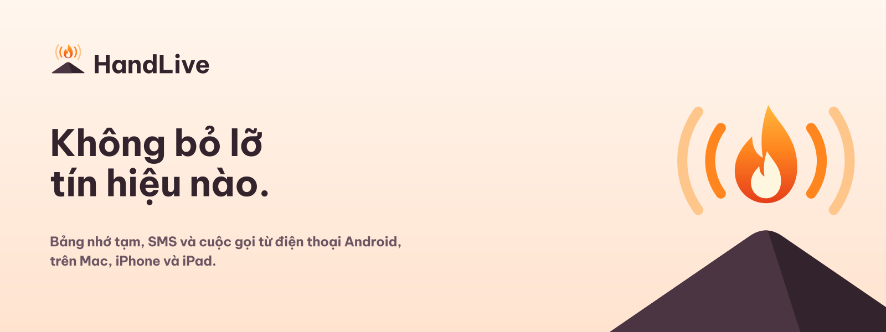
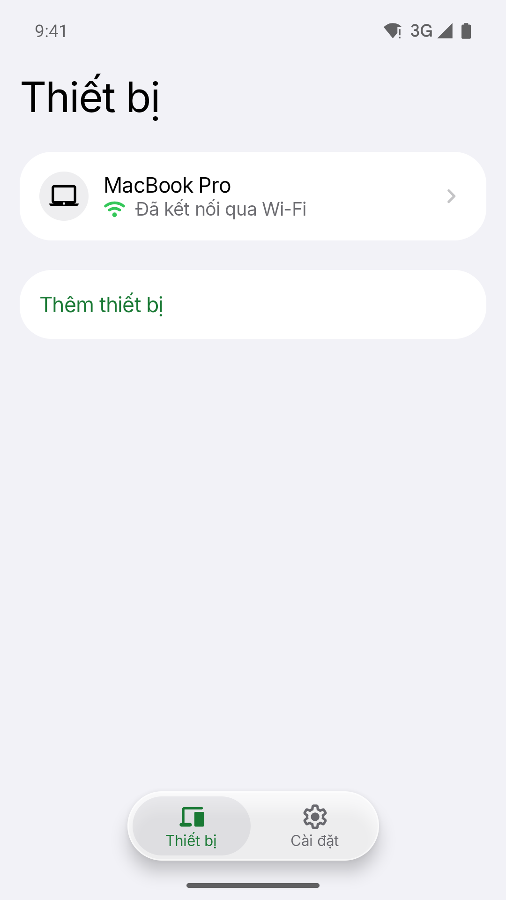
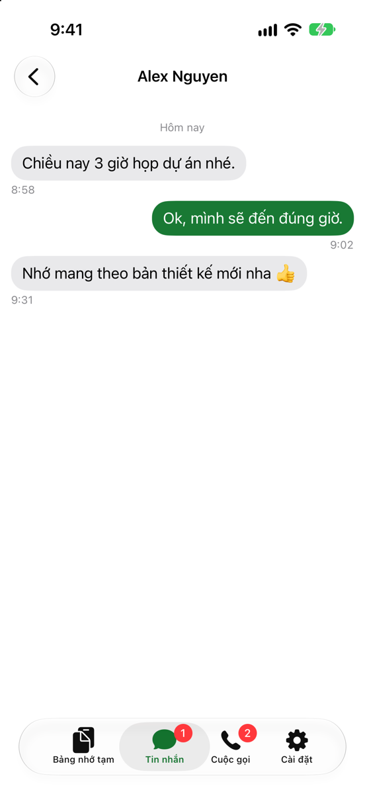
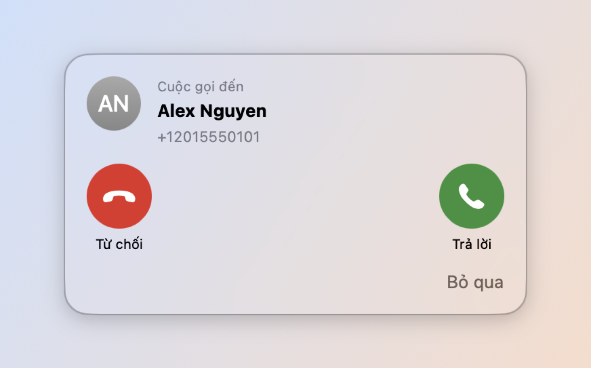

[English](README.md) | Tiếng Việt

# HandLive



> **Không bỏ lỡ tín hiệu nào.** Bảng nhớ tạm, SMS và thông báo cuộc gọi từ điện thoại Android, ngay trên Mac, iPhone và iPad.

[](https://github.com/HandLive/handlive/actions/workflows/ci-docs.yml)
[](LICENSE)
[](https://github.com/HandLive/handlive/releases/tag/v0.2.0)

HandLive kết nối điện thoại Android với các thiết bị macOS, iOS và iPadOS. Ứng dụng đồng bộ bảng nhớ tạm, chuyển tiếp tin nhắn SMS và hiển thị thông báo cuộc gọi kèm nút thao tác—hoàn toàn không phụ thuộc vào đám mây. Mã hóa đầu cuối luôn bật, và toàn bộ dự án là mã nguồn mở theo giấy phép Apache-2.0.

## Tải bản beta

Tải bản phát hành mới nhất [`v0.2.0`](https://github.com/HandLive/handlive/releases/tag/v0.2.0) (30/10/2026):
- **macOS:** Tệp DMG ký ad-hoc (chọn *Open Anyway* trong lần mở đầu tiên).
- **Android:** Tệp APK `foss` đã ký. Mã ứng dụng đã đổi (`com.handlive.android`): gỡ bản beta cũ trước, rồi ghép đôi lại.
- **iOS / iPadOS:** Tệp IPA chưa ký để sideload. Bản beta cập nhật lên bản này phải ghép đôi lại (App Group mới).

Bản beta dành cho người thử nghiệm sớm và chưa có trên App Store hay Google Play. Xem [Hướng dẫn phân phối](docs/deployment-guide.vi.md) để biết chi tiết cài đặt và đóng gói.

Tài liệu hub có cả tiếng Anh và tiếng Việt. Website và blog WordPress trong `website/` chạy trên máy, chưa triển khai ([hướng dẫn](docs/website.vi.md)).

## Tính năng

| Tính năng | macOS | iOS / iPadOS |
|-----------|:-----:|:------------:|
| Bảng nhớ tạm hai chiều (chữ giữ dạng HTML, mỗi lần một ảnh) | Có | Có |
| Gửi và nhận SMS | Có | Có |
| Thông tin và thao tác cuộc gọi (nghe, từ chối, kết thúc) | Có | Chỉ thông tin và từ chối (không âm thanh) |
| Âm thanh cuộc gọi trên máy tính | Không làm (Phase 4 dừng, quyết định của chủ dự án 12/10/2026) | Không (Apple không mở API HFP phía tai nghe) |
| Camera và mic ảo | Dự kiến (Phase 5) | Không |
| Duyệt web tiếp (trang đang mở theo bạn) | Dự kiến (Phase 6) | Dự kiến (chỉ từ điện thoại) |

Mã hóa đầu cuối luôn bật và không thể tắt.

## Ảnh màn hình

| | | |
|---|---|---|
|  |  |  |
| Android: Mac đã ghép qua Wi-Fi | iPhone: SMS từ điện thoại | Mac: bảng cuộc gọi đến |

Toàn bộ ảnh chụp màn hình (tiếng Anh và tiếng Việt): [`docs/screenshots/README.vi.md`](docs/screenshots/README.vi.md).

## Cách hoạt động

- **WebSocket nội bộ và mDNS:** Bảng nhớ tạm, SMS, thông tin cuộc gọi và thông báo đi qua Wi-Fi. Android chạy máy chủ Ktor nhúng; các máy tìm nhau bằng mDNS.
- **Âm thanh cuộc gọi:** Bluetooth HFP lẽ ra mang âm thanh cuộc gọi, dự phòng bằng Opus qua WebSocket. Chủ dự án đã dừng Phase 4 (12/10/2026), nên cuộc gọi trên máy tính chỉ còn thông báo và nút nghe, từ chối hoặc kết thúc.
- **Mã hóa đầu cuối:** Payload XChaCha20-Poly1305, khóa phiên X25519 + HKDF và ghép cặp qua mã QR.
- **Relay zero-knowledge:** Máy chủ trung chuyển Rust chuyển tiếp dữ liệu mã hóa giữa các mạng mà không thể đọc nội dung.

Xem chi tiết kiến trúc kỹ thuật tại [`docs/system-architecture.vi.md`](docs/system-architecture.vi.md).

## Trạng thái

HandLive xây lần lượt. Mỗi phase là một phần dùng được. Ngoại lệ (chủ dự án, 28/09/2026): Phase 5 và 6 làm trước Phase 4. Phase 4 đã dừng (quyết định của chủ dự án, 12/10/2026): cổng G4 đóng, chỉ mở lại khi chủ dự án quyết định xem lại âm thanh cuộc gọi.

| Phase / cổng | Mục tiêu | Trạng thái |
|--------------|----------|------------|
| **0** Nền tảng | Giao thức, vector kiểm thử dùng chung, CI xanh | **Xong** |
| **1** Đồng bộ bảng nhớ tạm (MVP) | Android ↔ Mac, WebSocket LAN, ghép cặp QR | **Mã xong** · Cổng G1 còn mở · clip chữ giữ HTML (`text/html`); khi đọc ảnh chỉ mở mục app khác chia sẻ qua content provider, URI khác bị từ chối (12/10/2026, android #13) |
| **2** Cầu nối SMS và iOS | Hội thoại, relay Rust, APNs/FCM | **Mã xong** · Cổng G2 còn mở · iPhone giữ phiên tối đa 25 giây khi chạy nền · biểu tượng ứng dụng Liquid Glass trên iPhone, iPad và Mac |
| **3** Thông tin và điều khiển cuộc gọi | API Telecom, bảng Mac, nhật ký cuộc gọi | **Mã xong** · Kiểm máy thật còn mở · cuộc gọi từ ứng dụng khác giữ tên ứng dụng và không kết thúc khi thông báo đang gọi bị vuốt bỏ |
| **4** Âm thanh cuộc gọi | Bluetooth HFP/SCO và dự phòng Opus | **Dừng** (quyết định của chủ dự án, 12/10/2026) · G4 đóng: chỉ có macOS 27, cuộc gọi chỉ còn thông báo và nút nghe/từ chối/kết thúc, không âm thanh |
| **5** Camera / mic ảo | CMIOExtension và AudioServerPlugin | **Spike trên `main`** (`CameraSpike`) · G5 cần Apple Developer trả phí |
| **6** Duyệt web tiếp | Chuyển tiếp URL đang mở giữa các thiết bị | **Spike trên `main`** · đã đo Chrome và Samsung Internet; còn go/no-go trình duyệt |
| **7** Kết nối mọi nơi | Tự kết nối khi không chung mạng Wi-Fi | **Đang làm** · SP1+SP2 (kênh điều khiển Bluetooth; luồng B QR, luồng C PIN qua CPace-X25519-SHA512) **đã phát hành ở `v0.2.0`** (30/10/2026) trên `main`; SP3 (làn bulk theo từng kết nối, `K_bulk`) và SP4 (Wi-Fi Direct) đã có đặc tả nhưng chưa code; chỉ bulk qua relay bị bỏ khỏi phạm vi |
| **G0** Vector mã hóa | Vector kiểm thử mã hóa dùng chung giữa các nền tảng | **Xong** |
| **G1** Máy thật | Kiểm thực tế ma trận máy thật Phase 1 | **Mở** (trước 1.0) · ảnh App Store Connect đã chụp lại ở kích thước gốc 1320×2868 (12/10/2026) |
| **G2** Play Console | Tờ khai quyền SMS và nhật ký cuộc gọi | **Mở** (trước 1.0; phương án B: F-Droid/APK) · ảnh Play Console đã chụp lại ở 1080×1920 (12/10/2026) |

Xem lộ trình và lịch sử chi tiết: [`docs/project-roadmap.vi.md`](docs/project-roadmap.vi.md). Thẻ việc: [`plans/20260925-implementation/plan.vi.md`](plans/20260925-implementation/plan.vi.md).

### Quy định: luôn cập nhật lộ trình

Mỗi khi hoàn thành một công việc cụ thể (merge thẻ phase, đóng cổng kiểm soát, giải quyết spike hoặc sửa lỗi máy thật trên `main`), cùng đợt thay đổi phải cập nhật bảng này, bản chụp trong [`docs/project-roadmap.vi.md`](docs/project-roadmap.vi.md), và [`CHANGELOG.vi.md`](CHANGELOG.vi.md) của hub đối với các thay đổi ảnh hưởng đến người dùng.

## Các kho mã nguồn

| Kho lưu trữ | Mô tả |
|-------------|-------|
| [handlive](https://github.com/HandLive/handlive) | Hub tài liệu, kế hoạch và công cụ workspace |
| [handlive-android](https://github.com/HandLive/handlive-android) | Ứng dụng và dịch vụ Android (Kotlin) |
| [handlive-apple](https://github.com/HandLive/handlive-apple) | Ứng dụng thanh menu macOS, iOS và iPadOS (Swift) |
| [handlive-relay](https://github.com/HandLive/handlive-relay) | Máy chủ trung chuyển mã hóa zero-knowledge (Rust) |
| [handlive-shared](https://github.com/HandLive/handlive-shared) | Schema giao thức, vector kiểm thử mã hóa và chuỗi UI dùng chung |

```
HandLive/                 # hub: handlive
├── docs/  plans/  tools/
├── android/              # handlive-android
├── apple/                # handlive-apple
├── relay/                # handlive-relay
├── shared/               # handlive-shared
└── .github-org/          # HandLive/.github (CONTRIBUTING, SECURITY, …)
```

## Tài liệu

- [`docs/project-overview-pdr.vi.md`](docs/project-overview-pdr.vi.md) — Mục tiêu, phạm vi và ràng buộc sản phẩm
- [`docs/system-architecture.vi.md`](docs/system-architecture.vi.md) — Kênh truyền, giao thức và mô hình bảo mật
- [`docs/project-roadmap.vi.md`](docs/project-roadmap.vi.md) — Các phase, tiến độ tổng quan và công sức
- [`docs/deployment-guide.vi.md`](docs/deployment-guide.vi.md) — Đóng gói, ký số và phân phối
- [`docs/design-guidelines.vi.md`](docs/design-guidelines.vi.md) — Nguyên tắc trải nghiệm và bảo mật
- [`docs/code-standards.vi.md`](docs/code-standards.vi.md) — Quy ước và tiêu chuẩn giữa các nền tảng
- [`docs/privacy.vi.md`](docs/privacy.vi.md) — Nguyên tắc riêng tư, lưu trữ trên thiết bị và chính sách lưu trữ của relay
- [`docs/codebase-summary.vi.md`](docs/codebase-summary.vi.md) — Bản đồ mã nguồn và tổng quan kiến trúc
- [`docs/detailed-design/README.vi.md`](docs/detailed-design/README.vi.md) — Đặc tả chức năng, giao thức và mã lỗi
- [`docs/screenshots/README.vi.md`](docs/screenshots/README.vi.md) — Bộ ảnh chụp màn hình ứng dụng

## Cộng đồng và đóng góp

- [CONTRIBUTING](https://github.com/HandLive/.github/blob/main/CONTRIBUTING.vi.md) — Chứng nhận nguồn gốc DCO (`git commit -s`), quy trình PR và tiêu chuẩn đóng góp
- [CODE_OF_CONDUCT](https://github.com/HandLive/.github/blob/main/CODE_OF_CONDUCT.vi.md) — Quy tắc ứng xử và chuẩn mực cộng đồng
- [SECURITY](https://github.com/HandLive/.github/blob/main/SECURITY.vi.md) — Chính sách báo cáo và công bố lỗ hổng bảo mật

## Giấy phép

Apache License 2.0 — [LICENSE](LICENSE). Áp dụng cho mọi kho trong [HandLive](https://github.com/HandLive).

Nội dung website và blog trong `website/` được cấp phép theo GPL-2.0-or-later.
