[English](00-common-specs.md) | Tiếng Việt

# 0. Đặc tả dùng chung

> Phần này **không phải nhóm chức năng**. Mọi chức năng lá tham chiếu tới đây cho thành phần, định
> danh, kiểu dữ liệu, khung tin, bảo mật, mã lỗi, mô hình dữ liệu và hằng số. Chức năng lá không
> định nghĩa lại các mục này; nếu cần loại tin, mã lỗi hay cột dữ liệu mới thì bổ sung vào đây
> trước.
>
> Wire format bám đúng quy ước ổn định trong `docs/code-standards.md`: envelope JSON
> `{v, type, id, ts, payload}` và khung audio nhị phân `[0x48 0x4C][ver][seq][ts][encrypted]`.

## 0.1 Thành phần hệ thống

Cột "Thành phần" trong bảng bước của mọi chức năng dùng các mã dưới đây.

| Mã | Thành phần | Nền tảng | Vai trò |
|----|-----------|----------|---------|
| A-UI | Ứng dụng HandLive Android (Activity, Jetpack Compose) | Android 10+ (API 29), target 35 | Giao diện, thiết lập, quét QR, xác nhận |
| A-SVC | `HandLiveService` — foreground service type `connectedDevice` | Android | WSS server (Ktor 3, engine Netty), mDNS (`NsdManager`), relay client, điều phối module |
| A-CLIP | `ClipboardModule`, `ClipboardAccessibilityService`, `ClipboardReadActivity` (trong suốt), `ClipboardTileService` (ô Cài đặt nhanh), `ClipboardShareTarget` (đích Chia sẻ) | Android | Phát hiện sao chép, đọc và ghi clipboard |
| A-SMS | `SmsModule` (`ContentObserver`, `SmsManager`) | Android | Đọc, gửi, theo dõi SMS |
| A-CALL | `CallModule` (`TelephonyCallback` / broadcast `PHONE_STATE`, `TelecomManager`); `AppCallListener` (`NotificationListenerService`) cho cuộc gọi từ ứng dụng khác | Android | Theo dõi và điều khiển cuộc gọi bằng API công khai (không dùng `InCallService` — xem README §5 C12); cuộc gọi từ ứng dụng khác qua thông báo cuộc gọi của chúng (CALL-05, C22) |
| A-AUD | `CallAudioModule` — interface `CallAudioRelay` với `HfpCallAudioRelay` và `OpusWsCallAudioRelay` | Android | Âm thanh cuộc gọi: theo dõi HFP; đường dự phòng Opus/WS |
| A-SHZ | Shizuku UserService (chạy uid shell) | Android 11+ | Thu âm cuộc gọi (`VOICE_CALL`) và chèn âm vào cuộc gọi cho đường Opus/WS; tùy chọn, cần Shizuku |
| A-CAM | `CameraStreamModule` (Camera2, MediaCodec, libopus JNI) | Android | Phát camera/micro |
| A-WEB | `BrowserPagesModule`, `BrowserPagesAccessibilityService` (tách khỏi dịch vụ bảng nhớ tạm), một `BrowserAdapter` cho mỗi trình duyệt | Android | Đọc trang đang mở trong trình duyệt ở foreground cho Duyệt web tiếp (P6, nhóm 9) |
| M-APP | HandLive for Mac (menu bar, SwiftUI + AppKit) | macOS 13+ | Client WSS, UI, clipboard, SMS, cuộc gọi, giải mã video |
| M-HFP | Mô-đun HFP trong M-APP (`IOBluetoothHandsFreeDevice`, sau protocol abstraction) | macOS | Âm thanh cuộc gọi qua SCO |
| M-CAMX | `HandLiveCamera` — CMIOExtension (system extension) | macOS | Camera ảo |
| M-MIC | `HandLiveMic.driver` — AudioServerPlugin | macOS | Micro ảo |
| I-APP | HandLive for iOS/iPadOS (SwiftUI) | iOS 16+ | Client WSS, clipboard, SMS, thông tin cuộc gọi |
| I-NSE | Notification Service Extension | iOS 16+ | Giải mã nội dung push |
| R-API | HandLive Relay (Rust, Actix-web 4 + actix-ws) | Linux VPS | REST, WSS relay, push proxy |
| R-DB | PostgreSQL 16 | Linux VPS | Registry thiết bị, cặp ghép nối, thống kê tối thiểu |
| R-KV | Redis 7 | Linux VPS | Presence, pub/sub định tuyến giữa các instance, challenge, rate limit |
| OS | Dịch vụ hệ điều hành (Telecom, SmsManager, ClipboardManager, CoreAudio, CoreMediaIO…) | — | — |
| PUSH | FCM (Android), APNs (iOS) | — | Đánh thức, đẩy thông báo |

Trong kết nối thiết bị–thiết bị: **máy chủ (S)** luôn là Android (A-SVC); **máy khách (C)** là Mac
hoặc iPhone/iPad.

## 0.2 Định danh

| Định danh | Kiểu | Sinh bởi | Quy tắc |
|-----------|------|----------|---------|
| `device_id` | uuid | Mỗi thiết bị, lần chạy đầu | UUIDv8 = 16 byte đầu của SHA-256(`ik_sig_pub`), đặt 4 bit version = `8`, 2 bit variant = `10`. Tự chứng thực: bất kỳ bên nào cũng kiểm được `device_id` khớp khóa công khai. Đổi khi cài lại ứng dụng. |
| `pair_id` | uuid | Mac/iOS khi ghép nối | UUIDv4 ngẫu nhiên |
| `id` (envelope) | uuid | Bên gửi | UUIDv7; dùng chống xử lý trùng |
| `clip_id`, `transfer_id`, `local_id`, `call_id`, `session_id`, `page_id` | uuid | Theo chức năng | UUIDv7 |
| `message_key` | string | Android | `sms:<_id>` với `_id` của `content://sms` |
| `thread_id` | int64 | Android | `thread_id` của Telephony provider |
| `entry_id` | int64 | Android | `CallLog.Calls._ID` |

Định danh ứng dụng và kho khóa:

| Định danh | Giá trị |
|-----------|---------|
| Gói Android | `app.handlive.android` |
| Bundle Mac / Camera Extension | `app.handlive.mac` / `app.handlive.mac.camera` |
| Bundle iOS / Notification Service Extension | `app.handlive.ios` / `app.handlive.ios.notifications` (`app.handlive.ios.nse` đang thuộc Personal Team miễn phí dùng trước 2026-10-07, team trả phí không đăng ký được) |
| App Group (iOS, Mac) | `group.app.hxd.handlive` (đoạn `hxd` phân biệt group của team chủ dự án với các dev khác trong công ty; App Group ID là duy nhất trên mọi team Apple, và `group.app.handlive` đang thuộc Personal Team miễn phí dùng trước 2026-10-07) |
| Alias khóa chủ trong Android Keystore | `hl_master` (AES-256-GCM, bọc keyset Tink, `prk_enc`, mật khẩu PKCS#12) |
| Account Keychain (service `app.handlive.keys`) | `ik_sig`, `ik_dh`, `db_key` (khóa SQLCipher), `<pair_id>` (`PRK` của từng cặp) |

## 0.3 Kiểu dữ liệu chuẩn

| Kiểu | Mô tả | Ví dụ |
|------|-------|-------|
| `string` | Chuỗi UTF-8 | `"Xin chào"` |
| `string(n)` | Tối đa n ký tự (code point) |  |
| `int32`, `int64` | Số nguyên có dấu |  |
| `bool` |  | `true` |
| `enum{a\| b}` | Một trong các giá trị liệt kê | `enum{front\| back}` |
| `uuid` | 36 ký tự thường, có gạch | `0192f3c1-7c1e-7a55-9d0b-3f4c2a1b9e10` |
| `timestamp` | int64 mili-giây Unix epoch UTC | `1727150000123` |
| `b64` | Base64 chuẩn (RFC 4648 §4, có padding) |  |
| `b64u` | Base64url không padding (RFC 4648 §5) |  |
| `e164` | Số điện thoại chuẩn E.164; nếu không chuẩn hóa được thì giữ chuỗi gốc | `+84900000123` |
| `bytes` | Chuỗi byte thô (chỉ trong khung nhị phân) |  |
| `object`, `array<T>` | JSON |  |

Quy ước cột **Input/Output** ở mục 3 của mỗi chức năng lá:

| Giá trị | Nghĩa |
|---------|-------|
| `Input` | Người dùng nhập hoặc chọn |
| `Output` | Hệ thống trả về, hiển thị hoặc phát cho người dùng |
| `Input/Output` | Hệ thống hiển thị giá trị hiện tại, người dùng sửa được |

Trường nội bộ giữa các thành phần (không hiển thị) chỉ mô tả ở mục 5 (Đặc tả API/service).

## 0.4 Kênh truyền

### 0.4.1 LAN: mDNS + WSS

- A-SVC lắng nghe TCP **47800** trên mọi interface; nếu cổng bận thử lần lượt 47801–47809 và quảng
  bá cổng thực qua bản ghi SRV.
- **TLS 1.3** bắt buộc. Chứng chỉ tự ký ECDSA P-256, sinh lúc cài, hạn 20 năm. Client **ghim**
  SHA-256 của chứng chỉ (DER) nhận được lúc ghép nối; không kiểm hostname.
- **mDNS**: kiểu dịch vụ `_handlive._tcp.local.`; tên instance ngẫu nhiên `HL-<6 hex>`, đổi mỗi lần
  dịch vụ khởi động (không lộ tên máy). Bản ghi TXT:

| Khóa | Giá trị | Khi nào có |
|------|---------|-----------|
| `v` | `1` (phiên bản giao thức) | Luôn |
| `h` | Tối đa 8 hint, nối bằng dấu phẩy không có khoảng trắng; mỗi cặp ghép nối 1 hint = 8 ký tự hex đầu (chữ thường) của HMAC-SHA256(`K_disc`, `"HLDISC1"` ‖ int64 BE `floor(now_ms / 3 600 000)`); `K_disc` = HKDF(`PRK`, info = `"handlive/v1/discovery"`) | Khi có ≥ 1 cặp |
| `pr` | 8 ký tự hex đầu (chữ thường) của SHA-256 trên 32 byte `pk` đã giải b64u trong QR | Chỉ trong 120 giây của chế độ ghép nối QR |
| `pm` | `1` | Chỉ trong 120 giây của chế độ ghép nối PIN |

Client so hint với giờ trước, giờ hiện tại **và** giờ sau (chịu lệch đồng hồ tới một giờ theo cả hai chiều quanh mốc giờ). Hint đổi mỗi giờ
nên người lạ trong LAN không theo dõi được thiết bị qua TXT.

- **Endpoint WSS** trên A-SVC:

| Đường dẫn | Mục đích | Xác thực | Giai đoạn |
|-----------|----------|----------|-----------|
| `/v1/pair` | Ghép nối | HMAC từ `pairing_secret` hoặc PIN | P1 |
| `/v1/ctl` | Kênh điều khiển: mọi envelope ứng dụng | Bắt tay phiên (0.6.3) | P1 |
| `/v1/stream/call-audio` | Âm thanh cuộc gọi Opus/WS — đường dự phòng (AUDIO-04) | Khóa dẫn xuất từ phiên ctl | P4 |
| `/v1/stream/camera` | Luồng camera/micro (kênh riêng) | Khóa dẫn xuất từ phiên ctl | P5 |
| `/v1/stream/bulk` | Truyền bulk, chỉ trên group Wi-Fi Direct (0.4.7) | Khóa theo kết nối dẫn xuất từ phiên ctl | P7 |

- Mỗi cặp chỉ có **một** kết nối `/v1/ctl` tại một thời điểm. Kết nối mới xác thực thành công thay
  thế kết nối cũ (đóng mã 4409).

### 0.4.2 USB (P5, tùy chọn)

- M-APP nói chuyện trực tiếp với adb server qua giao thức host trên `127.0.0.1:5037`
  (`host:version`, `host:devices-l`, `host:track-devices`, `forward`, `killforward`), không gọi lệnh
  `adb` khi server đã chạy — client adb khác phiên bản sẽ tắt server của Android Studio hoặc scrcpy.
  Chỉ khi chưa có server mới chạy `adb start-server` bằng bản đi kèm ứng dụng (build từ mã nguồn
  AOSP, Apache-2.0). Chi tiết: CAM-04.
- Yêu cầu chuyển tiếp tương đương `adb -s <serial> forward tcp:0 tcp:<cổng A-SVC>` trả về cổng cục
  bộ; kết nối `wss://127.0.0.1:<cổng cục bộ>/v1/...` với **cùng chứng chỉ ghim**.
- Dùng cho `/v1/stream/camera`; `/v1/ctl` chỉ đi qua USB khi LAN không kết nối được.

### 0.4.3 Relay (P2)

- REST: `https://{RELAY_HOST}/v1/...`, JSON UTF-8. Lỗi: HTTP status +
  `{"error":{"code":"<MÃ>","message":"<mô tả>"}}`.
- WSS: `wss://{RELAY_HOST}/v1/relay`, header `Authorization: Bearer <jwt>`.
- TLS 1.3 với chứng chỉ Let's Encrypt. Client ghim SPKI của ISRG Root X1 và ISRG Root X2, cộng một
  khóa dự phòng do dự án giữ.
- `{RELAY_HOST}` cấu hình lúc build. Ví dụ trong tài liệu dùng `relay.example.com`.
- Relay không có khóa E2E: chỉ thấy lớp bọc định tuyến, `type` của envelope và kích thước.
- Lớp bọc định tuyến (relay ↔ thiết bị):
  - WS text frame: `{"to":"<device_id>","env":{<envelope>}}` (thiết bị → relay); relay chuyển thành
    `{"from":"<device_id>","env":{<envelope>}}`.
  - WS binary frame: `[0x48 0x52]` ("HR") ‖ `ver` (1) ‖ `op` (1, `0x01` = chuyển tiếp) ‖ `device_id`
    đích/nguồn (16 byte) ‖ khung nhị phân HL nguyên vẹn.
  - Tin điều khiển của relay: WS text frame `{"op":"<tên>", ...}` (0.7.3).
- Relay xử lý lớp bọc `to`/`from` và khung `HR` như sau (cũng ở CONN-03 API 6; điểm hẹn ghép nối
  giữ quy tắc riêng, PAIR-01 API 7):
  - Relay chỉ kiểm lớp bọc (object JSON có `to` là một `device_id` và `env` là object) hoặc header
    `HR` 20 byte (magic, `ver` = `0x01`, `op` = `0x01`, `device_id`), và phải có khung theo sau.
    Relay không phân tích, không kiểm envelope hay khung HL bên trong. Thiết bị nhận mới kiểm các
    phần đó (0.5.1, 0.5.2).
  - Lớp bọc hoặc khung `HR` sai định dạng → op `error` của relay với `BAD_REQUEST`. `to` (hoặc
    `device_id` của `HR`) không phải đối phương của người gửi trong một cặp đã đăng ký, chưa thu hồi
    → `NOT_PAIRED`.
  - `from` do thiết bị gửi lên bị bỏ qua (0.5.1 quy tắc 6). Relay tự đặt `from` là `device_id` của
    người gửi và phát lại `env` nguyên từng byte, không tuần tự hóa lại:
    `{"from":"<device_id>","env":<env gốc>}`. Với khung `HR`, relay thay `device_id` đích bằng
    `device_id` nguồn và chuyển khung HL đi nguyên vẹn.
  - Ngoại lệ duy nhất là điểm hẹn ghép nối (`rv_msg`, PAIR-01 API 7). Ở đó relay đọc `env.type` và
    đọc payload `pair` chưa mã hóa (giải b64) để chặn `pair/hello` có `mode = "pin"`, vì ghép bằng
    PIN không bao giờ đi qua relay (LAN, hoặc Bluetooth có CPace).

### 0.4.4 Push (P2)

- **Android (FCM):** data message ưu tiên cao, TTL tối đa 60 s (relay giới hạn `ttl_s`),
  `collapse_key` là `wake`, **không chứa nội dung**:
  `{"t":"wake","p":"<pair_id>","r":"<lý do>"}`.
- **iOS (APNs):** push `alert`, `mutable-content: 1`, `apns-priority: 10`. Nội dung hiển thị mặc định chung chung, gửi bằng `loc-key` (khóa catalog nhóm `push`, 0.12.4) để iPhone tự dịch; trường `hl` chứa envelope đã mã hóa bằng `K_push` để I-NSE giải mã và thay nội dung. `hl` là base64 chuẩn có padding của JSON envelope dạng UTF-8, cùng chuỗi với `env_b64` của `POST /v1/push` (CONN-04 API 2), dài ≤ 3 000 ký tự base64. Tổng payload ≤ 4 KB.
- Mac không đăng ký push; khi thức dậy, M-APP kết nối lại và đồng bộ theo con trỏ.

### 0.4.5 Kênh Bluetooth: BLE L2CAP CoC (P7)

Kênh điều khiển khi điện thoại và Mac không chung LAN (Phase 7, hai máy ở gần nhau). Lớp
mang do cổng G7 chọn ([báo cáo spike](../../plans/20260925-implementation/reports/phase-07-spike-g7.md), mục
"Kết luận bearer"). Chỉ Mac; iOS không đổi. Luồng và ngoại lệ: CONN-05. Ghép đôi lần đầu qua BLE: mục "Chế độ ghép đôi" bên dưới và luồng B (QR), luồng C (PIN) của PAIR-01. Làn bulk (ảnh): 0.4.7. Wi-Fi Direct: 0.4.6.

- **Vai trò.** A-SVC là peripheral: phát quảng bá (dưới đây) và lắng nghe bằng
  `BluetoothAdapter.listenUsingInsecureL2capChannel()` (PSM LE động, không bond, không GATT server). M-APP là
  central: `CBCentralManager` quét, `CBPeripheral.openL2CAPChannel(_:)` mở kênh; không bên nào khởi động ghép đôi
  của hệ điều hành. L2CAP CoC không bond thì không có mã hóa tầng liên kết (G7, mục "Brief items", ý 5), nên lớp bảo
  mật link dưới đây là bắt buộc: không có gì khác đi qua sóng trước khi lớp này xong.
- **Khóa** (theo cặp, tính khi cần, lưu như `K_push`):
  `K_bt_disc` = HKDF(`PRK`, info = `"handlive/v1/bt-discovery"`); `K_bt_link` = HKDF(`PRK`, info =
  `"handlive/v1/bt-link"`). Không dùng lại `K_disc` hay `K_auth`.
- **Khóa ghép đôi** (theo từng QR, chỉ nằm trong bộ nhớ trong suốt thời gian sống của QR, `PAIRING_WINDOW`):
  `K_bt_pdisc` = HKDF-SHA256(ikm = `pairing_secret`, salt = rỗng, info = `"handlive/v1/bt-pair-disc"`, L = 32);
  `K_bt_plink` = HKDF-SHA256(ikm = `pairing_secret`, salt = rỗng, info = `"handlive/v1/bt-pair-link"`, L = 32). PIN
  có khóa Bluetooth riêng, sinh từ một lần trao đổi CPace ("Chế độ ghép đôi", PIN).

#### Quảng bá

Quảng bá legacy, kết nối được (`BluetoothLeAdvertiser.startAdvertisingSet`, chế độ legacy, khoảng
`INTERVAL_LOW`, công suất `TX_POWER_HIGH` — cấu hình probe G7), có scan response, không tên thiết bị, không trường
TX power. `BT_SERVICE_UUID` là UUID 128-bit tự sinh. Vì UUID 128-bit và service data không vừa 31 byte (G7 gặp
`ADVERTISE_FAILED_DATA_TOO_LARGE`, mục "Yêu cầu phát hiện cho sản phẩm", ý 2), gói quảng bá mang UUID còn scan
response mang service data, mỗi gói ≤ 31 byte.

| Cấu trúc AD | Byte | Nội dung |
|---|---|---|
| Flags (gói quảng bá) | 3 | Stack tự thêm cho advertising set kết nối được |
| Danh sách đầy đủ UUID dịch vụ 128-bit (gói quảng bá) | 18 | `BT_SERVICE_UUID` (Mac quét với bộ lọc này); gói quảng bá tổng 21 |
| Service data, UUID 128-bit (scan response) | 18 + 3 + 4 × n | `BT_SERVICE_UUID` ‖ service data bên dưới |
| **Tổng scan response** | ≤ 29 | n ≤ 2 (`BT_ADV_MAX_HINTS`) |

Service data (sau UUID):

| Offset | Độ dài | Trường | Mô tả |
|---|---|---|---|
| 0 | 1 | `ver` | `0x01` |
| 1 | 2 | `psm` | PSM L2CAP hiện tại, uint16 little-endian |
| 3 | 4 × n | `hints` | Mỗi cặp một hint, n = 0…`BT_ADV_MAX_HINTS`; hint = 4 byte đầu của HMAC-SHA256(`K_bt_disc`, `"HLBTDISC1"` ‖ int64 BE `floor(now_ms / BT_HINT_PERIOD)`) |

- A-SVC phát quảng bá khi `link.bluetooth` bật, Bluetooth bật, đã cấp Nearby devices (Android 12+) và có ít nhất
  một cặp chưa thu hồi đang không có phiên sống trên route nào; hint là của các cặp đó, `last_seen_at` gần nhất
  trước, tối đa `BT_ADV_MAX_HINTS`. Không có cặp như vậy và không có cửa sổ ghép đôi QR đang mở → không phát ("Chế độ ghép đôi").
- **Xoay vòng:** ở mỗi mốc `BT_HINT_PERIOD`, A-SVC dừng advertising set, đóng server socket (link hiện tại vẫn mở),
  mở socket mới (PSM mới) và chạy advertising set mới. Hint, PSM và advertising set đổi cùng lúc; khởi động lại set là
  đòn bẩy duy nhất app có lên địa chỉ vô tuyến (T7.1 bắt gói BLE kiểm địa chỉ có đổi, AC9).
- Client so hint của các epoch từ `e − 4` tới `e + 4` (e = epoch hiện tại: chịu lệch đồng hồ tới một giờ, như
  trong LAN). Quảng bá có `ver` ≠ `0x01` hoặc không có hint khớp → bỏ qua.

#### Bản ghi link

Mọi byte trên kênh L2CAP thuộc một bản ghi: `rlen` (uint16 BE) ‖ `rlen` byte. Bên đọc kiểm `rlen` **trước khi cấp
phát**: bản ghi pre-auth vượt `BT_PREAUTH_RECORD_MAX`, bản ghi transport có `rlen` khác 272, 1 040 và
4 112 (`BT_RECORD_MAX`), hoặc loại bản ghi không đúng lúc → đóng kênh ngay, không trả lời (probe G7 đọc độ dài 4 byte không có cận trên,
finding của pentester ở review #165, mục "Yêu cầu phát hiện cho sản phẩm", ý 3).

Bản ghi pre-auth, không mã hóa, byte đầu = loại:

| Loại | Tên | Chiều | Nội dung | Kích thước |
|---|---|---|---|---|
| `0x01` | `challenge` | S→C | `n_s`: 32 byte ngẫu nhiên, mới cho mỗi kênh | 33 |
| `0x02` | `noise1` | C→S | Noise message 1: `e` (32) ‖ payload rỗng đã mã hóa (16) | 49 |
| `0x03` | `noise2` | S→C | Noise message 2: `e` (32) ‖ payload rỗng đã mã hóa (16) | 49 |
| `0x04` | `cpace1` | C→S | `Ya` (32), chỉ cho ghép bằng PIN ("Chế độ ghép đôi") | 33 |
| `0x05` | `cpace2` | S→C | `Yb` (32), chỉ cho ghép bằng PIN | 33 |
| `0x7F` | `reject` | S→C | Rỗng; nghĩa là `LINK_REJECTED` (0.8.4) | 1 |

#### Bắt tay bảo mật link

Mẫu `Noise_NNpsk0_25519_ChaChaPoly_SHA256` (Noise rev. 34), psk = `K_bt_link` của cặp, prologue =
`"HLBT1"` ‖ `n_s`. C = M-APP (bên khởi tạo), S = A-SVC (bên đáp).

1. Kênh mở; S gửi `challenge` ngay và bắt đầu đếm `BT_PREAUTH_TIMEOUT`.
2. C gửi `noise1` với psk của cặp có hint vừa khớp.
3. S lần lượt thử psk của từng cặp chưa thu hồi (quảng bá không mang `pair_id`) tới khi tag payload của message 1
   hợp lệ. Prologue gắn `n_s`, nên một `noise1` bị ghi lại không bao giờ hợp lệ trên kênh mới. Không cặp nào hợp
   lệ → xác nhận khóa thất bại.
4. S gửi `noise2`; C kiểm tag payload (sai → C đóng kênh, CONN-05 E3). Hai bên `Split()` ra một CipherState cho
   mỗi chiều; từ đây link gắn với cặp đó.
5. S chỉ coi link đã xác nhận khi bản ghi transport đầu tiên của C giải mã được; lỗi ở đây cũng là xác nhận khóa
   thất bại.
6. Sau đó bắt tay phiên E2E (0.6.3) chạy bên trong link trên kênh điều khiển, không đổi gì. `session/hello` phải
   ghi đúng `pair_id` của psk đã hợp lệ; nếu không, S trả `AUTH_FAILED` (`session/error`) rồi đóng link.

Mọi lỗi trước khi xong bước 5 → S gửi `reject` khi gửi được rồi đóng kênh. `reject` là lỗi pre-auth duy nhất trên
sóng: nó không cho biết nguyên nhân là vượt giới hạn tiếp nhận, hết giờ, đang bị chặn hay xác nhận khóa thất bại.

#### Bản ghi transport và kênh con

Sau bước 4, mọi bản ghi là một Noise transport message: ciphertext của plaintext đã đệm + tag 16 byte, nonce = bộ
đếm 64-bit của chiều đó, associated data rỗng. Mỗi bên gọi Noise `Rekey()` trên CipherState gửi sau mỗi
`BT_LINK_REKEY_RECORDS` bản ghi, bên nhận làm theo ở cùng số đếm (không có message). Plaintext:

| Offset | Độ dài | Trường | Mô tả |
|---|---|---|---|
| 0 | 1 | `chan` | `0x01` điều khiển, `0x02` bulk (nội dung: 0.4.7); giá trị khác → đóng link |
| 1 | 1 | `flags` | bit0 `more`: còn mảnh tiếp theo của cùng message; bit1 `long`: mảnh thuộc làn dài của kênh điều khiển (chỉ kênh `0x01`, xem dưới); các bit khác bằng 0 |
| 2 | 2 | `dlen` | uint16 BE, độ dài `data`, ≤ `BT_FRAGMENT_MAX` |
| 4 | `dlen` | `data` | Một mảnh của một message |
| 4 + `dlen` | phần còn lại | đệm | Byte 0, đệm tới cỡ nhỏ nhất trong 256, 1 024 hoặc 4 096 byte đủ chứa frame |

- **Kênh điều khiển** (`0x01`): một message = một JSON envelope (0.5.1) dạng UTF-8, đúng thứ một WS text frame
  mang trên `/v1/ctl`. Luật envelope (0.5.1) giữ nguyên. Một envelope có thể tới 256 KiB (0.5.1 luật 4), tức khoảng
  20 s chiếm sóng ở 12.9 KB/s, nên kênh có hai làn, phân biệt bằng `long`:
  - *Làn ngắn* (`long` = 0): envelope tối đa `BT_FRAGMENT_MAX` byte, luôn đúng một mảnh. `more` = 1 mà `long` = 0
    → đóng link.
  - *Làn dài* (`long` = 1): mọi envelope tới `BT_MESSAGE_MAX`, chia mảnh tối đa `BT_BULK_FRAGMENT_MAX` byte, mỗi
    chiều chỉ một message tại một thời điểm. Bên gửi đưa vào làn này mọi envelope dài hơn `BT_FRAGMENT_MAX`, mọi envelope `session`
    (`rekey`, `bye`…), và envelope ngắn cùng `type` với một message dài còn trong hàng đợi hoặc đang gửi. Bên nhận
    chỉ ráp lại làn này và đóng link khi một mảnh của làn dài có `dlen` vượt `BT_BULK_FRAGMENT_MAX` hoặc một message vượt
    `BT_MESSAGE_MAX` trước mảnh cuối.
  - *Thứ tự.* Mỗi làn giữ đúng thứ tự bên gửi, và bên nhận xử lý envelope ngay khi nó đủ mảnh. Vì vậy envelope ngắn
    có thể vượt một envelope dài khác `type` (văn bản clipboard không bao giờ chờ 20 s sau một lô SMS); các envelope
    cùng `type` và mọi envelope `session` giữ đúng thứ tự đã gửi.
- **Ưu tiên:** bên gửi giữ ba hàng đợi và ở mỗi ranh giới mảnh gửi từ hàng đầu tiên còn dữ liệu: điều khiển ngắn,
  rồi điều khiển dài, rồi bulk. Tổng số bản ghi điều khiển dài và bulk đã ghi vào stream L2CAP mà chưa đi hết không
  vượt quá `BT_BULK_INFLIGHT`, nên envelope ngắn chờ nhiều nhất sau chừng đó bản ghi 1 040 byte (khoảng 160 ms) và
  bản ghi đang phát. Điều khiển dài đi trước bulk, không chia đều: envelope dài hiếm khi đi qua Bluetooth vì ảnh đi
  làn bulk (0.4.7). Probe G7 dùng một luồng FIFO duy nhất và không đạt AC1 khi đang truyền bulk (p95 một chiều
  4 769–7 768 ms, mục "Lần 1" và "Lần 2" của báo cáo spike), vì vậy mới có luật này.
- **Đệm** giấu `type` của envelope sau ba cỡ (AC9); `id` và `ts` chỉ đi bên trong ciphertext. Envelope dài, giống
  bulk, hiện ra thành một chuỗi bản ghi 1 040 byte: lộ kích thước với sai số khoảng 1 KiB, không lộ `type`.
- **Giữ kết nối:** cứ `BT_PING_INTERVAL` không có lưu lượng khác, client gửi `ping/ping` (CONN-02 API 2); bên nào
  không nhận bản ghi nào trong `BT_IDLE_TIMEOUT` thì đóng link.
- **Không có close code:** link không có thứ tương đương close code WS (0.8.3). Một bên kết thúc phiên đã lập bằng
  `session/bye` đã mã hóa, như phiên qua relay (CONN-02 API 4), rồi đóng kênh; trước khi bắt tay phiên thành công
  thì dùng `session/error` (CONN-01 API 6) rồi đóng. Kênh đóng mà không có `session/bye` được tính là mất kết nối.

#### Tiếp nhận (A-SVC)

- Tối đa `BT_LINK_LIMIT` link L2CAP cùng lúc, trong đó tối đa `BT_PREAUTH_LIMIT` link chưa xong bước 5. Kênh vượt
  một trong hai giới hạn nhận `reject` rồi bị đóng.
- Link chưa xong bước 5 trong `BT_PREAUTH_TIMEOUT` nhận `reject`; link đã xác nhận mà không có `session/hello` hợp
  lệ (trên link ghép đôi: `pair/hello`, "Chế độ ghép đôi") trong `HANDSHAKE_TIMEOUT` thì bị đóng.
- BLE không cho địa chỉ client để đếm theo, nên lỗi được đếm cho cả bộ lắng nghe Bluetooth: mỗi lần xác nhận khóa
  thất bại (bước 3 và 5) và mỗi `session/hello` bị từ chối với `AUTH_FAILED` tính là một `AUTH_FAILED`; đủ
  `BT_AUTH_FAIL_BLOCK` lần trong một phút → bộ lắng nghe trả `reject` cho mọi kênh mới trong một phút. Bộ đếm của
  LAN (`CTL_PREAUTH_LIMIT`, `CTL_IP_BLOCK`) không thấy link Bluetooth.
- Mỗi cặp một phiên trên mọi route (0.4.1): phiên mới xác nhận được khóa thì thay phiên cũ, bất kể route; qua
  Bluetooth bên bị thay nhận `session/bye {reason: replaced}`.

#### Chế độ ghép đôi (luồng B và C của PAIR-01)

Ghép đôi lần đầu khi điện thoại và Mac không chung LAN: QR (luồng B; định dạng QR không đổi) hoặc PIN (luồng C,
CPace, ý cuối).

- **Quảng bá.** Khi A-SVC đang giữ một cửa sổ ghép đôi QR (PAIR-01 bước 6) và dùng được Bluetooth (đang bật, đã cấp
  Nearby devices trên Android 12+, `link.bluetooth` bật), nó khởi động lại advertising set (server socket mới, PSM
  mới) với `pr_bt` là hint đầu tiên, sau đó tối đa `BT_ADV_MAX_HINTS` − 1 hint của cặp theo luật ở trên. `pr_bt` =
  4 byte đầu của HMAC-SHA256(`K_bt_pdisc`, `"HLBTPAIR1"`). Định dạng không đổi, nên người quan sát không phân biệt
  được chế độ ghép đôi với quảng bá thường; `pr_bt` đổi theo từng QR và không bao giờ tính từ `pk`, nên không nối
  được hai lần ghép đôi với nhau (AC9). Khi cửa sổ đóng, A-SVC khởi động lại set không có `pr_bt`.
- **Client.** Ở PAIR-01 bước 7, M-APP quét thêm với bộ lọc `BT_SERVICE_UUID` và coi gói quảng bá nào có `pr_bt` của
  chính nó trong danh sách hint là một ứng viên. Ứng viên LAN được ưu tiên; ứng viên Bluetooth được nối ngay khi
  không có ứng viên LAN. Nhiều máy phát cùng `pr_bt` (gói quảng bá bị chép lại) được thử lần lượt cho tới khi hết
  20 s của PAIR-01 bước 7.
- **Bắt tay bảo mật link.** Bước 1–5 ở trên, không đổi, với psk = `K_bt_plink`. Khi cửa sổ đang mở, S thử
  `K_bt_plink` trước, rồi tới psk của từng cặp chưa thu hồi. Link có `noise1` hợp lệ với `K_bt_plink` là **link ghép
  đôi**: như vậy frame đầu tiên của một lần ghép đôi đã được xác thực bằng khóa sinh từ `pairing_secret` trước khi
  suất pre-auth trở thành link đã xác nhận.
- **Link ghép đôi.** Trong `HANDSHAKE_TIMEOUT` sau bước 5, C gửi `pair/hello` với `mode = "qr"` trên kênh điều khiển
  `0x01`; sau đó PAIR-01 API 2–6 chạy dưới dạng envelope trên kênh đó (payload không mã hóa như trên `/v1/pair`, nằm
  bên trong lớp mã hóa link). Envelope có `type` khác trên link ghép đôi, hoặc envelope `pair` trên link của một cặp
  → đóng link, không trả lời. Link ghép đôi đã gửi `pair/hello` hợp lệ thì giữ cửa sổ: S thôi thử `K_bt_plink`, nên
  máy thứ hai muốn giành cửa sổ sẽ xác nhận khóa thất bại và nhận `reject` (mỗi cửa sổ một client, PAIR-01 API 2 logic 4).
- **Sau `pair/done`.** Link được giữ lại và trở thành link điều khiển của cặp mới: envelope tiếp theo từ C phải là
  `session/hello` mang `pair_id` vừa tạo trên link này (bước 6 ở trên), trong `HANDSHAKE_TIMEOUT`; nếu không,
  `session/error` `AUTH_FAILED` rồi đóng. `pair/error`, hoặc link bị đóng trước `pair/done`, kết thúc lần ghép đôi:
  không lưu gì (điều kiện sau của PAIR-01).
- **PIN (luồng C của PAIR-01, sếp quyết định ngày 2026-10-28).** PIN 6 số ghép qua Bluetooth bằng CPace, nên PIN
  không bao giờ đi qua sóng dưới bất kỳ dạng nào và một lần trao đổi bị ghi lại không kiểm được ngoại tuyến:
  - *Quảng bá.* Khi A-SVC đang giữ cửa sổ PIN (PAIR-01 A4) và dùng được Bluetooth, nó khởi động lại advertising set với
    `BT_PIN_HINT` là hint đầu tiên (sau đó tối đa `BT_ADV_MAX_HINTS` − 1 hint của cặp). Dấu hiệu này giống nhau cho mọi
    điện thoại ở chế độ PIN và chỉ cho biết "đang có một điện thoại ở chế độ ghép bằng PIN", như TXT `pm = 1` trong
    LAN; nó không mang gì về thiết bị, PIN hay cặp (AC9). Khi cửa sổ đóng, set khởi động lại không có nó. Ở bước A2,
    M-APP coi mọi gói quảng bá mang `BT_PIN_HINT` là ứng viên.
  - *CPace.* Sau `challenge`, C gửi `cpace1` thay cho `noise1`; S chỉ nhận khi đang mở cửa sổ PIN (nếu không thì đóng
    kênh, không trả lời). Bộ `CPACE-X25519-SHA512` của draft-irtf-cfrg-cpace (initiator-responder), bản draft cố định
    theo vector S7.1 (`shared/test-vectors/cpace.json`, trường `draft`): PRS = byte UTF-8 của sáu chữ số; CI =
    `"HLBTPIN1"`; sid = `n_s` (32 byte, mới cho mỗi kênh); ADa = ADb = rỗng. C: generator `g` =
    `calculate_generator(SHA-512, PRS, CI, sid)` (ánh xạ Elligator2 của RFC 9380), scalar ngẫu nhiên `ya`, `Ya` =
    X25519(`ya`, `g`) → `cpace1`. S: cùng `g`, `yb`, `Yb` → `cpace2`; `K` = X25519(`yb`, `Ya`). C: `K` =
    X25519(`ya`, `Yb`). `K` toàn số 0 → đóng, không trả lời. `ISK` (64 byte) tính theo draft từ `sid`, `K`, `Ya`, `Yb`.
  - *Khóa từ ISK* (chỉ trong bộ nhớ, xóa cùng PIN): `K_bt_pinlink` = HKDF-SHA256(ikm = `ISK`, salt = `n_s`, info =
    `"handlive/v1/bt-pin-link"`, L = 32), là psk Noise của bước 2–5 ở trên (cùng prologue); `K_bt_pin` =
    HKDF-SHA256(ikm = `ISK`, salt = `n_s`, info = `"handlive/v1/bt-pin-pair"`, L = 32), thay cho `K_pin` ở PAIR-01
    bước 9–11 (0.6.2). Link qua được `noise1` với `K_bt_pinlink` là **link ghép đôi PIN**: áp dụng các luật "Link ghép
    đôi" và "Sau `pair/done`" ở trên, với `pair/hello` `mode = "pin"`. `mode = "qr"` trên link ghép đôi PIN, hoặc
    `mode = "pin"` trên link ghép đôi QR → `pair/error` `AUTH_FAILED` rồi đóng.
  - *Chỉ dò được trực tuyến.* PIN sai ở bất kỳ bên nào làm tag `noise1` sai ở S (hoặc `noise2` ở C): một lần thử. Kẻ
    đứng giữa chỉ được đúng một lần đoán PIN cho mỗi kênh, kẻ nghe lén thụ động thì không được lần nào. Điện thoại
    giữ **một bộ đếm cho mỗi cửa sổ PIN, dùng chung cho cả hai đường truyền**: mỗi `pair/offer` trong LAN kết thúc mà
    không có `pair/done` và mỗi kênh Bluetooth thất bại sau `cpace1` đều cộng một; tổng tới `PIN_MAX_ATTEMPTS` thì
    đóng cửa sổ như "PIN hết hạn" (PAIR-01 E2) và từ chối mở mọi cửa sổ PIN mới, trong LAN hay qua Bluetooth, trong
    `BT_PIN_LOCKOUT` (PAIR-01 E10). Mac giữ cùng một bộ đếm duy nhất cho mỗi PIN (`PIN_INVALID` trong LAN cộng các
    kênh Bluetooth thất bại) và sinh PIN mới khi tới `PIN_MAX_ATTEMPTS` (E7). Với 10^6 PIN và 3 lần thử mỗi PIN, xác
    suất đoán trúng trong một cửa sổ PIN là 3 × 10^-6.
  - *Thời gian.* Thêm một lượt đi về so với link QR (`cpace1`/`cpace2`); điện thoại đang ở trong tay người dùng khi
    nhập PIN nên không có Doze, `BT_PREAUTH_TIMEOUT` giữ nguyên.
- **Tiếp nhận.** Link ghép đôi dùng chung `BT_LINK_LIMIT`, `BT_PREAUTH_LIMIT`, `BT_PREAUTH_TIMEOUT` và
  `BT_AUTH_FAIL_BLOCK` với link của cặp. Thiết bị không có `pairing_secret` (luồng B) hoặc không biết PIN (luồng C)
  chỉ giữ được suất pre-auth duy nhất tối đa `BT_PREAUTH_TIMEOUT` cho mỗi kênh và không bao giờ giành được cửa sổ;
  lỗi của nó được tính vào `BT_AUTH_FAIL_BLOCK`, có thể chặn một lần ghép đôi thật trong một phút (rủi ro đã chấp
  nhận, rủi ro 12 của plan: người dùng thử lại hoặc ghép qua LAN).
- **AC8.** Link ghép đôi không bao giờ đụng tới cặp đã có: kho cặp chỉ đổi ở PAIR-01 bước 11, sau các bước kiểm `mac`
  khóa bằng `pairing_secret`; `reject` và kênh bị đóng chỉ làm hỏng lần thử này.

### 0.4.6 Kênh Wi-Fi Direct cho bulk (P7)

Đường nhanh cho ảnh khi điện thoại và Mac không chung LAN (kịch bản X), chỉ mở khi cần và đóng ngay khi không còn cần.
Kênh chỉ mang kết nối stream bulk; kênh điều khiển vẫn ở link Bluetooth (0.4.5). Chỉ Mac; iOS/iPadOS không có route
Bluetooth và không có Wi-Fi Direct. Luồng và ngoại lệ: CONN-06. Nội dung bulk, khóa theo kết nối và lập lịch:
0.4.7.

- **Cấu trúc (quyết định).** A-SVC tạo một group Wi-Fi Direct tự chủ (`WifiP2pManager.createGroup` với một
  `WifiP2pConfig`, API 29+) và làm group owner; M-APP vào group như một client WPA2 thường bằng CoreWLAN. Lý do
  ([nghiên cứu 2026-10-01](../../plans/20260925-implementation/reports/research-direct-wifi-link-2026-10-01.vi.md), mục 3
  và 5): macOS không có API Wi-Fi Direct hay Wi-Fi Aware (F2), nên Mac chỉ có thể vào một mạng; app bên thứ ba không
  bật được hotspot của điện thoại; `LocalOnlyHotspot` buộc SSID và passphrase ngẫu nhiên và lỗi trên một số bản ROM của
  hãng; group Wi-Fi Direct cho app tự đặt SSID và passphrase (API 29+) và giữ nguyên mạng Wi-Fi riêng của điện thoại
  (STA + P2P).
- **Thông tin vào mạng.** A-SVC sinh mới cho mỗi group và không bao giờ dùng lại: `ssid` = `"DIRECT-"` ‖ 10 ký tự ngẫu
  nhiên trong `[A-Za-z0-9]` (17 byte; Android bắt buộc tiền tố `DIRECT-xy`, ở đây cả `xy` cũng ngẫu nhiên, nên tên
  không nói gì về HandLive hay cặp); `passphrase` = base64url không đệm của 18 byte ngẫu nhiên (24 ký tự, 144 bit; WPA2
  cần 8–63). Chúng chỉ đi trong `ack` của `direct/start`, một envelope E2E bên trong link Bluetooth: không bao giờ được
  quảng bá, không ghi log, chỉ nằm trong bộ nhớ và bị xóa khi group dừng. Group mới thì thông tin mới, nên không cần lịch
  xoay vòng: một group sống tối đa `DIRECT_WIFI_MAX`.
- **Cấu hình group.** `WifiP2pConfig.Builder().setNetworkName(ssid).setPassphrase(passphrase)
  .setGroupOperatingBand(WifiP2pConfig.GROUP_OWNER_BAND_AUTO)`; từ API 36 thêm
  `setPccModeConnectionType(WifiP2pConfig.PCC_MODE_CONNECTION_TYPE_LEGACY_OR_R2)` (Mac là client legacy, F4). A-SVC
  không bao giờ bật/tắt Wi-Fi và không bao giờ rời mạng của chính nó để dựng group.
- **Điều kiện vào (Mac, AC4).** M-APP chỉ xin group (`direct/start`) khi đủ mọi điều kiện: phiên chạy qua Bluetooth
  (không có phiên LAN); có một lần truyền bulk đang chờ theo chiều nào cũng được (0.4.7; điện thoại báo phần của nó bằng
  `direct/want`); `link.direct_wifi` bật; đã cấp quyền Vị trí; Wi-Fi đang bật và không nối mạng nào trong ít nhất
  `DIRECT_WIFI_IDLE_MIN`; lần quét gần nhất không thấy mạng nào trong danh sách mạng đã biết của Mac; không có lần thử
  Wi-Fi Direct nào thất bại trong `DIRECT_WIFI_RETRY_AFTER`. Mac đang nối bất kỳ mạng nào, kể cả mạng không có Internet,
  không bao giờ vào group: việc truyền đi qua Bluetooth ở nền (bảng route của plan). Vì vậy việc vào group không bao giờ kéo Mac khỏi
  một mạng khác.
- **Điều kiện rời.** Mac rời group (`CWInterface.disassociate()`) và gửi `direct/stop` khi: không stream bulk nào có dữ
  liệu trong `DIRECT_WIFI_LINGER`; group đã tồn tại `DIRECT_WIFI_MAX`; lần quét định kỳ mỗi `DIRECT_WIFI_SCAN_INTERVAL`
  thấy một mạng đã biết (để macOS quay về mạng đó); xuất hiện phiên LAN; phiên Bluetooth kết thúc. macOS tự chuyển sang
  mạng khác cũng tính là rời. A-SVC xóa group (`WifiP2pManager.removeGroup`) khi nhận `direct/stop`, theo cùng giới hạn
  `DIRECT_WIFI_LINGER` và `DIRECT_WIFI_MAX` tự đếm phía nó, khi không client nào vào trong `DIRECT_WIFI_JOIN_TIMEOUT`, và
  khi phiên điều khiển kết thúc.
- **Xác thực trên group (AC8).** Biết passphrase thì một thiết bị vào được group nhưng không nói chuyện được với HandLive.
  M-APP kết nối tới `host`:`port` trong `ack` bằng TLS ghim `peer_tls_sha256`, đúng như trong LAN (0.4.1), socket gắn
  vào giao diện Wi-Fi; chứng chỉ không khớp → `TLS_PIN_MISMATCH`, rời group. Trên kết nối có địa chỉ cục bộ là địa chỉ
  group owner, A-SVC chỉ nhận đường stream bulk `/v1/stream/bulk` (0.4.7), có bắt tay stream khóa bằng phiên điều khiển đang sống (0.6.3
  bước 7); `/v1/ctl`, `/v1/pair` và mọi thứ khác trên địa chỉ đó → đóng 4400. Thiết bị trong group mà không có khóa
  phiên thì không hoàn tất được bắt tay stream (4401).
- **Không phải LAN.** Group không bao giờ là route của phiên: instance mDNS hay địa chỉ thấy trên giao diện của group
  không phải ứng viên CONN-01 và không kích hoạt nâng cấp ở 0.11; phiên vẫn ở Bluetooth trong khi ảnh dùng group.
- **Mạng đã lưu.** Sau khi rời, M-APP xóa mạng khỏi danh sách mạng ưu tiên của Mac khi CoreWLAN cho phép mà không hỏi
  quyền quản trị; nếu không, mục đó ở lại, vô hại vì SSID đó không bao giờ được dùng lại (G7 chưa thử, xem yêu cầu đặc
  biệt của CONN-06).

### 0.4.7 Làn bulk (P7)

Các lần truyền lớn (ảnh của CLIP-03, văn bản quá `CLIP_INLINE_MAX`, CLIP-04) giữ nguyên các message của CLIP-03
(`clipboard/push` có `transfer`, `clipboard/chunk` 64 KiB, `clipboard/cancel` và `ack` của chúng); chỉ làn chở chúng thay
đổi theo route. Mọi envelope khác, kể cả văn bản clipboard gửi thẳng, vẫn ở kênh điều khiển.

- **Chọn làn** (bảng route của plan: LAN > Wi-Fi Direct > Bluetooth), quyết định lúc bắt đầu một lần truyền:

| Tình huống | Làn bulk | Khóa |
|---|---|---|
| Phiên LAN | `/v1/ctl`, như hiện nay (CLIP-03: tối đa 4 chunk trong bộ đệm gửi) | Khóa phiên (0.6.3) |
| Phiên Bluetooth, kích thước ≥ `BULK_DIRECT_MIN`, đủ điều kiện vào Wi-Fi Direct (0.4.6) | `wss://{host}:{port}/v1/stream/bulk` trên group (CONN-06) | Khóa theo kết nối (bên dưới) |
| Phiên Bluetooth, các trường hợp còn lại, hoặc Wi-Fi Direct thất bại | Kênh `0x02` của link (0.4.5), chạy ở nền | Khóa phiên bên trong lớp mã hóa link |

  Lần truyền từ `BULK_DIRECT_MIN` trở lên chờ Wi-Fi Direct tối đa `DIRECT_WIFI_JOIN_TIMEOUT`, group chưa lên thì bắt đầu
  qua Bluetooth. Dưới mức đó Bluetooth nhanh hơn việc vào group (12.9 KB/s, G7 Lần 2: 128 KiB ≈ 10 s so với ngân sách
  vào mạng 8 s). Không có giới hạn kích thước riêng cho Bluetooth: tới `CLIP_MAX_IMAGE` vẫn chạy ở nền (AC3 của plan).
  Không có route nào → không gửi gì; CLIP-03 gửi lại clip mới nhất khi phiên bắt đầu (QC7).
- **Khóa theo kết nối trên `/v1/stream/bulk`.** Bắt tay stream của 0.6.3 bước 7 với kênh `bulk` (`K_stream` từ phiên
  điều khiển đang sống, `bulk/stream_hello` và `bulk/stream_welcome`), rồi `K_bulk` = HKDF-SHA256(ikm = `K_stream`
  (96 byte), salt = `nonce_c` ‖ `nonce_s`, info = `"handlive/v1/bulk-conn"`, L = 64) → `k_c2s` (32) ‖ `k_s2c` (32). Mọi
  envelope trên kết nối đó là envelope 0.5.1 mã hóa bằng các khóa này thay cho khóa phiên; tập chống trùng của 0.5.1
  luật 2 tính riêng cho mỗi kết nối. Kết nối mới, kể cả trong cùng phiên, có nonce mới nên có khóa mới; `PRK` dài hạn
  không bao giờ được dùng trực tiếp. Thiết bị trong group mà không có phiên đang sống thì không qua được `stream_hello`
  (4401, AC8). Phiên điều khiển kết thúc thì kết nối bulk đóng theo.
- **Lập lịch trên Bluetooth.** Mảnh điều khiển luôn đi trước (0.4.5 "Ưu tiên": điều khiển ngắn, điều khiển dài, rồi
  bulk). Một mảnh bulk mang tối đa `BT_BULK_FRAGMENT_MAX` byte, nên vừa bản ghi 1 040 byte và chiếm sóng khoảng 80 ms
  ở 12.9 KB/s; bên gửi giữ tối đa `BT_BULK_INFLIGHT` bản ghi điều khiển dài và bulk đã ghi vào stream L2CAP mà chưa đi
  hết, nên một envelope điều khiển ngắn không bao giờ phải chờ sau nhiều hơn chừng đó. A7.4 đo điều này so với AC1 (≤ 200 ms khi đang truyền bulk).
- **Wi-Fi Direct và điều khiển.** Kênh điều khiển không bao giờ chuyển sang group (0.4.6 "Không phải LAN"); bulk trên
  group dùng đường sóng khác, nên không làm trễ envelope điều khiển trên Bluetooth.
- **Đổi làn giữa chừng: làm lại từ đầu, không nối tiếp.** Khi làn của một lần truyền đang chạy mất đi hoặc có làn tốt
  hơn (Wi-Fi Direct lên khi đang chạy trên Bluetooth; mất group, CONN-06 E7/E8; phiên LAN thay phiên Bluetooth), bên gửi
  gửi `clipboard/cancel` `rerouted` trên làn cũ nếu còn gửi được, rồi truyền lại toàn bộ với `transfer_id` mới và cùng
  `clip_id` trên làn mới, kể cả khi đã quá 120 s của QC7, miễn đó vẫn là clip mới nhất. Tối đa `BULK_MAX_RESTARTS` lần
  làm lại cho mỗi clip, sau đó áp dụng CLIP-03 E8. Chỉ làm lại vì có làn tốt hơn khi còn hơn một nửa lần truyền.
- **Thời hạn và tiến độ.** `CLIP_TRANSFER_IDLE_TIMEOUT` giữ nguyên trên mọi làn (bản ghi 1 040 byte với RTT Doze 3 s vẫn
  tới trong hạn). Qua Bluetooth, tiến độ hiện cho các lần truyền từ `BULK_DIRECT_MIN` trở lên (CLIP-03 trường 2) kèm
  dòng chữ ở CLIP-03 trường 10.

## 0.5 Khung tin

### 0.5.1 Envelope JSON (WS text frame)

```json
{"v":1,"type":"sms","id":"0192f3c1-7c1e-7a55-9d0b-3f4c2a1b9e10","ts":1727150000123,"payload":"<b64>"}
```

| Trường | Kiểu | Bắt buộc | Mô tả |
|--------|------|----------|-------|
| `v` | int32 | Có | Phiên bản envelope, hiện là `1` |
| `type` | enum | Có | Nhóm tin (0.7.1) |
| `id` | uuid | Có | UUIDv7 duy nhất |
| `ts` | timestamp | Có | Thời điểm tạo ở bên gửi |
| `payload` | b64 | Có | `nonce(24) ‖ ciphertext ‖ tag(16)` của XChaCha20-Poly1305. AAD = UTF-8 của `"<v> | <type> | <id> | <ts>"` ở dạng chuẩn tắc: `v` và `ts` là số thập phân không số 0 đầu, `id` 36 ký tự chữ thường; bên nhận dựng lại AAD từ giá trị đã parse (khớp `shared/test-vectors/`) |

Hai ngoại lệ:
- Tin bắt tay (`pair` op `hello` /`offer`/`confirm`/`done`/`error`; `session` op `hello`
  /`welcome`/`error`; `camera` và `call_audio` op `stream_hello` /`stream_welcome`) có `payload` =
  b64 của JSON **chưa mã hóa** (khóa chưa tồn tại); toàn vẹn được bảo vệ bằng trường `mac` bên
  trong.
- `clipboard` op `chunk` có plaintext **nhị phân** để tránh base64 hai lần: `hdr_len` (uint16 BE) ‖
  JSON `{"op":"chunk","data":{"transfer_id":"<uuid>","index":<int32>}}` ‖ bytes của khối (≤
  `CHUNK_SIZE`).

**Plaintext của payload:**

```json
{"op":"send","data":{ }}
```

| Trường | Kiểu | Bắt buộc | Mô tả |
|--------|------|----------|-------|
| `op` | string | Có | Thao tác trong nhóm (0.7.1) |
| `data` | object | Có | Nội dung theo thao tác |

**Phản hồi** dùng `type` = `ack`, plaintext:

```json
{"re":"<id của yêu cầu>","ok":true,"data":{ }}
{"re":"<id của yêu cầu>","ok":false,"error":{"code":"SMS_NO_SERVICE","message":"No cellular service","details":{}}}
```

Quy tắc chung:

1. Thao tác đánh dấu "có ack" ở 0.7.1 phải được trả `ack` trong **10 s** (`REQUEST_TIMEOUT`); quá
   hạn bên gọi coi là lỗi `TIMEOUT`.
2. Bên nhận lưu, theo từng chiều, mọi `id` đã nhận trong thế hệ khóa hiện tại (`DEDUP_WINDOW`,
   0.10): tập này được xóa khi rekey (0.6.3 bước 6) nên giữ tối đa 10 000 id, và trong lúc khóa của
   thế hệ trước còn được nhận thì id của thế hệ đó cũng được giữ. Một `id` chỉ được ghi lại sau khi
   envelope giải mã thành công, nên envelope giả không chiếm được `id` nào. Gặp `id` trùng thì gửi
   lại `ack` cũ, không xử lý lại. Phiên LAN và phiên qua relay xử lý như nhau.
3. `type` hoặc `op` không biết: nếu là yêu cầu → `ack` lỗi `UNSUPPORTED_TYPE`; nếu là sự kiện → bỏ
   qua.
4. Envelope ≤ 256 KiB. Dữ liệu lớn hơn đi theo chunk (`clipboard` op `chunk`).
5. Không ghi log `payload` hay nội dung đã giải mã ở bất kỳ thành phần nào; log chỉ gồm `type`,
   `op`, kích thước, mã lỗi.
6. **Tương thích tiến** trong cùng major `protocol`: bên nhận bỏ qua trường lạ ở mọi cấp; giá trị
   enum lạ không làm hỏng tin — mã lỗi lạ xử lý như `INTERNAL` (giữ `message`, ghi log mã lạ), phần
   tử lạ trong danh sách (vd. `codecs`, `cameras`) bị bỏ qua, trường enum đơn lạ coi là "không biết"
   (tính năng phụ thuộc coi như không hỗ trợ). Bên gửi chỉ phát giá trị có trong tài liệu này;
   `shared/schemas/` kiểm phía gửi (chặt), không phải phía nhận.

### 0.5.2 Khung nhị phân HL (WS binary frame, chỉ trên kênh `/v1/stream/*`)

Theo đúng định dạng audio đã chốt:

| Offset | Độ dài | Trường | Mô tả |
|--------|--------|--------|-------|
| 0 | 2 | magic | `0x48 0x4C` ("HL") |
| 2 | 1 | ver | `0x01` |
| 3 | 4 | seq | uint32 BE, tăng dần theo kết nối, bắt đầu 0 |
| 7 | 4 | ts | uint32 BE, mili-giây kể từ lúc mở kênh (quay vòng) |
| 11 | N | encrypted | `nonce(24) ‖ ciphertext ‖ tag(16)`, AAD = 11 byte đầu |

Plaintext theo kênh:
- `/v1/stream/call-audio`: một gói Opus.
- `/v1/stream/camera`: `track` (1: `0x01` video H.264, `0x02` audio Opus) ‖ `flags` (1: bit0
  keyframe, bit1 codec config SPS/PPS, bit2 discontinuity) ‖ `pts_us` (int64 BE) ‖ dữ liệu.

Bên nhận bỏ khung có `seq` ≤ `seq` lớn nhất đã nhận (chống phát lại).

## 0.6 Bảo mật

### 0.6.1 Khóa

| Khóa | Thuật toán | Nơi lưu | Vòng đời |
|------|-----------|---------|----------|
| `ik_sig` | Ed25519 | Android: byte khóa riêng mã hóa bằng keyset Tink AEAD (AES256-GCM); keyset bọc bởi khóa AES-256 `hl_master` trong Android Keystore (StrongBox nếu có) — Tink không có kiểu keyset cho X25519 thô nên `ik_sig`, `ik_dh`, `PRK` cùng một cách lưu. Mac/iOS: Keychain | Tạo lần chạy đầu; mất khi gỡ ứng dụng |
| `ik_dh` | X25519 | Như `ik_sig` | Như `ik_sig` |
| Khóa TLS | ECDSA P-256 + chứng chỉ tự ký | Android: PKCS#12, mật khẩu bọc bởi Keystore | Lúc cài. Kho PKCS#12 hỏng hoặc mất mật khẩu → sinh lại khóa và chứng chỉ; mọi client thấy `TLS_PIN_MISMATCH` ở mọi instance → hiển thị "Cần ghép nối lại" (CONN-01 E2) |
| `pairing_secret` | 32 byte ngẫu nhiên | Chỉ trong bộ nhớ Mac/iOS và trong QR | 120 s |
| `K_bt_pdisc`, `K_bt_plink` | HKDF(`pairing_secret`), 0.4.5 | Chỉ trong bộ nhớ (Mac và Android) | Như `pairing_secret`; xóa cùng lúc |
| `ISK`, `K_bt_pinlink`, `K_bt_pin` | CPace, rồi HKDF (0.4.5, PIN) | Chỉ trong bộ nhớ (Mac và Android) | Một kênh; xóa cùng PIN |
| `PRK` | 32 byte | Android: cột `prk_enc` (Tink AEAD, khóa trong Keystore). Mac/iOS: Keychain, account = `pair_id` | Theo cặp ghép nối |
| `K_push` | HKDF(`PRK`, info = `"handlive/v1/push"`) | Tính khi cần | Theo cặp |
| `k_c2s`, `k_s2c` | 32 byte | Bộ nhớ | Theo kết nối; rekey sau 24 h hoặc 10 000 envelope mỗi chiều |

- Keychain: `kSecClassGenericPassword`, service `app.handlive.keys`,
  `kSecAttrAccessibleWhenUnlockedThisDeviceOnly` (theo `docs/code-standards.md`). macOS dùng
  data-protection keychain (`kSecUseDataProtectionKeychain = true`) để thuộc tính này có hiệu lực
  như iOS; app phải ký với entitlement `keychain-access-groups` (`docs/deployment-guide.md`); tiến
  trình test không ký dùng kho khóa trong bộ nhớ. Bản build Mac không có entitlement đó (bản tải về
  ký ad-hoc, làm khi chưa có team Apple Developer trả phí) không vào được data-protection keychain
  (`errSecMissingEntitlement`, -34018) và dùng login keychain thay thế, cùng các mục nhưng không có
  `kSecUseDataProtectionKeychain` và không có lớp truy cập: khóa không còn gắn với máy này (bản sao lưu
  hay Migration Assistant có thể mang chúng sang Mac khác), và macOS hỏi một lần cho mỗi bản build mới
  xem app có được đọc chúng không. App chọn keychain theo entitlement của chính nó khi khởi động; bản
  đã ký luôn dùng data-protection keychain. Xóa ở login keychain thì tìm các mục bằng
  `SecItemCopyMatching` (`kSecReturnRef`, `kSecMatchLimitAll`, `kSecMatchSearchList` = danh sách
  keychain tìm kiếm của người dùng) rồi xóa từng mục bằng `SecKeychainItemDelete`: `SecItemDelete` trả
  `errSecInvalidOwnerEdit` (-25244) với mục do một chữ ký mã khác tạo (một bản ad-hoc trước đó, hoặc
  bản ad-hoc nhìn từ bản ký team; đo trên macOS 27), nên bản cập nhật không xóa được khóa của bản
  trước (SET-03 API 1 logic 1, PAIR-03 bước 7, SET-02 API 7). Cả hai lời gọi đều không hiện hộp
  thoại. M-APP và I-APP nạp `PRK` vào bộ nhớ khi khởi động
  lúc máy đang mở khóa và giữ trong suốt vòng đời tiến trình, nên vẫn kết nối lại được khi màn hình
  khóa. I-NSE không đọc được khóa khi iPhone đang khóa → hiển thị nội dung chung chung (xem
  CONN-04).
- Thư viện:
  - Android: Tink 1.14+ (`Ed25519Sign/Verify`, `X25519`, `Hkdf`, `subtle.XChaCha20Poly1305`).
  - Apple: CryptoKit (`Curve25519`, `HKDF`, `HMAC`, `SHA256`, `ChaChaPoly`). CryptoKit không có
    XChaCha20, nên XChaCha20-Poly1305 = HChaCha20 (tự cài theo draft-irtf-cfrg-xchacha-03 §2.2, kiểm
    bằng test vector §2.2.1) + `ChaChaPoly` với nonce 12 byte = `0x00000000` ‖ 8 byte cuối của nonce
    24 byte.
  - Relay: `ed25519-dalek`, `jsonwebtoken`, `ring`.
- Bộ test vector liên nền tảng (Kotlin ↔ Swift ↔ Rust) cho: `device_id`, `PRK`, bắt tay phiên, mã
  hóa envelope, khung HL. Chạy trong CI của cả ba phía. CPace (`cpace.json`, Kotlin và Swift): vector
  `CPACE-X25519-SHA512` của chính draft, rồi các trường hợp của HandLive (`n_s`, PIN, `ya`, `yb` cố định → `g`, `Ya`,
  `Yb`, `K`, `ISK`, `K_bt_pinlink`, `K_bt_pin`), PIN có số 0 đầu, và các trường hợp âm (`Ya` bậc thấp, `K` toàn số 0,
  PIN sai ở một bên).

### 0.6.2 Ghép nối

- `PRK` = HKDF-SHA256(ikm = X25519(`ik_dh` mình, `ik_dh` đối phương) ‖ `pairing_secret`, salt =
  SHA-256(`device_id` nhỏ hơn ‖ `device_id` lớn hơn, dạng 16 byte), info = `"handlive/v1/pair"`, L =
  32).
- Với PIN (dự phòng): thay `pairing_secret` bằng `K_pin` = Argon2id(PIN, salt = `nonce_c` ‖ `nonce_s`, t = 3, m = 64 MiB, p = 4, L = 32); PIN là byte UTF-8 của đúng 6 chữ số (giữ số 0 đầu), Argon2 phiên bản 0x13, không có secret và dữ liệu phụ.
- Qua Bluetooth bằng PIN (luồng C của PAIR-01): thay `pairing_secret` bằng `K_bt_pin` (0.4.5, từ CPace) thay vì
  `K_pin` Argon2id; phần còn lại không đổi.
- Qua Bluetooth (luồng B của PAIR-01, QR): `K_pa`, `PRK` và `attestation` tính đúng như trên; không có kết nối
  TLS, nên client ghim `tls_sha256` được `mac` của offer bảo vệ, như khi đi qua relay.
- Chuỗi đưa vào MAC, chữ ký hoặc hash (tên thiết bị…) là byte UTF-8 nguyên văn, không chuẩn hóa Unicode (NFC/NFD).
- Bản chứng thực ghép nối (`attestation`): `"HLPAIR1"` ‖ `pair_id` (16) ‖ `device_id` Android(16) ‖
  `device_id` client(16) ‖ `ik_sig_pub` Android(32) ‖ `ik_sig_pub` client(32) ‖ `created_at` (int64
  BE). Cả hai bên ký Ed25519; relay kiểm hai chữ ký trước khi cho phép định tuyến.
- Tuyên bố thu hồi (`HLREVOKE1`, PAIR-03): `sig` = Ed25519(`ik_sig` của thiết bị thu hồi,
  `"HLREVOKE1"` ‖ `pair_id` (16) ‖ `by` = `device_id` của thiết bị thu hồi (16) ‖ `revoked_at` (uint64
  BE, ms)) — ký 49 byte. Relay kiểm bằng khóa đã lưu của bên gọi, lưu lại và chuyển tiếp; thiết bị
  chỉ xử lý một lần thu hồi từ relay khi `by` là đối phương của cặp đó và `sig` hợp lệ với khóa công
  khai `ik_sig` đã lưu của đối phương (PAIR-03 API 4). Vector kiểm thử: `shared/test-vectors/`
  (`revoke`).
- Luồng chi tiết: PAIR-01.

### 0.6.3 Bắt tay phiên trên `/v1/ctl`

C = Mac/iOS, S = Android. Hai envelope đầu có payload chưa mã hóa (0.5.1).

1. C → S, `type` = `session`, op `hello`, data `{protocol, pair_id, device_id, eph, nonce, mac}`
   (`protocol` = 1; khác major → đóng 4426, xem CONN-01; `protocol` không nằm trong `T1`):
   - `eph` = b64u khóa công khai X25519 tạm; `nonce` = b64u 32 byte ngẫu nhiên.
   - `K_auth` = HKDF(`PRK`, info = `"handlive/v1/session-auth"`); `T1` = `"HL1|hello|"` ‖ `pair_id`
     ‖ `device_id` C ‖ `eph` C ‖ `nonce` C; `mac` = b64u HMAC-SHA256(`K_auth`, `T1`).
2. S kiểm: cặp tồn tại, chưa thu hồi, `device_id` đúng đối phương, `mac` đúng (so sánh hằng thời
   gian). Sai → op `error` rồi đóng 4401 hoặc 4403.
   S → C, op `welcome`, data `{device_id, eph, nonce, mac}` với `T2` = `"HL1|welcome|"` ‖ `T1` ‖
   `device_id` S ‖ `eph` S ‖ `nonce` S; `mac` = HMAC(`K_auth`, `T2`).
3. C kiểm `mac`. Hai bên tính `secret` = HKDF-SHA256(ikm = X25519(eph) ‖ `PRK`, salt =
   SHA-256(`T2`), info = `"handlive/v1/session"`, L = 64); `k_c2s` = 32 byte đầu, `k_s2c` = 32 byte
   sau.
4. Mọi envelope sau đó mã hóa bằng khóa theo chiều gửi. Envelope đầu tiên mỗi chiều là `capability`
   op `hello`.
5. Bắt tay quá 5 s (`HANDSHAKE_TIMEOUT`) → đóng 4408.
6. **Rekey**: sau 24 h hoặc 10 000 envelope một chiều, bên phát hiện trước gửi `session` op `rekey`
   `{epoch, eph, nonce}` (`epoch` = thế hệ khóa hiện tại + 1; có ack chứa `{epoch, eph, nonce}` của
   bên kia, xem CONN-02); khóa mới = HKDF(ikm = X25519(eph mới) ‖ `secret` cũ, salt = SHA-256(hai
   nonce), info = `"handlive/v1/rekey"`, L = 64). Bên nhận `ack` chuyển khóa ngay; bên gửi `ack`
   chuyển sau khi gửi xong; khóa cũ giữ thêm 30 s cho envelope đang bay.
7. **Khóa kênh stream** (`/v1/stream/*`): `K_stream` = HKDF(`secret`, info =
   `"handlive/v1/stream/" ‖ <kênh> ‖ "/" ‖ <session_id>`, L = 96) → `k_auth` (32) ‖ `k_c2s` (32) ‖
   `k_s2c` (32). Tin đầu tiên trên kênh stream là envelope `camera` /`call_audio` /`bulk` op `stream_hello`
   `{session_id, nonce, mac}` với `mac` = HMAC-SHA256(`k_auth`, `"HLSTREAM1|"` ‖ `session_id` ‖
   `nonce_c`); S trả `stream_welcome` `{session_id, nonce, mac}` với `mac` = HMAC-SHA256(`k_auth`,
   `"HLSTREAM1|welcome|"` ‖ `session_id` ‖ `nonce_c` ‖ `nonce_s`) — gắn cả hai nonce nên không phát
   lại được. Sai `mac` → đóng 4401.
8. **Mã hóa byte (chuẩn tắc, khớp `shared/test-vectors/`)**:
   - `T1`, `T2`, chuỗi MAC `HLSTREAM1` ghép **byte thô** như `T_offer` (PAIR-01): nhãn ASCII ‖ uuid
     16 byte ‖ `eph` 32 byte ‖ `nonce` 32 byte (giá trị đã giải b64u). `T1` = 106 byte, `T2` = 198
     byte. `protocol` không vào `T1`; phiên bản được xác thực lại trong `capability` op `hello` (đã
     mã hóa).
   - HKDF không ghi salt thì salt rỗng; không ghi L thì L = 32 (vd. `K_auth`).
   - Salt của `PRK`: hai `device_id` so theo 16 byte, thứ tự byte không dấu.
   - `info` của `K_stream`: UTF-8 `"handlive/v1/stream/<kênh>/<session_id 36 ký tự chữ thường>"`,
     `<kênh>` ∈ {`camera`, `call-audio`, `bulk` } (`bulk` sau đó dẫn thêm khóa theo kết nối, 0.4.7). `K_stream` luôn dẫn từ `secret` của bắt tay đầu (epoch 0)
     trong suốt kết nối, kể cả sau rekey.
   - Rekey: shared = X25519(eph bên khởi tạo, eph bên nhận); salt = SHA-256(`nonce` bên khởi tạo ‖
     `nonce` bên nhận); 64 byte kết quả chia `k_c2s` ‖ `k_s2c` theo vai C/S (không theo bên khởi
     tạo) và thay `secret` cho lần rekey sau; `epoch` không vào KDF.

### 0.6.4 Xác thực thiết bị với relay

1. `POST /v1/auth/challenge` `{device_id}` → `{challenge (b64u 32 byte), expires_at}` (60 s). Mỗi
   challenge được lưu riêng (`chal:<device_id>:<challenge>`, 0.9.4) và chỉ dùng một lần; challenge
   mới không bao giờ thay challenge khác đang chờ, nên người lạ xin challenge không khóa được thiết
   bị. Giới hạn (CONN-03 API 2–3): 30 yêu cầu mỗi phút mỗi IP cho `/auth/challenge` và `/auth/token`
   cộng lại, kiểm trước mọi truy vấn cơ sở dữ liệu, và 10 challenge mỗi phút mỗi (`device_id`, IP);
   client IPv6 tính theo /64.
2. `POST /v1/auth/token` `{device_id, challenge, sig}` với `sig` = Ed25519(`ik_sig`, `"HLAUTH1"` ‖
   challenge (32 byte thô đã giải b64u) ‖ `device_id` 16 byte) → `{access_token, expires_in}`. Token
   JWT HS256, `sub` = `device_id`, hạn 15 phút.
3. Gọi REST và mở WSS với `Authorization: Bearer <token>`. Nhận 401 `TOKEN_EXPIRED` → lặp lại bước
   1–2 rồi thử lại một lần.
4. Mọi endpoint dùng JWT kiểm `sub` còn trong `devices`: không còn → 404 `DEVICE_NOT_FOUND` (thiết
   bị đã tự xóa khỏi relay, SET-02), dù JWT còn hạn. Dòng có `revoked_at` (vận hành khóa thiết bị
   lạm dụng; ứng dụng không bao giờ đặt) → 410 `DEVICE_REVOKED` ở đăng ký, challenge, token và mọi
   endpoint. Thiếu hoặc sai header `Authorization` → 401 `SIGNATURE_INVALID`.

### 0.6.5 Nguyên tắc bảo mật chung

- E2E không tắt được. Không có đường gửi không mã hóa.
- Không log nội dung (clipboard, SMS, số điện thoại, tên liên hệ) ở bất kỳ thành phần nào.
- SQLite trên Mac/iOS mã hóa bằng SQLCipher (qua GRDB); khóa 32 byte trong Keychain.
- Chữ ký Ed25519 kiểm chặt: đúng 64 byte và S < L (RFC 8032 §5.1.7); không dùng hàm kiểm dễ dãi (vector âm trong `shared/test-vectors/ed25519.json`). Bộ ký có thể thêm ngẫu nhiên (CryptoKit): chữ ký khác từng byte nhưng vẫn hợp lệ, nên không bên nào so chữ ký theo byte — luôn kiểm bằng khóa công khai.
- Relay chỉ lưu thống kê theo `device_hash` = SHA-256(`device_id` 16 byte ‖ muối theo tháng), giữ 30
  ngày. Muối là 32 byte ngẫu nhiên, chỉ lưu trong Redis (`usage_salt:<YYYY-MM>`, 0.9.4). Khi muối hết
  hạn thì không còn nối được các mã băm với nhau. Redis khởi động lại giữa tháng thì dùng muối mới.

## 0.7 Danh mục loại tin

### 0.7.1 Envelope thiết bị ↔ thiết bị

`type` giữ đúng tập đã chốt (`clipboard | sms | call_event | call_audio | pair | ack | ping |
capability`) và bổ sung `session`, `camera` cho bắt tay phiên và Phase 5, và `web` cho Duyệt web
tiếp (Phase 6, README §5 C21), và `direct` cho kênh Wi-Fi Direct mở khi cần cùng `bulk` cho bắt tay stream của nó (Phase 7, 0.4.6, 0.4.7).

| type | op | Chiều | Ack | Kênh | Chức năng |
|------|----|-------|-----|------|-----------|
| `pair` | `hello` | C→S | trả `offer` | `/v1/pair` | PAIR-01 |
| `pair` | `offer` | S→C | — | `/v1/pair` | PAIR-01 |
| `pair` | `confirm` | C→S | trả `done` | `/v1/pair` | PAIR-01 |
| `pair` | `done` | S→C | — | `/v1/pair` | PAIR-01 |
| `pair` | `error` | Hai chiều | — | `/v1/pair` | PAIR-01 |
| `pair` | `revoke` | Hai chiều | Có | `/v1/ctl` | PAIR-03 |
| `session` | `hello` | C→S | trả `welcome` | `/v1/ctl` | CONN-01 |
| `session` | `welcome` | S→C | — | `/v1/ctl` | CONN-01 |
| `session` | `error` | S→C | — | `/v1/ctl` | CONN-01 |
| `session` | `rekey` | Hai chiều | Có | `/v1/ctl` | CONN-02 |
| `session` | `bye` | Hai chiều | — | `/v1/ctl` | CONN-02, PAIR-03 |
| `capability` | `hello` | Hai chiều | — | `/v1/ctl` | CONN-01 |
| `capability` | `update` | Hai chiều | — | `/v1/ctl` | SET-02 |
| `ping` | `ping` | Hai chiều | Có | `/v1/ctl` qua relay hoặc Bluetooth | CONN-02 |
| `clipboard` | `push` | Hai chiều | Có | `/v1/ctl` | CLIP-01…04 |
| `clipboard` | `chunk` | Hai chiều | — | `/v1/ctl` | CLIP-03, CLIP-04 |
| `clipboard` | `cancel` | Hai chiều | — | `/v1/ctl` | CLIP-03 |
| `clipboard` | `conflict` | Hai chiều | — | `/v1/ctl` | CLIP-01, CLIP-02 |
| `sms` | `sync` | C→S | Có (kèm dữ liệu) | `/v1/ctl` | SMS-01 |
| `sms` | `history` | C→S | Có (kèm dữ liệu) | `/v1/ctl` | SMS-03 |
| `sms` | `new` | S→C | — | `/v1/ctl` | SMS-02 |
| `sms` | `send` | C→S | Có (kèm dữ liệu) | `/v1/ctl` | SMS-04 |
| `sms` | `status` | S→C | — | `/v1/ctl` | SMS-04 |
| `sms` | `read_changed` | S→C | — | `/v1/ctl` | SMS-05 |
| `call_event` | `state` | S→C | — | `/v1/ctl` | CALL-01…03 |
| `call_event` | `action` | C→S | Có | `/v1/ctl` | CALL-02, CALL-03, CALL-05 (qua WS chỉ `answer`, `reject`, `end`; `hold`, `unhold`, `dtmf`, `mute` đi bằng lệnh HFP — gửi qua WS nhận `CALL_HFP_REQUIRED`; `call_id` của cuộc gọi ứng dụng do CALL-05 API 2 xử lý) |
| `call_event` | `hfp_status` | S→C | — | `/v1/ctl` | AUDIO-02 (các trường định nghĩa ở AUDIO-02 API 3, `07-call-audio.md`; client Phase 3 không đọc tin này) |
| `call_event` | `log_sync` | C→S | Có (kèm dữ liệu) | `/v1/ctl` | CALL-04 |
| `call_event` | `log_new` | S→C | — | `/v1/ctl` | CALL-04 |
| `call_event` | `app_call` | S→C | — | `/v1/ctl` | CALL-05: cuộc gọi từ ứng dụng khác trên điện thoại (chỉ Mac); bản mới nhất thắng theo `call_id`, gửi không chờ phản hồi như `call_event/state` |
| `call_audio` | `open` | C→S | Có | `/v1/ctl` | AUDIO-04 |
| `call_audio` | `close` | Hai chiều | Có | `/v1/ctl` | AUDIO-04 |
| `call_audio` | `stream_hello` / `stream_welcome` | C→S / S→C | — | `/v1/stream/call-audio` | AUDIO-04 |
| `camera` | `start` | C→S | Có | `/v1/ctl` | CAM-02 |
| `camera` | `ready` | S→C | — | `/v1/ctl` | CAM-02 |
| `camera` | `stop` | Hai chiều | Có | `/v1/ctl` | CAM-02 |
| `camera` | `config` | C→S | Có | `/v1/ctl` | CAM-03 |
| `camera` | `keyframe` | C→S | — | `/v1/ctl` | CAM-02, CAM-04 |
| `camera` | `stats` | C→S | — | `/v1/ctl` | CAM-05 |
| `camera` | `state` | S→C | — | `/v1/ctl` | CAM-02, CAM-05 |
| `camera` | `stream_hello` / `stream_welcome` | C→S / S→C | — | `/v1/stream/camera` | CAM-02, CAM-04 |
| `bulk` | `stream_hello` / `stream_welcome` | C→S / S→C | — | `/v1/stream/bulk` | 0.4.7, CLIP-03 |
| `web` | `active` | Hai chiều (Android → Mac, iPhone/iPad; Mac → Android) | — | `/v1/ctl` | WEB-01…05: `{page_id, url, title?, browser, observed_at}`, trang đang mở trong trình duyệt ở foreground của bên gửi; bản mới nhất thắng, gửi không chờ phản hồi như `call_event/state` |
| `web` | `inactive` | Hai chiều (như `active`) | — | `/v1/ctl` | WEB-01…05: `{page_id}`, trang không còn mở ở foreground |
| `direct` | `start` | C→S | Có (kèm dữ liệu) | `/v1/ctl` qua Bluetooth | CONN-06: nhờ điện thoại tạo group Wi-Fi Direct; `ack` mang `{ssid, passphrase, host, port}` |
| `direct` | `stop` | Hai chiều | Có | `/v1/ctl` qua Bluetooth | CONN-06: `{reason}`, group không còn cần hoặc đã mất |
| `direct` | `want` | S→C | — | `/v1/ctl` qua Bluetooth | CONN-06: `{bytes}`, điện thoại có bulk đang chờ gửi sang Mac |
| `ack` | — | Hai chiều | — | Mọi kênh | Phản hồi |

Quy tắc payload của `call_event/app_call` (đặc tả đầy đủ ở CALL-05 API 1): `{call_id, app: {package,
label}, caller, state, controls: {answer, decline, end}, answer_mode, audio, started_at, answered_at,
ended_at, end_reason}`, mọi trường luôn có mặt (null ở chỗ cho phép); `state` ∈ {`ringing`,
`ongoing`, `ended`}; `ended` gửi một lần rồi ngữ cảnh bị quên. Chỉ gửi tới phiên có
`features.call.app_calls` hiệu lực (0.7.2), không bao giờ đi trong push; `caller` là dữ liệu cá nhân (chỉ
đi trong E2E, không log, không lưu).

Quy tắc payload của `web` (đặc tả đầy đủ ở WEB-01 API 1 và API 2): `page_id` uuid (UUIDv7, mới cho
mỗi trang); `url` chỉ `http` hoặc `https`, tối đa `WEB_URL_MAX` UTF-8, như trình duyệt hiển thị, giữ
fragment; `title` tối đa `WEB_TITLE_MAX` ký tự hoặc vắng mặt; `browser` là một mã trong bảng dưới;
`observed_at` timestamp. Không `ack`, không có mã lỗi trên dây: payload không hợp lệ bị bỏ im lặng.
iPhone/iPad không bao giờ gửi `web`, và `web` không bao giờ đi trong push.

Mã trình duyệt (trường `browser` của `web/active`); tên là tên riêng, không dịch:

| Trình duyệt | id | Android gửi | Mac gửi |
|---------|----|----------------|------------|
| Chrome | `chrome` | Có | Có |
| Samsung Internet | `samsung` | Có | — |
| Firefox | `firefox` | Có | Không (không có scripting URL) |
| Edge | `edge` | Có | Có |
| Brave | `brave` | Có | Có |
| Opera | `opera` | Có | Có |
| Vivaldi | `vivaldi` | Có | Có |
| DuckDuckGo | `duckduckgo` | Có | — |
| Safari | `safari` | — | Có |
| Arc | `arc` | — | Có |
| Trình duyệt khác (bên nhận coi giá trị không biết là `other`) | `other` | — | — |

"Có" nghĩa là ứng viên: cổng G6 xác nhận từng trình duyệt, trình duyệt bị loại được ghi trong
`09-web-handoff.md`.

### 0.7.2 `capability` op `hello` và `update`

Hai bên gửi ngay sau bắt tay và mỗi khi cấu hình đổi. Tính năng **hiệu lực** = bật ở cả hai phía
**và** đủ quyền hệ điều hành. `capability/update` luôn mang **ảnh chụp đầy đủ** cùng cấu trúc
`capability/hello`; bên nhận thay toàn bộ bản đã lưu, không gộp từng phần. Tính năng mà nền tảng
không có (ví dụ `camera` trên iOS) vắng mặt trong `features` và được coi là tắt. Ví dụ trong các
nhóm chức năng có thể chỉ trích phần liên quan.

```json
{
  "op": "hello",
  "data": {
    "protocol": 1,
    "app_version": "1.0.0 (100)",
    "platform": "android",
    "os_version": "15",
    "model": "Pixel 8",
    "features": {
      "clipboard": {"enabled": true, "auto_send": true, "max_text_bytes": 1048576, "max_image_bytes": 10485760, "mimes": ["text/plain", "text/html", "image/png", "image/jpeg"]},
      "sms": {"enabled": true, "can_send": true, "default_sub_id": 1, "sims": [{"sub_id": 1, "slot": 0, "label": "SIM 1"}]},
      "call": {"enabled": true, "can_answer": true, "can_end": true, "caller_id": true, "app_calls": true},
      "call_audio": {"enabled": false, "bt_address": null, "hfp_connected": false,
                     "opus_fallback": {"available": false, "downlink": false, "uplink": false, "reason": "shizuku_not_running"}},
      "camera": {"enabled": true, "cameras": ["front", "back"], "max_width": 1920, "max_height": 1080, "max_fps": 30, "codecs": ["h264"]},
      "relay": {"enabled": true}
    },
    "permissions_missing": ["READ_CALL_LOG"]
  }
}
```

Khi `features.clipboard.mimes` liệt kê `"text/html"` thì bên kia chấp nhận trường `html` tùy chọn trên các push văn bản (CLIP-01 API 5).

| Trường | Kiểu | Mô tả |
|--------|------|-------|
| `protocol` | int32 | Phiên bản giao thức; khác major → đóng 4426 |
| `app_version`, `os_version`, `model` | string | Hiển thị ở PAIR-02 |
| `platform` | enum{android\| macos\| ios\| ipados} |  |
| `features.<tên>.enabled` | bool | Theo khóa cài đặt `feature.<tên>` (0.9.5) |
| `features.clipboard.auto_send` | bool | Android: Accessibility đang bật; client: luôn `true` |
| `features.sms.sims` | array | Chỉ Android; SIM đang hoạt động (cần `READ_PHONE_STATE`, thiếu → rỗng) |
| `features.sms.default_sub_id` | int32 \| null | Chỉ Android; SIM gửi SMS mặc định, null khi máy đặt "luôn hỏi" |
| `features.sms.notify` | bool | Chỉ iOS/iPadOS; bằng `sms.notify` — Android chỉ push SMS mới khi `true` |
| `features.call.can_answer`, `can_end` | bool | Android: có quyền `ANSWER_PHONE_CALLS` |
| `features.call.caller_id` | bool | Android: có `READ_CALL_LOG` (số gọi đến) |
| `features.call.notify` | bool | Chỉ iOS/iPadOS; bằng `call.notify` — Android chỉ push cuộc gọi đến/nhỡ khi `true` |
| `features.call.app_calls` | bool | Cuộc gọi từ ứng dụng khác (CALL-05). Android: `call.app_calls` ∧ đã cấp quyền truy cập thông báo ∧ `feature.call`; Mac: `feature.call` ∧ `call.app_calls`; iOS/iPadOS: luôn `false`. Hiệu lực với một phiên khi cả hai bên báo `true`; vắng mặt (phiên bản ứng dụng chưa có CALL-05) → `false` |
| `features.call_audio.bt_address` | string | Chỉ Mac: địa chỉ Bluetooth của Mac (để Android nhận ra Mac trong danh sách thiết bị HFP). Dạng `AA:BB:CC:DD:EE:FF` chữ hoa, tách bằng `:`; M-APP chuẩn hóa từ `IOBluetoothDevice.addressString` (thường chữ thường, gạch ngang) |
| `features.call_audio.hfp_connected` | bool | Android: Mac đang nối hồ sơ HFP tới điện thoại |
| `features.call_audio.consented` | bool | Chỉ Mac: có `consent_record` hiệu lực (AUDIO-01). Android từ chối mọi yêu cầu âm thanh cuộc gọi bằng `CALL_CONSENT_REQUIRED` khi giá trị gần nhất là `false` |
| `features.call_audio.opus_fallback` | object | Android: khả năng đường Opus/WS — `available`, `downlink` (thu được âm người gọi), `uplink` (chèn được giọng Mac), `reason` ∈ {`ok`, `disabled`, `android_10`, `shizuku_not_running`, `capture_silent`, `uplink_unsupported`} (`disabled` khi `call_audio.allow_opus_fallback = false`) |
| `features.web.enabled` | bool | Từ `feature.web` (P6) |
| `features.web.send` | bool | Android: `web.send` và dịch vụ Hỗ trợ tiếp cận "Trang trình duyệt HandLive" đang chạy; Mac: `web.send`; iOS/iPadOS: luôn `false` |
| `features.web.receive` | bool | Android: `web.notify` và thông báo được phép (thông báo là nơi duy nhất Android hiện trang); Mac, iOS/iPadOS: `true` |
| `permissions_missing` | array\<string> | Chỉ Android: quyền còn thiếu, dùng để client hiển thị hướng dẫn; quyền truy cập đặc biệt Truy cập thông báo ghi là `NOTIFICATION_LISTENER` (SET-01 API 2) |

### 0.7.3 Tin điều khiển relay (WS text frame, không E2E)

| op | Chiều | Dữ liệu | Chức năng |
|----|-------|---------|-----------|
| `presence` | R→thiết bị | `{pair_id, peer_device_id, online}`; gửi cho mọi cặp ngay sau khi kết nối, sau đó khi thay đổi | CONN-03 |
| `error` | R→thiết bị | `{code, message, to?}`; `code` ∈ {`NOT_PAIRED`, `NOT_CONNECTED`, `PAYLOAD_TOO_LARGE`, `RATE_LIMITED`, `BAD_REQUEST`} (CONN-03 API 5; nghĩa như ở 0.8.1 và 0.8.2) | CONN-03 |
| `rv_join` | Thiết bị→R | `{rv_id}` — tham gia điểm hẹn ghép nối | PAIR-01 |
| `rv_joined` | R→thiết bị | `{rv_id, peer_present}` | PAIR-01 |
| `rv_msg` | Hai chiều | `{rv_id, env}` — chuyển envelope `pair` qua điểm hẹn | PAIR-01 |
| `pair_revoked` | R→thiết bị | `{pair_id, by, revoked_at, sig}` — cặp đã bị thu hồi, kèm tuyên bố có chữ ký của thiết bị thu hồi (`HLREVOKE1`, 0.6.2); gửi ngay khi xảy ra và khi thiết bị kết nối lại; chỉ được xử lý khi `sig` hợp lệ với khóa của đối phương | PAIR-03 |

### 0.7.4 REST của relay

| Method | Đường dẫn | Xác thực | Mô tả | Chức năng |
|--------|-----------|----------|-------|-----------|
| POST | `/v1/devices` | Chữ ký trong body | Đăng ký hoặc cập nhật thiết bị | CONN-03 |
| POST | `/v1/auth/challenge` | — | Lấy challenge | CONN-03 |
| POST | `/v1/auth/token` | — | Đổi chữ ký lấy JWT | CONN-03 |
| PUT | `/v1/devices/me/push-token` | JWT | Cập nhật push token | CONN-04 |
| DELETE | `/v1/devices/me?revoke_pairs=<bool>` | JWT | Xóa thiết bị khỏi relay. `false`: gỡ đăng ký im lặng, các cặp vẫn dùng được trong LAN. `true`: thu hồi mọi cặp và báo đối phương; body `{revocations: [{pair_id, revoked_at, sig}]}`, mỗi cặp chưa thu hồi một tuyên bố `HLREVOKE1`, thiếu hoặc sai → 400 `BAD_REQUEST`. Thiếu `revoke_pairs` → 400 `BAD_REQUEST` (0.8.2) | SET-02 |
| POST | `/v1/pairs` | JWT | Đăng ký cặp (bản chứng thực + 2 chữ ký) | PAIR-01 |
| GET | `/v1/pairs` | JWT | Danh sách cặp của thiết bị; cặp đã thu hồi có `revoked_by`, `revoked_at`, `revoke_sig`; `?include_revoked=` chỉ nhận `true` hoặc `false`, giá trị khác → 400 `BAD_REQUEST` (0.8.2) | PAIR-02, CONN-03 |
| POST | `/v1/pairs/{pair_id}/revoke` | JWT | Thu hồi cặp; body `{revoked_at, sig}` (`HLREVOKE1`, 0.6.2), thiếu hoặc sai tuyên bố → 400 `BAD_REQUEST` | PAIR-03 |
| POST | `/v1/push` | JWT | Gửi push tới thiết bị cùng cặp | CONN-04 |
| GET (WS) | `/v1/relay` | JWT | Kênh relay | CONN-03 |

## 0.8 Mã lỗi

Mã lỗi là định danh tiếng Anh cố định. Trường `message` đi kèm là chuỗi chẩn đoán tiếng Anh cho
log, không hiển thị cho người dùng; giao diện chọn câu chữ theo mã qua catalog (0.12.4).

### 0.8.1 Mã lỗi ứng dụng (trong `ack.error.code`)

| Mã | Nhóm | Ý nghĩa | Xử lý phía gọi |
|----|------|---------|----------------|
| `BAD_REQUEST` | Chung | Thiếu hoặc sai trường | Sửa lỗi lập trình; không thử lại |
| `UNSUPPORTED_TYPE` | Chung | `type`/`op` không hỗ trợ | Ẩn tính năng |
| `UNSUPPORTED_VERSION` | Chung | Khác phiên bản giao thức | Nhắc cập nhật ứng dụng |
| `FEATURE_DISABLED` | Chung | Tính năng tắt ở bên nhận | Hiển thị "Tính năng đang tắt trên <thiết bị>" |
| `PERMISSION_MISSING` | Chung | Thiếu quyền Android; `details.permission` | Hướng dẫn cấp quyền (SET-01) |
| `TIMEOUT` | Chung | Không có ack trong hạn | Thử lại theo chính sách từng chức năng |
| `RATE_LIMITED` | Chung | Vượt hạn mức (ví dụ giới hạn `sms/send`, SMS-04); `details.retry_after_ms` | Chờ `details.retry_after_ms` |
| `PAYLOAD_TOO_LARGE` | Chung | Vượt giới hạn kích thước | Báo người dùng |
| `NOT_CONNECTED` | Chung | Không có phiên tới thiết bị đích | Chờ kết nối hoặc xếp hàng |
| `INTERNAL` | Chung | Lỗi không mong đợi | Thử lại 1 lần, rồi báo lỗi |
| `QR_INVALID` | Ghép nối | QR sai định dạng hoặc phiên bản | Quét lại |
| `PAIRING_CLOSED` | Ghép nối | Hết cửa sổ 120 s hoặc Mac đã làm mới QR | Quét QR mới (luồng PIN: lấy mã PIN mới) |
| `PIN_INVALID` | Ghép nối | PIN sai (tối đa 3 lần) | Nhập lại; quá 3 lần Mac sinh PIN mới |
| `AUTH_FAILED` | Phiên | HMAC hoặc chữ ký sai | Không thử lại tự động |
| `PAIR_UNKNOWN` | Phiên | Không có cặp tương ứng | Trên route có `phoneAuthenticatedByTLS` (LAN, USB: TLS ghim tới điện thoại): xóa cặp cục bộ, yêu cầu ghép nối lại. Trên route khác (relay, Bluetooth), trước khi xác thực: `Backoff`, không bao giờ hủy cặp (0.11, CONN-03 E9, CONN-05 E5) |
| `PAIR_REVOKED` | Phiên | Cặp đã bị thu hồi | Trên route có `phoneAuthenticatedByTLS`: xóa cặp cục bộ. Trên route khác, trước khi xác thực: `Backoff`, không bao giờ hủy cặp (0.11, CONN-03 E9, CONN-05 E5) |
| `DECRYPT_FAILED` | Phiên | Không giải mã được envelope | Đóng phiên, kết nối lại |
| `TLS_PIN_MISMATCH` | Phiên | Chứng chỉ không khớp ghim | Bỏ instance này, thử instance khác |
| `CLIP_TOO_LARGE` | Clipboard | Vượt `max_text_bytes`/`max_image_bytes` | Báo người dùng |
| `CLIP_SENSITIVE_BLOCKED` | Clipboard | Nội dung nhạy cảm bị chặn | Chỉ thông báo |
| `CLIP_CHECKSUM_MISMATCH` | Clipboard | SHA-256 ảnh không khớp | Gửi lại 1 lần |
| `CLIP_UNSUPPORTED_MIME` | Clipboard | Định dạng không hỗ trợ | Bỏ qua |
| `SMS_INVALID_ADDRESS` | SMS | Số nhận không hợp lệ | Sửa số |
| `SMS_NO_SERVICE` | SMS | Không có sóng | Cho phép thử lại |
| `SMS_RADIO_OFF` | SMS | Chế độ máy bay | Cho phép thử lại |
| `SMS_GENERIC_FAILURE` | SMS | Lỗi chung từ `SmsManager` | Cho phép thử lại |
| `SMS_LIMIT_EXCEEDED` | SMS | Vượt hạn mức gửi của hệ thống | Chờ rồi thử lại |
| `SMS_SIM_UNAVAILABLE` | SMS | SIM được chọn không hoạt động | Chọn SIM khác |
| `SMS_THREAD_NOT_FOUND` | SMS | `thread_id` không tồn tại | Đồng bộ lại |
| `SMS_CURSOR_INVALID` | SMS | Con trỏ hoặc `page_token` không đọc được hoặc đã cũ; `details.reason` ∈ {`cursor`, `page_token`} | Bắt đầu lại trang đầu hoặc đồng bộ lại toàn bộ |
| `CALL_NOT_FOUND` | Cuộc gọi | `call_id` không còn | Làm mới giao diện theo `call_event/state` |
| `CALL_ACTION_NOT_ALLOWED` | Cuộc gọi | Trạng thái không cho phép thao tác; `details.reason` ∈ {`state`, `waiting`, `platform`, `system`} | Làm mới giao diện |
| `CALL_APP_ACTION_UNAVAILABLE` | Cuộc gọi | Cuộc gọi ứng dụng (CALL-05): thông báo của ứng dụng gọi điện không còn thao tác đó, hoặc đã mất | Làm mới giao diện theo `call_event/app_call` mới nhất |
| `CALL_ROUTE_FAILED` | Âm thanh | Không định tuyến được âm thanh | Giữ âm thanh ở điện thoại, báo người dùng |
| `CALL_BT_NOT_CONNECTED` | Âm thanh | Mac chưa kết nối Bluetooth HFP tới điện thoại | Hướng dẫn kết nối Bluetooth |
| `CALL_CONSENT_REQUIRED` | Âm thanh | Chưa chấp thuận công bố | Mở AUDIO-01 |
| `CALL_HFP_REQUIRED` | Cuộc gọi | Thao tác (giữ máy, DTMF, tắt tiếng) chỉ làm được qua lệnh HFP khi Mac nối Bluetooth; `details.action` = thao tác bị từ chối | Ẩn nút hoặc hướng dẫn nối Bluetooth |
| `SHIZUKU_NOT_RUNNING` | Âm thanh | Đường Opus/WS cần Shizuku đang chạy | Hướng dẫn khởi động Shizuku (AUDIO-01) |
| `CALL_AUDIO_CAPTURE_UNSUPPORTED` | Âm thanh | Máy/phiên bản Android không thu hoặc không chèn được âm cuộc gọi | Giữ âm thanh ở điện thoại |
| `CAM_BUSY` | Camera | Camera đang được ứng dụng khác dùng | Báo người dùng |
| `CAM_UNAVAILABLE` | Camera | Không có camera yêu cầu | Chọn camera khác |
| `CAM_USER_CONFIRM_REQUIRED` | Camera | Cần người dùng chạm xác nhận trên điện thoại | Chờ `camera/ready` |
| `CAM_DENIED_BY_USER` | Camera | Người dùng từ chối trên điện thoại | Dừng |
| `CAM_ENCODER_UNSUPPORTED` | Camera | Không có bộ mã hóa H.264 phù hợp | Giảm độ phân giải hoặc dừng |
| `CAM_THERMAL_LIMIT` | Camera | Máy quá nóng | Giảm chất lượng hoặc dừng |
| `CAM_TRANSPORT_UNSUPPORTED` | Camera | Phiên `/v1/ctl` đang đi qua relay hoặc Bluetooth; camera chỉ chạy qua LAN hoặc USB | Hiển thị "Cần cùng mạng Wi-Fi hoặc cắm cáp USB" |
| `USB_ADB_UNAUTHORIZED` | USB | Điện thoại chưa cho phép gỡ lỗi USB | Hướng dẫn chấp nhận hộp thoại RSA |
| `USB_ADB_UNAVAILABLE` | USB | Chưa bật gỡ lỗi USB hoặc không có adb | Mở wizard (CAM-04) |
| `MAC_EXTENSION_NOT_ACTIVE` | Camera | Camera Extension chưa được kích hoạt | Mở CAM-01 |
| `MAC_MIC_DRIVER_MISSING` | Camera | Chưa cài driver micro ảo | Mở CAM-01 |
| `DIRECT_WIFI_UNAVAILABLE` | Link | Điện thoại không tạo được group Wi-Fi Direct; `details.reason` ∈ {`wifi_off`, `location_off`, `p2p_unsupported`, `busy`, `error`} | Gửi qua Bluetooth ở nền; không gửi `direct/start` mới trước `DIRECT_WIFI_RETRY_AFTER` (CONN-06 E3) |

### 0.8.2 Mã lỗi relay (HTTP)

| HTTP | Mã | Ý nghĩa |
|------|----|---------|
| 400 | `BAD_REQUEST` | Body sai |
| 401 | `CHALLENGE_EXPIRED` | Challenge hết hạn hoặc đã dùng |
| 401 | `SIGNATURE_INVALID` | Chữ ký sai hoặc `device_id` không khớp khóa; cũng dùng khi thiếu hoặc sai header `Authorization` |
| 401 | `TOKEN_EXPIRED` | JWT hết hạn |
| 403 | `NOT_PAIRED` | Hai thiết bị không cùng cặp hợp lệ |
| 404 | `DEVICE_NOT_FOUND` | Thiết bị chưa đăng ký |
| 409 | `PAIR_EXISTS` | `pair_id` đã tồn tại với dữ liệu khác |
| 409 | `PUSH_TOKEN_MISSING` | Thiết bị đích chưa có push token |
| 410 | `DEVICE_REVOKED` | Thiết bị đã bị xóa |
| 413 | `PAYLOAD_TOO_LARGE` | Vượt giới hạn |
| 429 | `RATE_LIMITED` | Vượt hạn mức; header `Retry-After` |
| 500 | `INTERNAL` | Lỗi máy chủ; client thử lại theo backoff |
| 502 | `PUSH_PROVIDER_ERROR` | FCM/APNs trả lỗi |

### 0.8.3 Mã đóng WebSocket

| Mã | Ý nghĩa |
|----|---------|
| 1000 | Đóng bình thường |
| 4400 | `BAD_REQUEST` |
| 4401 | `AUTH_FAILED` |
| 4403 | `PAIR_REVOKED` |
| 4408 | Bắt tay quá hạn |
| 4409 | Phiên bị thay bởi kết nối mới hơn |
| 4410 | `REKEY_FAILED` — rekey không có `ack` trong 10 s, `ack` lỗi hoặc dữ liệu sai (CONN-02 E4) |
| 4411 | `IDLE_TIMEOUT` — phiên im lặng quá 45 s (CONN-02) |
| 4426 | `UNSUPPORTED_VERSION` |
| 4429 | `RATE_LIMITED` — trên `/v1/ctl`: quá 16 kết nối chưa bắt tay hoặc quá 4 kết nối từ một IP, hoặc IP bị chặn 5 phút (sai `mac`, hoặc lỗi trước bắt tay lặp lại, CONN-01 API 3, API 4); trên `/v1/pair`: quá 4 kết nối hoặc quá 2 kết nối từ một IP (PAIR-01 API 2) |
| 4500 | `INTERNAL` |

### 0.8.4 Mã lỗi kênh Bluetooth

Kênh Bluetooth không có close code (0.4.5); lỗi trước xác thực duy nhất của nó là một bản ghi.

| Mã | Ý nghĩa | Cách client xử lý |
|----|---------|----------------|
| `LINK_REJECTED` | Bản ghi `reject` trên kênh Bluetooth trước khi bắt tay bảo mật link xong: vượt giới hạn tiếp nhận, hết giờ, bộ lắng nghe đang chặn hoặc xác nhận khóa thất bại, không bao giờ nói là cái nào (0.4.5) | `Backoff` thường; không bao giờ hủy cặp, không bao giờ ngừng kết nối lại (0.11, CONN-05 E4) |

## 0.9 Mô hình dữ liệu

> **Về "query lấy từ mã":** tại ngày 2026-09-24 repo chưa có mã nguồn nên không trích được query từ
> mã. Mọi query trong tài liệu là **thiết kế**, gắn nhãn `[Thiết kế]`, dựa trên lược đồ dưới đây.
> Khi có mã, thay bằng query thực và bỏ nhãn.

### 0.9.1 Android — Room `handlive.db`

```sql
-- [Thiết kế] Cặp ghép nối phía Android
CREATE TABLE paired_device (
  pair_id           TEXT    PRIMARY KEY,                 -- uuid
  peer_device_id    TEXT    NOT NULL UNIQUE,             -- uuid (UUIDv8 từ khóa)
  peer_name         TEXT    NOT NULL,
  peer_platform     TEXT    NOT NULL CHECK (peer_platform IN ('macos','ios','ipados')),
  peer_model        TEXT,
  peer_ik_sig_pub   BLOB    NOT NULL,                    -- 32 byte
  peer_ik_dh_pub    BLOB    NOT NULL,                    -- 32 byte
  peer_bt_address   TEXT,                                -- chỉ Mac, cho định tuyến âm thanh
  prk_enc           BLOB    NOT NULL,                    -- PRK bọc bởi Tink AEAD
  attestation       BLOB    NOT NULL,
  sig_self          BLOB    NOT NULL,
  sig_peer          BLOB    NOT NULL,
  features_json     TEXT    NOT NULL DEFAULT '{}',       -- capability gần nhất của đối phương
  relay_registered  INTEGER NOT NULL DEFAULT 0,
  created_at        INTEGER NOT NULL,
  last_seen_at      INTEGER,
  revoked_at        INTEGER
);

-- [Thiết kế] Trạng thái bộ theo dõi SMS (một dòng)
CREATE TABLE sms_observer_state (
  id                INTEGER PRIMARY KEY CHECK (id = 1),
  last_sms_id       INTEGER NOT NULL,                    -- _id lớn nhất đã phát sự kiện
  updated_at        INTEGER NOT NULL
);

-- [Thiết kế] Hàng đợi push chờ gửi khi relay tạm lỗi
CREATE TABLE push_outbox (
  id                TEXT    PRIMARY KEY,                 -- uuid
  pair_id           TEXT    NOT NULL REFERENCES paired_device(pair_id) ON DELETE CASCADE,
  kind              TEXT    NOT NULL CHECK (kind IN ('wake','alert')),
  body_b64          TEXT,                                -- envelope đã mã hóa bằng K_push
  collapse_key      TEXT,
  attempts          INTEGER NOT NULL DEFAULT 0,
  next_attempt_at   INTEGER NOT NULL,
  expires_at        INTEGER NOT NULL,
  reason            TEXT    NOT NULL DEFAULT 'sms_new'   -- lý do push (CONN-04 API 2): call_incoming và call_missed dùng chung call:<call_id> nên lần gửi lại cần nó; Room schema phiên bản 3 thêm cột này
);
```

### 0.9.2 Android — nguồn dữ liệu hệ thống được đọc

| URI | Quyền | Dùng cho |
|-----|-------|----------|
| `content://sms` (`Telephony.Sms.CONTENT_URI`) | `READ_SMS` | SMS-01…05 |
| `content://mms-sms/conversations?simple=true` (`Telephony.Threads`) | `READ_SMS` | SMS-01 |
| `content://mms-sms/canonical-addresses` | `READ_SMS` | SMS-01 |
| `CallLog.Calls.CONTENT_URI` | `READ_CALL_LOG` | CALL-04 |
| `ContactsContract.PhoneLookup.CONTENT_FILTER_URI` | `READ_CONTACTS` | SMS, CALL (tên hiển thị) |

HandLive không phải ứng dụng SMS mặc định nên **không ghi** được vào provider SMS (hệ thống tự ghi
tin đã gửi qua `SmsManager` vào hộp Sent).

### 0.9.3 Mac/iOS — SQLite `handlive.sqlite` (GRDB + SQLCipher)

`paired_device` không phải một bảng của cơ sở dữ liệu này: M-APP và I-APP giữ các cặp trong một file niêm phong bằng `db_key` (XChaCha20-Poly1305, AAD `handlive/v1/paired-devices`) sau API kho cặp, như ở Phase 1; cơ sở dữ liệu SQLCipher chứa các bảng còn lại dưới đây, từ Phase 2 (bảng SMS). Vì vậy các bảng này mang `pair_id` mà không có khóa ngoại tới `paired_device`, và việc hủy ghép nối (PAIR-03 bước 7, SET-02 A4 cũng chạy cho mọi cặp) xóa tường minh các dòng của cặp. File dữ liệu trên Mac dùng lớp bảo vệ "tới lần mở khóa đầu tiên" vì app thanh menu vẫn ghi khi màn hình khóa; nội dung đã được niêm phong bằng `db_key`.

```sql
-- [Thiết kế] Cặp ghép nối phía client: bản ghi của file cặp niêm phong, không phải bảng của cơ sở dữ liệu này
-- (PRK nằm trong Keychain, account = pair_id)
CREATE TABLE paired_device (
  pair_id           TEXT    PRIMARY KEY,
  peer_device_id    TEXT    NOT NULL UNIQUE,
  peer_name         TEXT    NOT NULL,
  peer_model        TEXT,
  peer_ik_sig_pub   BLOB    NOT NULL,
  peer_ik_dh_pub    BLOB    NOT NULL,
  peer_tls_sha256   BLOB    NOT NULL,                    -- ghim chứng chỉ
  attestation       BLOB    NOT NULL,
  sig_self          BLOB    NOT NULL,
  sig_peer          BLOB    NOT NULL,
  features_json     TEXT    NOT NULL DEFAULT '{}',
  last_host         TEXT,
  last_port         INTEGER,
  relay_registered  INTEGER NOT NULL DEFAULT 0,
  created_at        INTEGER NOT NULL,
  last_seen_at      INTEGER,
  revoked_at        INTEGER
);

-- [Thiết kế] Hội thoại SMS
CREATE TABLE sms_thread (
  pair_id           TEXT    NOT NULL,                    -- không có khóa ngoại (xem ở trên)
  thread_id         INTEGER NOT NULL,
  addresses_json    TEXT    NOT NULL,                    -- ["+84900000123"]
  display_name      TEXT,
  snippet           TEXT,
  last_ts           INTEGER NOT NULL,
  unread_count      INTEGER NOT NULL DEFAULT 0,          -- theo điện thoại
  local_read_ts     INTEGER NOT NULL DEFAULT 0,          -- đã đọc trên thiết bị này tới thời điểm
  PRIMARY KEY (pair_id, thread_id)
);

-- [Thiết kế] Tin nhắn SMS
CREATE TABLE sms_message (
  pair_id           TEXT    NOT NULL,                    -- không có khóa ngoại (xem ở trên)
  message_key       TEXT    NOT NULL,                    -- sms:<_id>
  thread_id         INTEGER NOT NULL,
  address           TEXT    NOT NULL,
  body              TEXT    NOT NULL,
  box               TEXT    NOT NULL CHECK (box IN ('inbox','sent','outbox','failed','queued')),
  ts                INTEGER NOT NULL,
  ts_sent           INTEGER,
  read              INTEGER NOT NULL DEFAULT 0,
  sub_id            INTEGER,
  local_id          TEXT,                                -- liên kết sms_outbox khi gửi từ thiết bị này
  PRIMARY KEY (pair_id, message_key)
);
CREATE INDEX idx_sms_message_thread_ts ON sms_message (pair_id, thread_id, ts DESC);

-- [Thiết kế] Hàng đợi gửi SMS từ Mac/iOS
CREATE TABLE sms_outbox (
  local_id          TEXT    PRIMARY KEY,
  pair_id           TEXT    NOT NULL,                    -- không có khóa ngoại (xem ở trên)
  thread_id         INTEGER,
  addresses_json    TEXT    NOT NULL,
  body              TEXT    NOT NULL,
  sub_id            INTEGER,
  state             TEXT    NOT NULL CHECK (state IN ('pending','sending','sent','delivered','failed')),
  attempts          INTEGER NOT NULL DEFAULT 0,
  last_error        TEXT,
  created_at        INTEGER NOT NULL,
  updated_at        INTEGER NOT NULL
);

-- [Thiết kế] Con trỏ đồng bộ theo luồng dữ liệu
CREATE TABLE sync_cursor (
  pair_id           TEXT    NOT NULL,                    -- không có khóa ngoại (xem ở trên)
  stream            TEXT    NOT NULL CHECK (stream IN ('sms','calllog')),
  cursor            TEXT    NOT NULL,                    -- chuỗi mờ do Android cấp
  updated_at        INTEGER NOT NULL,
  PRIMARY KEY (pair_id, stream)
);

-- [Thiết kế] Nhật ký cuộc gọi
CREATE TABLE call_log_entry (
  pair_id           TEXT    NOT NULL,                    -- không có khóa ngoại (xem ở trên)
  entry_id          INTEGER NOT NULL,
  number            TEXT,
  display_name      TEXT,
  type              TEXT    NOT NULL CHECK (type IN ('incoming','outgoing','missed','rejected','blocked','voicemail')),
  ts                INTEGER NOT NULL,
  duration_s        INTEGER NOT NULL DEFAULT 0,
  sub_id            INTEGER,
  seen              INTEGER NOT NULL DEFAULT 0,          -- đã xem cuộc gọi nhỡ trên thiết bị này
  PRIMARY KEY (pair_id, entry_id)
);
CREATE INDEX idx_call_log_ts ON call_log_entry (pair_id, ts DESC);

-- [Thiết kế] Chấp thuận công bố (chỉ Mac)
CREATE TABLE consent_record (
  id                INTEGER PRIMARY KEY,
  feature           TEXT    NOT NULL CHECK (feature IN ('call_audio')),
  text_version      TEXT    NOT NULL,
  accepted_at       INTEGER NOT NULL,
  revoked_at        INTEGER
);
CREATE UNIQUE INDEX consent_record_active ON consent_record (feature, text_version) WHERE revoked_at IS NULL;
```

iOS dùng cùng lược đồ, trừ `consent_record`. File nằm trong vùng chứa riêng của I-APP (Application
Support), không nằm trong App Group container: I-NSE không bao giờ mở file này (nó đọc `PRK` qua nhóm
keychain dùng chung và `sms.preview` từ `UserDefaults` của App Group), và iOS buộc dừng ứng dụng đang
tạm ngưng mà còn giữ khóa SQLite trên một file trong vùng chứa dùng chung (0xDEAD10CC).

### 0.9.4 Relay — PostgreSQL 16 và Redis 7

```sql
-- [Thiết kế] Thiết bị đã đăng ký
CREATE TABLE devices (
  device_id      UUID        PRIMARY KEY,
  ik_sig_pub     BYTEA       NOT NULL UNIQUE CHECK (octet_length(ik_sig_pub) = 32),
  platform       TEXT        NOT NULL CHECK (platform IN ('android','macos','ios','ipados')),
  app_version    TEXT        NOT NULL,
  push_provider  TEXT        CHECK (push_provider IN ('fcm','apns','apns_sandbox')),
  push_token     TEXT,
  push_topic     TEXT,                                  -- bundle id cho APNs
  created_at     TIMESTAMPTZ NOT NULL DEFAULT now(),
  last_seen_at   TIMESTAMPTZ NOT NULL DEFAULT now(),
  revoked_at     TIMESTAMPTZ                            -- vận hành khóa thiết bị lạm dụng; mọi endpoint trả 410 (0.6.4)
);

-- [Thiết kế] Cặp ghép nối đã chứng thực
CREATE TABLE pairs (
  pair_id        UUID        PRIMARY KEY,
  device_a       UUID        NOT NULL REFERENCES devices(device_id) ON DELETE CASCADE,  -- Android
  device_b       UUID        NOT NULL REFERENCES devices(device_id) ON DELETE CASCADE,  -- Mac/iOS
  attestation    BYTEA       NOT NULL,
  sig_a          BYTEA       NOT NULL,
  sig_b          BYTEA       NOT NULL,
  created_at     TIMESTAMPTZ NOT NULL DEFAULT now(),
  revoked_at     TIMESTAMPTZ,                           -- revoked_at đã ký trong tuyên bố (độ chính xác ms)
  revoked_by     UUID,                                  -- by của tuyên bố (thành viên thu hồi)
  revoke_sig     BYTEA       CHECK (octet_length(revoke_sig) = 64),  -- chữ ký HLREVOKE1 (0.6.2); NULL ở các dòng thu hồi trước khi có thu hồi có chữ ký
  CHECK (device_a <> device_b)
);
CREATE INDEX idx_pairs_device_a ON pairs (device_a) WHERE revoked_at IS NULL;
CREATE INDEX idx_pairs_device_b ON pairs (device_b) WHERE revoked_at IS NULL;

-- [Thiết kế] Thống kê tối thiểu, giữ 30 ngày
CREATE TABLE usage_daily (
  day            DATE        NOT NULL,
  device_hash    BYTEA       NOT NULL,
  envelopes      BIGINT      NOT NULL DEFAULT 0,
  bytes          BIGINT      NOT NULL DEFAULT 0,
  pushes         INTEGER     NOT NULL DEFAULT 0,
  PRIMARY KEY (day, device_hash)
);
```

Khóa Redis `[Thiết kế]`:

| Khóa / kênh | Kiểu | TTL | Mô tả |
|-------------|------|-----|-------|
| `chal:<device_id>:<challenge>` | string | 60 s | Một challenge đang chờ (b64u trong khóa); `GETDEL` khi dùng; có thể có nhiều challenge chờ cùng lúc (0.6.4) |
| `presence:<device_id>` | string (instance id) | 60 s, gia hạn 20 s/lần | Thiết bị đang nối tới instance nào |
| `dev:<device_id>` | pub/sub channel | — | Instance đang giữ kết nối subscribe; instance khác publish khung cần chuyển |
| `rv:<rv_id>` | set (device_id) | 180 s | Điểm hẹn ghép nối |
| `revoked_notice:<device_id>` | set (`<pair_id>\|<by>\|<revoked_at>\|<sig>`) | 30 ngày | Cặp đã bị thu hồi do đối phương xóa toàn bộ dữ liệu (`DELETE /v1/devices/me?revoke_pairs=true`, dòng `pairs` đã bị xóa), kèm tuyên bố `HLREVOKE1` của đối phương (`revoked_at` tính bằng ms, `sig` b64u); gửi `pair_revoked` khi thiết bị kết nối relay rồi xóa khóa |
| `rl:<device_id>:<nhóm>:<phút>` | counter | 120 s | Rate limit |
| `rl:ip:<ip>:reg:<giờ>` | counter | 3 600 s | 10 đăng ký mới/giờ/IP (CONN-03 API 1); IP lấy từ `X-Forwarded-For` chỉ khi đến từ reverse proxy tin cậy (Phase 2); `<ip>` là địa chỉ IPv4 hoặc tiền tố /64 của IPv6, như mọi khóa `rl:ip:` |
| `rl:reg:<giờ>` | counter | 3 600 s | Số thiết bị mới đăng ký trên toàn relay, tối đa `RELAY_MAX_REGISTRATIONS_PER_HOUR` (CONN-03 API 1) |
| `rl:ip:<ip>:auth:<phút>` | counter | 120 s | 30 yêu cầu/phút/IP cho `/v1/auth/challenge` và `/v1/auth/token` cộng lại, kiểm trước mọi truy vấn cơ sở dữ liệu (0.6.4) |
| `rl:<device_id>:<ip>:chal:<phút>` | counter | 120 s | 10 challenge/phút mỗi (`device_id`, IP) (CONN-03 API 2) |
| `usage_salt:<YYYY-MM>` | string (32 byte ngẫu nhiên) | 40 ngày | Muối theo tháng của `device_hash` (0.6.5), chỉ lưu ở đây |
| `maintenance:<ngày>` | string (khóa) | 25 h | Chỉ instance lấy được khóa mới chạy dọn dữ liệu hằng ngày |
| `wake:<device_id>:<lý do>` | string | 300 s | Gộp các push `wake` lặp cùng lý do (CONN-04 API 2); nhả khi gửi lỗi |

Việc dọn dữ liệu chạy hằng ngày:

```sql
-- [Thiết kế] Xóa thống kê quá 30 ngày
DELETE FROM usage_daily WHERE day < current_date - INTERVAL '30 days';
-- [Thiết kế] Xóa thiết bị không hoạt động 180 ngày (cặp xóa theo CASCADE)
DELETE FROM devices WHERE last_seen_at < now() - INTERVAL '180 days';
```

### 0.9.5 Khóa cài đặt

Android lưu bằng DataStore; Mac/iOS lưu bằng `UserDefaults` (suite của App Group với iOS). Chức năng
SET-02 quản lý các khóa này.

| Khóa | Kiểu | Mặc định | Nền tảng | Mô tả |
|------|------|----------|----------|-------|
| `setup.started_at`, `setup.completed_at` | timestamp | rỗng | Tất cả | Tiến độ thiết lập ban đầu (SET-01, SET-03) |
| `perm.requested` | set\<string> | rỗng | Android | Quyền đã từng xin, để phân biệt "chưa hỏi" và "bị từ chối vĩnh viễn" |
| `feature.clipboard` | bool | `true` | Tất cả | Đồng bộ bảng nhớ tạm |
| `feature.sms` | bool | `true` | Tất cả | Cầu nối SMS |
| `feature.call` | bool | `true` | Tất cả | Thông tin và điều khiển cuộc gọi |
| `feature.call_audio` | bool | `false` | Android, Mac | Bật sau AUDIO-01 |
| `call_audio.allow_opus_fallback` | bool | `true` | Android, Mac | Cho phép đường Opus/WS khi HFP không dùng được (cần Shizuku) |
| `call_audio.phone_bt_address` | string | rỗng | Mac | Địa chỉ Bluetooth của điện thoại người dùng chọn cho HFP |
| `feature.camera` | bool | `false` | Android, Mac | Bật sau CAM-01 |
| `relay.enabled` | bool | `true` | Tất cả | Cho phép dùng relay khi ngoài LAN |
| `link.bluetooth` | bool | `true` | Android, Mac | Kênh điều khiển Bluetooth (0.4.5, CONN-05); tắt → không quảng bá, không quét, phiên Bluetooth kết thúc |
| `link.bt_enable_asked_at` | timestamp | rỗng | Android | Lần gần nhất tự xin bật Bluetooth (SET-01 API 10); lần sau chờ `BT_ENABLE_PROMPT_INTERVAL` |
| `link.direct_wifi` | bool | `true` | Android, Mac | Kênh Wi-Fi Direct mở khi cần cho bulk (0.4.6, CONN-06); tắt → ảnh khi không có LAN chỉ đi Bluetooth |
| `clip.auto_send` | bool | `true` | Android | Tự gửi khi sao chép (cần Accessibility, D4) |
| `clip.a11y_consent_at` | timestamp | rỗng | Android | Thời điểm người dùng đồng ý công bố dùng Accessibility |
| `clip.send_images` | bool | `true` | Tất cả | Đồng bộ ảnh |
| `clip.block_sensitive` | bool | `true` | Tất cả | Chặn nội dung nhạy cảm |
| `clip.auto_clear_s` | int32 | `60` | Tất cả | Tự xóa bảng nhớ tạm đã nhận; `0` = tắt; cho chọn 0/60/300 |
| `clip.seen_change_count` | int64 | `0` | iOS (nội bộ) | `UIPasteboard.changeCount` đã xem, để chỉ gợi ý gửi khi có nội dung mới |
| `sms.notify` | bool | `true` | Mac, iOS | Thông báo SMS mới |
| `sms.preview` | bool | `true` | Mac, iOS | Hiện nội dung trong thông báo |
| `sms.peer_can_send` | map\<pair_id, bool> | rỗng | iOS (nội bộ) | Bản sao `features.sms.can_send` mới nhất của từng cặp do I-APP giữ, tính cả việc SMS hiệu lực ở hai đầu: chỉ `true` khi cả hai điều này đúng; ghi lại mỗi khi capability này hoặc SMS ở một trong hai phía đổi; I-NSE đọc nó để quyết định nút "Nhắn tin" của cuộc gọi nhỡ (CALL-04 API 4); không có mục → không có nút "Nhắn tin" |
| `call.notify` | bool | `true` | Mac, iOS | Thông báo cuộc gọi |
| `call.ringtone` | bool | `true` | Mac | Phát chuông khi có cuộc gọi đến (tôn trọng chế độ Tập trung) |
| `call.quick_replies` | array\<string> | 2 mẫu mặc định | Mac | Tin trả lời nhanh khi từ chối, tối đa 6 mẫu × 160 ký tự |
| `call.app_calls` | bool | `true` | Android, Mac | Cuộc gọi từ ứng dụng khác (CALL-05): Android đọc thông báo cuộc gọi của các ứng dụng gọi điện (cần quyền truy cập thông báo); Mac hiển thị chúng |
| `cam.default_camera` | enum{front\| back} | `front` | Mac | Camera mặc định |
| `cam.default_quality` | enum{auto\| 480p\| 720p\| 1080p} | `auto` | Mac | Chất lượng mặc định |
| `cam.usb_boost` | bool | `true` | Mac | Tự chuyển USB khi cắm cáp |
| `cam.usb_wizard_dismissed` | bool | `false` | Mac | Người dùng chọn "Không hỏi lại" ở wizard bật gỡ lỗi USB (CAM-04) |
| `feature.web` | bool | `false` | Tất cả | Duyệt web tiếp (P6, nhóm 9); Android bật qua công bố và dịch vụ Hỗ trợ tiếp cận (WEB-01) |
| `web.send` | bool | `true` | Android, Mac | Gửi trang đang mở trong trình duyệt ở foreground (WEB-01, WEB-03) |
| `web.notify` | bool | Android `true`, Mac `false` | Android, Mac | Android: thông báo của WEB-04 (tắt → `features.web.receive = false`); Mac: thông báo tùy chọn bên cạnh mục menu (WEB-02) |
| `web.browsers` | set\<string> | Mọi mã trình duyệt được hỗ trợ của nền tảng | Android, Mac | Danh sách cho phép theo trình duyệt (mã ở 0.7.1); trình duyệt bị bỏ ra không bao giờ được đọc |
| `web.a11y_consent_at` | timestamp | rỗng | Android | Lúc người dùng đồng ý công bố Duyệt web tiếp (WEB-01 trường 4) |
| `mac.menu_bar_extra` | bool | `true` | Mac | Hiện biểu tượng HandLive trên thanh menu; tắt → app giữ biểu tượng Dock và thanh menu của app làm lối vào (SET-03 bước 6) |

## 0.10 Hằng số cấu hình

| Hằng | Giá trị | Ghi chú |
|------|---------|---------|
| `CTL_PORT` | 47800 (dự phòng 47801–47809) |  |
| `PAIRING_WINDOW` | 120 s | Hạn QR/PIN và cửa sổ `/v1/pair` |
| `PIN_MAX_ATTEMPTS` | 3 | Số lần thử thất bại cho mỗi cửa sổ PIN, đếm chung một lần cho LAN và Bluetooth: `pair/offer` không có `pair/done` cộng các kênh Bluetooth thất bại sau `cpace1`; tới lần thứ ba thì cửa sổ đóng như "PIN hết hạn" (PAIR-01 A4, C3) |
| `HANDSHAKE_TIMEOUT` | 5 s |  |
| `CTL_PREAUTH_LIMIT` | 16 kết nối chưa bắt tay, tối đa 4 mỗi IP | `/v1/ctl`; vượt → 4429 (CONN-01 API 3) |
| `CTL_IP_BLOCK` | 10 lỗi trước bắt tay (4408, `PAIR_UNKNOWN`, `BAD_REQUEST`) trong 5 phút → chặn IP 5 phút; chỉ tính lỗi xảy ra trước khi một `session/hello` qua được kiểm tra `mac`, và một phiên thiết lập thành công xóa bộ đếm của địa chỉ đó | Bên cạnh quy tắc `AUTH_FAILED` (5/phút); bị chặn → 4429 (CONN-01 API 4) |
| `PAIR_CONN_LIMIT` | 4 kết nối cùng lúc, 2 mỗi IP; tin đầu tiên ≤ 8 KiB | `/v1/pair`; vượt → 4429 (PAIR-01 API 2) |
| `REQUEST_TIMEOUT` | 10 s | Chờ `ack` |
| `WS_PING_INTERVAL` / `PONG_TIMEOUT` | 15 s / 10 s | LAN: ping WS; relay: thêm `ping` E2E mỗi 30 s |
| `RECONNECT_BACKOFF` | 0,5 → 1 → 2 → 4 → 8 → 16 → 30 s, jitter ±20 % | Về 0 khi một phiên đã giữ `Connected` được 30 s (phiên rớt sớm hơn giữ nguyên bậc hiện tại, để một thiết bị nhận kết nối rồi rớt ngay không bị thử lại mỗi 0,5 s); thử ngay khi đổi mạng hoặc thức dậy |
| `LAN_DISCOVERY_GRACE` | 10 s | Không thấy trên LAN sau 10 s → thử relay |
| `IOS_BACKGROUND_GRACE` | 25 s | iOS giữ phiên chừng này sau khi vào nền, tối đa bằng thời gian nền iOS còn cho − 5 s; iOS từ chối tác vụ nền → đóng ngay (CONN-02 E3) |
| `REKEY_AFTER` | 24 h hoặc 10 000 envelope/chiều |  |
| `DEDUP_WINDOW` | Mọi `id` đã nhận trong thế hệ khóa hiện tại, theo từng chiều (≤ 10 000 id; một chiều đạt 20 000 id vì rekey chưa xong thì đóng phiên với 4410) | Xóa khi rekey; id của thế hệ trước được giữ trong lúc khóa của nó còn được nhận; chỉ ghi envelope đã giải mã (0.5.1 quy tắc 2); các `ack` giữ lại để trả lời envelope trùng bị giới hạn 8 MiB mỗi phiên, bỏ cái cũ nhất trước, và envelope trùng mà `ack` của nó đã bị bỏ thì bị bỏ qua, không trả lời |
| `CLIP_MAX_TEXT` | 1 MiB (UTF-8) |  |
| `CLIP_MAX_IMAGE` | 10 MiB |  |
| `CHUNK_SIZE` | 64 KiB | Trước mã hóa |
| `CLIP_POLL_MAC` | 500 ms |  |
| `CLIP_CONFLICT_WINDOW` | 500 ms |  |
| `CLIP_INLINE_MAX` | 180 KiB | Văn bản lớn hơn đi theo chunk (giữ envelope < 256 KiB sau base64) |
| `CLIP_MAX_HTML` | 180 KiB | UTF-8 của `html` đã vệ sinh trong push văn bản |
| `CLIP_LOOP_WINDOW` | 5 s | Bỏ qua thay đổi cục bộ trùng hash clip vừa nhận |
| `CLIP_DETECT_DEBOUNCE` | 300 ms | Gom tín hiệu sao chép từ Accessibility |
| `CLIP_TRANSFER_IDLE_TIMEOUT` | 30 s | Không có chunk mới → `clipboard/cancel` |
| `CALL_REJECT_BG_TIMEOUT` | 15 s | Hạn gửi lệnh từ chối từ thông báo iOS |
| `CALL_HFP_CMD_TIMEOUT` | 2 s | Chờ phản hồi lệnh HFP |
| `APP_CALL_LINK_WINDOW` | 3 s | Sau khi thông báo đổ chuông của một ứng dụng bị gỡ, thông báo đang diễn ra của cùng ứng dụng đăng trong khoảng này chuyển cuộc gọi ứng dụng sang đang gọi (CALL-05) |
| `APP_CALL_LINK_GRACE` | 500 ms | A-CALL đóng `APP_CALL_LINK_WINDOW` muộn hơn chừng này, để thông báo còn trong hàng đợi được quyết định theo `postTime` (CALL-05 API 1 logic 3) |
| `APP_CALL_TAP_NOTIFICATION_TTL` | 60 s | Thông báo chạm để nghe trên điện thoại bị gỡ khi cuộc gọi ứng dụng rời `ringing` hoặc sau khoảng này (CALL-05) |
| `CLIP_STALE_AFTER` | 120 s | Clip cũ hơn không gửi khi kết nối lại |
| `SMS_SYNC_THREADS` | 200 hội thoại gần nhất | Lần đồng bộ đầu |
| `SMS_SYNC_PER_THREAD` | 50 tin |  |
| `SMS_PAGE_MAX` | 500 tin / `ack` |  |
| `SMS_HISTORY_PAGE` | 50 tin |  |
| `SMS_OUTBOX_RETRY` | 3 lần: 5 s, 15 s, 45 s | Gửi lại `sms/send` khi chưa có `ack` |
| `SMS_OUTBOX_EXPIRY` | 24 h | Tin chờ quá hạn → `failed` |
| `SMS_PAGE_MAX_BYTES` | 180 KiB plaintext / `ack` | Cùng với `SMS_PAGE_MAX` giữ envelope < 256 KiB |
| `SMS_BODY_MAX` | 1 600 ký tự |  |
| `SMS_SEND_LIMIT` | 10 `sms/send` mỗi phút và 100 mỗi ngày (cửa sổ trượt), mỗi cặp | Vượt → `RATE_LIMITED` kèm `details.retry_after_ms` (SMS-04 API 1) |
| `SMS_SEND_MATCH_WINDOW` | 60 s | Dòng provider mới ở `sent` hoặc `failed` khớp mục `SendRegistry` còn chờ kết quả cuối hoặc đã có kết quả đó không quá chừng này (SMS-04 API 4) |
| `SMS_QUICK_REPLY_TIMEOUT` | 20 s | Trả lời nhanh từ thông báo iOS |
| `SMS_OBSERVER_DEBOUNCE` | 100 ms | Gom các lần `onChange` của provider SMS |
| `CALLLOG_SYNC_WINDOW` | 90 ngày, tối đa 500 mục |  |
| `JWT_TTL` / `CHALLENGE_TTL` | 15 phút / 60 s |  |
| `RELAY_IDLE_DISCONNECT` | 5 phút | Android tự rời relay sau chừng này thời gian không có phiên qua relay, điểm hẹn, cuộc gọi đang đổ chuông hay lưu lượng (CONN-03 bước 2) |
| `RELAY_RATE_LIMIT` | REST 60/phút, push 30/phút, 2 MiB/s mỗi cặp mỗi chiều |  |
| `RELAY_AUTH_LIMIT` | 30/phút mỗi IP (`/auth/challenge` + `/auth/token`); 10 challenge/phút mỗi (`device_id`, IP) | IPv6 tính theo /64 (0.6.4) |
| `RELAY_REG_IP_LIMIT` | 10 đăng ký mới/giờ mỗi IP | IPv6 tính theo /64 (CONN-03 API 1) |
| `RELAY_MAX_REGISTRATIONS_PER_HOUR` | 1 000 (mặc định, cấu hình relay) | Số thiết bị mới đăng ký trên toàn relay; vượt → 429 `RATE_LIMITED` (CONN-03 API 1) |
| `REVOKE_CLOCK_SKEW` | ±10 phút | `revoked_at` của tuyên bố thu hồi so với đồng hồ relay (PAIR-03 API 3) |
| `CAM_DEFAULT` | 1280×720, 30 fps, 2,5 Mbps |  |
| `CAM_IDR_INTERVAL` | 1 s (WiFi), 2 s (USB) |  |
| `CAM_STATS_INTERVAL` | 1 s |  |
| `USB_DETECT_DEBOUNCE` | 1 s |  |
| `USB_SWITCH_GAP` | < 500 ms | Mục tiêu gián đoạn khi chuyển USB ↔ Wi-Fi |
| `CAM_STOP_GRACE` | 5 s | Chờ sau khi hết consumer rồi mới dừng |
| `CAM_CONFIRM_TIMEOUT` | 60 s | Hạn người dùng chạm "Bật" trên điện thoại |
| `CAM_STREAM_OPEN_TIMEOUT` | 10 s | Hạn M-APP mở `/v1/stream/camera` sau `camera/ready` |
| `CAM_STREAM_STALL` | 1 s | Không nhận khung nào khi có track đang bật → coi kênh stream đã đứt |
| `CAM_PLACEHOLDER_AFTER` | 1 s | Không có khung từ sink → M-CAMX phát khung chờ |
| `CAM_JITTER_BUFFER` | 20–60 ms, thích ứng | Âm thanh camera phía Mac |
| `CAM_KEYFRAME_MIN_GAP` | 500 ms | Khoảng tối thiểu giữa hai yêu cầu IDR |
| `CAM_MAX_FRAME` | 1 MiB | Mỗi khung HL |
| `CAM_CONGESTION` / `CAM_RECOVER_AFTER` | `queue_delay_ms` > 150 hoặc rơi khung > 5 % liên tục 3 s / ổn định 10 s | CAM-05 |
| `MIC_DRIVER_WAIT` | 60 s | Chờ thiết bị micro xuất hiện sau khi cài driver |
| `WEB_SETTLE` | 1,5 s | URL phải giữ nguyên chừng này trước khi gửi `web/active` (WEB-01, WEB-03) |
| `WEB_POLL_MAC` | 1,5 s | Chu kỳ đọc Apple Events, chỉ khi một trình duyệt được hỗ trợ ở trước nhất (WEB-03) |
| `WEB_REFRESH` | 5 phút | Khi trang vẫn mở, bên gửi gửi lại `web/active` với cùng `page_id` theo chu kỳ này, để `WEB_PAGE_TTL` không bao giờ làm hết hạn một trang còn mở (WEB-01, WEB-03) |
| `WEB_PAGE_TTL` | 10 phút | Bên nhận quên trang sau chừng này không có `web/active` mới (WEB-02, WEB-04, WEB-05) |
| `WEB_URL_MAX` | 8 KiB (UTF-8) | URL dài hơn không được gửi và bị bên nhận bỏ |
| `WEB_TITLE_MAX` | 256 ký tự | Bên gửi cắt tiêu đề dài hơn; bên nhận bỏ tiêu đề dài hơn |
| `BT_SERVICE_UUID` | `3b3a01f9-ab27-44a8-bb68-b9b11a488bdb` (128-bit, tự sinh) | `0xFEED` 16-bit của probe G7 chỉ dùng cho spike, bản thật không bao giờ được dùng: SIG đã cấp nó cho công ty khác (0.4.5) |
| `BT_ADV_MAX_HINTS` | 2 | Giữ scan response ≤ 31 byte (0.4.5) |
| `BT_HINT_PERIOD` | 15 phút (900 000 ms) | Hint, PSM và advertising set xoay cùng lúc; client kiểm các epoch từ e − 4 tới e + 4 |
| `BT_PREAUTH_RECORD_MAX` | 64 byte | Bản ghi pre-auth lớn nhất (`rlen`) |
| `BT_RECORD_MAX` | 4 112 byte | Bản ghi transport lớn nhất (`rlen`): 4 096 byte plaintext đã đệm + tag 16 byte; `rlen` hợp lệ chỉ có 272, 1 040 và 4 112 |
| `BT_FRAGMENT_MAX` | 4 092 byte | `dlen` của một mảnh; cũng là cỡ envelope lớn nhất trên làn ngắn của kênh điều khiển (0.4.5) |
| `BT_MESSAGE_MAX` | 256 KiB | Message của làn dài kênh điều khiển sau khi ráp, đúng giới hạn envelope của 0.5.1 luật 4 |
| `BT_LINK_REKEY_RECORDS` | 65 536 bản ghi mỗi chiều | Noise `Rekey()` trên link |
| `BT_LINK_LIMIT` / `BT_PREAUTH_LIMIT` | 4 link / 1 link | Tiếp nhận ở A-SVC (0.4.5) |
| `BT_PREAUTH_TIMEOUT` | 7 s | Từ `challenge` tới bản ghi transport hợp lệ đầu tiên; hai lượt đi về ở RTT p95 Doze ≤ 3 s (sếp chốt 2026-10-28) = 6 s + 1 s biên độ |
| `BT_AUTH_FAIL_BLOCK` | 5 `AUTH_FAILED` trong 1 phút → từ chối mọi kênh mới trong 1 phút | Đếm cho cả bộ lắng nghe Bluetooth (0.4.5) |
| `BT_PING_INTERVAL` / `BT_IDLE_TIMEOUT` | 30 s / 45 s | Cùng giá trị với ping E2E qua relay và close code 4411 |
| `BT_ENABLE_PROMPT_INTERVAL` | 24 h | Mỗi khoảng này tự xin bật Bluetooth tối đa một lần (AC7, SET-01 API 10) |
| `BT_PIN_HINT` | `00 00 00 00` | Hint được quảng bá khi đang mở cửa sổ PIN qua Bluetooth (0.4.5 "Chế độ ghép đôi"); giống nhau cho mọi điện thoại |
| `BT_PIN_LOCKOUT` | 5 phút | Sau khi cửa sổ PIN đóng vì đủ `PIN_MAX_ATTEMPTS` lần thất bại, điện thoại không mở cửa sổ PIN nào, trong LAN hay qua Bluetooth, trong chừng này (PAIR-01 E10) |
| `DIRECT_WIFI_IDLE_MIN` | 30 s | Wi-Fi của Mac phải không nối mạng nào trong chừng này mới được vào group (AC4; bỏ qua lúc chuyển mạng ngắn) |
| `DIRECT_WIFI_JOIN_TIMEOUT` | 8 s | Từ lúc gửi `direct/start` tới khi có kết nối TLS đã ghim trên group; chừa chỗ trong ngân sách AC3 (ảnh đầu ở X ≤ 10 s) |
| `DIRECT_WIFI_LINGER` | 60 s | Chừng này không có dữ liệu bulk → rời và xóa group (giữ group cho các ảnh tiếp theo, AC3) |
| `DIRECT_WIFI_MAX` | 10 phút | Thời gian sống dài nhất của một group; lần truyền sau mở group mới với thông tin vào mạng mới (AC4) |
| `DIRECT_WIFI_SCAN_INTERVAL` | 30 s | Chu kỳ quét trên Mac khi đang ở group, để rời ngay khi thấy một mạng đã biết (AC4) |
| `DIRECT_WIFI_RETRY_AFTER` | 5 phút | Trong chừng này không gửi `direct/start` mới sau một lần thử thất bại (`ack` lỗi, hết giờ vào mạng, lệch ghim) |
| `BULK_DIRECT_MIN` | 128 KiB | Qua Bluetooth, lần truyền từ cỡ này trở lên chờ Wi-Fi Direct trước (0.4.7); khoảng 10 s ở tốc độ 12.9 KB/s của G7 |
| `BT_BULK_FRAGMENT_MAX` | 1 020 byte | `dlen` của một mảnh trên làn dài kênh điều khiển (kênh `0x01`, `long` = 1) và của một mảnh bulk trên kênh `0x02` (vừa bản ghi 1 040 byte, chiếm sóng khoảng 80 ms) |
| `BT_BULK_INFLIGHT` | 2 bản ghi | Tổng số bản ghi điều khiển dài và bulk đã ghi vào stream L2CAP mà chưa đi hết; giới hạn thời gian một envelope điều khiển ngắn phải chờ (AC1) |
| `BULK_MAX_RESTARTS` | 2 | Số lần làm lại vì đổi làn cho mỗi clip (0.4.7); sau đó áp dụng CLIP-03 E8 |

## 0.11 Trạng thái kết nối của client (Mac/iOS)

```mermaid
stateDiagram-v2
  [*] --> Idle
  Idle --> Discovering: có ≥1 cặp và có mạng, hoặc Bluetooth bật và đã cấp quyền
  Discovering --> ConnectingLAN: thấy instance có hint khớp
  ConnectingLAN --> Handshaking: TLS OK và ghim khớp
  ConnectingLAN --> Discovering: TLS_PIN_MISMATCH (bỏ instance)
  Handshaking --> Connected: welcome hợp lệ + capability
  Handshaking --> Backoff: lỗi hoặc 4408
  ConnectingLAN --> Backoff: lỗi mạng hoặc TLS (không phải lệch ghim)
  ConnectingLAN --> Idle: mọi instance của cặp lệch ghim (Cần ghép nối lại)
  Discovering --> ConnectingBT: thấy quảng bá Bluetooth có hint khớp, không có ứng viên LAN
  ConnectingBT --> Handshaking: bắt tay bảo mật link OK (0.4.5)
  Idle --> Handshaking: ghép đôi qua Bluetooth xong bằng pair/done, link được giữ lại (0.4.5 Chế độ ghép đôi, PAIR-01 B4)
  ConnectingBT --> Backoff: không mở được kênh, reject, BT_PREAUTH_TIMEOUT hoặc bắt tay bảo mật kênh thất bại (noise2, CONN-05 E3)
  ConnectingRelay --> Backoff: relay không tới được, 401 hoặc 404 sau khi đăng ký lại
  WaitingPeer --> Backoff: mất kết nối relay
  Discovering --> Backoff: quá LAN_DISCOVERY_GRACE, relay.enabled = false và không quét Bluetooth
  Discovering --> Idle: hủy cặp cuối cùng
  Backoff --> Idle: hủy cặp cuối cùng
  Discovering --> ConnectingRelay: quá LAN_DISCOVERY_GRACE và relay.enabled
  ConnectingRelay --> WaitingPeer: relay OK, đối phương offline
  WaitingPeer --> Handshaking: presence online
  WaitingPeer --> Discovering: điện thoại xuất hiện trong LAN (instance mDNS có hint khớp)
  ConnectingRelay --> Handshaking: presence online
  Connected --> Backoff: mất kết nối
  Connected --> ConnectingLAN: đang qua relay hoặc Bluetooth và thấy LAN (nâng cấp)
  Connected --> WaitingPeer: phiên qua relay kết thúc, liên kết relay vẫn còn (điện thoại đã rời, CONN-03 E8)
  Handshaking --> WaitingPeer: bắt tay qua relay kết thúc, liên kết relay vẫn còn (điện thoại đã rời)
  Backoff --> Discovering: hết thời gian chờ, đổi mạng hoặc điện thoại xuất hiện lại trên mDNS hoặc Bluetooth
  Connected --> Idle: hủy ghép nối
```



Trạng thái hiển thị cho người dùng (PAIR-02): `Idle` /`Backoff` → "Mất kết nối"; `Discovering`
/`Connecting*`/`Handshaking` → "Đang kết nối…"; `WaitingPeer` → "Điện thoại ngoại tuyến";
`Connected` → "Đã kết nối qua Wi-Fi", "Đã kết nối qua Bluetooth" hoặc "Đã kết nối qua Internet" ("Đã kết nối qua USB" khi kênh
camera đang dùng USB); mọi instance lệch ghim → "Cần ghép nối lại". Kèm tên thiết bị bên kia (dòng
trạng thái, câu đọc màn hình của chỉ báo trạng thái): "Đã kết nối qua Wi-Fi với <tên>",
"Đã kết nối qua Bluetooth với <tên>", "Đã kết nối qua Internet với <tên>", "Đã kết nối qua USB với <tên>". Hai
chuỗi Bluetooth là khóa catalog mới (S7.1).

**Route và thứ tự ưu tiên (P7).** Một phiên chạy trên một route: `lan` (cả `usb`, chỉ cho camera), `relay` hoặc
`bluetooth` (chỉ Mac, 0.4.5). Ưu tiên: LAN > Bluetooth; Phase 7 không triển khai relay và code relay đứng cuối. Ở
`Discovering`, client duyệt mDNS khi có mạng và quét `BT_SERVICE_UUID` khi Bluetooth bật, đã cấp quyền Bluetooth và
`link.bluetooth` bật. Ứng viên LAN luôn được thử trước; ứng viên Bluetooth được nối ngay khi không có ứng viên LAN
(AC2 tính từ lúc thấy điện thoại). Phiên qua Bluetooth được nâng cấp ngay khi xuất hiện instance mDNS có hint khớp:
phiên LAN mới thay nó khi đã xác nhận khóa, nên người dùng không thấy khoảng đứt. Group Wi-Fi Direct ở 0.4.6 không bao giờ là
route: nó chỉ mang stream bulk trong khi phiên vẫn ở Bluetooth.

**Bắt đầu và mất kết nối.** Rời `Idle` cần ≥ 1 cặp và có mạng hoặc Bluetooth bật và đã cấp quyền. Mất mạng chỉ kết
thúc phiên và lượt thử LAN, relay: phiên qua Bluetooth vẫn `Connected`; không có phiên thì client về `Discovering`
khi còn dùng được Bluetooth, ngược lại về `Idle` (CONN-02 E1). Tắt Bluetooth, thu hồi quyền Bluetooth hoặc tắt
`link.bluetooth` chỉ kết thúc phiên và lượt quét Bluetooth, theo cùng quy tắc theo chiều ngược lại. Hủy cặp cuối cùng
→ `Idle`. iOS không có route Bluetooth nên các quy tắc này đọc như cũ.

**Quy tắc trước xác thực theo route (AC8).** Mỗi route có thuộc tính `phoneAuthenticatedByTLS`: đúng với `lan` và
`usb` (TLS ghim tới chứng chỉ của điện thoại), sai với `relay` và `bluetooth`. Trước khi bắt tay phiên xác thực được
điện thoại (`mac` của `session/welcome` hợp lệ), trên route có thuộc tính sai: `session/error` `PAIR_UNKNOWN` hoặc
`PAIR_REVOKED` → `Backoff`, không bao giờ hủy cặp và không bao giờ ngừng kết nối lại; `UNSUPPORTED_VERSION` hoặc
`AUTH_FAILED` vẫn hiện thông báo (CONN-01 E3, E5) nhưng giữ lịch backoff thường thay vì dừng hay chờ 5 phút;
`reject` (`LINK_REJECTED`) hoặc kênh bị đóng giữa bắt tay bảo mật link → `Backoff` thường. Trên route có thuộc tính
đúng, CONN-01 E3–E5 giữ nguyên ý nghĩa. Việc thu hồi chỉ được thực hiện qua route có thuộc tính đúng hoặc qua bản
tuyên bố có chữ ký (PAIR-03).

Qua relay, phiên hoặc bước bắt tay kết thúc trong khi liên kết `/v1/relay` vẫn còn nghĩa là điện thoại đã rời (CONN-03 E8): quay về `WaitingPeer`, không về `Backoff`; khi đang ở `WaitingPeer`, thấy instance mDNS có hint khớp thì quay về `Discovering` để mở phiên LAN. Trong `Backoff`, thấy lại instance có hint khớp trên mDNS thì dừng chờ (trừ sau `AUTH_FAILED`); Thấy quảng bá Bluetooth có hint khớp cũng dừng chờ như vậy. `4429 RATE_LIMITED` lùi theo lịch backoff thường.

## 0.12 Bản địa hóa và catalog chuỗi giao diện

Quyết định C20: tiếng Anh (`en`) là ngôn ngữ mặc định, ngôn ngữ nguồn và ngôn ngữ dự phòng; tiếng
Việt (`vi`) là ngôn ngữ thứ hai. Thêm một ngôn ngữ về sau chỉ cần thêm bản dịch vào catalog và mã
ngôn ngữ vào danh sách của từng nền tảng.

### 0.12.1 Catalog `shared/strings/ui-strings.json`

Nguồn duy nhất của mọi chuỗi hiển thị trên Android, macOS, iOS/iPadOS: nhãn, nút, menu, thông báo,
tên kênh thông báo, purpose string xin quyền, nhãn trợ năng, câu lỗi. Mã không chứa câu chữ hiển
thị. Schema: `shared/strings/ui-strings.schema.json`.

```jsonc
{
  "version": 1,
  "source_language": "en",
  "languages": ["en", "vi"],
  "strings": [
    {
      "key": "status.connected_wifi",
      "en": "Connected via Wi-Fi",
      "vi": "Đã kết nối qua Wi-Fi",
      "comment": "StatusIndicator khi phiên đi qua LAN (0.11)",
      "platforms": ["android", "macos", "ios"],
      "specs": ["PAIR-02", "CONN-01"]
    },
    {
      "key": "pairing.paired_with",
      "en": "Paired with {device_name}",
      "vi": "Đã ghép nối với {device_name}",
      "comment": "Phản hồi khi ghép nối xong",
      "platforms": ["android", "macos", "ios"],
      "args": [{"name": "device_name", "type": "string"}],
      "specs": ["PAIR-01"]
    },
    {
      "key": "sms.unread_count",
      "en": {"one": "{count} unread message", "other": "{count} unread messages"},
      "vi": {"other": "{count} tin chưa đọc"},
      "comment": "Nhãn trợ năng của ThreadRow",
      "platforms": ["macos", "ios"],
      "args": [{"name": "count", "type": "int"}],
      "specs": ["SMS-03"]
    },
    {
      "key": "infoplist.microphone_usage",
      "plist_key": "NSMicrophoneUsageDescription",
      "en": "HandLive uses the microphone so you can talk during calls transferred from your phone.",
      "vi": "HandLive dùng micro để bạn nói trong cuộc gọi chuyển từ điện thoại.",
      "comment": "Purpose string xin quyền micro (SET-03, AUDIO-01)",
      "platforms": ["macos"],
      "specs": ["SET-03", "AUDIO-01"]
    }
  ]
}
```

| Trường | Quy tắc |
|--------|---------|
| `key` | Chữ thường `[a-z0-9_]`, 2–5 đoạn nối bằng dấu chấm; đoạn đầu là nhóm: `common`, `setup`, `settings`, `pairing`, `status`, `menu`, `clipboard`, `sms`, `call`, `call_audio`, `camera`, `web`, `permission`, `notification`, `push`, `error`, `a11y`, `infoplist`. Khóa không đổi khi sửa câu chữ; đổi nghĩa thì tạo khóa mới. Sau khi đổi `.` thành `_` (tên tài nguyên Android) khóa vẫn duy nhất |
| `en`, `vi` | Chuỗi; hoặc object số nhiều theo CLDR: `en` có `one` và `other`, `vi` chỉ có `other`; chuỗi số nhiều có đúng một tham số, tên `count`. Bộ sinh truyền `count` dạng số nguyên nên số hiện không có dấu ngăn nghìn ("1500 tin", không phải "1.500 tin"). Câu số nhiều phải đọc ổn khi không có dấu ngăn nghìn. Không rỗng; mỗi khóa có đủ mọi ngôn ngữ trong `languages` |
| `args` | Tham số `{tên}` với `type` ∈ `string`, `int`, `double`. Mọi bản dịch dùng đúng tập tham số, thứ tự trong câu tự do (bộ sinh đổi sang tham số có vị trí). Ngày, giờ, số được định dạng trước khi truyền vào (0.12.3), trừ `count` của chuỗi số nhiều (dòng `en`, `vi`) |
| `comment` | Bắt buộc: chuỗi xuất hiện ở đâu, giới hạn độ dài nếu có — ngữ cảnh cho người dịch |
| `platforms` | Tập con của `android`, `macos`, `ios` |
| `specs` | Mã chức năng lá (hoặc mục `0.x`) đặc tả chuỗi |
| `plist_key` | Chỉ nhóm `infoplist`: tên khóa Info.plist (purpose string, tên hiển thị) |

Văn phong theo design system, mục "Viết nội dung": tiếng Anh viết hoa kiểu tiêu đề cho nút, menu,
tiêu đề cửa sổ; tiếng Việt viết hoa đầu câu, dấu kiểu Apple; ký tự "…" một ký tự; tên riêng không
dịch (HandLive, Wi-Fi, Bluetooth, USB, SIM, Mac, iPhone, iPad, Android); tên mục hệ thống theo đúng
bản của hệ điều hành ở từng ngôn ngữ ("Privacy & Security" / "Quyền riêng tư & Bảo mật"). Tài liệu
chi tiết bản tiếng Anh (`X.md`) ghi chuỗi `en`, bản tiếng Việt (`X.vi.md`) ghi chuỗi `vi`; catalog
và tài liệu phải khớp.

### 0.12.2 Sinh tài nguyên của từng nền tảng

| Nền tảng | Đầu ra | Quy tắc |
|----------|--------|---------|
| Android | `values/strings.xml` (en, mặc định), `values-vi/strings.xml` | Task Gradle trong `buildSrc` sinh vào thư mục build (không commit) và gắn vào nguồn `res`; tên tài nguyên = khóa đổi `.` thành `_`; số nhiều thành `<plurals>`; `{tên}` thành `%1$s` / `%1$d` theo thứ tự `args`; thoát `'`, `"`, `@`, `?` đầu chuỗi và xuống dòng. `res/xml/locales_config.xml` (en, vi) với `android:localeConfig`; `androidResources.localeFilters` = en, vi |
| Apple | `Localizable.xcstrings`, `InfoPlist.xcstrings` (`sourceLanguage` en) cho từng target dùng; accessor Swift sinh kèm | Script trong `apple/` (như bộ sinh token) sinh và commit; test `--check` so với catalog; khóa giữ dạng chấm; số nhiều thành biến thể plural của String Catalog; `{tên}` thành `%1$@` / `%1$lld`. `project.yml`: `developmentLanguage: en`, `knownRegions` gồm en và vi |

### 0.12.3 Chọn ngôn ngữ và định dạng

- Mặc định theo danh sách ngôn ngữ ưu tiên của hệ thống: ngôn ngữ đầu tiên có trong catalog được
  dùng, không có thì tiếng Anh.
- Chọn riêng cho HandLive: Android 13+ trang ngôn ngữ ứng dụng của hệ thống (nhờ
  `locales_config`); Android 10–12 SET-02 trường 32; iOS/iPadOS Cài đặt › HandLive › Ngôn ngữ; macOS
  Cài đặt hệ thống › Chung › Ngôn ngữ & Vùng › Ứng dụng.
- Đổi ngôn ngữ không làm mất phiên; giao diện dựng lại theo cơ chế của hệ điều hành.
- Ngày, giờ, số, dung lượng, thời lượng, số điện thoại định dạng bằng formatter của hệ thống theo
  locale đang hiển thị (design system, mục "Viết nội dung").
- Hai máy trong một cặp có thể khác ngôn ngữ; mỗi máy hiển thị bằng ngôn ngữ của chính nó.

### 0.12.4 Giao thức không mang câu chữ hiển thị

- Mã lỗi (0.8) là định danh; `message` đi kèm (`ack.error.message`, `session/error`, lỗi REST của
  relay) là chuỗi chẩn đoán tiếng Anh cho log. Giao diện chọn câu theo mã qua catalog (nhóm
  `error`).
- Push (0.4.4, CONN-04): FCM không mang nội dung; APNs `aps.alert` chỉ có `loc-key` (khóa catalog
  nhóm `push`), iPhone dịch theo ngôn ngữ của nó; I-NSE dựng nội dung đã giải mã bằng catalog của
  app.
- Nội dung của người dùng (tin SMS, tên thiết bị, tên liên hệ, tin trả lời nhanh đã lưu) không dịch.
  Tin trả lời nhanh mặc định (`call.quick_replies`) lấy từ catalog theo ngôn ngữ lúc tạo, sau đó là
  dữ liệu của người dùng.
- Relay không có giao diện và không gửi câu chữ hiển thị.

### 0.12.5 Kiểm tra

- `shared/tools/strings/check_strings.py`: đúng schema; khóa duy nhất (kể cả sau khi đổi `.` thành
  `_`); đủ mọi ngôn ngữ; cùng tập tham số giữa các bản dịch; plural hợp lệ; không chuỗi rỗng, không
  khoảng trắng đầu hoặc cuối, dùng "…" thay "..."; `vi` dùng dấu kiểu Apple; `specs` là mã có thật.
  `--docs <docs/detailed-design>` báo chuỗi không tìm thấy trong tài liệu (chỉ cảnh báo).
- Android: lint `HardcodedText`, `MissingTranslation`, `ExtraTranslation` là lỗi; pseudo-locale
  `en-XA`, `ar-XB` bật cho bản debug.
- Apple: test so file sinh với catalog; không có chuỗi hiển thị viết cứng ngoài accessor sinh ra.
- Kiểm giao diện ở cả `en` và `vi` với cỡ chữ lớn nhất (AX5, font scale 200%); câu tiếng Việt
  thường dài hơn tiếng Anh 20–30%.
