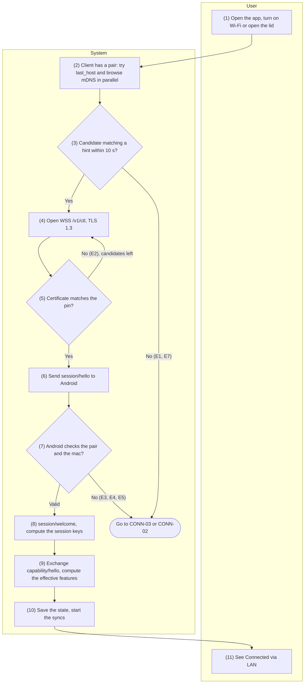
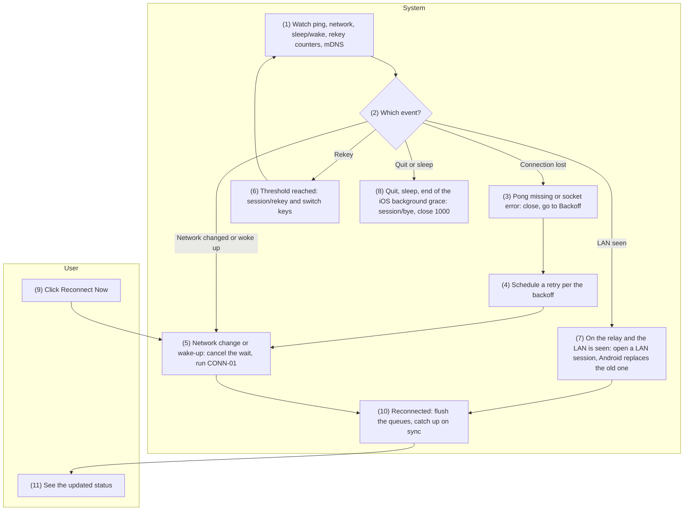
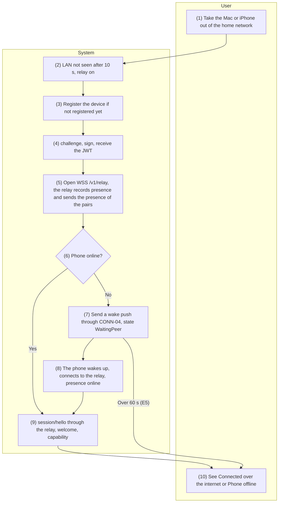
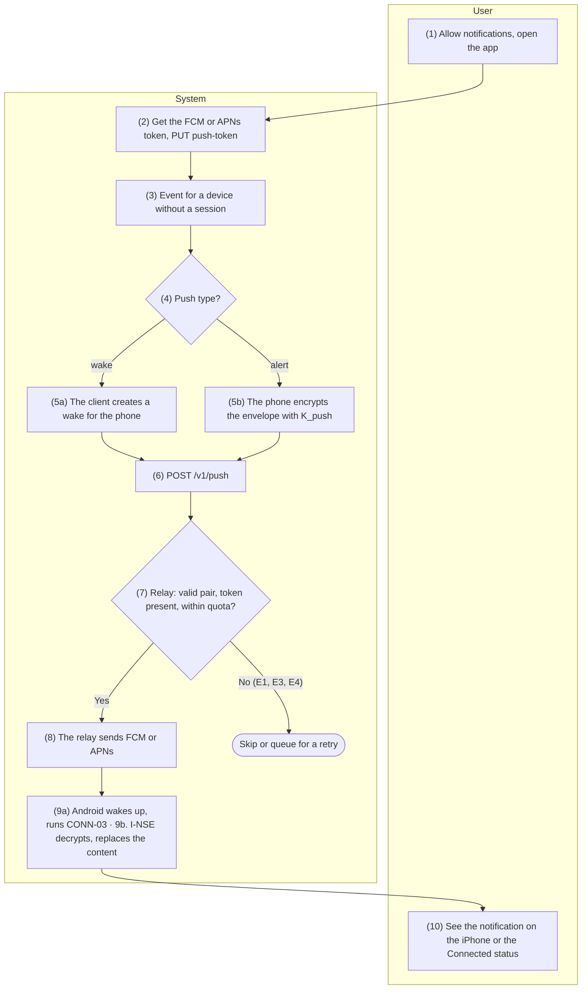
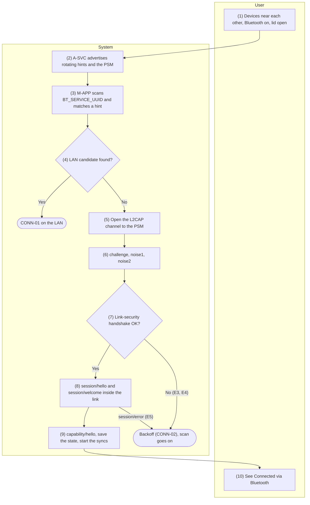
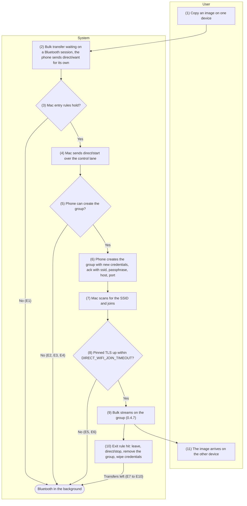

English | [Tiếng Việt](03-connectivity.vi.md)

# 3. Function group: Connectivity

> Common references: [`00-common-specs.md`](00-common-specs.md) — transport channels (0.4), message
> frames (0.5), session handshake (0.6.3), relay authentication (0.6.4), message type catalog (0.7),
> error codes (0.8), schema (0.9), constants (0.10), client state machine (0.11).

## 3.1 CONN-01 — Automatic discovery and connection on the LAN

### 3.1.1 General information

| Item | Content |
|-----|----------|
| Name | CONN-01 — Automatic discovery and connection on the LAN |
| Description | The client (Mac/iOS) finds the paired phone on the LAN by itself, opens the `/v1/ctl` channel over TLS with a pinned certificate, performs the session handshake per 0.6.3, exchanges capabilities to determine the effective features, then starts the dependent syncs (SMS-01, CALL-04, sending the latest clipboard).<br>Runs automatically when the app launches, when a new network becomes available, when the Mac wakes up, when iOS returns to the foreground without a live session (a session kept through the background grace of CONN-02 E3 goes on), right after PAIR-01 and every time CONN-02 retries the connection. |
| Actors | Primary: System (M-APP / I-APP, A-SVC). The user acts indirectly (opening the app, turning on Wi-Fi, opening the lid) or clicks "Reconnect Now". |
| Preconditions | 1. There is a valid pair (PAIR-01).<br>2. A-SVC is running as a foreground service.<br>3. Both devices are on the same LAN and the network allows mDNS multicast.<br>4. The client has been granted the local network permission (iOS 14+, macOS 15+) per SET-03. |
| Postconditions | **Success:** state `Connected` (LAN); session keys ready; the peer's capability stored in `features_json`; `last_seen_at`, `last_host`, `last_port` updated; the effective features turned on; the Android foreground service notification reads "Connected to \<name>".<br>**Failure:** move to CONN-03 after `LAN_DISCOVERY_GRACE` (if the relay is on) or to `Backoff` (CONN-02). |
| Exceptions | E1 — No instance with a matching hint within 10 s → CONN-03 (relay on) or keep browsing.<br>E2 — `TLS_PIN_MISMATCH`: drop this instance (it may be another device or an impostor) and try the next instance; if every instance of the pair fails the pin (the phone has regenerated its TLS key, 0.6.1) → stop trying and show "Needs to be paired again" (PAIR-02).<br>E3 — `session/error AUTH_FAILED` → report "Couldn't verify the phone", long 5-minute backoff, no continuous retries.<br>E4 — `PAIR_UNKNOWN` or `PAIR_REVOKED` (4403) before the phone is authenticated: on a route where `phoneAuthenticatedByTLS` is true (LAN, USB: pinned TLS to the phone) → clean up the pair per PAIR-03 flow B, ask to pair again. On a route where it is false (relay, Bluetooth) the same codes only lead to `Backoff` (0.11, CONN-03 E9, CONN-05 E5).<br>E5 — 4426 `UNSUPPORTED_VERSION` → prompt to update the app on the older device.<br>E6 — Handshake longer than 5 s (4408) → CONN-02 backoff.<br>E7 — The network isolates clients (guest Wi-Fi, mDNS blocked) → same as E1.<br>E8 — Local network permission denied → report it and open the SET-03 guidance. |
| Special requirements | **Performance:** reconnect < 3 s when `last_host` is known (a project success metric); handshake ≤ 300 ms on the LAN.<br>**Security:** TLS 1.3 only; pin the certificate's SHA-256, no hostname check; the mDNS TXT contains no static identifier (0.4.1).<br>**Platform:** iOS/macOS declare `NSLocalNetworkUsageDescription` and `NSBonjourServices = ["_handlive._tcp"]`; Android runs A-SVC with type `connectedDevice` (permissions `FOREGROUND_SERVICE_CONNECTED_DEVICE` + `CHANGE_NETWORK_STATE`) with an ongoing notification.<br>**Feature independence:** capabilities decide each feature; a feature that lacks a permission does not block the other features. |

### 3.1.2 Screens

N/A — no approved wireframe yet.

### 3.1.3 Component details

| # | Field | Data type | Input/Output | Initial value | Description |
|---|--------|--------------|--------------|------------------|-------|
| 1 | Status icon (Mac menu bar / iOS tab) | enum{connected\| connecting\| peer_offline\| disconnected} | Output | `connecting` | Mapped from the state machine in 0.11. Mac: template icon in the menu bar (`MenuBarExtra`, `.menuBarExtraStyle(.menu)`) — clicking it opens a menu, not a popover |
| 2 | Status line | string | Output | "Connecting…" | "Connected via Wi-Fi to \<phone name>" |
| 3 | Phone name | string(64) | Output | `peer_name` |  |
| 4 | Connection error message | string | Output | Empty | Per E3–E8 |
| 5 | "Reconnect Now" button | action | Input | Hidden while connected | Skips the backoff wait and runs again from step 2 |
| 6 | Foreground service notification (Android) | string | Output | "Waiting for a connection" | "Connected to \<client name>"; several clients: "Connected to 2 devices" |
| 7 | Effective features | array\<string> | Output | Empty | Shown in PAIR-02; updated after step 9 |

### 3.1.4 Business flow



| Step | Actor | Component | Description | Exceptions / Notes |
|------|----------|-----------|-------|--------------------|
| 1 | User | M-APP / I-APP | Opens the app, turns on Wi-Fi, opens the Mac's lid, brings the iOS app to the foreground; or clicks "Reconnect Now". | The flow also runs by itself after PAIR-01 and from CONN-02. |
| 2 | System | M-APP / I-APP | Reads the valid pair and loads `PRK` (memory cache or Keychain). In parallel: (a) immediately tries `last_host:last_port` (fast path); (b) runs `NWBrowser` for `_handlive._tcp` with TXT. | No local network permission yet → E8. |
| 3 | System | M-APP / I-APP | Computes the hints for the previous, the current and the next hour (0.4.1); an instance whose TXT `h` contains one of the three hints is a candidate. The fast path (a) is also a candidate. | 10 s without a candidate → E1. |
| 4 | System | M-APP / I-APP → A-SVC | Opens `wss://<host>:<port>/v1/ctl`, TLS 1.3. A-SVC accepts the connection and starts counting `HANDSHAKE_TIMEOUT`. |  |
| 5 | System | M-APP / I-APP | Compares the SHA-256 of the server certificate with `peer_tls_sha256`. | Different → close, E2. |
| 6 | System | M-APP / I-APP | Generates an ephemeral X25519 key and a `nonce`, sends `session/hello`. |  |
| 7 | System | A-SVC | Checks that `pair_id` exists and is not revoked, that `device_id` is the peer's, that `mac` is correct (constant time), and the protocol version.<br>If the pair already has another session: the old session receives `session/bye {reason: replaced}` and is closed with 4409 once the new session has confirmed its keys (A-SVC can decrypt the first `capability/hello` of the new session; a replayed `hello` only gets a `welcome` and can never kick out the real session). | Failure → `session/error` + close 4401/4403/4426 (E3, E4, E5). |
| 8 | System | A-SVC → M-APP / I-APP | Android sends `session/welcome`; the client checks `mac`. Both sides compute `k_c2s`, `k_s2c`. | The client's check fails → close 4401, E3. |
| 9 | System | Both sides | Each side sends its first encrypted envelope, `capability/hello` (0.7.2). Effective features = on at both sides and Android has the permissions; `features_json` is stored. |  |
| 10 | System | Both sides | Update `last_seen_at`, `last_host`, `last_port`; publish the `Connected` state; Android updates the foreground service notification and the hints.<br>Start: SMS-01 (if sms is effective), CALL-04 (if call is effective), sending the latest clip if it was created within `CLIP_STALE_AFTER` (CLIP-01/02), flushing `sms_outbox` (SMS-04). | Each task runs independently; the failure of one task does not affect the others. |
| 11 | User | M-APP / I-APP, A-UI | Sees "Connected via Wi-Fi" on the client and the notification on Android. |  |

### 3.1.5 API/service specification

**List of calls**

| # | API/service | Channel | Direction | Used in steps |
|---|-------------|------|-------|-------------|
| 1 | mDNS advertising `NsdManager.registerService` | LAN multicast | Android | Background (before step 2), 10 |
| 2 | mDNS browsing `NWBrowser` (`.bonjourWithTXTRecord`) | LAN multicast | Client | 2, 3 |
| 3 | Opening the `wss://…/v1/ctl` connection (TLS 1.3, pinned) | TCP LAN | C→S | 4, 5 |
| 4 | `WS session/hello` | `/v1/ctl` | C→S | 6, 7 |
| 5 | `WS session/welcome` | `/v1/ctl` | S→C | 8 |
| 6 | `WS session/error` | `/v1/ctl` | S→C | 7 |
| 7 | `WS capability/hello` | `/v1/ctl` | Both ways | 9 |

#### API 1 — mDNS advertising (Android)

- **URL:** N/A (mDNS multicast `224.0.0.251:5353`, `ff02::fb`)
- **Method:** `NsdManager.registerService(NsdServiceInfo, NsdManager.PROTOCOL_DNS_SD, listener)`
- **Request:**

| Property | Value | Description |
|-----------|---------|-------|
| `serviceType` | `_handlive._tcp` |  |
| `serviceName` | `HL-<6 random hex>` | Changes every time A-SVC starts |
| `port` | The actual port of A-SVC (47800–47809) |  |
| TXT `v` | `1` |  |
| TXT `h` | Hint list (0.4.1) | Recomputed at the top of every hour and when a pair is added or removed |

- **Response:** callback `onServiceRegistered` (the system may change the final name on a conflict) or
  `onRegistrationFailed(errorCode)`.
- **Example:** `HL-4f9a2c._handlive._tcp.local.` SRV → `192.168.1.23:47800`, TXT `v=1`, `h=1a2b3c4d`
- **Business logic:**
  1. To change the TXT, unregister and register again (NsdManager cannot update TXT in place); A-SVC
     batches the changes, at most once per second.
  2. Registration failure → retry after 5 s, 30 s, then every 5 minutes; meanwhile clients can still
     reach it through `last_host`.
  3. When no pair is left: drop the `h` key, keep advertising `v` (needed for pairing).

#### API 2 — mDNS browsing (Mac/iOS)

- **URL:** N/A (mDNS)
- **Method:**
  `NWBrowser(for: .bonjourWithTXTRecord(type: "_handlive._tcp", domain: nil), using: .tcp)`
- **Request:** no parameters besides the service type.
- **Response:** a set of `NWBrowser.Result` with `endpoint` (`.service(name:type:domain:interface:)`) and
  `metadata` (`.bonjour(NWTXTRecord)`).
- **Example:** result `HL-4f9a2c` with TXT `["v": "1", "h": "1a2b3c4d,77e0aa19"]`.
- **Business logic:**
  1. Only consider results with `v = 1` and an `h` that contains a hint of the pair (previous, current or next hour).
  2. Connect to the service endpoint (the Network framework resolves it); once connected, take the
     actual IP address from `currentPath.remoteEndpoint` to store as `last_host`.
  3. The browser keeps running while connected through the relay, to detect the LAN and upgrade
     (CONN-02).

#### API 3 — Opening the `/v1/ctl` connection

- **URL:** `wss://{android_host}:{port}/v1/ctl`
- **Method:** WebSocket upgrade (HTTP/1.1 `GET` + `Upgrade: websocket`) over TLS 1.3.
- **Request:** standard WebSocket headers; no authentication header (authentication happens in the
  session handshake). Client: Network.framework (`NWConnection` with `NWProtocolWebSocket`, TLS 1.3 minimum); the TLS verify block compares the certificate with the pin. A Bonjour instance is resolved to IPv4 with a short TCP connection before the WSS connection, so the phone sees one extra connection that closes before TLS. A failure on the `last_host` fast path (stale address, pin mismatch) is dropped silently; only hint-matching mDNS instances lead to `Backoff` or "Needs to be paired again".
- **Response:** `101 Switching Protocols`. Android rejects any other path with `404`.
- **Example:** `GET /v1/ctl HTTP/1.1` · `Host: 192.168.1.23:47800` · `Upgrade: websocket` ·
  `Sec-WebSocket-Version: 13`
- **Business logic:**
  1. TLS delegate: take the leaf certificate from `SecTrust`, compute SHA-256 over the DER, compare it
     with `peer_tls_sha256`; match → `.useCredential`, mismatch → `.cancelAuthenticationChallenge` (E2).
  2. A-SVC allows at most 16 concurrent `/v1/ctl` connections without a handshake, and at most 4 of
     them from the same IP (`CTL_PREAUTH_LIMIT`), and closes any connection that does not send
     `session/hello` within 5 s (protection against resource exhaustion); a connection over either
     cap is closed with 4429 `RATE_LIMITED`, silent connections are closed with 4408.

#### API 4 — `WS session/hello`

- **URL:** `wss://{android_host}:{port}/v1/ctl` (via relay: CONN-03)
- **Method:** `WS session/hello` (C→S), unencrypted payload (0.5.1), answered by `session/welcome` or
  `session/error`.
- **Request (`data`):**

| Field | Type | Required | Description |
|--------|------|----------|-------|
| `protocol` | int32 | Yes | `1` |
| `pair_id` | uuid | Yes |  |
| `device_id` | uuid | Yes | The client's `device_id` |
| `eph` | b64u (32 bytes) | Yes | The session's ephemeral X25519 public key |
| `nonce` | b64u (32 bytes) | Yes |  |
| `mac` | b64u (32 bytes) | Yes | HMAC-SHA256(`K_auth`, `T1`) per 0.6.3 |

- **Response:** API 5 or API 6.
- **Example:**

```json
{"v":1,"type":"session","id":"0192f400-11aa-7b2c-9d3e-4f5a6b7c8d9e","ts":1727151000000,"payload":"eyJvcCI6ImhlbGxvIiwiZGF0YSI6eyJwcm90b2NvbCI6MSwicGFpcl9pZCI6IjNmMmIxYzRkLTVlNmYtNGE3Yi04YzlkLTBlMWYyYTNiNGM1ZCIsImRldmljZV9pZCI6IjViMWY4YzJlLTlhNGQtOGU2Zi1hMWIyLWMzZDRlNWY2MDcxOCIsImVwaCI6Ii4uLiIsIm5vbmNlIjoiLi4uIiwibWFjIjoiLi4uIn19"}
```

Payload after base64 decoding:
`{"op":"hello","data":{"protocol":1,"pair_id":"3f2b1c4d-5e6f-4a7b-8c9d-0e1f2a3b4c5d","device_id":"5b1f8c2e-9a4d-8e6f-a1b2-c3d4e5f60718","eph":"…","nonce":"…","mac":"…"}}`

- **Business logic:**
  1. Order of checks in A-SVC: `protocol` (different major → 4426) → the pair exists (no →
     `PAIR_UNKNOWN`, 4401) → not revoked (4403) → `device_id` matches → `mac`.
  2. Wrong `mac` 5 times/minute from the same IP address (every `session/hello` rejected with `AUTH_FAILED` counts: wrong `mac`, wrong `device_id`, a low-order ephemeral key; `PAIR_UNKNOWN` and `PAIR_REVOKED` do not) → block that IP for 5 minutes (connections
     from a blocked IP are closed with 4429 `RATE_LIMITED` right after TLS). This rule is unchanged.
     Next to it (`CTL_IP_BLOCK`): handshake timeouts (4408), `PAIR_UNKNOWN` and `BAD_REQUEST` before
     the handshake also count toward a block — 10 of them within 5 minutes from the same IP block it
     for 5 minutes (4429).
  3. `nonce` is not stored; Android's ephemeral key is generated anew for every welcome, so a
     replayed hello never leads to a usable session.

#### API 5 — `WS session/welcome`

- **URL:** as in API 4
- **Method:** `WS session/welcome` (S→C), unencrypted payload.
- **Request (`data`):**

| Field | Type | Required | Description |
|--------|------|----------|-------|
| `device_id` | uuid | Yes | Android's `device_id` |
| `eph` | b64u (32 bytes) | Yes | Android's ephemeral X25519 key |
| `nonce` | b64u (32 bytes) | Yes |  |
| `mac` | b64u (32 bytes) | Yes | HMAC-SHA256(`K_auth`, `T2`) |

- **Response:** N/A (the client sends an encrypted `capability/hello` to confirm the keys).
- **Example:**
  `{"op":"welcome","data":{"device_id":"8c7d6e5f-4a3b-8c2d-9e1f-0a1b2c3d4e5f","eph":"…","nonce":"…","mac":"…"}}`
- **Business logic:**
  1. Android computes the session keys right after sending the welcome and waits for the first
     encrypted envelope; if that first envelope cannot be decrypted → close 4401.
  2. The client checks `mac` and that `device_id` matches `peer_device_id`; failure → close 4401.

#### API 6 — `WS session/error`

- **URL:** as in API 4
- **Method:** `WS session/error` (S→C), unencrypted payload; Android closes the connection right
  afterwards with the corresponding code (0.8.3).
- **Request (`data`):** `code` —
  enum{AUTH_FAILED\|PAIR_UNKNOWN\|PAIR_REVOKED\|UNSUPPORTED_VERSION\|RATE_LIMITED}; `message` —
  string; `min_protocol` — int32 (required with `UNSUPPORTED_VERSION`, absent with the other codes;
  the client uses it to show "Update HandLive on the phone" or "Update HandLive on this device").
- **Response:** N/A.
- **Example:** `{"op":"error","data":{"code":"PAIR_UNKNOWN","message":"Device is not paired"}}`
- **Business logic:** The client handles it per E3–E5; no automatic retry within 5 minutes of an
  `AUTH_FAILED`.

#### API 7 — `WS capability/hello`

- **URL:** as in API 4
- **Method:** `WS capability/hello` (both ways), encrypted envelope, no ack.
- **Request (`data`):** per 0.7.2.
- **Response:** N/A (the other side sends its own capability).
- **Example:** see 0.7.2.
- **Business logic:**
  1. Feature F is effective = `features.F.enabled` on both sides **and** Android is not missing a
     permission that F needs (table below).
  2. A feature that goes from effective to not effective → stop F's tasks (e.g. cancel the camera
     stream) and notify the user once.
  3. A different major `protocol` has already been blocked in the handshake; a different minor → use
     the common feature set.

| Feature | Android permissions needed (missing → not effective) |
|-----------|------------------------------------------|
| `clipboard` | None (automatic sending needs Accessibility — only affects `auto_send`) |
| `sms` | `READ_SMS` (new messages are detected with a `ContentObserver`, no `RECEIVE_SMS` needed); sending also needs `SEND_SMS` (missing → `can_send = false`); the SIM list needs `READ_PHONE_STATE`; contact names need `READ_CONTACTS` |
| `call` | `READ_PHONE_STATE`; answering/ending also needs `ANSWER_PHONE_CALLS` (missing → `can_answer = can_end = false`); the incoming number and the call log also need `READ_CALL_LOG` (missing → `caller_id = false`) |
| `call_audio` | `BLUETOOTH_CONNECT`; the Opus/WS path also needs Shizuku running and Android 11+ (only affects `opus_fallback`) |
| `camera` | `CAMERA`, `RECORD_AUDIO` |

#### Query

```sql
-- [Design] Mac/iOS, step 2: the valid pair and its known address
SELECT pair_id, peer_device_id, peer_name, peer_tls_sha256, last_host, last_port
FROM paired_device
WHERE revoked_at IS NULL
LIMIT 1;

-- [Design] Mac/iOS, step 10
UPDATE paired_device
SET last_seen_at = :now, last_host = :host, last_port = :port, features_json = :features_json
WHERE pair_id = :pair_id;

-- [Design] Android, step 7: check the pair of a session/hello
SELECT pair_id, peer_device_id, prk_enc, revoked_at
FROM paired_device
WHERE pair_id = :pair_id;

-- [Design] Android, step 10
UPDATE paired_device
SET last_seen_at = :now, features_json = :features_json
WHERE pair_id = :pair_id;

-- [Design] Android, API 1: pairs whose hints must be computed
SELECT pair_id, prk_enc
FROM paired_device
WHERE revoked_at IS NULL;
```

---

## 3.2 CONN-02 — Keep the connection alive and reconnect automatically

### 3.2.1 General information

| Item | Content |
|-----|----------|
| Name | CONN-02 — Keep the connection alive and reconnect automatically |
| Description | Keeps the session alive and recovers by itself: a WebSocket ping every 15 s (over the relay, plus an E2E `ping` every 30 s), detects a lost connection, reconnects with backoff, reacts immediately to network changes, sleep/wake and foreground/background events; rekeys the session after 24 h or 10,000 envelopes; upgrades from the relay to the LAN when the phone shows up on the LAN; closes gracefully with `session/bye`.<br>After reconnecting, it flushes the queues and catches up on sync. |
| Actors | Primary: System (M-APP / I-APP, A-SVC). The user can click "Reconnect Now". |
| Preconditions | There has been a session (`Connected`) before, or the client is in `Backoff`/`Discovering`. |
| Postconditions | The session is kept or re-established; the displayed status matches reality within ≤ 1 s of detection; `sms_outbox` entries still `pending` are resent; SMS-01 and CALL-04 catch up. |
| Exceptions | E1 — The network is completely lost: LAN and relay sessions end; go to `Idle`, wait for `NWPathMonitor`/`NetworkCallback` to report a network, no useless backoff. On the Mac with Bluetooth usable, a Bluetooth session stays and the client keeps looking over Bluetooth instead of going to `Idle` (0.11, CONN-05).<br>E2 — The Mac goes to sleep: send `session/bye {reason: shutdown}` if there is still time; on wake-up run CONN-01 immediately.<br>E3 — iOS goes to the background (`scenePhase` of the app becomes `.background`; `.inactive` is ignored): I-APP keeps the session for a short grace instead of closing at once. It starts a background task (`beginBackgroundTask`); iOS refuses it → `session/bye {reason: shutdown}` and close at once. Otherwise the session stays open (pings go on) until min(`IOS_BACKGROUND_GRACE`, the background time iOS still gives − 5 s), then `session/bye {reason: shutdown}`, close 1000 and end the task.<br>The grace is one holder of the session; a notification action (SMS-04 step B2, CALL-02 step B2) is another and keeps its own background task as today. I-APP sends `bye` and closes only when no holder is left and the app is not in the foreground. When iOS expires the grace task, the grace releases its hold and ends its task at once without waiting; an action still running keeps the session through its own task. An action after the session has closed connects as before (CONN-01 or CONN-03).<br>Closing and opening run one after the other on one queue (cancelling the timer, the timer firing, `bye`, close, CONN-01). Back in the foreground: the close has not started → cancel the timer, end the task, keep the session (no `bye`, no new CONN-01); `bye` already sent → wait until the close completes, then run CONN-01, so the client never holds two sessions of the same pair (no 4409 against itself).<br>The session drops during the grace → release the grace at once: cancel the timer, end the task, no `bye`, no reconnection in the background.<br>During the grace: an incoming SMS or call shows the notification the user would get through push (CONN-04), posted locally with no new text and with the same content rules as I-NSE (`sms.preview`, locked iPhone, SMS-02 field 2); a `clipboard/push` is written only if `UIPasteboard.changeCount` still equals its reference value, taken when the app went to the background and moved after each write or clear HandLive makes during the grace (CLIP-04 E2, CLIP-05); a successful write is remembered as HandLive's own, a failed write follows the existing error path (`ack` as today).<br>After the grace, while suspended, messages arrive through push (CONN-04).<br>E4 — Rekey without an `ack` within 10 s → close the session, reconnect (a new handshake generates new keys).<br>E5 — `DECRYPT_FAILED` → close 4400, reconnect.<br>E6 — The operating system stops A-SVC (OEM background killing) → the client sees the connection drop; A-SVC `START_STICKY` restarts by itself; SET-01 has already requested the battery optimization exemption.<br>E7 — Closed with 4409 (replaced by a new connection of the same client; over the relay: `session/bye {reason: replaced}`, API 4) → do not reconnect from the old session. |
| Special requirements | **Performance:** reconnect < 3 s after the network returns; detect a lost connection in ≤ 25 s (15 s ping + 10 s waiting for the pong).<br>**Battery:** the client pings actively, Android only answers with pongs and closes connections that have been silent for more than 45 s; Android does not keep the relay connection when idle for more than 5 minutes.<br>**Backoff:** 0.5 → 1 → 2 → 4 → 8 → 16 → 30 s, jitter ±20 %, back to the start once a session has stayed connected for 30 s (`RECONNECT_BACKOFF`, 0.10). |

### 3.2.2 Screens

N/A — no approved wireframe yet.

### 3.2.3 Component details

| # | Field | Data type | Input/Output | Initial value | Description |
|---|--------|--------------|--------------|------------------|-------|
| 1 | Connection status | enum{connected\| connecting\| peer_offline\| disconnected} | Output | Current value | As in CONN-01 field 1 |
| 2 | Channel | enum{lan\| relay\| usb} | Output | Current channel | Changes on the relay → LAN upgrade |
| 3 | Time until the next retry | int32 (seconds) | Output | Empty | "Retrying in 8 s" while in `Backoff` |
| 4 | "Reconnect Now" button | action | Input | Shown when `disconnected` | Cancels the backoff wait, runs CONN-01 |
| 5 | Messages waiting to be sent | int32 | Output | Number of `sms_outbox` rows in `pending` | "2 messages waiting for the phone" |

### 3.2.4 Business flow



| Step | Actor | Component | Description | Exceptions / Notes |
|------|----------|-----------|-------|--------------------|
| 1 | System | M-APP / I-APP, A-SVC | The client sends a WS ping every 15 s; over the relay it also sends a `ping/ping` envelope every 30 s (the WS ping only checks the hop to the relay).<br>It watches `NWPathMonitor`, `NSWorkspace.willSleepNotification`/`didWakeNotification` (Mac), `scenePhase` (iOS).<br>Android watches `ConnectivityManager.registerDefaultNetworkCallback` and counts the silent time of each session.<br>Both sides count the envelopes sent and the session age. |  |
| 2 | System | as above | Classifies the event. |  |
| 3 | System | M-APP / I-APP | No pong within 10 s, or a socket error, or `ping/ping` without an `ack` for 10 s → close the session, state `Backoff`. Android: a session silent for more than 45 s → close 4411 `IDLE_TIMEOUT`. | E5, E6. |
| 4 | System | M-APP / I-APP | Waits per the backoff table (with jitter). No network → `Idle`, wait for a network event. | E1. |
| 5 | System | M-APP / I-APP | Cancels the wait, runs CONN-01 (LAN first, then CONN-03 after 10 s). |  |
| 6 | System | The side that reaches the threshold first | Sends `session/rekey`; the receiver answers with an `ack` carrying its own ephemeral key and switches keys; the sender switches keys once it receives the `ack`. The old keys are kept for 30 s for envelopes in flight. | No `ack` → E4. |
| 7 | System | M-APP / I-APP → A-SVC | On the relay while mDNS sees a matching hint → open a new LAN session per CONN-01 steps 4–9. A-SVC sends `session/bye {reason: replaced}` on the relay session and ends it (a relayed session has no close code, API 4). | E7 for the old session. |
| 8 | System | M-APP / I-APP | The user quits the app, the Mac is about to sleep, or the iOS background grace ends (`IOS_BACKGROUND_GRACE`, E3) → send `session/bye` and close with 1000. iOS back in the foreground during the grace → keep the session, no `bye`. | E2, E3. |
| 9 | User | M-APP / I-APP | Clicks "Reconnect Now". |  |
| 10 | System | M-APP / I-APP, A-SVC | Once `Connected` again: resend the `sms_outbox` entries still `pending` in creation order (SMS-04), run SMS-01 and CALL-04 with the stored cursors. |  |
| 11 | User | M-APP / I-APP | Sees the status and the number of waiting messages updated. |  |

### 3.2.5 API/service specification

**List of calls**

| # | API/service | Channel | Direction | Used in steps |
|---|-------------|------|-------|-------------|
| 1 | WS ping/pong (RFC 6455 control frames) | `/v1/ctl` or `/v1/relay` | C→S | 1, 3 |
| 2 | `WS ping/ping` | `/v1/ctl` via relay | C→S | 1, 3 |
| 3 | `WS session/rekey` | `/v1/ctl` | Both ways | 6 |
| 4 | `WS session/bye` | `/v1/ctl` | Both ways | 7, 8 |
| 5 | Operating system services: `NWPathMonitor`, `NSWorkspace` sleep/wake, `scenePhase`, `ConnectivityManager.NetworkCallback`, Network.framework WebSocket ping | Local | — | 1, 4, 5, 8 |

#### API 1 — WS ping/pong

- **URL:** the current connection
- **Method:** WebSocket control frame `0x9` (ping) / `0xA` (pong).
- **Request:** 8-byte ping payload = a uint64 BE counter.
- **Response:** a pong with the same payload (Ktor and Network.framework answer automatically).
- **Example:** ping `00 00 00 00 00 00 00 2A` → pong `00 00 00 00 00 00 00 2A`.
- **Business logic:** Mac/iOS send a Network.framework WebSocket ping (`NWProtocolWebSocket`, `.ping` metadata with a pong handler) with a 10 s timer; no pong in time → treat it as a lost connection. Right after the default network changes, one more ping with a 2 s deadline detects a dead socket in about 2 s (reconnect target < 3 s).

#### API 2 — `WS ping/ping`

- **URL:** `wss://{RELAY_HOST}/v1/relay` with the `to`/`from` wrapper (only used when the session goes
  through the relay)
- **Method:** `WS ping/ping` (C→S), encrypted envelope, with ack.
- **Request (`data`):** `seq` — int64, increasing.
- **Response (`ack.data`):** `seq` — int64 (echoed), `server_ts` — Android's timestamp.
- **Example:** `{"op":"ping","data":{"seq":42}}` →
  `{"re":"0192f4a0-…","ok":true,"data":{"seq":42,"server_ts":1727151030000}}`
- **Business logic:** Measures the end-to-end RTT (shown in diagnostics); a single missing `ack`
  within 10 s → lost connection.

#### API 3 — `WS session/rekey`

- **URL:** `/v1/ctl` (LAN, USB or relay)
- **Method:** `WS session/rekey` (both ways), envelope encrypted with the current key, with ack.
- **Request (`data`):**

| Field | Type | Required | Description |
|--------|------|----------|-------|
| `epoch` | int32 | Yes | New key generation (current + 1) |
| `eph` | b64u (32 bytes) | Yes | New ephemeral X25519 key |
| `nonce` | b64u (32 bytes) | Yes |  |

- **Response (`ack.data`):** the receiver's `{epoch, eph, nonce}`.
- **Example:** `{"op":"rekey","data":{"epoch":1,"eph":"…","nonce":"…"}}` →
  `{"re":"…","ok":true,"data":{"epoch":1,"eph":"…","nonce":"…"}}`
- **Business logic:**
  1. New keys per 0.6.3 step 6; the devices re-derive both `k_c2s` and `k_s2c`.
  2. Both sides start a rekey at the same time → the side with the smaller `device_id` wins; the other
     side cancels its own request and answers with an `ack`; the winner ignores the loser's request
     and does not return an `ack`. A failed rekey (no `ack` within 10 s, an error `ack`, invalid data) →
     close 4410 `REKEY_FAILED`, then reconnect (E4).
  3. Envelopes encrypted with the old key that arrive within 30 s of the switch are still decrypted;
     after that → `DECRYPT_FAILED`.
  4. Deduplication (`DEDUP_WINDOW`, 0.5.1 rule 2) covers the whole key epoch, per direction: the set
     of accepted `id`s starts empty with the new keys; the previous epoch's set is kept as long as its
     keys are still accepted (30 s), then dropped. Only envelopes that decrypted are recorded. Relay
     and LAN sessions behave the same.

#### API 4 — `WS session/bye`

Specified as in PAIR-03 API 2. In this group `reason` is `shutdown` (quit, sleep, the end of the iOS background grace of E3),
`replaced` (Android replaces an old session with a new session of the same pair) or `update` (the app
is about to be updated).

A session through the relay has no WebSocket close between the peers: the `/v1/relay` link carries
the other sessions and stays open, so no close code (4409, 4410, 4411, …) reaches the peer. A device
therefore always sends `session/bye` before it ends a relayed session: `revoked`, `replaced` or
`update` as defined, `shutdown` for every other end (quit, sleep, the end of the iOS background grace, relay switched off, and
the ends that close an established LAN session with 4400, 4410, 4411 or 4500). The receiver ends the
session when `session/bye` arrives: `replaced` counts as 4409 (E7), any other reason as 1000. One
exception: when the peer opens a new session with `session/hello` over the relay, the device ends the
old relayed session at once without `session/bye`, because the peer has already dropped the old keys
and could not open it.

#### Query

```sql
-- [Design] Mac/iOS, step 10: SMS messages waiting to be resent
SELECT local_id, pair_id, thread_id, addresses_json, body, sub_id, attempts
FROM sms_outbox
WHERE pair_id = :pair_id AND state = 'pending'
ORDER BY created_at ASC;

-- [Design] Mac/iOS, field 5: count the waiting messages
SELECT COUNT(*) FROM sms_outbox WHERE pair_id = :pair_id AND state = 'pending';

-- [Design] Mac/iOS, step 10: the stored sync cursors
SELECT stream, cursor FROM sync_cursor WHERE pair_id = :pair_id;
```

---

## 3.3 CONN-03 — Connect through the relay outside the LAN

### 3.3.1 General information

| Item | Content |
|-----|----------|
| Name | CONN-03 — Connect through the relay outside the LAN |
| Description | When the client does not see the phone on the LAN after `LAN_DISCOVERY_GRACE` (10 s) or the network blocks mDNS, and `relay.enabled = true` on both sides, the client connects to the relay: registers the device (once), authenticates with a challenge–signature exchange to get a JWT, opens the WSS `/v1/relay`, receives presence.<br>When the phone is online, the client performs the session handshake and exchanges capabilities through the relay exactly as on the LAN; the content is still end-to-end encrypted.<br>The phone does not keep a permanent relay connection: it connects only on the demands of step 2 (among them a wake-up push, CONN-04) and disconnects by itself after 5 idle minutes.<br>The camera does not go through the relay. |
| Actors | Primary: System (M-APP / I-APP, A-SVC, R-API, R-KV, R-DB). |
| Preconditions | 1. There is a valid pair, already registered with the relay or registrable right away (PAIR-01 API 8). 2. `relay.enabled = true` on both devices. 3. Internet access. |
| Postconditions | **Success:** an E2E session through the relay, status "Connected over the internet"; the data features work as on the LAN (except the camera and call audio — they need proximity).<br>**Phone offline:** state `WaitingPeer` ("Phone offline"), a wake push has been sent. |
| Exceptions | E1 — The relay does not respond or returns 5xx → backoff (CONN-02).<br>E2 — 401 `SIGNATURE_INVALID` or 404 `DEVICE_NOT_FOUND` → register the device again, then retry once.<br>E3 — 410 `DEVICE_REVOKED` → report "This device was removed from the internet service", turn the relay off until the user turns it back on (new registration).<br>E4 — `relay.error NOT_PAIRED` when sending → call `GET /v1/pairs`: revoked → PAIR-03 flow B; not registered → `POST /v1/pairs`, then retry.<br>E5 — The phone does not come online within 60 s of the push → stay in `WaitingPeer`; do not push again more than once per 5 minutes.<br>E6 — 429 `RATE_LIMITED` → wait for `Retry-After`; field 4: "Too many requests. Trying again in {duration}." (`{duration}` = the remaining `Retry-After` wait, formatted by the system).<br>E7 — The relay certificate does not match the pin, on any device (Android included) → do not connect; field 4: "The server's certificate isn't trusted, so HandLive didn't connect over the internet."<br>E8 — `relay.error NOT_CONNECTED` (the peer just left) → back to `WaitingPeer`.<br>E9 — `session/error` `PAIR_UNKNOWN` or `PAIR_REVOKED` over the relay, before the handshake authenticated the phone → `Backoff`, never unpair: the relay route has `phoneAuthenticatedByTLS` = false (0.11), since anyone on the relay path could forge it. A revocation is acted on only through a signed `pair_revoked` (PAIR-03 API 4), `GET /v1/pairs` (PAIR-02) or a route where `phoneAuthenticatedByTLS` is true (CONN-01 E4). A pre-authentication `UNSUPPORTED_VERSION` or `AUTH_FAILED` over the relay still shows its message (CONN-01 E3, E5) but keeps the normal backoff schedule instead of stopping or waiting 5 minutes, so a forged error cannot leave the client idle. The same route rule covers Bluetooth (CONN-05 E5). |
| Special requirements | **Security:** the relay only sees the wrapper (`to`/`from`, `type`, size, time); it has no E2E key; 15-minute JWT; pinned SPKI of ISRG Root X1/X2 + a backup key.<br>**Resources:** at most 2 MiB/s per pair and direction; envelope ≤ 256 KiB.<br>**Reference performance:** SMS and call notifications through the relay ≤ 1 s when both sides are online.<br>**Operations:** the relay is stateless; presence and routing between instances go through Redis; statistics only per `device_hash`. |

### 3.3.2 Screens

N/A — no approved wireframe yet.

### 3.3.3 Component details

| # | Field | Data type | Input/Output | Initial value | Description |
|---|--------|--------------|--------------|------------------|-------|
| 1 | Connection status | enum{connected\| connecting\| peer_offline\| disconnected} | Output | `connecting` | `peer_offline` shows "Phone offline" |
| 2 | Channel | enum{lan\| relay\| usb} | Output | `relay` on success | "Internet" |
| 3 | Allow internet connection | bool | Input/Output | `relay.enabled` = `true` | Managed in SET-02, shown here to explain the situation when it is off |
| 4 | Relay error message | string | Output | Empty | Per E3, E6, E7. Android shows E3 and E7 in place of the description under "Internet Connection" (SET-02 field 21) |

### 3.3.4 Business flow



| Step | Actor | Component | Description | Exceptions / Notes |
|------|----------|-----------|-------|--------------------|
| 1 | User | — | Leaves the home network or uses a network that blocks mDNS. |  |
| 2 | System | M-APP / I-APP, A-SVC | Client: in `Discovering` for more than 10 s, `relay.enabled = true`.<br>Phone (A-SVC): it cannot tell that a client is waiting on the relay, so it connects only on a demand: the service starts, or the relay is switched on, while a relay-registered pair has no session; a LAN session ends without `session/bye`; SMS-02 detects a new message while a relay-registered pair has no session; an incoming call rings while a relay-registered pair has no session (from `RINGING`, not only after the push: an iPhone can decline over it and a Mac waiting on the relay gets the call, CALL-01 steps 4–5); the phone joins a pairing rendezvous (QR with `rv`, PAIR-01); an FCM wake-up (CONN-04).<br>While the last demand is less than `RELAY_IDLE_DISCONNECT` (5 minutes) old, a relayed session or a rendezvous is open, or a call is ringing, it reconnects per `RECONNECT_BACKOFF` (a network change retries at once). It leaves after 5 minutes without a relayed session, a rendezvous, a ringing call or traffic, and comes back only on a new demand. | Relay off → stay in `Discovering`. No demand and no wake-up push → the client stays in `WaitingPeer` (E5). |
| 3 | System | M-APP / I-APP → R-API | If not registered yet or after E2: `POST /v1/devices`. If `relay_registered = 0` for the pair: `POST /v1/pairs`. | 410 → E3. |
| 4 | System | M-APP / I-APP → R-API | `POST /v1/auth/challenge`, then `POST /v1/auth/token` (0.6.4). A token with more than 60 s left is reused. | E2, E6. |
| 5 | System | M-APP / I-APP → R-API, R-KV | Opens `wss://{RELAY_HOST}/v1/relay` with `Authorization: Bearer`. Relay: records `presence`, subscribes to `dev:<device_id>`, sends `presence` for each pair and `pair_revoked` for revoked pairs. | Wrong pin → E7. |
| 6 | System | M-APP / I-APP | Reads the phone's `presence.online`. |  |
| 7 | System | M-APP / I-APP → R-API → PUSH | `POST /v1/push` kind `wake` to the phone (CONN-04). State `WaitingPeer`. | E5. |
| 8 | System | A-SVC → R-API | The phone receives the FCM message and performs steps 3–5 on its side; the relay publishes `presence online` to the client. |  |
| 9 | System | M-APP / I-APP ↔ R-API ↔ A-SVC | The client sends `session/hello` wrapped in `{"to": <android>, "env": …}`; the relay checks that the pair is valid and turns it into `{"from": <client>, "env": …}`. The handshake and capability exchange continue as in CONN-01 steps 6–10. | E4, E8. |
| 10 | User | M-APP / I-APP | Sees "Connected over the internet" or "Phone offline". |  |

### 3.3.5 API/service specification

**List of calls**

| # | API/service | Channel | Direction | Used in steps |
|---|-------------|------|-------|-------------|
| 1 | `POST /v1/devices` | Relay REST | Device → R-API | 3 |
| 2 | `POST /v1/auth/challenge` | Relay REST | Device → R-API | 4 |
| 3 | `POST /v1/auth/token` | Relay REST | Device → R-API | 4 |
| 4 | `GET /v1/relay` (WebSocket) | Relay WSS | Device ↔ R-API | 5, 8 |
| 5 | Relay op `presence`, `error` | Relay WSS (text) | R-API → device | 5, 6, 8, 9 |
| 6 | Envelope forwarding (`to`/`from` wrapper) | Relay WSS (text) | Device → R-API → device | 9 and every later envelope |

#### API 1 — `POST /v1/devices`

- **URL:** `https://{RELAY_HOST}/v1/devices`
- **Method:** `POST` (no JWT needed; self-certified by the signature in the body)
- **Request:**

| Field | Type | Required | Description |
|--------|------|----------|-------|
| `device_id` | uuid | Yes | Must equal UUIDv8(SHA-256(`ik_sig_pub`)) |
| `platform` | enum{android\| macos\| ios\| ipados} | Yes |  |
| `app_version` | string(32) | Yes |  |
| `ik_sig_pub` | b64u (32 bytes) | Yes |  |
| `ts` | timestamp | Yes | Skew from the relay clock ≤ 5 minutes |
| `sig` | b64u (64 bytes) | Yes | Ed25519(`ik_sig`, `"HLREG1"` ‖ `device_id`(16) ‖ `ik_sig_pub`(32) ‖ UTF-8(`platform`) ‖ `ts`(int64 BE)) |

- **Response:**

| HTTP | Body | When |
|------|------|---------|
| 201 | `{"device_id":"…","created_at":…}` | New registration |
| 200 | as above | Already registered; `app_version`, `last_seen_at` updated |
| 401 `SIGNATURE_INVALID` | error | Wrong signature, `device_id` does not match the key, or `ts` is skewed |
| 410 `DEVICE_REVOKED` | error | The device has been removed |
| 429 `RATE_LIMITED` | error | Over the per-IP limit or the relay-wide cap (logic 3); `Retry-After` |

- **Example:**

```json
{"device_id":"5b1f8c2e-9a4d-8e6f-a1b2-c3d4e5f60718","platform":"macos","app_version":"1.0.0 (100)","ik_sig_pub":"7Kx9vQ2mTn4pL8rWz1YcHd6fJb3gSa5eUo0iVtNkQxA","ts":1727151100000,"sig":"<b64u, 64 bytes>"}
```

```json
{"device_id":"5b1f8c2e-9a4d-8e6f-a1b2-c3d4e5f60718","created_at":1727151100420}
```

- **Business logic:**
  1. Check `ts`, rebuild the signed string, check `sig`, check that `device_id` is derived from the
     key.
  2. Upsert by `device_id`; the `ik_sig_pub` of a `device_id` never changes (a new key = a new
     `device_id`).
  3. At most 10 new registrations per hour per IP address, an IPv6 address counted per /64
     (`RELAY_REG_IP_LIMIT`), and at most `RELAY_MAX_REGISTRATIONS_PER_HOUR` (default 1,000) new
     registrations per hour on the whole relay; over either → 429 `RATE_LIMITED`. Updating an existing
     registration does not count.
  4. Client IP: when `RELAY_TRUSTED_PROXIES` is empty and the relay binds a loopback address, it
     trusts the loopback addresses (`127.0.0.1`, `::1`) as proxies, since only a local reverse proxy
     can reach it; addresses are compared after mapping IPv4-mapped IPv6 to IPv4. At startup the
     relay logs a warning when `RELAY_TRUSTED_PROXIES` is empty and it binds a non-loopback address,
     and at most once a minute when a peer it does not trust sends `X-Forwarded-For` (the per-IP
     limits would otherwise put every client behind a proxy into one bucket). The relay-wide cap is
     checked before the per-IP counter is incremented, so a refused request does not use up an IP's
     quota. Behind carrier NAT many phones share one IPv4 address; 30 auth requests per minute per IP
     is enough for about 200 devices, which is accepted for a self-hosted relay.

#### API 2 — `POST /v1/auth/challenge`

- **URL:** `https://{RELAY_HOST}/v1/auth/challenge`
- **Method:** `POST`
- **Request:** `device_id` — uuid, required.
- **Response 200:** `challenge` — b64u (32 bytes); `expires_at` — timestamp (+60 s). Errors: 404
  `DEVICE_NOT_FOUND`, 410 `DEVICE_REVOKED`, 429 `RATE_LIMITED`.
- **Example:** `{"device_id":"5b1f8c2e-9a4d-8e6f-a1b2-c3d4e5f60718"}` →
  `{"challenge":"0tXoN3f1C9aYQbJ8kVw2mZr5uHs7pLd4gEi6cBy0xQA","expires_at":1727151160000}`
- **Business logic:** First the per-IP limit: 30 requests/minute per client IP for
  `/auth/challenge` and `/auth/token` together (IPv6 per /64), checked before any database lookup →
  429 `RATE_LIMITED`. Then at most 10 challenges/minute per (`device_id`, client IP). Generate 32
  random bytes and write `chal:<device_id>:<challenge>` with TTL 60 s; a new challenge never replaces
  another pending one, so a stranger asking for challenges for a `device_id` cannot lock it out.

#### API 3 — `POST /v1/auth/token`

- **URL:** `https://{RELAY_HOST}/v1/auth/token`
- **Method:** `POST`
- **Request:**

| Field | Type | Required | Description |
|--------|------|----------|-------|
| `device_id` | uuid | Yes |  |
| `challenge` | b64u | Yes | The value just received |
| `sig` | b64u (64 bytes) | Yes | Ed25519(`ik_sig`, `"HLAUTH1"` ‖ challenge ‖ `device_id`(16)) |

- **Response 200:** `access_token` — string (JWT HS256, claims `sub`, `iat`, `exp`, `jti`);
  `expires_in` — int32 (900). Errors: 400 `BAD_REQUEST` (`sig` is not a 64-byte b64u), 401
  `CHALLENGE_EXPIRED`, 401 `SIGNATURE_INVALID`, 404 `DEVICE_NOT_FOUND`, 410 `DEVICE_REVOKED`, 429
  `RATE_LIMITED` (per-IP limit of API 2), 500 `INTERNAL`.
- **Example:** `{"access_token":"eyJhbGciOiJIUzI1NiJ9.eyJzdWIiOiI1YjFm…","expires_in":900}`
- **Business logic:** Per-IP limit of API 2 first. Read and delete `chal:<device_id>:<challenge>` (the
  `challenge` echoed in the request) in a single command (`GETDEL`); missing → `CHALLENGE_EXPIRED`; verify the signature with the `ik_sig_pub` in `devices`; update
  `last_seen_at`.

#### API 4 — `GET /v1/relay` (WebSocket)

- **URL:** `wss://{RELAY_HOST}/v1/relay`
- **Method:** WebSocket upgrade, header `Authorization: Bearer <jwt>`.
- **Request:** no body. Once open: wrapper text frames (API 6) or control ops (`rv_join`,
  `rv_msg`).
- **Response:** `101 Switching Protocols`; 401 `TOKEN_EXPIRED` /`SIGNATURE_INVALID` if the JWT is
  invalid; 404 `DEVICE_NOT_FOUND` if the device has removed itself from the relay. Right after
  opening, the relay sends `presence` for every valid pair, `pair_revoked` for pairs revoked within
  the last 30 days, and `pair_revoked` for each element of `revoked_notice:<device_id>` (the peer
  deleted all of its data, SET-02), then deletes that key. Each `pair_revoked` carries the stored
  `HLREVOKE1` statement; the device acts on it only if the signature is the peer's (PAIR-03 API 4).
- **Example:** `GET /v1/relay HTTP/1.1` · `Host: relay.example.com` ·
  `Authorization: Bearer eyJhbGciOi…` · `Upgrade: websocket`
- **Business logic:**
  1. One relay connection per device; a new connection replaces the old one (closed with 4409).
  2. Write `presence:<device_id>` = instance id, TTL 60 s, renewed every 20 s; subscribe to
     `dev:<device_id>`.
  3. Load the list of valid peers from `pairs` into the connection's memory; refresh it on
     `pair_revoked`.
  4. Publish `presence online` to each peer that is online (publish `dev:<peer>`); on close: delete
     `presence` if it still belongs to this instance, publish `presence offline`.
  5. A JWT that expires while the connection is open does not cut the connection; only the next
     opening needs a new token.
  6. Limits: the upgrade request counts against the REST limit (`RELAY_RATE_LIMIT`); a frame over
     1 MiB closes the connection with 4400 (a frame over 256 KiB only gets `error PAYLOAD_TOO_LARGE`,
     API 6); the relay pings every 15 s and closes with 4411 after 45 s without any frame from the
     device, pongs included; a receiving connection with 32 MiB waiting to be written, or a write
     stuck for 10 s, is dropped with 4500 (0.8.3).

#### API 5 — Relay op `presence` and `error`

- **URL:** `wss://{RELAY_HOST}/v1/relay`
- **Method:** control WS text frame (R-API → device).
- **Request:**

| op | Field | Type | Description |
|----|--------|------|-------|
| `presence` | `pair_id` | uuid |  |
| `presence` | `peer_device_id` | uuid |  |
| `presence` | `online` | bool |  |
| `error` | `code` | string | `NOT_PAIRED`, `NOT_CONNECTED`, `PAYLOAD_TOO_LARGE`, `RATE_LIMITED`, `BAD_REQUEST` |
| `error` | `message` | string |  |
| `error` | `to` | uuid | Destination of the rejected frame (if any) |

- **Response:** N/A.
- **Example:**
  `{"op":"presence","pair_id":"3f2b1c4d-5e6f-4a7b-8c9d-0e1f2a3b4c5d","peer_device_id":"8c7d6e5f-4a3b-8c2d-9e1f-0a1b2c3d4e5f","online":true}`
- **Business logic:** Devices treat `presence` as a hint; the source of truth for the session is still
  a successful E2E handshake.

#### API 6 — Forwarding envelopes through the relay

- **URL:** `wss://{RELAY_HOST}/v1/relay`
- **Method:** wrapper WS text frame.
- **Request (device → relay):** `to` — uuid (destination `device_id`); `env` — object (the intact
  0.5.1 envelope).
- **Response (relay → destination device):** `from` — uuid; `env` — object. Errors go back to the
  sender with op `error`.
- **Example:**

```json
{"to":"8c7d6e5f-4a3b-8c2d-9e1f-0a1b2c3d4e5f","env":{"v":1,"type":"sms","id":"0192f4b2-5c6d-7e8f-9a0b-1c2d3e4f5a6b","ts":1727151200000,"payload":"<b64>"}}
{"from":"5b1f8c2e-9a4d-8e6f-a1b2-c3d4e5f60718","env":{"v":1,"type":"sms","id":"0192f4b2-5c6d-7e8f-9a0b-1c2d3e4f5a6b","ts":1727151200000,"payload":"<b64>"}}
```

- **Business logic:**
  1. The relay checks only the wrapper: a JSON object whose `to` is a `device_id` (a UUIDv8) and
     whose `env` is an object (binary frames: the 20-byte `HR` header of 0.4.3, followed by a frame).
     It never parses or checks `env` or the inner HL frame; the receiving device does (0.5.1, 0.5.2).
     The only exception is the pairing rendezvous (PAIR-01 API 7, logic 4). A malformed wrapper or
     `HR` frame, including a `to` or `HR` destination that is not a UUIDv8 → `error BAD_REQUEST`
     without `to`, so a malformed id is never echoed.
  2. `to` (or the `HR` `device_id`) must be the peer of the sender in a registered, unrevoked pair;
     otherwise → `error NOT_PAIRED` (also when `to` is the sender itself).
  3. A `from` sent by the device is ignored (0.5.1 rule 6): the relay sets `from` to the sender's
     `device_id` and re-emits `env` byte for byte, never re-serialized:
     `{"from":"<device_id>","env":<raw env>}`. An `HR` frame gets the source `device_id` in place of
     the destination one; the HL frame is forwarded unchanged.
  4. Frame > 256 KiB → `error PAYLOAD_TOO_LARGE`; over 2 MiB/s per pair and direction → delay socket
     reads (backpressure), no frame is dropped.
  5. Publish on `dev:<to>`: 0 receivers, or a frame the relay cannot publish (Redis error) →
     `error NOT_CONNECTED`. `presence:<to>` is not consulted here; it only feeds the `presence` op and
     `GET /v1/pairs`.
  6. No decryption, no logging of `env`; only the envelope count and bytes are added to
     `usage_daily` per `device_hash`.
  7. Ending a relayed session: there is no WebSocket close between the peers, so the device that
     ends it always sends `session/bye` first (CONN-02 API 4); the `/v1/relay` link stays open.

#### Query

```sql
-- [Design] Relay, API 1: register or update a device
INSERT INTO devices (device_id, ik_sig_pub, platform, app_version)
VALUES ($1, $2, $3, $4)
ON CONFLICT (device_id) DO UPDATE
SET app_version = EXCLUDED.app_version, last_seen_at = now()
WHERE devices.revoked_at IS NULL AND devices.ik_sig_pub = EXCLUDED.ik_sig_pub
RETURNING device_id, created_at;

-- [Design] Relay, API 2 and 3: public key and status
SELECT ik_sig_pub, revoked_at FROM devices WHERE device_id = $1;

-- [Design] Relay, API 3
UPDATE devices SET last_seen_at = now() WHERE device_id = $1;

-- [Design] Relay, API 4: valid peers of the device that just connected
SELECT pair_id,
       CASE WHEN device_a = $1 THEN device_b ELSE device_a END AS peer_device_id
FROM pairs
WHERE (device_a = $1 OR device_b = $1) AND revoked_at IS NULL;

-- [Design] Relay, API 6: add to the statistics (batched every 60 s)
INSERT INTO usage_daily (day, device_hash, envelopes, bytes)
VALUES (current_date, $1, $2, $3)
ON CONFLICT (day, device_hash) DO UPDATE
SET envelopes = usage_daily.envelopes + EXCLUDED.envelopes,
    bytes     = usage_daily.bytes + EXCLUDED.bytes;

-- [Design] Every device, step 3: pairs not yet registered with the relay
SELECT pair_id FROM paired_device WHERE revoked_at IS NULL AND relay_registered = 0;
```

```text
# [Design] Redis
INCR      rl:ip:<ip>:auth:<minute>                     # API 2 and 3, before any database lookup
SET       chal:<device_id>:<challenge> 1 EX 60         # API 2, one key per challenge
GETDEL    chal:<device_id>:<challenge>                 # API 3
SET       presence:<device_id> <instance_id> EX 60     # API 4, renewed every 20 s
SUBSCRIBE dev:<device_id>                              # API 4
SMEMBERS  revoked_notice:<device_id>                   # API 4: send pair_revoked for each element
DEL       revoked_notice:<device_id>                   # API 4: once they have been sent
PUBLISH   dev:<to> {"from":"<device_id>","env":{...}}  # API 6: 0 receivers → NOT_CONNECTED
```

---

## 3.4 CONN-04 — Push registration and device wake-up

### 3.4.1 General information

| Item | Content |
|-----|----------|
| Name | CONN-04 — Push registration and device wake-up |
| Description | Registers the push token with the relay (FCM for Android, APNs for iOS) and sends a push when the target device has no session: (a) **wake** — the client needs the phone (sending an SMS, the user opens the app outside the LAN): the relay sends a high-priority FCM data message, the phone wakes up and connects to the relay (CONN-03); (b) **alert** — the phone needs to notify a suspended iPhone/iPad (new SMS, incoming call, missed call): an envelope encrypted with `K_push` travels inside the APNs push, and I-NSE decrypts it and replaces the notification content.<br>The Mac does not use push. |
| Actors | Primary: System (A-SVC, I-APP, I-NSE, R-API, FCM, APNs). Secondary: User (allows notifications on iOS, sees the notifications). |
| Preconditions | 1. `relay.enabled = true`; the target device is registered with the relay and has a push token. 2. iOS: the user has allowed notifications (SET-03). 3. The pair is valid on the relay. |
| Postconditions | The latest token is in `devices`; the push reaches the right device; the phone connects to the relay within ≤ 10 s of a wake (reference target); the iPhone shows a notification with content while unlocked and generic content while locked. |
| Exceptions | E1 — The target device has no token yet (409 `PUSH_TOKEN_MISSING`) → skip; the data will arrive through sync once connected.<br>E2 — Temporary FCM/APNs error (502 `PUSH_PROVIDER_ERROR`) → Android queues the push in `push_outbox` and retries with backoff until `expires_at`.<br>E3 — The token is no longer valid (FCM `UNREGISTERED`, APNs 410) → the relay deletes the token and answers 409 `PUSH_TOKEN_MISSING`, so the phone does not queue a retry; the device registers again the next time the app is opened.<br>E4 — 429 `RATE_LIMITED`.<br>E5 — I-NSE cannot read the key (device locked) or decryption fails → shows "New notification from your phone".<br>E6 — The phone is in a background-restricted mode and FCM is deprioritized → it wakes up late; SET-01 has already guided the user to turn off battery optimization.<br>E7 — Envelope older than 24 h or `id` already processed → I-NSE shows the generic content and does not process it again. |
| Special requirements | **Security:** FCM carries no content; APNs only carries the encrypted envelope (`K_push`), and the `aps.alert` part only has a `loc-key` — the iPhone translates the generic wording into its own language (0.12.4).<br>**Limits:** APNs payload ≤ 4 KB → `env_b64` ≤ 3,000 characters of base64; SMS content in a push is shortened per step 5b and arrives complete after SMS-01.<br>**Platform policy:** no PushKit VoIP (iOS 13+ requires every VoIP push to report a call to CallKit); incoming call notifications use an alert with `interruption-level: time-sensitive`; high-priority FCM is only used for things the user needs right away.<br>**Anti-spam:** `apns-collapse-id` per SMS message or call (API 4); at most 30 pushes/minute per sending device. |

### 3.4.2 Screens

N/A — no approved wireframe yet.

### 3.4.3 Component details

| # | Field | Data type | Input/Output | Initial value | Description |
|---|--------|--------------|--------------|------------------|-------|
| 1 | Notification permission (iOS) | enum{allowed\| denied\| not_determined} | Input/Output | `not_determined` | The system asks during SET-03; guidance is shown if `denied` |
| 2 | Notification title | string | Output | "HandLive" | I-NSE replaces it with the sender's or caller's name or number (details for calls: CALL-01 API 6, CALL-04 API 4) |
| 3 | Notification content | string | Output | "New notification from your phone" | I-NSE replaces it with the decrypted content (respects `sms.preview`) |
| 4 | Notification group | string | Output | — | APNs `thread-id` = `sms` or `calls` (the relay cannot see the conversation); after decrypting, I-NSE groups an SMS by conversation with `threadIdentifier` (SMS-02 API 4) |

### 3.4.4 Business flow



| Step | Actor | Component | Description | Exceptions / Notes |
|------|----------|-----------|-------|--------------------|
| 1 | User | I-APP, A-UI | iOS: allows notifications when SET-03 asks. Android: no action needed (FCM data messages need no notification permission). | Declined → field 1 = `denied`; content only arrives when the app is opened. |
| 2 | System | A-SVC, I-APP → R-API | Gets the token (`FirebaseMessaging.getToken()`, `registerForRemoteNotifications`) and calls `PUT /v1/devices/me/push-token` for a new token, on `onNewToken`, and every 7 days. |  |
| 3 | System | M-APP / I-APP or A-SVC | An event arises that the target device must handle while the target has no session (LAN or relay): the client needs the phone (CONN-03 step 7, sending an SMS); the phone has `sms/new`, `call_event/state` (ringing), `call_event/log_new` (missed) for an iPhone/iPad. | Mac as the target → no push, wait for the sync. |
| 4 | System | as above | Chooses `wake` (the target is Android) or `alert` (the target is iOS/iPadOS). |  |
| 5a | System | M-APP / I-APP | Creates a `wake` request with a reason (`user_open`, `sms_send`, `call_action`). | At most 1 wake/5 minutes for the same reason. |
| 5b | System | A-SVC | Builds the envelope as when sending over a session (e.g. `sms/new`) but encrypts it with `K_push`; `env_b64` = standard base64 with padding of the UTF-8 envelope JSON.<br>SMS: a `message.body` over 1,000 code points becomes its first 999 code points + "…". While `env_b64` is over 3,000 characters, `message.body` becomes the longest shorter cut that fits (fewer code points each step, ending with "…"), down to "…" alone; only then `thread.snippet` (160 code points, no "…", SMS-01) is cut the same way. If nothing fits, no alert push is sent; the message arrives with SMS-01.<br>Call (`call_event/state`, `call_event/log_new`): if `env_b64` is over 3,000 characters, each name (`display_name`, `waiting_display_name`, `entry.display_name`) is cut at a code-point boundary to 64 code points, the last one "…"; still too long → the names are dropped (`null`). If nothing fits, no alert push is sent; a missed call still arrives through CALL-04.<br>`collapse_key` = the `message_key` for an SMS (e.g. `sms:12847`, since `message_key` is already `sms:<_id>`), `call:<call_id>` for a call (a missed call whose `call_id` is unknown: `calllog:<entry_id>`, CALL-04 API 5). | Relay error → E2, write to `push_outbox` (deadline: 30 s for incoming calls, 24 h for SMS and missed calls). |
| 6 | System | → R-API | `POST /v1/push`. |  |
| 7 | System | R-API, R-DB | Checks that the sender and the target are in the same valid pair, that the target has a token, and the rate limit. | E1, E3, E4. |
| 8 | System | R-API → PUSH | FCM HTTP v1 (Android) or APNs HTTP/2 (iOS). Broken token → delete it from `devices` (E3). |  |
| 9a | System | A-SVC | `onMessageReceived` with `t = wake`: starts/keeps A-SVC (the foreground service start exemption for high-priority FCM), runs CONN-03, waits for the client's handshake; after 5 idle minutes it disconnects from the relay. | E6. |
| 9b | System | I-NSE | Reads `p` (pair_id) and `hl`; takes `PRK` from the shared Keychain group, derives `K_push`, decrypts; checks `ts` ≤ 24 h and that `id` has not been processed; builds the title/content by message type and, for an SMS, sets `threadIdentifier` to its conversation (SMS-02 API 4); for a missed call, sets the `HL_CALL_MISSED` category ("Message") only when the number is known and I-APP's copy for that pair in the App Group `UserDefaults` (`sms.peer_can_send`, 0.9.5: `features.sms.can_send` with SMS in effect at both ends) is `true` (no copy → no "Message" action; CALL-04 API 4); calls `contentHandler`. | E5, E7. |
| 10 | User | I-APP / operating system | Sees the notification; tapping it opens I-APP (CONN-01, sync). On the waiting client: sees "Connected over the internet". |  |

### 3.4.5 API/service specification

**List of calls**

| # | API/service | Channel | Direction | Used in steps |
|---|-------------|------|-------|-------------|
| 1 | `PUT /v1/devices/me/push-token` | Relay REST | Device → R-API | 2 |
| 2 | `POST /v1/push` | Relay REST | Device → R-API | 6, 7 |
| 3 | FCM HTTP v1 `messages:send` | HTTPS | R-API → Google | 8 |
| 4 | APNs HTTP/2 | HTTPS | R-API → Apple | 8 |
| 5 | Operating system services: `FirebaseMessagingService.onMessageReceived`/`onNewToken`, `UIApplication.registerForRemoteNotifications`, `UNNotificationServiceExtension.didReceive(_:withContentHandler:)` | Local | — | 2, 9a, 9b |

#### API 1 — `PUT /v1/devices/me/push-token`

- **URL:** `https://{RELAY_HOST}/v1/devices/me/push-token`
- **Method:** `PUT`, header `Authorization: Bearer <jwt>`
- **Request:**

| Field | Type | Required | Description |
|--------|------|----------|-------|
| `provider` | enum{fcm\| apns\| apns_sandbox} | Yes | `apns_sandbox` for development builds |
| `token` | string(4096) | Yes | FCM registration token, or the APNs device token in lowercase hex (the relay stores APNs tokens lowercase) |
| `topic` | string(255) | With APNs | Bundle id of I-APP; only with `apns` or `apns_sandbox`, and it must equal the relay's configured topic (`RELAY_APNS_TOPIC`); senders never send it with `fcm`, and the relay ignores it there (0.5.1 rule 6) |

- **Response:** 204 with no body. Errors: 400 `BAD_REQUEST` in the relay error format (0.8.2): `topic` missing with APNs or other than
  `RELAY_APNS_TOPIC`, an APNs token that is not hex, provider does not match the platform (a Mac never
  registers a token).
- **Example:** `{"provider":"apns","token":"4f1c2e…a9","topic":"app.handlive.ios"}`
- **Business logic:** The provider must match `platform` (android ↔ fcm; ios/ipados ↔ apns*; never
  macos); the old token is overwritten; APNs tokens are stored lowercase. The relay accepts only the
  APNs `topic` equal to `RELAY_APNS_TOPIC` (the bundle id of I-APP, set in the relay's environment);
  any other topic → 400. When APNs is not configured on the relay no topic matches: no APNs token is
  stored, and a later push to that device answers 409 `PUSH_TOKEN_MISSING` (API 2).

#### API 2 — `POST /v1/push`

- **URL:** `https://{RELAY_HOST}/v1/push`
- **Method:** `POST`, header `Authorization: Bearer <jwt>`
- **Request:**

| Field | Type | Required | Description |
|--------|------|----------|-------|
| `pair_id` | uuid | Yes |  |
| `to` | uuid | Yes | Target `device_id` |
| `kind` | enum{wake\| alert} | Yes | `wake` only to Android; `alert` only to iOS/iPadOS |
| `reason` | enum{user_open\| sms_send\| call_action\| sms_new\| call_incoming\| call_missed} | Yes |  |
| `env_b64` | b64 | With `alert` | Standard base64 with padding of the UTF-8 JSON of the envelope encrypted with `K_push` (step 5b), the same string as the APNs `hl`; ≤ 3,000 characters of base64 |
| `collapse_key` | string(64) | No | 1–64 visible ASCII characters (0x21–0x7E, no spaces), because it becomes the `apns-collapse-id` HTTP/2 header; FCM wakes always use `wake` (API 3) |
| `ttl_s` | int32 | No | 0–86,400; default 60 (wake), 30 (call_incoming, the value CALL-01 API 4 sends), 86,400 (sms_new, call_missed); FCM caps it at 60 s (0.4.4) |

- **Response:** 202 `{"accepted":true}`. Errors: 400 `BAD_REQUEST` (invalid body, `kind` and `reason`
  that do not match, a target of the wrong platform, a Mac), 403 `NOT_PAIRED`, 409
  `PUSH_TOKEN_MISSING` (also right after a dead token, E3), 413 `PAYLOAD_TOO_LARGE`, 429
  `RATE_LIMITED`, 502 `PUSH_PROVIDER_ERROR`.
- **Example:**

```json
{"pair_id":"7a6b5c4d-3e2f-4a1b-9c8d-7e6f5a4b3c2d","to":"2c3d4e5f-6a7b-8c9d-8e0f-1a2b3c4d5e6f","kind":"alert","reason":"sms_new","env_b64":"eyJ2IjoxLCJ0eXBlIjoic21zIiwiaWQiOiIwMTky…","collapse_key":"sms:12847","ttl_s":86400}
```

- **Business logic:**
  1. Check that the caller (`sub`) and `to` are the two members of a non-revoked `pair_id`.
  2. Check that `kind` matches the target platform (`wake` → android, `alert` → ios/ipados; a Mac
     never receives pushes, 0.4.4), otherwise 400, and that the target has a token.
  3. Rate limit of 30 pushes/minute per sender; a `wake` with the same `reason` within 5 minutes is
     coalesced (returns 202 but is not sent again).
  4. Call API 3 or API 4; add to `usage_daily.pushes`. `env_b64` is not kept after sending.

#### API 3 — FCM HTTP v1 (relay → Google)

- **URL:** `https://fcm.googleapis.com/v1/projects/{project_id}/messages:send`
- **Method:** `POST`, header `Authorization: Bearer <OAuth2 access token of the service account>`
- **Request:**

```json
{"message":{"token":"<fcm token>","data":{"t":"wake","p":"7a6b5c4d-3e2f-4a1b-9c8d-7e6f5a4b3c2d","r":"sms_send"},"android":{"priority":"HIGH","ttl":"60s","collapse_key":"wake"}}}
```

- **Response:** 200 `{"name":"projects/{project_id}/messages/<id>"}`; 404 with `UNREGISTERED` → delete
  the token and answer 409 `PUSH_TOKEN_MISSING` (E3); 500/503 or a network error → one retry after
  500 ms inside the request, then 502; other errors (429…) → 502 for the caller.
- **Example:** as above.
- **Business logic:** Data messages only (no `notification` block) so that Android handles them in
  `onMessageReceived` even in the background; the service account key lives outside the repo (an
  environment variable of the relay). `android.collapse_key` is always `wake` and `android.ttl` =
  min(`ttl_s`, 60) s (0.4.4).

#### API 4 — APNs HTTP/2 (relay → Apple)

- **URL:** `https://api.push.apple.com/3/device/{device_token}` (sandbox:
  `https://api.sandbox.push.apple.com/3/device/{device_token}`)
- **Method:** `POST`, header `authorization: bearer <ES256 JWT from the .p8 key>`,
  `apns-push-type: alert`, `apns-topic: <bundle id>`, `apns-priority: 10`,
  `apns-expiration: <now + ttl>`, `apns-collapse-id: <collapse_key>`
- **Request:**

```json
{"aps":{"alert":{"loc-key":"push.sms_new"},"mutable-content":1,"sound":"default","thread-id":"sms","interruption-level":"active"},"p":"7a6b5c4d-3e2f-4a1b-9c8d-7e6f5a4b3c2d","hl":"eyJ2IjoxLCJ0eXBlIjoic21zIiwiaWQiOiIwMTky…"}
```

- **Response:** 200 (header `apns-id`); 410 `Unregistered` → delete the token and answer 409
  `PUSH_TOKEN_MISSING` (E3); 403 `ExpiredProviderToken` or `InvalidProviderToken` → sign a new provider
  token and try once more, then 502; 400 (`BadDeviceToken`, `DeviceTokenNotForTopic`…) and any other 403
  → log a configuration error and answer 502; 500/503 or a network error → one retry after 500 ms inside
  the request, then 502; 429 → 502.
- **Example:** as above; with `reason = call_incoming`: `interruption-level` = `time-sensitive`,
  `thread-id` = `calls`.
- **Business logic:**
  1. The .p8 key lives outside the repo; the provider JWT is refreshed every 50 minutes, and at once after `ExpiredProviderToken` or `InvalidProviderToken`; total payload ≤ 4 KB; `aps` always carries `sound: "default"`. Without an APNs configuration the relay stores no APNs token (API 1), so an alert push to an iPhone/iPad answers 409 `PUSH_TOKEN_MISSING`.
  2. The default content (shown when I-NSE cannot decrypt, e.g. while the iPhone is locked) is sent as `aps.alert.loc-key` — the relay sends no wording, the iPhone looks the key up in the app's catalog in the device language (0.12.4); it contains no phone number and no content. Keys by `reason`:

| `reason` | `aps.alert.loc-key` | Text (`en`) | `interruption-level` | `apns-collapse-id` / `thread-id` |
|----------|-------------------|------------------|----------------------|----------------------------------|
| `sms_new` | `push.sms_new` (no title; the system shows the app name) | New SMS message | `active` | the `message_key`, e.g. `sms:12847` / `sms` |
| `call_incoming` | `push.call_incoming` | Incoming call on your phone | `time-sensitive` | `call:<call_id>` / `calls` |
| `call_missed` | `push.call_missed` | Missed call on your phone | `active` | `call:<call_id>` when the `call_id` is known, otherwise `calllog:<entry_id>` (CALL-04 API 5) / `calls` |

  3. `thread-id` is generic (`sms` or `calls`): the conversation is inside the encrypted envelope and
     `POST /v1/push` has no field for it. After decrypting, I-NSE sets `threadIdentifier` per
     conversation (SMS-02 API 4); a locked iPhone keeps every SMS push in the `sms` group.

#### Query

```sql
-- [Design] Relay, API 1
UPDATE devices
SET push_provider = $2, push_token = $3, push_topic = $4, last_seen_at = now()
WHERE device_id = $1 AND revoked_at IS NULL;

-- [Design] Relay, API 2: check the pair and get the target's token
SELECT d.platform, d.push_provider, d.push_token, d.push_topic
FROM pairs p
JOIN devices d ON d.device_id = $3
WHERE p.pair_id = $1
  AND p.revoked_at IS NULL
  AND ((p.device_a = $2 AND p.device_b = $3) OR (p.device_b = $2 AND p.device_a = $3))
  AND d.revoked_at IS NULL;

-- [Design] Relay, API 3/4: broken token
UPDATE devices SET push_token = NULL, push_provider = NULL WHERE device_id = $1;

-- [Design] Relay: count pushes
INSERT INTO usage_daily (day, device_hash, pushes)
VALUES (current_date, $1, 1)
ON CONFLICT (day, device_hash) DO UPDATE SET pushes = usage_daily.pushes + 1;

-- [Design] Android, step 5b (E2): queue a push
INSERT INTO push_outbox (id, pair_id, kind, body_b64, collapse_key, attempts, next_attempt_at, expires_at, reason)
VALUES (:id, :pair_id, :kind, :body_b64, :collapse_key, 0, :now, :expires_at, :reason);

-- [Design] Android: fetch the pushes that are due for a retry
SELECT id, pair_id, kind, body_b64, collapse_key, attempts, reason
FROM push_outbox
WHERE next_attempt_at <= :now AND expires_at > :now
ORDER BY next_attempt_at ASC
LIMIT 20;

-- [Design] Android: clean up pushes that were sent or have expired
DELETE FROM push_outbox WHERE id = :id OR expires_at <= :now;
```

---

## 3.5 CONN-05 — Connect over Bluetooth when there is no shared LAN

### 3.5.1 General information

| Item | Content |
|-----|----------|
| Name | CONN-05 — Connect over Bluetooth when there is no shared LAN |
| Description | When the Mac and paired phone are near but share no LAN (offline or different networks), M-APP finds the BLE advertisement, opens an L2CAP channel, runs the link-security handshake (0.4.5), then the session handshake (0.6.3) and capability exchange. The control lane (clipboard, SMS, call info, `ping`) works as on the LAN; the session upgrades to LAN when found (0.11).<br>Runs whenever in `Discovering` with Bluetooth usable (0.11): app launch, wake-up, network lost, Bluetooth toggle, each CONN-02 retry. Mac only; iOS unchanged. Offline first pairing: PAIR-01 flow B. Images (bulk lane): 0.4.7. Images over Wi-Fi Direct: CONN-06. Bluetooth prompts and off request: SET-01, SET-03. |
| Actors | Primary: System (M-APP, A-SVC). The user acts indirectly (turns Bluetooth on, opens the lid, brings the phone closer). |
| Preconditions | 1. There is a valid pair (PAIR-01).<br>2. A-SVC runs as a foreground service of type `connectedDevice`.<br>3. Bluetooth is on on both devices; Android 12+ has Nearby devices granted; the Mac has Bluetooth access.<br>4. `link.bluetooth` is on on both devices. |
| Postconditions | **Success:** state `Connected` on route `bluetooth`; status "Connected via Bluetooth to \<name>"; the peer's capability stored and the effective features on; `last_seen_at` updated (`last_host`, `last_port` untouched); A-SVC no longer advertises this pair's hint while the session lives.<br>**Failure:** `Backoff` (CONN-02), the scan goes on. |
| Exceptions | E1 — Bluetooth off, Bluetooth access missing or `link.bluetooth` off on the Mac → no scan; without a network the client stays `Idle` and the status line says that Bluetooth is off (wording: SET-03 field 18; the Android request to turn Bluetooth on: SET-01 API 10).<br>E2 — The phone is not seen (out of range, Bluetooth off on the phone, A-SVC stopped) → keep scanning in `Discovering`; no timeout of its own.<br>E3 — `noise2` fails its tag check (a device that copies the advertisement but has no `PRK`) → close the channel, `Backoff`; when several advertisers carry the hint, the next attempt tries another one.<br>E4 — `reject` (`LINK_REJECTED`), or the channel closes during the link-security handshake → `Backoff` on the normal schedule, never unpair (0.11).<br>E5 — `session/error` `PAIR_UNKNOWN`, `PAIR_REVOKED`, `UNSUPPORTED_VERSION` or `AUTH_FAILED` before the phone is authenticated → route rule of 0.11 (`phoneAuthenticatedByTLS` = false): `Backoff`, never unpair, never stop reconnecting; the version and verification messages are still shown (CONN-01 E3, E5).<br>E6 — Bluetooth turned off on the phone, or the phone out of range, during a session → the Mac sees the disconnect (`didDisconnectPeripheral`) → `Backoff`, then `Discovering` once the advertisement is seen again (AC2).<br>E7 — Bluetooth turned back on on the phone → A-SVC rebuilds the L2CAP server and the advertiser on `STATE_ON` (API 6); without this the phone stays invisible until the app restarts.<br>E8 — Malformed record, `rlen` out of bounds, unknown `chan`, a message over `BT_MESSAGE_MAX` or a record that does not decrypt → close the link without an answer; the client counts it as a connection loss (`Backoff`).<br>E9 — No record received for `BT_IDLE_TIMEOUT` → close the link, reconnect.<br>E10 — The LAN appears during a Bluetooth session → upgrade per 0.11; the Bluetooth session receives `session/bye {reason: replaced}` once the LAN session has confirmed its keys.<br>E11 — The network is lost during a Bluetooth session → the session is not affected (0.11). |
| Special requirements | **Performance** (targets backed by gate G7, `plans/20260925-implementation/reports/phase-07-spike-g7.md`; one-way latency is estimated as RTT/2, the G7 method):<br>1. Text envelope one way, p95 ≤ 200 ms on an idle established link (AC1). G7 Lần 2: p50/p95 91.72/133.97 ms.<br>2. The same ≤ 200 ms while a bulk transfer runs on the link (AC1). G7 missed it with one FIFO stream (p95 4,769.3 ms in Lần 2, 7,768.4 ms in Lần 1), so the control-before-bulk scheduler of 0.4.5 is mandatory; measured in A7.4.<br>3. Phone in Doze, screen off: the link stays up and the accepted latency is `ping` RTT p95 ≤ 3 s (one way ≤ 1.5 s; owner decision of 2026-10-28). G7 Lần 5b: 29/29 pings, 0 `bt_lost` over 15 minutes of forced Doze, RTT p50/p95 232.4/1,328.7 ms. No connection-priority tuning: an L2CAP CoC without GATT has no public API for it (G7 "Yêu cầu phát hiện cho sản phẩm", item 4); a minimal GATT server only to request priority is not built unless T7.1 misses this target.<br>4. Reconnect ≤ 3 s from Bluetooth turned back on on the phone, or the phone seen again, to `Connected` (AC2). G7 Lần 4 (Bluetooth on → L2CAP channel open, without the two handshakes): p50 2,793 ms, max 10,583 ms, n = 3, so the margin is thin and T7.1 measures it again with more rounds.<br>5. Loss detection: the Mac reports `bt_lost` about 0.7 s after Bluetooth turns off on the phone (G7 Lần 3; 67 and 42 ms in Lần 4 rounds 1 and 2).<br>6. Throughput, for information: 12.9 KB/s (G7 Lần 2): enough for the control lane only; images use the bulk lane (0.4.7).<br>**Security:** AC8 — no pre-authentication message over Bluetooth changes pair state, removes a pair or stops reconnecting (0.11, E4, E5). AC9 — nothing static on the air: no name, `pair_id`, `device_id`, key or `pr` in the advertisement; hints rotate every `BT_HINT_PERIOD` together with the PSM and the advertising set; the link-security layer hides every envelope field and padding hides `type` (0.4.5). Every length is checked before allocation (0.4.5). Admission per 0.4.5.<br>**Platform:** Android: API 29+ (L2CAP CoC), `BLUETOOTH_ADVERTISE` and `BLUETOOTH_CONNECT` (Android 12+), A-SVC registers `BluetoothAdapter.ACTION_STATE_CHANGED`. Mac: CoreBluetooth, `NSBluetoothAlwaysUsageDescription`; never starts OS pairing. |

### 3.5.2 Screens

N/A — no approved wireframe yet.

### 3.5.3 Component details

| # | Field | Data type | Input/Output | Initial value | Description |
|---|--------|--------------|--------------|------------------|-------|
| 1 | Status icon (Mac menu bar) | enum{connected\| connecting\| peer_offline\| disconnected} | Output | `connecting` | From 0.11; a Bluetooth session shows `connected` |
| 2 | Status line | string | Output | "Connecting…" | "Connected via Bluetooth to \<phone name>" (catalog key added in S7.1) |
| 3 | Route of the session | enum{lan\| relay\| bluetooth\| usb} | Output | Empty | Internal; decides the status wording and the pre-authentication rule (`phoneAuthenticatedByTLS`, 0.11) |
| 4 | Bluetooth unavailable message | string | Output | Empty | Per E1; wording and button: SET-03 field 18 |
| 5 | Foreground service notification (Android) | string | Output | "Waiting for a connection" | Unchanged: "Connected to \<client name>" whatever the route |

### 3.5.4 Business flow



| Step | Actor | Component | Description | Exceptions / Notes |
|------|----------|-----------|-------|--------------------|
| 1 | User | — | Brings the devices near each other, turns Bluetooth on, opens the Mac's lid. | The flow also runs by itself from 0.11 and CONN-02. |
| 2 | System | A-SVC | Advertises per 0.4.5: the hints of the pairs without a live session, the current PSM; hint, PSM and advertising set rotate every `BT_HINT_PERIOD`. | E7. |
| 3 | System | M-APP | Scans with the `BT_SERVICE_UUID` filter, reads the service data, computes the hints of the epochs e − 4 to e + 4 with `K_bt_disc`; an advertisement with `ver` = `0x01` and a matching hint is a candidate. | E1, E2. |
| 4 | System | M-APP | Priority LAN > Bluetooth: a LAN candidate (CONN-01 step 3) is tried first; otherwise the Bluetooth candidate is connected at once. |  |
| 5 | System | M-APP → A-SVC | Connects to the peripheral and opens the L2CAP channel to the advertised PSM; A-SVC applies the admission rules (0.4.5). | Over a cap → `reject` (E4). |
| 6 | System | Both sides | Link-security handshake, 0.4.5 steps 1–5. | E3, E4. |
| 7 | System | Both sides | Handshake result: M-APP verified `noise2`, A-SVC decrypted the first transport record. | E3, E4. |
| 8 | System | Both sides | Session handshake (0.6.3) on control channel `0x01`, exactly as CONN-01 steps 6–8; A-SVC also checks that `pair_id` is the pair bound to the link. | E5. |
| 9 | System | Both sides | `capability/hello`, effective features, `last_seen_at`; state `Connected` on route `bluetooth`; the syncs start as in CONN-01 step 10. A-SVC drops this pair's hint from the advertisement (stops advertising when no pair is left). | E6, E8–E11. |
| 10 | User | M-APP | Sees "Connected via Bluetooth" on the Mac and the usual notification on Android. |  |

### 3.5.5 API/service specification

**List of calls**

| # | API/service | Channel | Direction | Used in steps |
|---|-------------|------|-------|-------------|
| 1 | BLE advertising `BluetoothLeAdvertiser.startAdvertisingSet` | BLE advertising | Android | 2 |
| 2 | L2CAP server `BluetoothAdapter.listenUsingInsecureL2capChannel` | L2CAP | Android | 2, 5 |
| 3 | BLE scan `CBCentralManager.scanForPeripherals` | BLE advertising | Mac | 3 |
| 4 | Open the channel `CBPeripheral.openL2CAPChannel` | L2CAP | C→S | 5 |
| 5 | Link-security handshake (records `challenge`, `noise1`, `noise2`, `reject`) | L2CAP | Both ways | 6, 7 |
| 6 | Bluetooth state `ACTION_STATE_CHANGED` / `centralManagerDidUpdateState` | System | Both sides | E1, E6, E7 |
| 7 | Control envelopes over the link | Link channel `0x01` | Both ways | 8, 9 |

#### API 1 — BLE advertising (Android)

- **URL:** N/A (BLE advertising channels)
- **Method:** `BluetoothLeAdvertiser.startAdvertisingSet(parameters, advertiseData, null, null, null, callback)`
- **Request:**

| Property | Value | Description |
|-----------|---------|-------|
| `setLegacyMode` | `true` | 31-byte legacy advertising, seen by every central |
| `setConnectable` | `true` |  |
| `setScannable` | `true` | The scan response carries the service data |
| `setInterval` | `INTERVAL_LOW` | The G7 probe setting behind the AC2 numbers |
| `setTxPowerLevel` | `TX_POWER_HIGH` | As in the G7 probe |
| Service UUID | `BT_SERVICE_UUID` | 128-bit, in the advertisement; service data in the scan response |
| Service data | `ver` ‖ `psm` ‖ `hints` | 0.4.5 |
| `setIncludeDeviceName`, `setIncludeTxPowerLevel` | `false` | No name, no TX power field |

- **Response:** `AdvertisingSetCallback.onAdvertisingSetStarted(set, txPower, status)`; `status` ≠
  `ADVERTISE_SUCCESS` → logic 3.
- **Example** (two pairs, PSM `0x0085`, `U×16` = `BT_SERVICE_UUID` little-endian): advertisement `02 01 06` ·
  `11 07 U×16` (21 bytes); scan response `1c 21 U×16 01 85 00 1a 2b 3c 4d 77 e0 aa 19` (29 bytes).
- **Business logic:**
  1. Restart the set when the pair set, a live session, the `BT_HINT_PERIOD` epoch or the QR pairing window (open or
     closed, PAIR-01 B1) changes, at most once per
     second (changes batched).
  2. At each restart: stop the set, close the server socket (accepted links stay), open a new server socket (API 2),
     start a new set with its PSM.
  3. Start failure → retry after 5 s, 30 s, then every 5 minutes, as mDNS (CONN-01 API 1).
     `ADVERTISE_FAILED_DATA_TOO_LARGE` is a programming error: the S7.1 vectors include the largest advertisement.
  4. No pair needs Bluetooth and no QR pairing window is open, `link.bluetooth` off or Bluetooth off → stop the set.

#### API 2 — L2CAP server (Android)

- **URL:** N/A (LE dynamic PSM)
- **Method:** `BluetoothAdapter.listenUsingInsecureL2capChannel()` → `BluetoothServerSocket`; `getPsm()` gives the PSM
  advertised in API 1; `accept()` on A-SVC's own thread.
- **Request:** none.
- **Response:** one `BluetoothSocket` per accepted channel.
- **Example:** PSM `0x0085` (133), in the advertisement as `85 00`.
- **Business logic:**
  1. Each accepted socket goes through the admission of 0.4.5 first, then the link-security handshake (API 5); a
     confirmed link becomes a `BluetoothPeerSocket` served by the same `/v1/ctl` session logic as LAN and relay peers.
  2. Closing the server socket at a rotation never closes accepted sockets.
  3. `accept()` failing because Bluetooth went off ends the loop; API 6 restarts it.

#### API 3 — BLE scan (Mac)

- **URL:** N/A (BLE advertising channels)
- **Method:** `CBCentralManager.scanForPeripherals(withServices: [CBUUID(BT_SERVICE_UUID)], options: nil)`, as in the
  G7 probe.
- **Request:** the service filter only.
- **Response:** `centralManager(_:didDiscover:advertisementData:rssi:)`; the service data is
  `advertisementData[CBAdvertisementDataServiceDataKey][CBUUID(BT_SERVICE_UUID)]`.
- **Example:** service data `01 85 00 1a 2b 3c 4d 77 e0 aa 19` → `ver` 1, PSM 133, two hints.
- **Business logic:**
  1. The service data comes from the scan response, which CoreBluetooth merges into `advertisementData`; G7 used no
     scan response, so M7.1 checks this first on the S25 + Mac. Ignore service data shorter than 3 bytes, with `ver` ≠ `0x01`, or whose length minus 3 is not a multiple of 4.
  2. Scan while the client is in `Discovering` or `Backoff` and Bluetooth is usable; stop while `Connected` on any
     route (the LAN upgrade comes from mDNS).
  3. Several advertisers with the same matching hint (a cloned advertisement) → try them one after the other; only
     the real phone passes `noise2` (E3).

#### API 4 — Opening the L2CAP channel (Mac)

- **URL:** N/A
- **Method:** `CBCentralManager.connect(peripheral, options: nil)`, then
  `CBPeripheral.openL2CAPChannel(psm)` → `peripheral(_:didOpen:error:)` with a `CBL2CAPChannel`.
- **Request:** the PSM read in API 3.
- **Response:** `CBL2CAPChannel.inputStream` / `outputStream`, read and written as link records (0.4.5).
- **Example:** `openL2CAPChannel(0x0085)`.
- **Business logic:**
  1. Connect and open must finish within `BT_PREAUTH_TIMEOUT`; otherwise `cancelPeripheralConnection` and
     `Backoff`.
  2. The channel never starts OS pairing: no encrypted GATT characteristic is read.
  3. `didDisconnectPeripheral` during a session → E6.

#### API 5 — Link-security handshake

- **URL:** N/A (records on the L2CAP channel)
- **Method:** records `challenge` (S→C), `noise1` (C→S), `noise2` (S→C), `reject` (S→C), then the first transport
  record from C (0.4.5).
- **Request (`noise1`):** `rlen` = `0x0031` ‖ `0x02` ‖ `e` (32) ‖ tag (16).
- **Response:** `noise2` (`rlen` = `0x0031` ‖ `0x03` ‖ `e` ‖ tag) or `reject` (`rlen` = `0x0001` ‖ `0x7F`).
- **Example:** `00 21 01` ‖ 32 random bytes (`challenge`); the S7.1 vectors give full transcripts.
- **Business logic:**
  1. Steps 1–6 of the link-security handshake in 0.4.5; A-SVC tries the psk of every unrevoked pair (Query).
  2. Failures count toward `BT_AUTH_FAIL_BLOCK` as defined in 0.4.5.
  3. `reject` and a closed channel look the same to the client: E4.

#### API 6 — Bluetooth state

- **URL:** N/A
- **Method:** Android: a receiver for `BluetoothAdapter.ACTION_STATE_CHANGED` registered by A-SVC for its whole life;
  Mac: `centralManagerDidUpdateState(_:)`.
- **Request:** `EXTRA_STATE` (Android); `CBManager.state` (Mac).
- **Response:** N/A.
- **Example:** `STATE_TURNING_OFF` → `STATE_OFF` → `STATE_ON`.
- **Business logic:**
  1. Android `STATE_TURNING_OFF` or `STATE_OFF`: close every link (the peers see a loss), stop the advertising set.
  2. Android `STATE_ON`: open a new server socket (new PSM) and start a new advertising set, exactly as when A-SVC
     starts. G7 found the probe silent after a real off/on cycle until it did this (Lần 3).
  3. Mac `.poweredOn`: scan per API 3 when the client is in `Discovering` or `Backoff`. `.poweredOff`,
     `.unauthorized`: end the Bluetooth session and the scan, then follow 0.11.

#### API 7 — Control envelopes over the link

- **URL:** N/A (control channel `0x01` of the link)
- **Method:** the JSON envelopes of 0.5.1, one per message, fragmented per 0.4.5.
- **Request:** as on `/v1/ctl`: `session/hello` (CONN-01 API 4), then every envelope of 0.7.1 that uses `/v1/ctl`.
- **Response:** as on `/v1/ctl`: `session/welcome` or `session/error` (CONN-01 API 5, 6), `ack`.
- **Example:** see CONN-01 API 4.
- **Business logic:**
  1. No WebSocket ping exists on the link: the client sends `ping/ping` every `BT_PING_INTERVAL` without other
     traffic (CONN-02 API 2).
  2. The session ends with `session/bye` under the rules of a relayed session (CONN-02 API 4), then the channel
     closes.
  3. `camera/start` over Bluetooth gets `CAM_TRANSPORT_UNSUPPORTED`, as over the relay.
  4. Bulk content and channel `0x02`: 0.4.7 (CLIP-03 messages, fragments of at most `BT_BULK_FRAGMENT_MAX`).

#### Query

```sql
-- [Design] Android, API 1: pairs whose Bluetooth hints may be advertised (live sessions are filtered in memory)
SELECT pair_id, prk_enc, last_seen_at
FROM paired_device
WHERE revoked_at IS NULL
ORDER BY last_seen_at DESC;

-- [Design] Android, API 5: candidate psks for noise1
SELECT pair_id, prk_enc
FROM paired_device
WHERE revoked_at IS NULL;

-- [Design] Mac, API 3: pairs whose hints are matched
SELECT pair_id, peer_device_id, peer_name
FROM paired_device
WHERE revoked_at IS NULL;

-- [Design] Both sides, step 9
UPDATE paired_device
SET last_seen_at = :now, features_json = :features_json
WHERE pair_id = :pair_id;
```

---

## 3.6 CONN-06 — Open a Wi-Fi Direct link for images when there is no shared LAN

### 3.6.1 General information

| Item | Content |
|-----|----------|
| Name | CONN-06 — Open a Wi-Fi Direct link for images when there is no shared LAN |
| Description | While the session runs over Bluetooth (CONN-05) and an image or other bulk transfer is waiting, the Mac asks the phone over the encrypted control lane to create a Wi-Fi Direct group, joins it as a plain Wi-Fi client, connects with the pinned TLS of the LAN, and leaves as soon as the transfers are done (0.4.6). The control lane stays on Bluetooth. Mac only; iOS unchanged. Bulk lane, per-connection keys and restarts: 0.4.7. |
| Actors | Primary: System (M-APP, A-SVC). The user acts indirectly (copies an image on one device). |
| Preconditions | 1. `Connected` on route `bluetooth` (CONN-05); no LAN session.<br>2. A bulk transfer is waiting (0.4.7) in either direction.<br>3. Both devices have `link.direct_wifi` on.<br>4. Android: Wi-Fi on, Nearby devices granted (Android 13+) or Location granted with location services on (Android 10–12) (SET-01).<br>5. Mac: Location access granted (SET-03); Wi-Fi powered on and unassociated for ≥ `DIRECT_WIFI_IDLE_MIN`; the last scan shows no known network. |
| Postconditions | **Success:** the Mac is on the group with a pinned TLS connection to A-SVC; the bulk streams of 0.4.7 run on it; after `DIRECT_WIFI_LINGER` without bulk data, or at `DIRECT_WIFI_MAX`, the Mac leaves, the phone removes the group and both wipe the credentials; the Mac's Wi-Fi is back to unassociated.<br>**Failure:** no group remains; the transfer goes over Bluetooth in the background; no new attempt before `DIRECT_WIFI_RETRY_AFTER`. In every case neither device leaves or changes the network it was on (AC4). |
| Exceptions | E1 — An entry rule does not hold (the Mac is on a network, a known network is visible, Wi-Fi off, Location missing, `link.direct_wifi` off) → no `direct/start`; Bluetooth in the background.<br>E2 — `ack` with `PERMISSION_MISSING` (Nearby devices or Location missing on the phone) → Bluetooth in the background; A-SVC posts the permission suggestion notification (SET-01 field 17, E14); retry after `DIRECT_WIFI_RETRY_AFTER`.<br>E3 — `ack` with `DIRECT_WIFI_UNAVAILABLE` (`wifi_off`, `location_off`, `p2p_unsupported`, `busy`, `error`) → Bluetooth in the background, retry after `DIRECT_WIFI_RETRY_AFTER`; HandLive never turns Wi-Fi or location services on.<br>E4 — `ack` with `FEATURE_DISABLED` (`link.direct_wifi` off on the phone) or `UNSUPPORTED_TYPE` (an older phone) → no more `direct/start` in this session.<br>E5 — The SSID is not found, `associate` fails or the pinned TLS connection is not up within `DIRECT_WIFI_JOIN_TIMEOUT` → `direct/stop {reason: join_failed}`, disassociate, Bluetooth in the background, retry after `DIRECT_WIFI_RETRY_AFTER`.<br>E6 — The certificate on the group does not match `peer_tls_sha256` (`TLS_PIN_MISMATCH`: another device answers at that address) → close, leave, `direct/stop {reason: join_failed}`; the pair is not touched (AC8).<br>E7 — macOS moves to another network by itself, or a periodic scan shows a known network → leave at once (AC4), `direct/stop {reason: known_network}`; unfinished transfers continue over Bluetooth (0.4.7).<br>E8 — The phone's group disappears (Wi-Fi turned off on the phone, the OS removed it) → A-SVC sends `direct/stop {reason: group_lost}`; the Mac sees the association drop and goes back to Bluetooth.<br>E9 — A LAN session appears → leave the group, `direct/stop {reason: lan}`; bulk moves to the LAN.<br>E10 — The Bluetooth session ends → both sides end the group (the stream keys belong to that session).<br>E11 — A device without the session keys joins the group and connects to A-SVC → `/v1/ctl`, `/v1/pair` and unknown paths are closed with 4400, a failed stream handshake with 4401 (0.4.6). |
| Special requirements | **Performance:** AC3 — 5 MB image in X: the first ≤ 10 s, joining included (`DIRECT_WIFI_JOIN_TIMEOUT` 8 s leaves about 2 s for the transfer); the next ones ≤ 2 s while the group is open (`DIRECT_WIFI_LINGER`).<br>**Battery:** the group exists only while a transfer is waiting or running, at most `DIRECT_WIFI_MAX`; no group without a reason (AC4).<br>**Security:** credentials new for every group, 144-bit passphrase, sent only inside the E2E control lane, never advertised or logged; pinned TLS and session-keyed stream handshake on the group; the group never becomes a session route (AC8, 0.4.6).<br>**Network invariant (AC4):** the Mac joins only while unassociated and with no known network visible, so it never loses another network; the phone keeps its own Wi-Fi (STA + P2P).<br>**Not yet measured (A7.5/M7.5 check first on the S25 + Mac; G7 did not test Wi-Fi Direct, spike report "Brief items", item 7):** the Mac joining the S25 group from the notarized app with Location granted; join time against `DIRECT_WIFI_JOIN_TIMEOUT` and AC3; reading "associated or idle" and SSIDs on macOS 27 and macOS 13 or 14; whether macOS keeps the joined SSID in its preferred networks and whether the app can remove it without an administrator prompt; STA + P2P concurrency on the S25 while the phone is on its own Wi-Fi; the group owner address the S25 hands out (not always `192.168.49.1`, research section 2). |

### 3.6.2 Screens

N/A — no approved wireframe yet.

### 3.6.3 Component details

| # | Field | Data type | Input/Output | Initial value | Description |
|---|--------|--------------|--------------|------------------|-------|
| 1 | Bulk path | enum{lan\| direct_wifi\| bluetooth} | Output | Empty | Internal; chosen per the plan routing table (LAN > Wi-Fi Direct > Bluetooth); no text of its own |
| 2 | Transfer status (Mac) | string | Output | Empty | Unchanged CLIP-03 wording; no Wi-Fi Direct text, the user does not need to know the path |
| 3 | Wi-Fi Direct credentials | object{ssid, passphrase, host, port} | Input (Mac), Output (Android) | Empty | Memory only, wiped when the group ends; never logged |
| 4 | Status line (Mac) | string | Output | "Connected via Bluetooth to \<phone name>" | Unchanged while on the group: the session route is still `bluetooth` (0.4.6) |

### 3.6.4 Business flow



| Step | Actor | Component | Description | Exceptions / Notes |
|------|----------|-----------|-------|--------------------|
| 1 | User | — | Copies an image (CLIP-03) on the phone or on the Mac while the two share no LAN. | Any other bulk transfer of 0.4.7 starts the same way. |
| 2 | System | M-APP, A-SVC | The transfer is queued on the bulk lane (0.4.7). A transfer waiting on the phone → A-SVC sends `direct/want {bytes}` (API 3), at most once per waiting transfer. | Until a faster path exists, the transfer may start over Bluetooth in the background (0.4.7). |
| 3 | System | M-APP | Checks the entry rules of 0.4.6 with API 7: Bluetooth session, no LAN session, `link.direct_wifi`, Location granted, Wi-Fi on and unassociated for ≥ `DIRECT_WIFI_IDLE_MIN`, no known network in the last scan, no failure within `DIRECT_WIFI_RETRY_AFTER`. | Any rule fails → E1. |
| 4 | System | M-APP → A-SVC | Sends `direct/start` (API 1) and starts `DIRECT_WIFI_JOIN_TIMEOUT`. |  |
| 5 | System | A-SVC | Checks `link.direct_wifi`, the permissions of SET-01 (API 2 table), Wi-Fi on, location services on (Android 10–12). | E2, E3, E4. |
| 6 | System | A-SVC | Generates `ssid` and `passphrase` (0.4.6), calls `createGroup` (API 4), reads the group owner address from `WifiP2pInfo.groupOwnerAddress` and answers the `ack` with `{ssid, passphrase, host, port}`. Starts its own `DIRECT_WIFI_JOIN_TIMEOUT`, `DIRECT_WIFI_LINGER` and `DIRECT_WIFI_MAX` counters. | `createGroup` fails → `DIRECT_WIFI_UNAVAILABLE` (E3). |
| 7 | System | M-APP | Scans for the received SSID and associates with the passphrase (API 5). | E5. |
| 8 | System | M-APP → A-SVC | Opens TLS to `host`:`port` on the Wi-Fi interface and checks the pin (API 6); success within `DIRECT_WIFI_JOIN_TIMEOUT` means joined. | E5, E6. |
| 9 | System | Both sides | The bulk streams of 0.4.7 run over the group; further images reuse it while it is open. A-SVC accepts only the bulk stream path on the group owner address. | E11. |
| 10 | System | Both sides | An exit rule of 0.4.6 holds (linger, max, known network, LAN, Bluetooth lost): the Mac disassociates and removes the saved network when it can (API 5), sends `direct/stop` (API 2); A-SVC calls `removeGroup`; both wipe the credentials. | E7–E10. |
| 11 | User | M-APP / A-UI | The image is available on the other device (CLIP-03). |  |

### 3.6.5 API/service specification

**List of calls**

| # | API/service | Channel | Direction | Used in steps |
|---|-------------|------|-------|-------------|
| 1 | `WS direct/start` | Link channel `0x01` (Bluetooth) | C→S | 4, 5, 6 |
| 2 | `WS direct/stop` | Link channel `0x01` (Bluetooth) | Both ways | 10, E5–E10 |
| 3 | `WS direct/want` | Link channel `0x01` (Bluetooth) | S→C | 2 |
| 4 | Wi-Fi Direct group `WifiP2pManager.createGroup` / `removeGroup` | Local (Android) | — | 6, 10 |
| 5 | Join and leave with CoreWLAN `CWInterface.scanForNetworks` / `associate` / `disassociate` | Wi-Fi (Mac) | — | 7, 10 |
| 6 | Pinned TLS connection on the group | TCP/TLS on the group | C→S | 8, 9 |
| 7 | Mac Wi-Fi state: `CWWiFiClient` events, `NWPathMonitor(requiredInterfaceType: .wifi)` | Local (Mac) | — | 3, 9, E7 |

#### API 1 — `WS direct/start`

- **URL:** N/A (control channel `0x01` of the Bluetooth link, 0.4.5)
- **Method:** `WS direct/start` (C→S), encrypted envelope (0.5.1); the response is an `ack` with data.
- **Request (`data`):**

| Field | Type | Required | Description |
|--------|------|----------|-------|
| `reason` | enum{bulk} | Yes | Why a group is needed; only `bulk` in this version |

- **Response (`ack.data`):**

| Field | Type | Required | Description |
|--------|------|----------|-------|
| `ssid` | string(32) | Yes | `"DIRECT-"` ‖ 10 random characters from `[A-Za-z0-9]` (0.4.6) |
| `passphrase` | string(24) | Yes | base64url without padding of 18 random bytes |
| `host` | string | Yes | The group owner's IPv4 address (`WifiP2pInfo.groupOwnerAddress`), dotted decimal |
| `port` | int32 | Yes | The port A-SVC listens on (`CTL_PORT` or the fallback in use) |

  Errors: `PERMISSION_MISSING` (`details.permission`), `DIRECT_WIFI_UNAVAILABLE` (`details.reason`), `FEATURE_DISABLED`,
  `RATE_LIMITED` (a group already exists for another pair).
- **Example:**

```json
{"op":"start","data":{"reason":"bulk"}}
{"re":"0192f3c1-7c1e-7a55-9d0b-3f4c2a1b9e10","ok":true,"data":{"ssid":"DIRECT-q7Lm2Xc9Ta","passphrase":"3vQ8kN0pR2sT4uW6xY8zA1bC","host":"192.168.49.1","port":47800}}
```

- **Business logic:**
  1. Accepted only on a Bluetooth session; over a LAN session → `BAD_REQUEST` (bulk uses the LAN).
  2. One group at a time on the phone: a `direct/start` while this pair's group exists returns the same credentials;
     for another pair → `RATE_LIMITED` with `details.retry_after_ms` = the time left on that group.
  3. The `ack` is sent only after `onGroupInfoAvailable` reports the group with the requested SSID, so the Mac never
     scans before the group exists.
  4. The `ack` payload is personal data in the sense of 0.5.1 rule 5: never logged, not even its size.

#### API 2 — `WS direct/stop`

- **URL:** N/A (control channel `0x01` of the Bluetooth link)
- **Method:** `WS direct/stop` (both ways), encrypted envelope; answered with an `ack` without data.
- **Request (`data`):**

| Field | Type | Required | Description |
|--------|------|----------|-------|
| `reason` | enum{idle\| max\| known_network\| lan\| join_failed\| group_lost} | Yes | `idle` after `DIRECT_WIFI_LINGER`, `max` at `DIRECT_WIFI_MAX`, others per E5–E9 |

- **Response:** `ack` (`ok: true`).
- **Example:** `{"op":"stop","data":{"reason":"idle"}}`
- **Business logic:**
  1. Idempotent: a `stop` for a group that no longer exists is acknowledged with `ok: true`.
  2. The sender has already left (Mac) or removed the group (phone) before sending; the receiver does the same
     without waiting for anything else.
  3. `join_failed` starts `DIRECT_WIFI_RETRY_AFTER` on the Mac; the other reasons do not.

#### API 3 — `WS direct/want`

- **URL:** N/A (control channel `0x01` of the Bluetooth link)
- **Method:** `WS direct/want` (S→C), encrypted event, no `ack`.
- **Request (`data`):**

| Field | Type | Required | Description |
|--------|------|----------|-------|
| `bytes` | int64 | Yes | Total size of the bulk waiting on the phone, for the Mac's decision only |

- **Response:** N/A; the Mac answers, when the entry rules hold, with `direct/start` (API 1).
- **Example:** `{"op":"want","data":{"bytes":5242880}}`
- **Business logic:**
  1. Sent once per waiting transfer, and not while this pair's group exists.
  2. The Mac decides alone (AC4 depends on the Mac's Wi-Fi state); the phone never creates a group without
     `direct/start`.

#### API 4 — Wi-Fi Direct group (Android)

- **URL:** N/A
- **Method:** `WifiP2pManager.initialize(context, looper, listener)` → `Channel`;
  `createGroup(channel, config, actionListener)`; `requestGroupInfo(channel, listener)` and
  `requestConnectionInfo(channel, listener)`; `removeGroup(channel, actionListener)`; broadcast
  `WIFI_P2P_CONNECTION_CHANGED_ACTION`.
- **Request:** `WifiP2pConfig.Builder().setNetworkName(ssid).setPassphrase(passphrase)
  .setGroupOperatingBand(GROUP_OWNER_BAND_AUTO)`, plus `setPccModeConnectionType(PCC_MODE_CONNECTION_TYPE_LEGACY_OR_R2)`
  on API 36+.
- **Response:** `ActionListener.onSuccess()` or `onFailure(reason)` with `P2P_UNSUPPORTED`, `BUSY` or `ERROR`;
  `WifiP2pGroup.getNetworkName()`, `WifiP2pInfo.groupOwnerAddress`; the client list in `WifiP2pGroup.getClientList()`.
- **Example:** `onFailure(BUSY)` → `ack` `DIRECT_WIFI_UNAVAILABLE` `{reason: "busy"}`.
- **Business logic:**
  1. `P2P_UNSUPPORTED` → `p2p_unsupported`; `BUSY` → `busy`; `ERROR` → `error`; Wi-Fi off
     (`WifiManager.isWifiEnabled() = false`) → `wifi_off` without calling `createGroup`; Android 10–12 with location
     services off → `location_off`.
  2. A group left by an earlier crash (`requestGroupInfo` returns one) is removed before creating a new one.
  3. No client in `getClientList()` within `DIRECT_WIFI_JOIN_TIMEOUT` after the `ack` → `removeGroup`, `direct/stop
     {reason: join_failed}`.
  4. The group disappearing while needed (connection-changed broadcast) → `direct/stop {reason: group_lost}` (E8).
  5. A-SVC keeps listening on every interface (0.4.1); on a connection whose local address is the group owner address
     it serves only the bulk stream path `/v1/stream/bulk` (0.4.6, 0.4.7).

#### API 5 — Join and leave the group (Mac)

- **URL:** N/A
- **Method:** `CWWiFiClient.shared().interface()`; `scanForNetworks(withSSID: Data(ssid.utf8))`;
  `associate(to: network, password: passphrase)`; `disassociate()`; saved-network removal through
  `CWMutableConfiguration` (`networkProfiles`) and `commitConfiguration(_:authorization:)` only when it needs no
  administrator prompt.
- **Request:** the `ssid` and `passphrase` of API 1.
- **Response:** a `CWNetwork` set; `associate` throws a `CWErr` on failure.
- **Example:** scan returns one network `DIRECT-q7Lm2Xc9Ta` → `associate` succeeds → `interface.ssid()` =
  `"DIRECT-q7Lm2Xc9Ta"`.
- **Business logic:**
  1. Needs Location access: without it CoreWLAN returns networks with no SSID (research section 2), so the entry rules
     already require it.
  2. Never `networksetup` with the passphrase on its command line (plan G7 pass criterion).
  3. Scan up to two times within `DIRECT_WIFI_JOIN_TIMEOUT`; several networks with the same SSID → try the strongest
     first; the pinned TLS of API 6 tells the real phone apart.
  4. Leaving: `disassociate()`; macOS then joins a known network by itself when one is in range.

#### API 6 — Pinned TLS connection on the group

- **URL:** `wss://{host}:{port}/v1/stream/bulk`
- **Method:** TLS 1.3 with the certificate pinned to `peer_tls_sha256` and no hostname check, as on the LAN (0.4.1);
  `NWParameters.requiredInterface` = the Wi-Fi interface that joined the group.
- **Request:** `bulk/stream_hello` (0.6.3 step 7, channel `bulk`), keyed by the live Bluetooth control session; then the per-connection keys `K_bulk` (0.4.7).
- **Response:** `bulk/stream_welcome`; a pin mismatch → `TLS_PIN_MISMATCH` before any byte is sent.
- **Example:** `wss://192.168.49.1:47800/…` with the pinned certificate SHA-256 of PAIR-01.
- **Business logic:**
  1. The first successful TLS handshake on the group ends `DIRECT_WIFI_JOIN_TIMEOUT` (step 8).
  2. Pin mismatch → E6; the Mac never sends data to an unpinned endpoint.
  3. The connection is never used for `/v1/ctl`: the session stays on Bluetooth (0.4.6 "Not a LAN").

#### API 7 — Mac Wi-Fi state

- **URL:** N/A
- **Method:** `CWWiFiClient.shared().delegate` with `startMonitoringEvent(with: .ssidDidChange)` and `.linkDidChange`;
  `CWInterface.powerOn()`, `ssid()`; `CWConfiguration.networkProfiles` for the known networks; `NWPathMonitor` on the
  Wi-Fi interface.
- **Request:** none.
- **Response:** events and the current values.
- **Example:** `ssid()` nil and no satisfied Wi-Fi path for 30 s → unassociated for `DIRECT_WIFI_IDLE_MIN`.
- **Business logic:**
  1. "Unassociated since" restarts at every association; a scan whose results contain any SSID of `networkProfiles`
     means "a known network is visible".
  2. While on the group: scan every `DIRECT_WIFI_SCAN_INTERVAL`; a known network → E7.
  3. `ssidDidChange` to anything but the group's SSID while on the group → E7.

#### Query

No database access. Settings read: `link.direct_wifi` (0.9.5) on both sides.

```text
# [Design] Mac UserDefaults and Android DataStore
defaults.bool(forKey: "link.direct_wifi")                                 # M-APP, step 3
prefs[booleanPreferencesKey("link.direct_wifi")] ?: true                  # A-SVC, step 5
```
