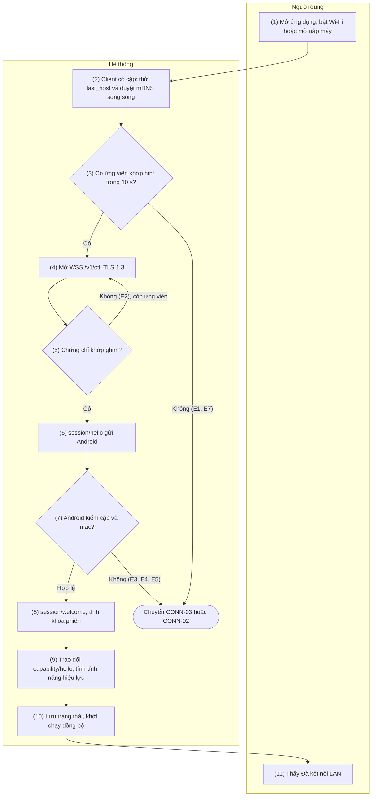
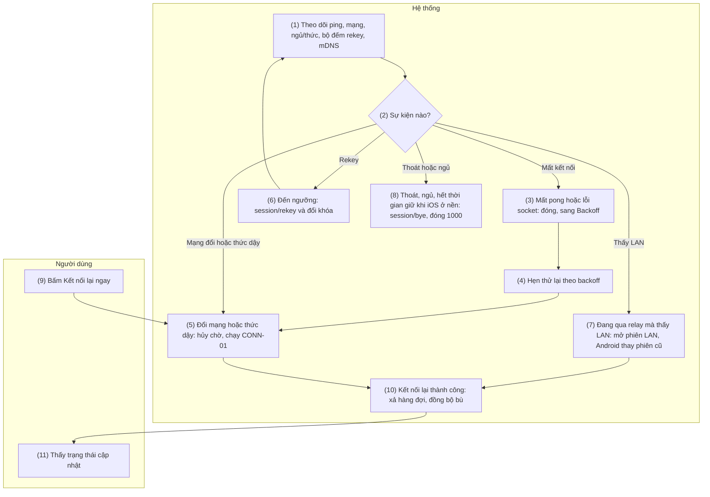
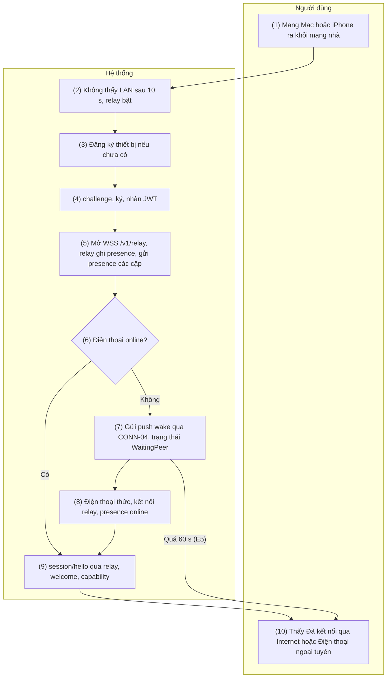
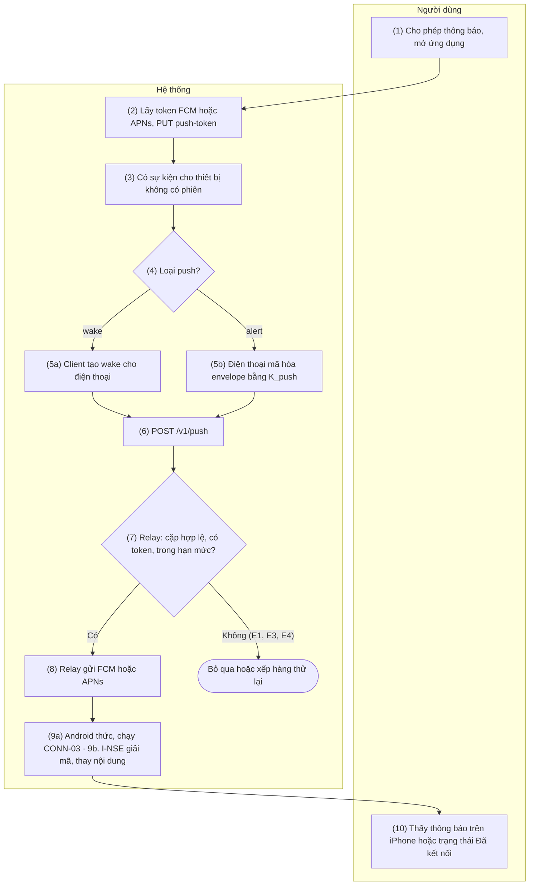
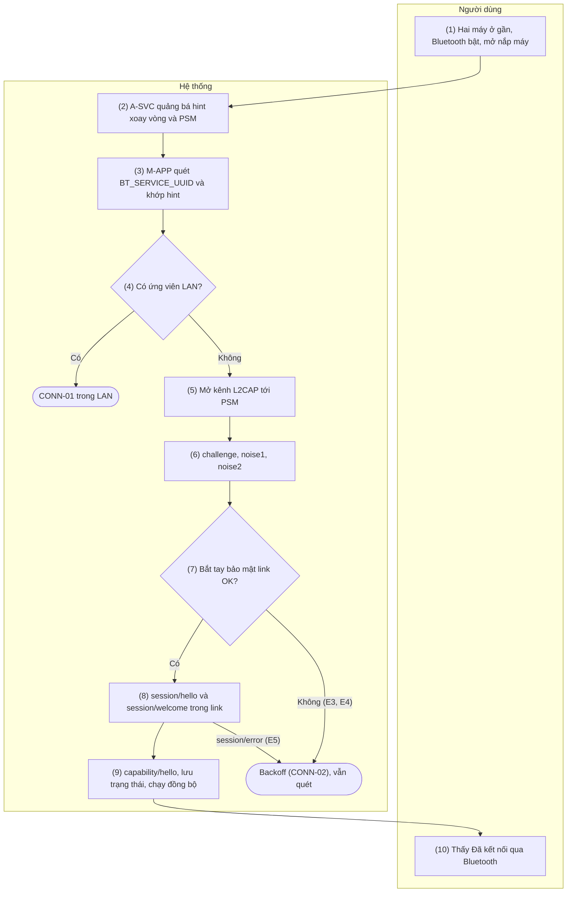
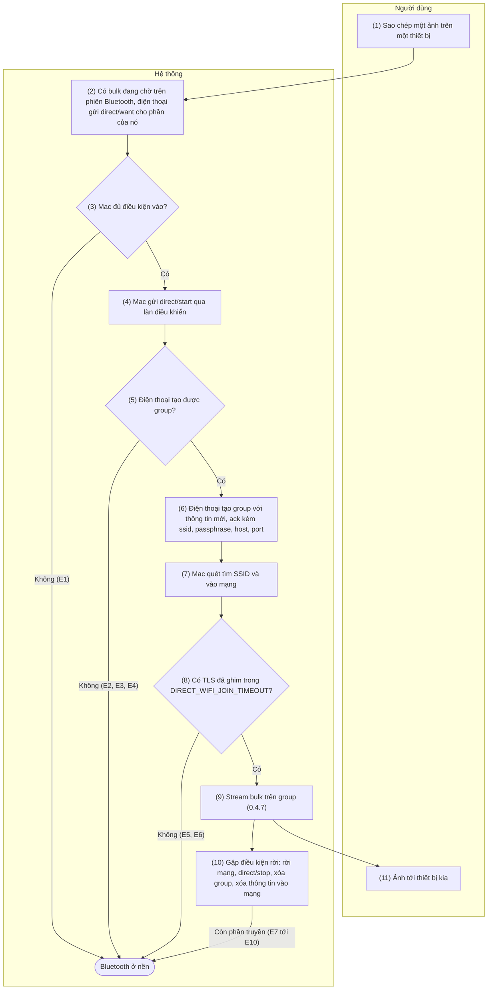

[English](03-connectivity.md) | Tiếng Việt

# 3. Nhóm chức năng: Kết nối

> Tham chiếu chung: [`00-common-specs.md`](00-common-specs.vi.md) — kênh truyền (0.4), khung tin (0.5),
> bắt tay phiên (0.6.3), xác thực relay (0.6.4), danh mục loại tin (0.7), mã lỗi (0.8), lược đồ
> (0.9), hằng số (0.10), máy trạng thái client (0.11).

## 3.1 CONN-01 — Tự khám phá và kết nối trong mạng LAN

### 3.1.1 Thông tin chung

| Mục | Nội dung |
|-----|----------|
| Tên | CONN-01 — Tự khám phá và kết nối trong mạng LAN |
| Mô tả | Client (Mac/iOS) tự tìm điện thoại đã ghép trong LAN, mở kênh `/v1/ctl` qua TLS có ghim chứng chỉ, bắt tay phiên theo 0.6.3, trao đổi capability để xác định tính năng hiệu lực, rồi khởi chạy các đồng bộ phụ thuộc (SMS-01, CALL-04, gửi clipboard mới nhất).<br>Chạy tự động khi ứng dụng khởi động, khi có mạng mới, khi Mac thức dậy, khi iOS quay lại foreground mà không còn phiên (phiên được giữ qua thời gian giữ ở nền của CONN-02 E3 thì tiếp tục), ngay sau PAIR-01 và mỗi lần CONN-02 thử kết nối lại. |
| Tác nhân | Chính: Hệ thống (M-APP / I-APP, A-SVC). Người dùng tác động gián tiếp (mở ứng dụng, bật WiFi, mở nắp máy) hoặc bấm "Kết nối lại ngay". |
| Điều kiện trước | 1. Có một cặp hiệu lực (PAIR-01).<br>2. A-SVC đang chạy dưới dạng foreground service.<br>3. Hai thiết bị cùng LAN và mạng cho phép multicast mDNS.<br>4. Client đã được cấp quyền mạng cục bộ (iOS 14+, macOS 15+) theo SET-03. |
| Điều kiện sau | **Thành công:** trạng thái `Connected` (LAN); khóa phiên sẵn sàng; capability của đối phương lưu vào `features_json`; `last_seen_at`, `last_host`, `last_port` cập nhật; tính năng hiệu lực được bật; thông báo foreground service trên Android ghi "Đã kết nối với <tên>".<br>**Thất bại:** chuyển CONN-03 sau `LAN_DISCOVERY_GRACE` (nếu relay bật) hoặc sang `Backoff` (CONN-02). |
| Ngoại lệ | E1 — Không thấy instance có hint khớp trong 10 s → CONN-03 (relay bật) hoặc tiếp tục duyệt.<br>E2 — `TLS_PIN_MISMATCH`: bỏ instance này (có thể là thiết bị khác hoặc giả mạo), thử instance kế tiếp; mọi instance của cặp đều lệch ghim (điện thoại đã sinh lại khóa TLS, 0.6.1) → dừng thử, hiển thị "Cần ghép nối lại" (PAIR-02).<br>E3 — `session/error AUTH_FAILED` → báo "Không xác thực được điện thoại", backoff dài 5 phút, không thử liên tục.<br>E4 — `PAIR_UNKNOWN` hoặc `PAIR_REVOKED` (4403) trước khi điện thoại được xác thực: trên route có `phoneAuthenticatedByTLS` đúng (LAN, USB: TLS ghim tới điện thoại) → dọn cặp theo PAIR-03 luồng B, yêu cầu ghép nối lại. Trên route có thuộc tính sai (relay, Bluetooth), cùng các mã này chỉ dẫn đến `Backoff` (0.11, CONN-03 E9, CONN-05 E5).<br>E5 — 4426 `UNSUPPORTED_VERSION` → nhắc cập nhật ứng dụng ở thiết bị cũ hơn.<br>E6 — Bắt tay quá 5 s (4408) → CONN-02 backoff.<br>E7 — Mạng cách ly client (Wi-Fi khách, mDNS bị chặn) → như E1.<br>E8 — Quyền mạng cục bộ bị từ chối → báo và mở hướng dẫn SET-03. |
| Yêu cầu đặc biệt | **Hiệu năng:** kết nối lại < 3 s khi đã biết `last_host` (chỉ số thành công của dự án); bắt tay ≤ 300 ms trong LAN.<br>**Bảo mật:** chỉ TLS 1.3; ghim SHA-256 chứng chỉ, không kiểm hostname; TXT mDNS không chứa định danh tĩnh (0.4.1).<br>**Nền tảng:** iOS/macOS khai báo `NSLocalNetworkUsageDescription` và `NSBonjourServices = ["_handlive._tcp"]`; Android chạy A-SVC type `connectedDevice` (quyền `FOREGROUND_SERVICE_CONNECTED_DEVICE` + `CHANGE_NETWORK_STATE`) với thông báo thường trực.<br>**Độc lập tính năng:** capability quyết định từng tính năng; một tính năng thiếu quyền không chặn các tính năng khác. |

### 3.1.2 Màn hình

N/A — chưa có wireframe được duyệt.

### 3.1.3 Mô tả chi tiết các thành phần

| # | Trường | Kiểu dữ liệu | Input/Output | Giá trị khởi tạo | Mô tả |
|---|--------|--------------|--------------|------------------|-------|
| 1 | Biểu tượng trạng thái (menu bar Mac / tab iOS) | enum{connected\| connecting\| peer_offline\| disconnected} | Output | `connecting` | Ánh xạ từ máy trạng thái 0.11. Mac: biểu tượng template trên thanh menu (`MenuBarExtra`, `.menuBarExtraStyle(.menu)`) — bấm vào mở menu, không popover |
| 2 | Dòng trạng thái | string | Output | "Đang kết nối…" | "Đã kết nối qua Wi-Fi với <tên điện thoại>" |
| 3 | Tên điện thoại | string(64) | Output | `peer_name` |  |
| 4 | Thông báo lỗi kết nối | string | Output | Rỗng | Theo E3–E8 |
| 5 | Nút "Kết nối lại ngay" | action | Input | Ẩn khi đã kết nối | Bỏ qua thời gian chờ backoff, chạy lại từ bước 2 |
| 6 | Thông báo foreground service (Android) | string | Output | "Đang chờ kết nối" | "Đã kết nối với <tên client>"; nhiều client: "Đã kết nối với 2 thiết bị" |
| 7 | Tính năng hiệu lực | array\<string> | Output | Rỗng | Hiển thị trong PAIR-02; cập nhật sau bước 9 |

### 3.1.4 Luồng nghiệp vụ



| Bước | Tác nhân | Thành phần | Mô tả | Ngoại lệ / Ghi chú |
|------|----------|-----------|-------|--------------------|
| 1 | Người dùng | M-APP / I-APP | Mở ứng dụng, bật Wi-Fi, mở nắp Mac, đưa ứng dụng iOS lên foreground; hoặc bấm "Kết nối lại ngay". | Luồng cũng tự chạy sau PAIR-01 và từ CONN-02. |
| 2 | Hệ thống | M-APP / I-APP | Đọc cặp hiệu lực và nạp `PRK` (bộ nhớ đệm hoặc Keychain). Song song: (a) thử ngay `last_host:last_port` (đường nhanh); (b) chạy `NWBrowser` cho `_handlive._tcp` với TXT. | Chưa có quyền mạng cục bộ → E8. |
| 3 | Hệ thống | M-APP / I-APP | Tính hint cho giờ trước, giờ hiện tại và giờ sau (0.4.1); instance có TXT `h` chứa một trong ba hint là ứng viên. Đường nhanh (a) cũng là ứng viên. | Hết 10 s không có ứng viên → E1. |
| 4 | Hệ thống | M-APP / I-APP → A-SVC | Mở `wss://<host>:<port>/v1/ctl`, TLS 1.3. A-SVC nhận kết nối, bắt đầu đếm `HANDSHAKE_TIMEOUT`. |  |
| 5 | Hệ thống | M-APP / I-APP | So SHA-256 chứng chỉ máy chủ với `peer_tls_sha256`. | Khác → đóng, E2. |
| 6 | Hệ thống | M-APP / I-APP | Sinh khóa tạm X25519 và `nonce`, gửi `session/hello`. |  |
| 7 | Hệ thống | A-SVC | Kiểm `pair_id` tồn tại, chưa thu hồi, `device_id` đúng đối phương, `mac` đúng (hằng thời gian), phiên bản giao thức.<br>Nếu cặp đang có phiên khác: phiên cũ nhận `session/bye {reason: replaced}` và đóng 4409 sau khi phiên mới xác nhận được khóa (A-SVC giải mã được `capability/hello` đầu tiên của phiên mới; một `hello` phát lại chỉ nhận được `welcome`, không bao giờ đá được phiên thật). | Sai → `session/error` + đóng 4401/4403/4426 (E3, E4, E5). |
| 8 | Hệ thống | A-SVC → M-APP / I-APP | Android gửi `session/welcome`; client kiểm `mac`. Hai bên tính `k_c2s`, `k_s2c`. | Client kiểm sai → đóng 4401, E3. |
| 9 | Hệ thống | Hai bên | Mỗi bên gửi envelope mã hóa đầu tiên `capability/hello` (0.7.2). Tính năng hiệu lực = bật ở hai bên và Android đủ quyền; lưu `features_json`. |  |
| 10 | Hệ thống | Hai bên | Cập nhật `last_seen_at`, `last_host`, `last_port`; phát trạng thái `Connected`; Android cập nhật thông báo foreground service và hint.<br>Khởi chạy: SMS-01 (sms hiệu lực), CALL-04 (call hiệu lực), gửi clip mới nhất nếu tạo trong `CLIP_STALE_AFTER` (CLIP-01/02), xả `sms_outbox` (SMS-04). | Mỗi tác vụ chạy độc lập; lỗi một tác vụ không ảnh hưởng tác vụ khác. |
| 11 | Người dùng | M-APP / I-APP, A-UI | Thấy "Đã kết nối qua Wi-Fi" trên client và thông báo trên Android. |  |

### 3.1.5 Đặc tả API/service

**Danh sách lời gọi**

| # | API/service | Kênh | Chiều | Dùng ở bước |
|---|-------------|------|-------|-------------|
| 1 | Quảng bá mDNS `NsdManager.registerService` | Multicast LAN | Android | Nền (trước bước 2), 10 |
| 2 | Duyệt mDNS `NWBrowser` (`.bonjourWithTXTRecord`) | Multicast LAN | Client | 2, 3 |
| 3 | Mở kết nối `wss://…/v1/ctl` (TLS 1.3, ghim) | TCP LAN | C→S | 4, 5 |
| 4 | `WS session/hello` | `/v1/ctl` | C→S | 6, 7 |
| 5 | `WS session/welcome` | `/v1/ctl` | S→C | 8 |
| 6 | `WS session/error` | `/v1/ctl` | S→C | 7 |
| 7 | `WS capability/hello` | `/v1/ctl` | Hai chiều | 9 |

#### API 1 — Quảng bá mDNS (Android)

- **URL:** N/A (mDNS multicast `224.0.0.251:5353`, `ff02::fb`)
- **Method:** `NsdManager.registerService(NsdServiceInfo, NsdManager.PROTOCOL_DNS_SD, listener)`
- **Request:**

| Thuộc tính | Giá trị | Mô tả |
|-----------|---------|-------|
| `serviceType` | `_handlive._tcp` |  |
| `serviceName` | `HL-<6 hex ngẫu nhiên>` | Đổi mỗi lần A-SVC khởi động |
| `port` | Cổng thực của A-SVC (47800–47809) |  |
| TXT `v` | `1` |  |
| TXT `h` | Danh sách hint (0.4.1) | Tính lại mỗi giờ tròn và khi thêm/bớt cặp |

- **Response:** callback `onServiceRegistered` (tên cuối cùng có thể bị hệ thống đổi nếu trùng) hoặc
  `onRegistrationFailed(errorCode)`.
- **Ví dụ:** `HL-4f9a2c._handlive._tcp.local.` SRV → `192.168.1.23:47800`, TXT `v=1`, `h=1a2b3c4d`
- **Logic nghiệp vụ:**
  1. Muốn đổi TXT thì hủy đăng ký rồi đăng ký lại (NsdManager không cập nhật TXT tại chỗ); A-SVC gom
     thay đổi, tối đa 1 lần/giây.
  2. Đăng ký thất bại → thử lại sau 5 s, 30 s, rồi mỗi 5 phút; trong lúc đó client vẫn tới được qua
     `last_host`.
  3. Khi không còn cặp nào: bỏ khóa `h`, vẫn quảng bá `v` (phục vụ ghép nối).

#### API 2 — Duyệt mDNS (Mac/iOS)

- **URL:** N/A (mDNS)
- **Method:**
  `NWBrowser(for: .bonjourWithTXTRecord(type: "_handlive._tcp", domain: nil), using: .tcp)`
- **Request:** không có tham số ngoài kiểu dịch vụ.
- **Response:** tập `NWBrowser.Result` với `endpoint` (`.service(name:type:domain:interface:)`) và
  `metadata` (`.bonjour(NWTXTRecord)`).
- **Ví dụ:** kết quả `HL-4f9a2c` với TXT `["v": "1", "h": "1a2b3c4d,77e0aa19"]`.
- **Logic nghiệp vụ:**
  1. Chỉ xét kết quả có `v = 1` và `h` chứa hint của cặp (giờ trước, giờ hiện tại hoặc giờ sau).
  2. Kết nối tới endpoint dịch vụ (Network framework tự phân giải); sau khi kết nối thành công, lấy
     địa chỉ IP thực từ `currentPath.remoteEndpoint` để lưu `last_host`.
  3. Browser tiếp tục chạy khi đã kết nối qua relay, để phát hiện LAN và nâng cấp (CONN-02).

#### API 3 — Mở kết nối `/v1/ctl`

- **URL:** `wss://{android_host}:{port}/v1/ctl`
- **Method:** WebSocket upgrade (HTTP/1.1 `GET` + `Upgrade: websocket`) trên TLS 1.3.
- **Request:** header chuẩn WebSocket; không có header xác thực (xác thực nằm ở bắt tay phiên).
  Client: Network.framework (`NWConnection` với `NWProtocolWebSocket`, TLS 1.3 tối thiểu), khối kiểm của TLS so chứng chỉ với ghim. Instance Bonjour được giải ra IPv4 bằng một kết nối TCP ngắn trước kết nối WSS, nên điện thoại thấy thêm một kết nối đóng trước TLS. Đường nhanh `last_host` lỗi (địa chỉ cũ, lệch ghim) thì bỏ im lặng; chỉ instance mDNS có hint khớp mới dẫn tới `Backoff` hoặc "Cần ghép nối lại".
- **Response:** `101 Switching Protocols`. Android từ chối đường dẫn khác bằng `404`.
- **Ví dụ:** `GET /v1/ctl HTTP/1.1` · `Host: 192.168.1.23:47800` · `Upgrade: websocket` ·
  `Sec-WebSocket-Version: 13`
- **Logic nghiệp vụ:**
  1. Delegate TLS: lấy chứng chỉ lá từ `SecTrust`, tính SHA-256 trên DER, so với `peer_tls_sha256`;
     khớp → `.useCredential`, khác → `.cancelAuthenticationChallenge` (E2).
  2. A-SVC giới hạn 16 kết nối `/v1/ctl` chưa bắt tay cùng lúc, trong đó tối đa 4 từ cùng một IP
     (`CTL_PREAUTH_LIMIT`), và đóng kết nối không gửi `session/hello` trong 5 s (chống cạn tài
     nguyên); kết nối vượt một trong hai giới hạn bị đóng 4429 `RATE_LIMITED`, kết nối im lặng bị
     đóng 4408.

#### API 4 — `WS session/hello`

- **URL:** `wss://{android_host}:{port}/v1/ctl` (qua relay: CONN-03)
- **Method:** `WS session/hello` (C→S), payload chưa mã hóa (0.5.1), phản hồi `session/welcome` hoặc
  `session/error`.
- **Request (`data`):**

| Trường | Kiểu | Bắt buộc | Mô tả |
|--------|------|----------|-------|
| `protocol` | int32 | Có | `1` |
| `pair_id` | uuid | Có |  |
| `device_id` | uuid | Có | `device_id` của client |
| `eph` | b64u (32 byte) | Có | Khóa công khai X25519 tạm của phiên |
| `nonce` | b64u (32 byte) | Có |  |
| `mac` | b64u (32 byte) | Có | HMAC-SHA256(`K_auth`, `T1`) theo 0.6.3 |

- **Response:** API 5 hoặc API 6.
- **Ví dụ:**

```json
{"v":1,"type":"session","id":"0192f400-11aa-7b2c-9d3e-4f5a6b7c8d9e","ts":1727151000000,"payload":"eyJvcCI6ImhlbGxvIiwiZGF0YSI6eyJwcm90b2NvbCI6MSwicGFpcl9pZCI6IjNmMmIxYzRkLTVlNmYtNGE3Yi04YzlkLTBlMWYyYTNiNGM1ZCIsImRldmljZV9pZCI6IjViMWY4YzJlLTlhNGQtOGU2Zi1hMWIyLWMzZDRlNWY2MDcxOCIsImVwaCI6Ii4uLiIsIm5vbmNlIjoiLi4uIiwibWFjIjoiLi4uIn19"}
```

Payload sau khi giải base64:
`{"op":"hello","data":{"protocol":1,"pair_id":"3f2b1c4d-5e6f-4a7b-8c9d-0e1f2a3b4c5d","device_id":"5b1f8c2e-9a4d-8e6f-a1b2-c3d4e5f60718","eph":"…","nonce":"…","mac":"…"}}`

- **Logic nghiệp vụ:**
  1. Thứ tự kiểm ở A-SVC: `protocol` (khác major → 4426) → cặp tồn tại (không → `PAIR_UNKNOWN`,
     4401) → chưa thu hồi (4403) → `device_id` khớp → `mac`.
  2. Sai `mac` 5 lần/phút từ cùng địa chỉ IP (tính mọi `session/hello` bị từ chối với `AUTH_FAILED`: sai `mac`, sai `device_id`, khóa tạm bậc thấp; không tính `PAIR_UNKNOWN`, `PAIR_REVOKED`) → chặn IP đó 5 phút (kết nối từ IP bị chặn đóng 4429
     `RATE_LIMITED` ngay sau TLS). Quy tắc này giữ nguyên. Bên cạnh đó (`CTL_IP_BLOCK`): bắt tay quá
     giờ (4408), `PAIR_UNKNOWN` và `BAD_REQUEST` trước bắt tay cũng được tính — 10 lần trong 5 phút từ
     cùng một IP thì chặn IP đó 5 phút (4429).
  3. Không lưu `nonce`; khóa tạm của Android sinh mới cho mỗi lần welcome nên hello bị phát lại
     không dẫn tới phiên dùng được.

#### API 5 — `WS session/welcome`

- **URL:** như API 4
- **Method:** `WS session/welcome` (S→C), payload chưa mã hóa.
- **Request (`data`):**

| Trường | Kiểu | Bắt buộc | Mô tả |
|--------|------|----------|-------|
| `device_id` | uuid | Có | `device_id` của Android |
| `eph` | b64u (32 byte) | Có | Khóa tạm X25519 của Android |
| `nonce` | b64u (32 byte) | Có |  |
| `mac` | b64u (32 byte) | Có | HMAC-SHA256(`K_auth`, `T2`) |

- **Response:** N/A (client gửi `capability/hello` đã mã hóa để xác nhận khóa).
- **Ví dụ:**
  `{"op":"welcome","data":{"device_id":"8c7d6e5f-4a3b-8c2d-9e1f-0a1b2c3d4e5f","eph":"…","nonce":"…","mac":"…"}}`
- **Logic nghiệp vụ:**
  1. Android tính khóa phiên ngay sau khi gửi welcome và chờ envelope mã hóa đầu tiên; envelope đầu
     không giải mã được → đóng 4401.
  2. Client kiểm `mac` và `device_id` khớp `peer_device_id`; sai → đóng 4401.

#### API 6 — `WS session/error`

- **URL:** như API 4
- **Method:** `WS session/error` (S→C), payload chưa mã hóa; Android đóng kết nối ngay sau đó với mã
  tương ứng (0.8.3).
- **Request (`data`):** `code` —
  enum{AUTH_FAILED\|PAIR_UNKNOWN\|PAIR_REVOKED\|UNSUPPORTED_VERSION\|RATE_LIMITED}; `message` —
  string; `min_protocol` — int32 (bắt buộc khi `UNSUPPORTED_VERSION`, không có ở mã khác; client
  dùng để hiển thị "Cập nhật HandLive trên điện thoại" hoặc "Cập nhật HandLive trên máy này").
- **Response:** N/A.
- **Ví dụ:** `{"op":"error","data":{"code":"PAIR_UNKNOWN","message":"Device is not paired"}}`
- **Logic nghiệp vụ:** Client xử lý theo E3–E5; không tự động thử lại với `AUTH_FAILED` trước 5
  phút.

#### API 7 — `WS capability/hello`

- **URL:** như API 4
- **Method:** `WS capability/hello` (hai chiều), envelope mã hóa, không ack.
- **Request (`data`):** theo 0.7.2.
- **Response:** N/A (bên kia gửi capability của mình).
- **Ví dụ:** xem 0.7.2.
- **Logic nghiệp vụ:**
  1. Tính năng hiệu lực F = `features.F.enabled` của cả hai bên **và** Android không thiếu quyền cần
     cho F (bảng dưới).
  2. Tính năng chuyển từ hiệu lực sang không hiệu lực → dừng tác vụ của F (ví dụ hủy luồng camera)
     và thông báo người dùng một lần.
  3. `protocol` khác major đã bị chặn ở bắt tay; khác minor → dùng tập tính năng chung.

| Tính năng | Quyền Android cần (thiếu → không hiệu lực) |
|-----------|------------------------------------------|
| `clipboard` | Không (tự gửi cần Accessibility — chỉ ảnh hưởng `auto_send`) |
| `sms` | `READ_SMS` (tin mới phát hiện bằng `ContentObserver`, không cần `RECEIVE_SMS`); gửi thêm `SEND_SMS` (thiếu → `can_send = false`); danh sách SIM cần `READ_PHONE_STATE`; tên liên hệ cần `READ_CONTACTS` |
| `call` | `READ_PHONE_STATE`; trả lời/kết thúc thêm `ANSWER_PHONE_CALLS` (thiếu → `can_answer = can_end = false`); số gọi đến và nhật ký thêm `READ_CALL_LOG` (thiếu → `caller_id = false`) |
| `call_audio` | `BLUETOOTH_CONNECT`; đường Opus/WS thêm Shizuku đang chạy và Android 11+ (chỉ ảnh hưởng `opus_fallback`) |
| `camera` | `CAMERA`, `RECORD_AUDIO` |

#### Query

```sql
-- [Thiết kế] Mac/iOS, bước 2: cặp hiệu lực và địa chỉ đã biết
SELECT pair_id, peer_device_id, peer_name, peer_tls_sha256, last_host, last_port
FROM paired_device
WHERE revoked_at IS NULL
LIMIT 1;

-- [Thiết kế] Mac/iOS, bước 10
UPDATE paired_device
SET last_seen_at = :now, last_host = :host, last_port = :port, features_json = :features_json
WHERE pair_id = :pair_id;

-- [Thiết kế] Android, bước 7: kiểm cặp của session/hello
SELECT pair_id, peer_device_id, prk_enc, revoked_at
FROM paired_device
WHERE pair_id = :pair_id;

-- [Thiết kế] Android, bước 10
UPDATE paired_device
SET last_seen_at = :now, features_json = :features_json
WHERE pair_id = :pair_id;

-- [Thiết kế] Android, API 1: các cặp cần tính hint
SELECT pair_id, prk_enc
FROM paired_device
WHERE revoked_at IS NULL;
```

---

## 3.2 CONN-02 — Duy trì kết nối và tự kết nối lại

### 3.2.1 Thông tin chung

| Mục | Nội dung |
|-----|----------|
| Tên | CONN-02 — Duy trì kết nối và tự kết nối lại |
| Mô tả | Giữ phiên sống và tự phục hồi: ping WebSocket mỗi 15 s (qua relay thêm `ping` E2E mỗi 30 s), phát hiện mất kết nối, kết nối lại theo backoff, phản ứng ngay với sự kiện đổi mạng, ngủ/thức, foreground/background; rekey phiên sau 24 h hoặc 10 000 envelope; nâng cấp từ relay lên LAN khi thấy điện thoại trong LAN; đóng êm bằng `session/bye`.<br>Sau khi kết nối lại, xả hàng đợi và đồng bộ bù. |
| Tác nhân | Chính: Hệ thống (M-APP / I-APP, A-SVC). Người dùng có thể bấm "Kết nối lại ngay". |
| Điều kiện trước | Đã từng có phiên (`Connected`) hoặc đang ở `Backoff`/`Discovering`. |
| Điều kiện sau | Phiên được duy trì hoặc thiết lập lại; trạng thái hiển thị đúng thực tế trong ≤ 1 s sau khi phát hiện; `sms_outbox` còn `pending` được gửi lại; SMS-01 và CALL-04 chạy bù. |
| Ngoại lệ | E1 — Mất mạng hoàn toàn: phiên LAN và relay kết thúc; chuyển `Idle`, chờ `NWPathMonitor`/`NetworkCallback` báo có mạng, không backoff vô ích. Trên Mac khi còn dùng được Bluetooth, phiên Bluetooth vẫn giữ và client tiếp tục tìm qua Bluetooth thay vì về `Idle` (0.11, CONN-05).<br>E2 — Mac ngủ: gửi `session/bye {reason: shutdown}` nếu còn kịp; khi thức dậy chạy CONN-01 ngay.<br>E3 — iOS vào nền (`scenePhase` của ứng dụng thành `.background`; bỏ qua `.inactive`): I-APP giữ phiên thêm một khoảng ngắn thay vì đóng ngay. I-APP bắt đầu một tác vụ nền (`beginBackgroundTask`); iOS từ chối → `session/bye {reason: shutdown}` và đóng ngay. Nếu không, phiên vẫn mở (ping vẫn chạy) tới min(`IOS_BACKGROUND_GRACE`, thời gian nền iOS còn cho − 5 s), rồi `session/bye {reason: shutdown}`, đóng 1000 và kết thúc tác vụ.<br>Thời gian giữ là một bên giữ phiên; một thao tác từ thông báo (SMS-04 bước B2, CALL-02 bước B2) là một bên khác và vẫn dùng tác vụ nền riêng như hiện nay. I-APP chỉ gửi `bye` và đóng khi không còn bên nào giữ và ứng dụng không ở foreground. Khi iOS cho hết hạn tác vụ của thời gian giữ, thời gian giữ nhả phần của nó và kết thúc tác vụ ngay, không chờ; thao tác còn đang chạy vẫn giữ phiên bằng tác vụ của chính nó. Thao tác đến sau khi phiên đã đóng thì kết nối như trước (CONN-01 hoặc CONN-03).<br>Đóng và mở chạy lần lượt trên một hàng đợi (hủy hẹn giờ, hẹn giờ kích hoạt, `bye`, đóng, CONN-01). Quay lại foreground: chưa bắt đầu đóng → hủy hẹn giờ, kết thúc tác vụ, giữ phiên (không `bye`, không chạy lại CONN-01); đã gửi `bye` → chờ đóng xong rồi mới chạy CONN-01, nên client không bao giờ có hai phiên của cùng một cặp (không tự gây 4409).<br>Phiên rớt trong lúc giữ → nhả thời gian giữ ngay: hủy hẹn giờ, kết thúc tác vụ, không `bye`, không nối lại khi đang ở nền.<br>Trong lúc giữ: SMS hoặc cuộc gọi đến hiện thông báo người dùng nhận được qua push (CONN-04), đăng cục bộ, không có chuỗi mới, theo cùng luật nội dung như I-NSE (`sms.preview`, iPhone đang khóa, SMS-02 trường 2); `clipboard/push` chỉ được ghi khi `UIPasteboard.changeCount` vẫn bằng giá trị mốc, lấy lúc ứng dụng vào nền và dời theo mỗi lần HandLive ghi hoặc xóa trong thời gian giữ (CLIP-04 E2, CLIP-05); ghi thành công được nhớ là lần ghi của chính HandLive, ghi thất bại theo đường lỗi sẵn có (`ack` như hiện nay).<br>Sau thời gian giữ, khi bị treo, tin đến qua push (CONN-04).<br>E4 — Rekey không nhận `ack` trong 10 s → đóng phiên, kết nối lại (bắt tay mới sinh khóa mới).<br>E5 — `DECRYPT_FAILED` → đóng 4400, kết nối lại.<br>E6 — Hệ điều hành dừng A-SVC (OEM tắt nền) → client thấy mất kết nối; A-SVC `START_STICKY` tự khởi động lại; SET-01 đã xin miễn tối ưu pin.<br>E7 — Đóng 4409 (bị thay bởi kết nối mới của chính client; qua relay: `session/bye {reason: replaced}`, API 4) → không kết nối lại từ phiên cũ. |
| Yêu cầu đặc biệt | **Hiệu năng:** kết nối lại < 3 s sau khi mạng trở lại; phát hiện mất kết nối ≤ 25 s (15 s ping + 10 s chờ pong).<br>**Pin:** client chủ động ping, Android chỉ trả pong và đóng kết nối im lặng quá 45 s; Android không giữ relay khi rảnh quá 5 phút.<br>**Backoff:** 0,5 → 1 → 2 → 4 → 8 → 16 → 30 s, jitter ±20 %, về đầu khi một phiên đã giữ kết nối được 30 s (`RECONNECT_BACKOFF`, 0.10). |

### 3.2.2 Màn hình

N/A — chưa có wireframe được duyệt.

### 3.2.3 Mô tả chi tiết các thành phần

| # | Trường | Kiểu dữ liệu | Input/Output | Giá trị khởi tạo | Mô tả |
|---|--------|--------------|--------------|------------------|-------|
| 1 | Trạng thái kết nối | enum{connected\| connecting\| peer_offline\| disconnected} | Output | Giá trị hiện tại | Như CONN-01 trường 1 |
| 2 | Kênh | enum{lan\| relay\| usb} | Output | Kênh hiện tại | Đổi khi nâng cấp relay → LAN |
| 3 | Thời gian thử lại tiếp theo | int32 (giây) | Output | Rỗng | "Thử lại sau 8 s" khi ở `Backoff` |
| 4 | Nút "Kết nối lại ngay" | action | Input | Hiện khi `disconnected` | Hủy chờ backoff, chạy CONN-01 |
| 5 | Số tin chờ gửi | int32 | Output | Số dòng `sms_outbox` đang `pending` | "2 tin đang chờ điện thoại" |

### 3.2.4 Luồng nghiệp vụ



| Bước | Tác nhân | Thành phần | Mô tả | Ngoại lệ / Ghi chú |
|------|----------|-----------|-------|--------------------|
| 1 | Hệ thống | M-APP / I-APP, A-SVC | Client gửi WS ping mỗi 15 s; qua relay thêm envelope `ping/ping` mỗi 30 s (ping WS chỉ kiểm chặng tới relay).<br>Theo dõi `NWPathMonitor`, `NSWorkspace.willSleepNotification`/`didWakeNotification` (Mac), `scenePhase` (iOS).<br>Android theo dõi `ConnectivityManager.registerDefaultNetworkCallback`, đếm thời gian im lặng của từng phiên.<br>Hai bên đếm envelope đã gửi và tuổi phiên. |  |
| 2 | Hệ thống | như trên | Phân loại sự kiện. |  |
| 3 | Hệ thống | M-APP / I-APP | Không nhận pong trong 10 s, hoặc socket lỗi, hoặc `ping/ping` không có `ack` 10 s → đóng phiên, trạng thái `Backoff`. Android: phiên im lặng quá 45 s → đóng 4411 `IDLE_TIMEOUT`. | E5, E6. |
| 4 | Hệ thống | M-APP / I-APP | Chờ theo bảng backoff (có jitter). Không có mạng → `Idle`, chờ sự kiện mạng. | E1. |
| 5 | Hệ thống | M-APP / I-APP | Hủy chờ, chạy CONN-01 (LAN trước, rồi CONN-03 sau 10 s). |  |
| 6 | Hệ thống | Bên đạt ngưỡng trước | Gửi `session/rekey`; bên nhận trả `ack` kèm khóa tạm của mình, đổi khóa; bên gửi đổi khóa sau khi nhận `ack`. Giữ khóa cũ 30 s cho envelope đang bay. | Không có `ack` → E4. |
| 7 | Hệ thống | M-APP / I-APP → A-SVC | Đang dùng relay mà mDNS thấy hint khớp → mở phiên LAN mới theo CONN-01 bước 4–9. A-SVC gửi `session/bye {reason: replaced}` trên phiên relay rồi kết thúc phiên đó (phiên qua relay không có mã đóng, API 4). | E7 với phiên cũ. |
| 8 | Hệ thống | M-APP / I-APP | Người dùng thoát ứng dụng, Mac sắp ngủ, hoặc hết thời gian giữ khi iOS ở nền (`IOS_BACKGROUND_GRACE`, E3) → gửi `session/bye` và đóng 1000. iOS quay lại foreground trong lúc giữ → giữ phiên, không `bye`. | E2, E3. |
| 9 | Người dùng | M-APP / I-APP | Bấm "Kết nối lại ngay". |  |
| 10 | Hệ thống | M-APP / I-APP, A-SVC | Khi `Connected` trở lại: gửi lại `sms_outbox` còn `pending` theo thứ tự tạo (SMS-04), chạy SMS-01 và CALL-04 với con trỏ đã lưu. |  |
| 11 | Người dùng | M-APP / I-APP | Thấy trạng thái và số tin chờ gửi cập nhật. |  |

### 3.2.5 Đặc tả API/service

**Danh sách lời gọi**

| # | API/service | Kênh | Chiều | Dùng ở bước |
|---|-------------|------|-------|-------------|
| 1 | WS ping/pong (khung điều khiển RFC 6455) | `/v1/ctl` hoặc `/v1/relay` | C→S | 1, 3 |
| 2 | `WS ping/ping` | `/v1/ctl` qua relay | C→S | 1, 3 |
| 3 | `WS session/rekey` | `/v1/ctl` | Hai chiều | 6 |
| 4 | `WS session/bye` | `/v1/ctl` | Hai chiều | 7, 8 |
| 5 | Dịch vụ hệ điều hành: `NWPathMonitor`, `NSWorkspace` sleep/wake, `scenePhase`, `ConnectivityManager.NetworkCallback`, ping WebSocket của Network.framework | Cục bộ | — | 1, 4, 5, 8 |

#### API 1 — WS ping/pong

- **URL:** kết nối hiện tại
- **Method:** khung điều khiển WebSocket `0x9` (ping) / `0xA` (pong).
- **Request:** payload ping 8 byte = bộ đếm uint64 BE.
- **Response:** pong cùng payload (Ktor và Network.framework tự trả).
- **Ví dụ:** ping `00 00 00 00 00 00 00 2A` → pong `00 00 00 00 00 00 00 2A`.
- **Logic nghiệp vụ:** Mac/iOS gửi ping WebSocket của Network.framework (`NWProtocolWebSocket`, metadata `.ping` kèm pong handler) với bộ hẹn 10 s; pong không về đúng hạn → coi như mất kết nối. Ngay khi mạng mặc định đổi, gửi thêm một ping với hạn 2 s để phát hiện socket chết trong khoảng 2 s (mục tiêu kết nối lại < 3 s).

#### API 2 — `WS ping/ping`

- **URL:** `wss://{RELAY_HOST}/v1/relay` với lớp bọc `to`/`from` (chỉ dùng khi phiên đi qua relay)
- **Method:** `WS ping/ping` (C→S), envelope mã hóa, có ack.
- **Request (`data`):** `seq` — int64, tăng dần.
- **Response (`ack.data`):** `seq` — int64 (lặp lại), `server_ts` — timestamp của Android.
- **Ví dụ:** `{"op":"ping","data":{"seq":42}}` →
  `{"re":"0192f4a0-…","ok":true,"data":{"seq":42,"server_ts":1727151030000}}`
- **Logic nghiệp vụ:** Đo RTT đầu-cuối (hiển thị trong chẩn đoán); 1 lần không có `ack` trong 10 s →
  mất kết nối.

#### API 3 — `WS session/rekey`

- **URL:** `/v1/ctl` (LAN, USB hoặc relay)
- **Method:** `WS session/rekey` (hai chiều), envelope mã hóa bằng khóa hiện tại, có ack.
- **Request (`data`):**

| Trường | Kiểu | Bắt buộc | Mô tả |
|--------|------|----------|-------|
| `epoch` | int32 | Có | Thế hệ khóa mới (hiện tại + 1) |
| `eph` | b64u (32 byte) | Có | Khóa tạm X25519 mới |
| `nonce` | b64u (32 byte) | Có |  |

- **Response (`ack.data`):** `{epoch, eph, nonce}` của bên nhận.
- **Ví dụ:** `{"op":"rekey","data":{"epoch":1,"eph":"…","nonce":"…"}}` →
  `{"re":"…","ok":true,"data":{"epoch":1,"eph":"…","nonce":"…"}}`
- **Logic nghiệp vụ:**
  1. Khóa mới theo 0.6.3 bước 6; thiết bị dẫn xuất lại cả `k_c2s` và `k_s2c`.
  2. Hai bên cùng khởi tạo rekey một lúc → bên có `device_id` nhỏ hơn thắng, bên kia hủy yêu cầu của
     mình và trả `ack`; bên thắng bỏ qua yêu cầu của bên thua, không trả `ack`. Rekey thất bại
     (không `ack` trong 10 s, `ack` lỗi, dữ liệu sai) → đóng 4410 `REKEY_FAILED` rồi kết nối lại
     (E4).
  3. Envelope mã hóa bằng khóa cũ đến trong 30 s sau khi đổi vẫn được giải mã; sau đó →
     `DECRYPT_FAILED`.
  4. Chống trùng (`DEDUP_WINDOW`, 0.5.1 quy tắc 2) bao trọn thế hệ khóa, theo từng chiều: tập `id`
     đã nhận bắt đầu rỗng với khóa mới; tập của thế hệ trước được giữ chừng nào khóa của nó còn được
     nhận (30 s), rồi bỏ. Chỉ ghi envelope đã giải mã được. Phiên qua relay và phiên LAN xử lý như
     nhau.

#### API 4 — `WS session/bye`

Đặc tả như PAIR-03 API 2. Trong nhóm này `reason` dùng `shutdown` (thoát, ngủ, hết thời gian giữ khi iOS ở nền của E3),
`replaced` (Android thay phiên cũ bằng phiên mới của cùng cặp), `update` (sắp cập nhật ứng dụng).

Phiên đi qua relay không có lệnh đóng WebSocket giữa hai bên: liên kết `/v1/relay` còn mang các phiên
khác nên vẫn mở, và không mã đóng nào (4409, 4410, 4411, …) đến được đối phương. Vì vậy thiết bị luôn
gửi `session/bye` trước khi kết thúc một phiên qua relay: `revoked`, `replaced` hoặc `update` như đã
định nghĩa, `shutdown` cho mọi trường hợp kết thúc khác (thoát, ngủ, hết thời gian giữ khi iOS ở nền, tắt relay, và các
trường hợp đóng một phiên LAN đã thiết lập bằng 4400, 4410, 4411 hoặc 4500). Bên nhận kết thúc phiên
khi nhận `session/bye`: `replaced` tính như 4409 (E7), lý do khác tính như 1000. Ngoại lệ duy nhất:
khi đối phương mở phiên mới bằng `session/hello` qua relay, thiết bị kết thúc phiên cũ ngay mà không
gửi `session/bye`. Đối phương đã bỏ khóa cũ nên không mở được tin đó.

#### Query

```sql
-- [Thiết kế] Mac/iOS, bước 10: tin SMS chờ gửi lại
SELECT local_id, pair_id, thread_id, addresses_json, body, sub_id, attempts
FROM sms_outbox
WHERE pair_id = :pair_id AND state = 'pending'
ORDER BY created_at ASC;

-- [Thiết kế] Mac/iOS, trường 5: đếm tin chờ gửi
SELECT COUNT(*) FROM sms_outbox WHERE pair_id = :pair_id AND state = 'pending';

-- [Thiết kế] Mac/iOS, bước 10: con trỏ đồng bộ đã lưu
SELECT stream, cursor FROM sync_cursor WHERE pair_id = :pair_id;
```

---

## 3.3 CONN-03 — Kết nối qua relay khi ngoài LAN

### 3.3.1 Thông tin chung

| Mục | Nội dung |
|-----|----------|
| Tên | CONN-03 — Kết nối qua relay khi ngoài LAN |
| Mô tả | Khi client không thấy điện thoại trong LAN sau `LAN_DISCOVERY_GRACE` (10 s) hoặc mạng chặn mDNS, và `relay.enabled = true` ở cả hai bên, client kết nối relay: đăng ký thiết bị (một lần), xác thực challenge–chữ ký lấy JWT, mở WSS `/v1/relay`, nhận presence.<br>Khi điện thoại online, client bắt tay phiên và trao đổi capability qua relay y như LAN; nội dung vẫn mã hóa đầu-cuối.<br>Điện thoại không giữ relay thường trực: nó chỉ kết nối khi có một nhu cầu ở bước 2 (trong đó có push đánh thức, CONN-04) và tự ngắt sau 5 phút rảnh.<br>Camera không đi qua relay. |
| Tác nhân | Chính: Hệ thống (M-APP / I-APP, A-SVC, R-API, R-KV, R-DB). |
| Điều kiện trước | 1. Có cặp hiệu lực, đã đăng ký relay hoặc đăng ký được ngay (PAIR-01 API 8). 2. `relay.enabled = true` ở cả hai thiết bị. 3. Có Internet. |
| Điều kiện sau | **Thành công:** phiên E2E qua relay, trạng thái "Đã kết nối qua Internet"; các tính năng dữ liệu hoạt động như LAN (trừ camera và âm thanh cuộc gọi — cần ở gần).<br>**Điện thoại offline:** trạng thái `WaitingPeer` ("Điện thoại ngoại tuyến"), đã gửi push đánh thức. |
| Ngoại lệ | E1 — Relay không phản hồi hoặc 5xx → backoff (CONN-02).<br>E2 — 401 `SIGNATURE_INVALID` hoặc 404 `DEVICE_NOT_FOUND` → đăng ký lại thiết bị rồi thử lại một lần.<br>E3 — 410 `DEVICE_REVOKED` → báo "Thiết bị đã bị xóa khỏi dịch vụ Internet", tắt relay cho tới khi người dùng bật lại (đăng ký mới).<br>E4 — `relay.error NOT_PAIRED` khi gửi → gọi `GET /v1/pairs`: đã thu hồi → PAIR-03 luồng B; chưa đăng ký → `POST /v1/pairs` rồi thử lại.<br>E5 — Điện thoại không online trong 60 s sau push → giữ `WaitingPeer`; không push lại quá 1 lần/5 phút.<br>E6 — 429 `RATE_LIMITED` → chờ `Retry-After`; trường 4: "Quá nhiều yêu cầu. Thử lại sau {duration}." (`{duration}` là thời gian chờ `Retry-After` còn lại, định dạng bằng formatter của hệ thống).<br>E7 — Chứng chỉ relay không khớp ghim, trên mọi thiết bị (kể cả Android) → không kết nối; trường 4: "Chứng chỉ máy chủ không đáng tin cậy nên HandLive không kết nối qua Internet."<br>E8 — `relay.error NOT_CONNECTED` (đối phương vừa rời) → quay về `WaitingPeer`.<br>E9 — `session/error` `PAIR_UNKNOWN` hoặc `PAIR_REVOKED` qua relay, trước khi bước bắt tay xác thực được điện thoại → `Backoff`, không bao giờ hủy cặp: route relay có `phoneAuthenticatedByTLS` sai (0.11), vì bất kỳ ai trên đường relay cũng có thể giả mạo nó. Việc thu hồi chỉ được xử lý qua `pair_revoked` có chữ ký (PAIR-03 API 4), `GET /v1/pairs` (PAIR-02) hoặc qua route có `phoneAuthenticatedByTLS` đúng (CONN-01 E4). `UNSUPPORTED_VERSION` hoặc `AUTH_FAILED` trước xác thực qua relay vẫn hiện thông báo của nó (CONN-01 E3, E5) nhưng giữ lịch backoff bình thường thay vì dừng hoặc chờ 5 phút, để lỗi giả mạo không làm client đứng yên. Cùng quy tắc route này áp dụng cho Bluetooth (CONN-05 E5). |
| Yêu cầu đặc biệt | **Bảo mật:** relay chỉ thấy lớp bọc (`to`/`from`, `type`, kích thước, thời điểm); không có khóa E2E; JWT 15 phút; ghim SPKI ISRG Root X1/X2 + khóa dự phòng.<br>**Tài nguyên:** tối đa 2 MiB/s mỗi cặp mỗi chiều; envelope ≤ 256 KiB.<br>**Hiệu năng tham khảo:** SMS, thông báo cuộc gọi qua relay ≤ 1 s khi hai bên đã online.<br>**Vận hành:** relay stateless; presence và định tuyến giữa instance qua Redis; thống kê chỉ theo `device_hash`. |

### 3.3.2 Màn hình

N/A — chưa có wireframe được duyệt.

### 3.3.3 Mô tả chi tiết các thành phần

| # | Trường | Kiểu dữ liệu | Input/Output | Giá trị khởi tạo | Mô tả |
|---|--------|--------------|--------------|------------------|-------|
| 1 | Trạng thái kết nối | enum{connected\| connecting\| peer_offline\| disconnected} | Output | `connecting` | `peer_offline` hiển thị "Điện thoại ngoại tuyến" |
| 2 | Kênh | enum{lan\| relay\| usb} | Output | `relay` khi thành công | "Qua Internet" |
| 3 | Cho phép kết nối qua Internet | bool | Input/Output | `relay.enabled` = `true` | Quản lý ở SET-02, hiển thị ở đây để giải thích khi đang tắt |
| 4 | Thông báo lỗi relay | string | Output | Rỗng | Theo E3, E6, E7. Android hiện E3 và E7 thay cho mô tả dưới "Kết nối qua Internet" (SET-02 trường 21) |

### 3.3.4 Luồng nghiệp vụ



| Bước | Tác nhân | Thành phần | Mô tả | Ngoại lệ / Ghi chú |
|------|----------|-----------|-------|--------------------|
| 1 | Người dùng | — | Rời mạng nhà hoặc dùng mạng chặn mDNS. |  |
| 2 | Hệ thống | M-APP / I-APP, A-SVC | Client: ở `Discovering` quá 10 s, `relay.enabled = true`.<br>Điện thoại (A-SVC): không biết được client nào đang chờ trên relay, nên chỉ kết nối khi có nhu cầu: dịch vụ khởi động, hoặc relay được bật, trong khi một cặp đã đăng ký relay chưa có phiên; một phiên LAN kết thúc mà không có `session/bye`; SMS-02 phát hiện tin mới trong khi một cặp đã đăng ký relay chưa có phiên; có cuộc gọi đến đổ chuông trong khi một cặp đã đăng ký relay chưa có phiên (từ lúc `RINGING`, không chỉ sau khi push: iPhone từ chối qua đó được, Mac đang chờ trên relay nhận được cuộc gọi, CALL-01 bước 4–5); điện thoại vào điểm hẹn ghép nối (QR có `rv`, PAIR-01); được FCM đánh thức (CONN-04).<br>Khi nhu cầu gần nhất chưa quá `RELAY_IDLE_DISCONNECT` (5 phút), còn phiên qua relay hay điểm hẹn, hoặc có cuộc gọi đang đổ chuông, điện thoại kết nối lại theo `RECONNECT_BACKOFF` (đổi mạng thì thử lại ngay). Nó rời relay sau 5 phút không có phiên qua relay, điểm hẹn, cuộc gọi đang đổ chuông hay lưu lượng, và chỉ quay lại khi có nhu cầu mới. | Relay tắt → ở lại `Discovering`. Không có nhu cầu và không có push đánh thức → client ở lại `WaitingPeer` (E5). |
| 3 | Hệ thống | M-APP / I-APP → R-API | Nếu chưa đăng ký hoặc sau E2: `POST /v1/devices`. Nếu `relay_registered = 0` cho cặp: `POST /v1/pairs`. | 410 → E3. |
| 4 | Hệ thống | M-APP / I-APP → R-API | `POST /v1/auth/challenge` rồi `POST /v1/auth/token` (0.6.4). Token còn hạn > 60 s thì dùng lại. | E2, E6. |
| 5 | Hệ thống | M-APP / I-APP → R-API, R-KV | Mở `wss://{RELAY_HOST}/v1/relay` với `Authorization: Bearer`. Relay: ghi `presence`, subscribe `dev:<device_id>`, gửi `presence` cho từng cặp và `pair_revoked` cho cặp đã thu hồi. | Ghim sai → E7. |
| 6 | Hệ thống | M-APP / I-APP | Đọc `presence.online` của điện thoại. |  |
| 7 | Hệ thống | M-APP / I-APP → R-API → PUSH | `POST /v1/push` kind `wake` tới điện thoại (CONN-04). Trạng thái `WaitingPeer`. | E5. |
| 8 | Hệ thống | A-SVC → R-API | Điện thoại nhận FCM, thực hiện bước 3–5 phía mình; relay phát `presence online` cho client. |  |
| 9 | Hệ thống | M-APP / I-APP ↔ R-API ↔ A-SVC | Client gửi `session/hello` bọc `{"to": <android>, "env": …}`; relay kiểm cặp hợp lệ, chuyển thành `{"from": <client>, "env": …}`. Tiếp tục bắt tay và capability như CONN-01 bước 6–10. | E4, E8. |
| 10 | Người dùng | M-APP / I-APP | Thấy "Đã kết nối qua Internet" hoặc "Điện thoại ngoại tuyến". |  |

### 3.3.5 Đặc tả API/service

**Danh sách lời gọi**

| # | API/service | Kênh | Chiều | Dùng ở bước |
|---|-------------|------|-------|-------------|
| 1 | `POST /v1/devices` | REST relay | Thiết bị → R-API | 3 |
| 2 | `POST /v1/auth/challenge` | REST relay | Thiết bị → R-API | 4 |
| 3 | `POST /v1/auth/token` | REST relay | Thiết bị → R-API | 4 |
| 4 | `GET /v1/relay` (WebSocket) | WSS relay | Thiết bị ↔ R-API | 5, 8 |
| 5 | Relay op `presence`, `error` | WSS relay (text) | R-API → thiết bị | 5, 6, 8, 9 |
| 6 | Chuyển tiếp envelope (lớp bọc `to`/`from`) | WSS relay (text) | Thiết bị → R-API → thiết bị | 9 và mọi envelope sau đó |

#### API 1 — `POST /v1/devices`

- **URL:** `https://{RELAY_HOST}/v1/devices`
- **Method:** `POST` (không cần JWT; tự chứng thực bằng chữ ký trong body)
- **Request:**

| Trường | Kiểu | Bắt buộc | Mô tả |
|--------|------|----------|-------|
| `device_id` | uuid | Có | Phải bằng UUIDv8(SHA-256(`ik_sig_pub`)) |
| `platform` | enum{android\| macos\| ios\| ipados} | Có |  |
| `app_version` | string(32) | Có |  |
| `ik_sig_pub` | b64u (32 byte) | Có |  |
| `ts` | timestamp | Có | Lệch giờ relay ≤ 5 phút |
| `sig` | b64u (64 byte) | Có | Ed25519(`ik_sig`, `"HLREG1"` ‖ `device_id`(16) ‖ `ik_sig_pub`(32) ‖ UTF-8(`platform`) ‖ `ts`(int64 BE)) |

- **Response:**

| HTTP | Body | Khi nào |
|------|------|---------|
| 201 | `{"device_id":"…","created_at":…}` | Đăng ký mới |
| 200 | như trên | Đã có, cập nhật `app_version`, `last_seen_at` |
| 401 `SIGNATURE_INVALID` | lỗi | Chữ ký sai, `device_id` không khớp khóa, hoặc `ts` lệch |
| 410 `DEVICE_REVOKED` | lỗi | Thiết bị đã bị xóa |
| 429 `RATE_LIMITED` | lỗi | Vượt giới hạn theo IP hoặc giới hạn toàn relay (logic 3); `Retry-After` |

- **Ví dụ:**

```json
{"device_id":"5b1f8c2e-9a4d-8e6f-a1b2-c3d4e5f60718","platform":"macos","app_version":"1.0.0 (100)","ik_sig_pub":"7Kx9vQ2mTn4pL8rWz1YcHd6fJb3gSa5eUo0iVtNkQxA","ts":1727151100000,"sig":"<b64u 64 byte>"}
```

```json
{"device_id":"5b1f8c2e-9a4d-8e6f-a1b2-c3d4e5f60718","created_at":1727151100420}
```

- **Logic nghiệp vụ:**
  1. Kiểm `ts`, dựng lại chuỗi ký, kiểm `sig`, kiểm `device_id` dẫn xuất từ khóa.
  2. Upsert theo `device_id`; `ik_sig_pub` của một `device_id` không bao giờ đổi (đổi khóa =
     `device_id` mới).
  3. Giới hạn 10 lần/giờ mỗi địa chỉ IP cho đăng ký mới, địa chỉ IPv6 tính theo /64
     (`RELAY_REG_IP_LIMIT`), và tối đa `RELAY_MAX_REGISTRATIONS_PER_HOUR` (mặc định 1 000) đăng ký mới
     mỗi giờ trên toàn relay; vượt một trong hai → 429 `RATE_LIMITED`. Cập nhật một đăng ký đã có
     không bị tính.
  4. IP của client: khi `RELAY_TRUSTED_PROXIES` rỗng và relay lắng nghe trên địa chỉ loopback, relay
     tin các địa chỉ loopback (`127.0.0.1`, `::1`) là proxy, vì chỉ reverse proxy trên cùng máy mới tới
     được relay; địa chỉ được so sánh sau khi đổi IPv6 dạng IPv4-mapped về IPv4. Khi khởi động, relay
     ghi cảnh báo vào log nếu `RELAY_TRUSTED_PROXIES` rỗng mà relay lắng nghe trên địa chỉ không phải
     loopback, và ghi cảnh báo tối đa một lần mỗi phút khi một peer không được tin gửi
     `X-Forwarded-For` (nếu không, giới hạn theo IP sẽ gộp mọi client sau proxy vào một nhóm). Giới
     hạn toàn relay được kiểm tra trước khi tăng bộ đếm theo IP, nên yêu cầu bị từ chối không tiêu
     hạn mức của IP. Sau carrier NAT, nhiều điện thoại dùng chung một địa chỉ IPv4; 30 yêu cầu xác
     thực mỗi phút mỗi IP đủ cho khoảng 200 thiết bị, mức này được chấp nhận với relay tự host.

#### API 2 — `POST /v1/auth/challenge`

- **URL:** `https://{RELAY_HOST}/v1/auth/challenge`
- **Method:** `POST`
- **Request:** `device_id` — uuid, bắt buộc.
- **Response 200:** `challenge` — b64u (32 byte); `expires_at` — timestamp (+60 s). Lỗi: 404
  `DEVICE_NOT_FOUND`, 410 `DEVICE_REVOKED`, 429 `RATE_LIMITED`.
- **Ví dụ:** `{"device_id":"5b1f8c2e-9a4d-8e6f-a1b2-c3d4e5f60718"}` →
  `{"challenge":"0tXoN3f1C9aYQbJ8kVw2mZr5uHs7pLd4gEi6cBy0xQA","expires_at":1727151160000}`
- **Logic nghiệp vụ:** Trước hết là giới hạn theo IP: 30 yêu cầu/phút mỗi IP cho `/auth/challenge`
  và `/auth/token` cộng lại (IPv6 theo /64), kiểm trước mọi truy vấn cơ sở dữ liệu → 429
  `RATE_LIMITED`. Sau đó tối đa 10 challenge/phút mỗi (`device_id`, IP). Sinh 32 byte ngẫu nhiên, ghi
  `chal:<device_id>:<challenge>` với TTL 60 s; challenge mới không bao giờ thay challenge khác đang
  chờ, nên người lạ xin challenge cho một `device_id` không khóa được thiết bị đó.

#### API 3 — `POST /v1/auth/token`

- **URL:** `https://{RELAY_HOST}/v1/auth/token`
- **Method:** `POST`
- **Request:**

| Trường | Kiểu | Bắt buộc | Mô tả |
|--------|------|----------|-------|
| `device_id` | uuid | Có |  |
| `challenge` | b64u | Có | Giá trị vừa nhận |
| `sig` | b64u (64 byte) | Có | Ed25519(`ik_sig`, `"HLAUTH1"` ‖ challenge ‖ `device_id`(16)) |

- **Response 200:** `access_token` — string (JWT HS256, claim `sub`, `iat`, `exp`, `jti`);
  `expires_in` — int32 (900). Lỗi: 400 `BAD_REQUEST` (`sig` không phải b64u 64 byte), 401
  `CHALLENGE_EXPIRED`, 401 `SIGNATURE_INVALID`, 404 `DEVICE_NOT_FOUND`, 410 `DEVICE_REVOKED`, 429
  `RATE_LIMITED` (giới hạn theo IP của API 2), 500 `INTERNAL`.
- **Ví dụ:** `{"access_token":"eyJhbGciOiJIUzI1NiJ9.eyJzdWIiOiI1YjFm…","expires_in":900}`
- **Logic nghiệp vụ:** Kiểm giới hạn theo IP của API 2 trước. Lấy và xóa
  `chal:<device_id>:<challenge>` (`challenge` gửi lại trong yêu cầu) trong một lệnh (`GETDEL`); không
  có → `CHALLENGE_EXPIRED`; kiểm chữ ký bằng `ik_sig_pub` trong `devices`; cập nhật `last_seen_at`.

#### API 4 — `GET /v1/relay` (WebSocket)

- **URL:** `wss://{RELAY_HOST}/v1/relay`
- **Method:** WebSocket upgrade, header `Authorization: Bearer <jwt>`.
- **Request:** không có body. Sau khi mở: text frame lớp bọc (API 6) hoặc op điều khiển (`rv_join`,
  `rv_msg`).
- **Response:** `101 Switching Protocols`; 401 `TOKEN_EXPIRED` /`SIGNATURE_INVALID` nếu JWT sai; 404
  `DEVICE_NOT_FOUND` nếu thiết bị đã tự xóa khỏi relay. Ngay sau khi mở, relay gửi `presence` cho
  mọi cặp hiệu lực, `pair_revoked` cho cặp đã thu hồi trong 30 ngày, và `pair_revoked` cho từng phần
  tử của `revoked_notice:<device_id>` (đối phương đã xóa toàn bộ dữ liệu, SET-02) rồi xóa khóa đó.
  Mỗi `pair_revoked` mang tuyên bố `HLREVOKE1` đã lưu; thiết bị chỉ xử lý khi chữ ký là của đối
  phương (PAIR-03 API 4).
- **Ví dụ:** `GET /v1/relay HTTP/1.1` · `Host: relay.example.com` ·
  `Authorization: Bearer eyJhbGciOi…` · `Upgrade: websocket`
- **Logic nghiệp vụ:**
  1. Mỗi thiết bị một kết nối relay; kết nối mới thay kết nối cũ (đóng 4409).
  2. Ghi `presence:<device_id>` = id instance, TTL 60 s, gia hạn mỗi 20 s; subscribe
     `dev:<device_id>`.
  3. Nạp danh sách đối phương hợp lệ từ `pairs` vào bộ nhớ của kết nối; làm mới khi có
     `pair_revoked`.
  4. Phát `presence online` tới từng đối phương đang online (publish `dev:<peer>`); khi đóng: xóa
     `presence` nếu còn là của instance này, phát `presence offline`.
  5. JWT hết hạn trong lúc kết nối vẫn mở không cắt kết nối; lần mở sau mới cần token mới.
  6. Giới hạn: yêu cầu upgrade tính vào hạn mức REST (`RELAY_RATE_LIMIT`). Khung lớn hơn 1 MiB → đóng
     kết nối với 4400 (khung lớn hơn 256 KiB chỉ nhận `error PAYLOAD_TOO_LARGE`, API 6). Relay ping
     mỗi 15 s và đóng với 4411 khi 45 s không nhận khung nào từ thiết bị, kể cả pong. Kết nối nhận có
     32 MiB đang chờ ghi, hoặc một lần ghi bị kẹt 10 s, bị ngắt với 4500 (0.8.3).

#### API 5 — Relay op `presence` và `error`

- **URL:** `wss://{RELAY_HOST}/v1/relay`
- **Method:** WS text frame điều khiển (R-API → thiết bị).
- **Request:**

| op | Trường | Kiểu | Mô tả |
|----|--------|------|-------|
| `presence` | `pair_id` | uuid |  |
| `presence` | `peer_device_id` | uuid |  |
| `presence` | `online` | bool |  |
| `error` | `code` | string | `NOT_PAIRED`, `NOT_CONNECTED`, `PAYLOAD_TOO_LARGE`, `RATE_LIMITED`, `BAD_REQUEST` |
| `error` | `message` | string |  |
| `error` | `to` | uuid | Đích của khung bị từ chối (nếu có) |

- **Response:** N/A.
- **Ví dụ:**
  `{"op":"presence","pair_id":"3f2b1c4d-5e6f-4a7b-8c9d-0e1f2a3b4c5d","peer_device_id":"8c7d6e5f-4a3b-8c2d-9e1f-0a1b2c3d4e5f","online":true}`
- **Logic nghiệp vụ:** Thiết bị coi `presence` là gợi ý; nguồn sự thật về phiên vẫn là bắt tay E2E
  thành công.

#### API 6 — Chuyển tiếp envelope qua relay

- **URL:** `wss://{RELAY_HOST}/v1/relay`
- **Method:** WS text frame lớp bọc.
- **Request (thiết bị → relay):** `to` — uuid (`device_id` đích); `env` — object (envelope 0.5.1
  nguyên vẹn).
- **Response (relay → thiết bị đích):** `from` — uuid; `env` — object. Lỗi trả về bên gửi bằng op
  `error`.
- **Ví dụ:**

```json
{"to":"8c7d6e5f-4a3b-8c2d-9e1f-0a1b2c3d4e5f","env":{"v":1,"type":"sms","id":"0192f4b2-5c6d-7e8f-9a0b-1c2d3e4f5a6b","ts":1727151200000,"payload":"<b64>"}}
{"from":"5b1f8c2e-9a4d-8e6f-a1b2-c3d4e5f60718","env":{"v":1,"type":"sms","id":"0192f4b2-5c6d-7e8f-9a0b-1c2d3e4f5a6b","ts":1727151200000,"payload":"<b64>"}}
```

- **Logic nghiệp vụ:**
  1. Relay chỉ kiểm lớp bọc: object JSON có `to` là một `device_id` (UUIDv8) và `env` là object
     (khung nhị phân: header `HR` 20 byte của 0.4.3 và phải có khung theo sau). Relay không phân tích,
     không kiểm `env` hay khung HL bên trong. Thiết bị nhận mới kiểm các phần đó (0.5.1, 0.5.2).
     Ngoại lệ duy nhất là điểm hẹn ghép nối (PAIR-01 API 7, logic 4). Lớp bọc hoặc khung `HR` sai
     định dạng, kể cả `to` hay đích `HR` không phải UUIDv8 → `error BAD_REQUEST` không kèm `to`, để
     không bao giờ lặp lại một id sai định dạng.
  2. `to` (hoặc `device_id` của `HR`) phải là đối phương của người gửi trong một cặp đã đăng ký,
     chưa thu hồi; không → `error NOT_PAIRED` (kể cả khi `to` là chính người gửi).
  3. `from` do thiết bị gửi lên bị bỏ qua (0.5.1 quy tắc 6). Relay tự đặt `from` là `device_id` của
     người gửi và phát lại `env` nguyên từng byte, không tuần tự hóa lại:
     `{"from":"<device_id>","env":<env gốc>}`. Khung `HR` được thay `device_id` đích bằng
     `device_id` nguồn; khung HL chuyển đi nguyên vẹn.
  4. Khung > 256 KiB → `error PAYLOAD_TOO_LARGE`; vượt 2 MiB/s mỗi cặp mỗi chiều → trì hoãn đọc
     socket (backpressure), không hủy khung.
  5. Publish lên `dev:<to>`: 0 bên nhận, hoặc relay không publish được khung (Redis lỗi) →
     `error NOT_CONNECTED`. Bước này không dùng `presence:<to>`; khóa đó chỉ phục vụ op `presence` và
     `GET /v1/pairs`.
  6. Không giải mã, không ghi log `env`; chỉ cộng số envelope và byte vào `usage_daily` theo
     `device_hash`.
  7. Kết thúc phiên qua relay: giữa hai bên không có lệnh đóng WebSocket, nên thiết bị kết thúc phiên
     luôn gửi `session/bye` trước (CONN-02 API 4); liên kết `/v1/relay` vẫn mở.

#### Query

```sql
-- [Thiết kế] Relay, API 1: đăng ký hoặc cập nhật thiết bị
INSERT INTO devices (device_id, ik_sig_pub, platform, app_version)
VALUES ($1, $2, $3, $4)
ON CONFLICT (device_id) DO UPDATE
SET app_version = EXCLUDED.app_version, last_seen_at = now()
WHERE devices.revoked_at IS NULL AND devices.ik_sig_pub = EXCLUDED.ik_sig_pub
RETURNING device_id, created_at;

-- [Thiết kế] Relay, API 2 và 3: khóa công khai và trạng thái
SELECT ik_sig_pub, revoked_at FROM devices WHERE device_id = $1;

-- [Thiết kế] Relay, API 3
UPDATE devices SET last_seen_at = now() WHERE device_id = $1;

-- [Thiết kế] Relay, API 4: đối phương hợp lệ của thiết bị vừa kết nối
SELECT pair_id,
       CASE WHEN device_a = $1 THEN device_b ELSE device_a END AS peer_device_id
FROM pairs
WHERE (device_a = $1 OR device_b = $1) AND revoked_at IS NULL;

-- [Thiết kế] Relay, API 6: cộng thống kê (gom theo lô mỗi 60 s)
INSERT INTO usage_daily (day, device_hash, envelopes, bytes)
VALUES (current_date, $1, $2, $3)
ON CONFLICT (day, device_hash) DO UPDATE
SET envelopes = usage_daily.envelopes + EXCLUDED.envelopes,
    bytes     = usage_daily.bytes + EXCLUDED.bytes;

-- [Thiết kế] Mọi thiết bị, bước 3: cặp chưa đăng ký relay
SELECT pair_id FROM paired_device WHERE revoked_at IS NULL AND relay_registered = 0;
```

```text
# [Thiết kế] Redis
INCR      rl:ip:<ip>:auth:<phút>                       # API 2 và 3, trước mọi truy vấn cơ sở dữ liệu
SET       chal:<device_id>:<challenge> 1 EX 60         # API 2, mỗi challenge một khóa
GETDEL    chal:<device_id>:<challenge>                 # API 3
SET       presence:<device_id> <instance_id> EX 60     # API 4, gia hạn mỗi 20 s
SUBSCRIBE dev:<device_id>                              # API 4
SMEMBERS  revoked_notice:<device_id>                   # API 4: gửi pair_revoked cho từng phần tử
DEL       revoked_notice:<device_id>                   # API 4: sau khi đã gửi
PUBLISH   dev:<to> {"from":"<device_id>","env":{...}}  # API 6: 0 bên nhận → NOT_CONNECTED
```

---

## 3.4 CONN-04 — Đăng ký push và đánh thức thiết bị

### 3.4.1 Thông tin chung

| Mục | Nội dung |
|-----|----------|
| Tên | CONN-04 — Đăng ký push và đánh thức thiết bị |
| Mô tả | Đăng ký push token với relay (FCM cho Android, APNs cho iOS) và gửi push khi thiết bị đích không có phiên: (a) **wake** — client cần điện thoại (gửi SMS, người dùng mở ứng dụng ngoài LAN): relay gửi FCM data message ưu tiên cao, điện thoại thức dậy và kết nối relay (CONN-03); (b) **alert** — điện thoại cần báo cho iPhone/iPad đang suspended (SMS mới, cuộc gọi đến, cuộc gọi nhỡ): envelope mã hóa bằng `K_push` đi trong APNs, I-NSE giải mã và thay nội dung thông báo.<br>Mac không dùng push. |
| Tác nhân | Chính: Hệ thống (A-SVC, I-APP, I-NSE, R-API, FCM, APNs). Phụ: Người dùng (cho phép thông báo trên iOS, thấy thông báo). |
| Điều kiện trước | 1. `relay.enabled = true`; thiết bị đích đã đăng ký relay và có push token. 2. iOS: người dùng đã cho phép thông báo (SET-03). 3. Cặp hợp lệ trên relay. |
| Điều kiện sau | Token mới nhất nằm trong `devices`; push tới đúng thiết bị; điện thoại kết nối relay trong ≤ 10 s sau wake (mục tiêu tham khảo); iPhone hiển thị thông báo có nội dung khi máy đang mở khóa, nội dung chung khi đang khóa. |
| Ngoại lệ | E1 — Thiết bị đích chưa có token (409 `PUSH_TOKEN_MISSING`) → bỏ qua; dữ liệu sẽ đến qua đồng bộ khi kết nối.<br>E2 — FCM/APNs lỗi tạm thời (502 `PUSH_PROVIDER_ERROR`) → Android xếp vào `push_outbox`, thử lại theo backoff tới `expires_at`.<br>E3 — Token không còn hợp lệ (FCM `UNREGISTERED`, APNs 410) → relay xóa token và trả 409 `PUSH_TOKEN_MISSING`, nên điện thoại không xếp hàng thử lại; thiết bị đăng ký lại lần mở ứng dụng sau.<br>E4 — 429 `RATE_LIMITED`.<br>E5 — I-NSE không đọc được khóa (máy khóa) hoặc giải mã lỗi → hiển thị "Có thông báo mới từ điện thoại".<br>E6 — Điện thoại ở chế độ hạn chế nền, FCM bị hạ ưu tiên → thức dậy chậm; SET-01 đã hướng dẫn tắt tối ưu pin.<br>E7 — Envelope cũ hơn 24 h hoặc `id` đã xử lý → I-NSE hiển thị nội dung chung, không xử lý lại. |
| Yêu cầu đặc biệt | **Bảo mật:** FCM không chứa nội dung; APNs chỉ chứa envelope mã hóa (`K_push`), phần `aps.alert` chỉ có `loc-key` — câu chữ chung do iPhone dịch theo ngôn ngữ của nó (0.12.4).<br>**Giới hạn:** payload APNs ≤ 4 KB → `env_b64` ≤ 3 000 ký tự base64; nội dung SMS trong push được rút gọn theo bước 5b, đầy đủ sau SMS-01.<br>**Chính sách nền tảng:** không dùng PushKit VoIP (iOS 13+ buộc mỗi VoIP push phải báo cuộc gọi cho CallKit); thông báo cuộc gọi đến dùng alert `interruption-level: time-sensitive`; FCM ưu tiên cao chỉ dùng cho việc người dùng cần ngay.<br>**Chống spam:** `apns-collapse-id` theo từng tin SMS hoặc cuộc gọi (API 4); tối đa 30 push/phút mỗi thiết bị gửi. |

### 3.4.2 Màn hình

N/A — chưa có wireframe được duyệt.

### 3.4.3 Mô tả chi tiết các thành phần

| # | Trường | Kiểu dữ liệu | Input/Output | Giá trị khởi tạo | Mô tả |
|---|--------|--------------|--------------|------------------|-------|
| 1 | Quyền thông báo (iOS) | enum{allowed\| denied\| not_determined} | Input/Output | `not_determined` | Hệ thống hỏi ở SET-03; hiển thị hướng dẫn nếu `denied` |
| 2 | Tiêu đề thông báo | string | Output | "HandLive" | I-NSE thay bằng tên hoặc số của người gửi hay người gọi (chi tiết với cuộc gọi: CALL-01 API 6, CALL-04 API 4) |
| 3 | Nội dung thông báo | string | Output | "Có thông báo mới từ điện thoại" | I-NSE thay bằng nội dung đã giải mã (tôn trọng `sms.preview`) |
| 4 | Nhóm thông báo | string | Output | — | `thread-id` của APNs = `sms` hoặc `calls` (relay không thấy hội thoại); sau khi giải mã, I-NSE gom SMS theo hội thoại bằng `threadIdentifier` (SMS-02 API 4) |

### 3.4.4 Luồng nghiệp vụ



| Bước | Tác nhân | Thành phần | Mô tả | Ngoại lệ / Ghi chú |
|------|----------|-----------|-------|--------------------|
| 1 | Người dùng | I-APP, A-UI | iOS: cho phép thông báo khi SET-03 hỏi. Android: không cần thao tác (FCM data message không cần quyền thông báo). | Từ chối → trường 1 = `denied`, chỉ nhận khi mở ứng dụng. |
| 2 | Hệ thống | A-SVC, I-APP → R-API | Lấy token (`FirebaseMessaging.getToken()`, `registerForRemoteNotifications`), gọi `PUT /v1/devices/me/push-token` khi token mới, khi `onNewToken`, và định kỳ 7 ngày. |  |
| 3 | Hệ thống | M-APP / I-APP hoặc A-SVC | Phát sinh sự kiện cần thiết bị đích xử lý mà đích không có phiên (LAN hoặc relay): client cần điện thoại (CONN-03 bước 7, gửi SMS); điện thoại có `sms/new`, `call_event/state` (ringing), `call_event/log_new` (missed) cho iPhone/iPad. | Mac đích → không push, chờ đồng bộ. |
| 4 | Hệ thống | như trên | Chọn `wake` (đích là Android) hoặc `alert` (đích là iOS/iPadOS). |  |
| 5a | Hệ thống | M-APP / I-APP | Tạo yêu cầu `wake` với lý do (`user_open`, `sms_send`, `call_action`). | Tối đa 1 wake/5 phút cho cùng lý do. |
| 5b | Hệ thống | A-SVC | Dựng envelope như khi gửi qua phiên (ví dụ `sms/new`) nhưng mã hóa bằng `K_push`; `env_b64` là base64 chuẩn có padding của JSON envelope dạng UTF-8.<br>SMS: `message.body` dài hơn 1 000 code point còn 999 code point đầu và "…". Khi `env_b64` còn dài hơn 3 000 ký tự, `message.body` thành đoạn cắt ngắn hơn dài nhất vừa khít (mỗi bước ít code point hơn, kết thúc bằng "…"), có thể chỉ còn "…". Chỉ khi đó `thread.snippet` (160 code point, không có "…", SMS-01) mới bị cắt theo cùng cách. Không vừa được thì không gửi push cảnh báo; tin vẫn đến qua SMS-01.<br>Cuộc gọi (`call_event/state`, `call_event/log_new`): khi `env_b64` dài hơn 3 000 ký tự, mỗi tên (`display_name`, `waiting_display_name`, `entry.display_name`) bị cắt tại ranh giới code point còn 64 code point, code point cuối là "…"; vẫn quá dài thì bỏ tên (`null`). Không vừa được thì không gửi push cảnh báo; cuộc gọi nhỡ vẫn đến qua CALL-04.<br>`collapse_key` = chính `message_key` với SMS (ví dụ `sms:12847`, vì `message_key` đã có dạng `sms:<_id>`), `call:<call_id>` với cuộc gọi (cuộc gọi nhỡ không biết `call_id`: `calllog:<entry_id>`, CALL-04 API 5). | Relay lỗi → E2, ghi `push_outbox` (hạn: 30 s cho cuộc gọi đến, 24 h cho SMS và cuộc gọi nhỡ). |
| 6 | Hệ thống | → R-API | `POST /v1/push`. |  |
| 7 | Hệ thống | R-API, R-DB | Kiểm người gửi và đích cùng một cặp hiệu lực, đích có token, rate limit. | E1, E3, E4. |
| 8 | Hệ thống | R-API → PUSH | FCM HTTP v1 (Android) hoặc APNs HTTP/2 (iOS). Token hỏng → xóa khỏi `devices` (E3). |  |
| 9a | Hệ thống | A-SVC | `onMessageReceived` với `t = wake`: khởi động/giữ A-SVC (ngoại lệ khởi chạy foreground service từ FCM ưu tiên cao), chạy CONN-03, chờ client bắt tay; rảnh 5 phút thì ngắt relay. | E6. |
| 9b | Hệ thống | I-NSE | Đọc `p` (pair_id) và `hl`; lấy `PRK` từ Keychain nhóm dùng chung, dẫn xuất `K_push`, giải mã; kiểm `ts` ≤ 24 h và `id` chưa xử lý; dựng tiêu đề/nội dung theo loại tin, với SMS thì đặt `threadIdentifier` theo hội thoại (SMS-02 API 4); với cuộc gọi nhỡ thì chỉ đặt danh mục `HL_CALL_MISSED` (nút "Nhắn tin") khi biết số và bản sao mà I-APP giữ cho cặp đó trong `UserDefaults` của App Group (`sms.peer_can_send`, 0.9.5: `features.sms.can_send` kèm SMS hiệu lực ở hai đầu) là `true` (không có bản sao thì không có "Nhắn tin"; CALL-04 API 4); gọi `contentHandler`. | E5, E7. |
| 10 | Người dùng | I-APP / hệ điều hành | Thấy thông báo; chạm vào mở I-APP (CONN-01, đồng bộ). Phía client chờ: thấy "Đã kết nối qua Internet". |  |

### 3.4.5 Đặc tả API/service

**Danh sách lời gọi**

| # | API/service | Kênh | Chiều | Dùng ở bước |
|---|-------------|------|-------|-------------|
| 1 | `PUT /v1/devices/me/push-token` | REST relay | Thiết bị → R-API | 2 |
| 2 | `POST /v1/push` | REST relay | Thiết bị → R-API | 6, 7 |
| 3 | FCM HTTP v1 `messages:send` | HTTPS | R-API → Google | 8 |
| 4 | APNs HTTP/2 | HTTPS | R-API → Apple | 8 |
| 5 | Dịch vụ hệ điều hành: `FirebaseMessagingService.onMessageReceived`/`onNewToken`, `UIApplication.registerForRemoteNotifications`, `UNNotificationServiceExtension.didReceive(_:withContentHandler:)` | Cục bộ | — | 2, 9a, 9b |

#### API 1 — `PUT /v1/devices/me/push-token`

- **URL:** `https://{RELAY_HOST}/v1/devices/me/push-token`
- **Method:** `PUT`, header `Authorization: Bearer <jwt>`
- **Request:**

| Trường | Kiểu | Bắt buộc | Mô tả |
|--------|------|----------|-------|
| `provider` | enum{fcm\| apns\| apns_sandbox} | Có | `apns_sandbox` cho bản build phát triển |
| `token` | string(4096) | Có | FCM registration token, hoặc APNs device token dạng hex chữ thường (relay lưu APNs token ở dạng chữ thường) |
| `topic` | string(255) | Với APNs | Bundle id của I-APP; chỉ đi với `apns` hoặc `apns_sandbox` và phải bằng topic relay đã cấu hình (`RELAY_APNS_TOPIC`); bên gửi không gửi kèm `fcm`, relay bỏ qua nếu có (0.5.1 quy tắc 6) |

- **Response:** 204 không body. Lỗi: 400 `BAD_REQUEST` theo định dạng lỗi của relay (0.8.2): thiếu `topic` với APNs hoặc
  `topic` khác `RELAY_APNS_TOPIC`, APNs token không phải hex, provider không khớp nền tảng (Mac không
  bao giờ đăng ký token).
- **Ví dụ:** `{"provider":"apns","token":"4f1c2e…a9","topic":"app.handlive.ios"}`
- **Logic nghiệp vụ:** Provider phải khớp `platform` (android ↔ fcm; ios/ipados ↔ apns*; macos không
  có); ghi đè token cũ; APNs token lưu ở dạng chữ thường. Relay chỉ nhận `topic` APNs bằng
  `RELAY_APNS_TOPIC` (bundle id của I-APP, đặt trong biến môi trường của relay); topic khác → 400. Khi
  relay chưa cấu hình APNs thì không topic nào khớp: không lưu APNs token nào, và push sau đó tới thiết
  bị này trả 409 `PUSH_TOKEN_MISSING` (API 2).

#### API 2 — `POST /v1/push`

- **URL:** `https://{RELAY_HOST}/v1/push`
- **Method:** `POST`, header `Authorization: Bearer <jwt>`
- **Request:**

| Trường | Kiểu | Bắt buộc | Mô tả |
|--------|------|----------|-------|
| `pair_id` | uuid | Có |  |
| `to` | uuid | Có | `device_id` đích |
| `kind` | enum{wake\| alert} | Có | `wake` chỉ tới Android; `alert` chỉ tới iOS/iPadOS |
| `reason` | enum{user_open\| sms_send\| call_action\| sms_new\| call_incoming\| call_missed} | Có |  |
| `env_b64` | b64 | Với `alert` | Base64 chuẩn có padding của JSON envelope dạng UTF-8, mã hóa bằng `K_push` (bước 5b), cùng chuỗi với `hl` của APNs; ≤ 3 000 ký tự base64 |
| `collapse_key` | string(64) | Không | 1–64 ký tự ASCII nhìn thấy được (0x21–0x7E, không có dấu cách), vì nó thành header HTTP/2 `apns-collapse-id`; FCM wake luôn dùng `wake` (API 3) |
| `ttl_s` | int32 | Không | 0–86 400; mặc định 60 (wake), 30 (call_incoming, giá trị CALL-01 API 4 gửi), 86 400 (sms_new, call_missed); FCM giới hạn ở 60 s (0.4.4) |

- **Response:** 202 `{"accepted":true}`. Lỗi: 400 `BAD_REQUEST` (body sai, `kind` và `reason` không
  khớp, đích sai nền tảng, đích là Mac), 403 `NOT_PAIRED`, 409 `PUSH_TOKEN_MISSING` (cả khi token vừa
  hỏng, E3), 413 `PAYLOAD_TOO_LARGE`, 429 `RATE_LIMITED`, 502 `PUSH_PROVIDER_ERROR`.
- **Ví dụ:**

```json
{"pair_id":"7a6b5c4d-3e2f-4a1b-9c8d-7e6f5a4b3c2d","to":"2c3d4e5f-6a7b-8c9d-8e0f-1a2b3c4d5e6f","kind":"alert","reason":"sms_new","env_b64":"eyJ2IjoxLCJ0eXBlIjoic21zIiwiaWQiOiIwMTky…","collapse_key":"sms:12847","ttl_s":86400}
```

- **Logic nghiệp vụ:**
  1. Kiểm người gọi (`sub`) và `to` là hai thành viên của `pair_id` chưa thu hồi.
  2. Kiểm `kind` khớp nền tảng đích (`wake` → android, `alert` → ios/ipados; Mac không nhận push,
     0.4.4), không khớp thì 400; đích có token.
  3. Rate limit 30 push/phút mỗi người gửi; `wake` trùng `reason` trong 5 phút bị gộp (trả 202 nhưng
     không gửi lại).
  4. Gọi API 3 hoặc API 4; cộng `usage_daily.pushes`. Không lưu `env_b64` sau khi gửi.

#### API 3 — FCM HTTP v1 (relay → Google)

- **URL:** `https://fcm.googleapis.com/v1/projects/{project_id}/messages:send`
- **Method:** `POST`, header `Authorization: Bearer <OAuth2 access token của service account>`
- **Request:**

```json
{"message":{"token":"<fcm token>","data":{"t":"wake","p":"7a6b5c4d-3e2f-4a1b-9c8d-7e6f5a4b3c2d","r":"sms_send"},"android":{"priority":"HIGH","ttl":"60s","collapse_key":"wake"}}}
```

- **Response:** 200 `{"name":"projects/{project_id}/messages/<id>"}`; 404 với `UNREGISTERED` → xóa
  token và trả 409 `PUSH_TOKEN_MISSING` (E3); 500/503 hoặc lỗi mạng → thử lại một lần sau 500 ms ngay
  trong yêu cầu, rồi 502; lỗi khác (429…) → 502 cho người gọi.
- **Ví dụ:** như trên.
- **Logic nghiệp vụ:** Chỉ data message (không có khối `notification`) để Android xử lý trong
  `onMessageReceived` kể cả khi ở nền; khóa service account nằm ngoài repo (biến môi trường của
  relay). `android.collapse_key` luôn là `wake` và `android.ttl` = min(`ttl_s`, 60) s (0.4.4).

#### API 4 — APNs HTTP/2 (relay → Apple)

- **URL:** `https://api.push.apple.com/3/device/{device_token}` (sandbox:
  `https://api.sandbox.push.apple.com/3/device/{device_token}`)
- **Method:** `POST`, header `authorization: bearer <JWT ES256 từ khóa .p8>`,
  `apns-push-type: alert`, `apns-topic: <bundle id>`, `apns-priority: 10`,
  `apns-expiration: <now + ttl>`, `apns-collapse-id: <collapse_key>`
- **Request:**

```json
{"aps":{"alert":{"loc-key":"push.sms_new"},"mutable-content":1,"sound":"default","thread-id":"sms","interruption-level":"active"},"p":"7a6b5c4d-3e2f-4a1b-9c8d-7e6f5a4b3c2d","hl":"eyJ2IjoxLCJ0eXBlIjoic21zIiwiaWQiOiIwMTky…"}
```

- **Response:** 200 (header `apns-id`); 410 `Unregistered` → xóa token và trả 409
  `PUSH_TOKEN_MISSING` (E3); 403 `ExpiredProviderToken` hoặc `InvalidProviderToken` → ký provider token
  mới và thử thêm một lần, rồi 502; 400 (`BadDeviceToken`, `DeviceTokenNotForTopic`…) và các 403 khác
  → ghi lỗi cấu hình, trả 502; 500/503 hoặc lỗi mạng → thử lại một lần sau 500 ms ngay trong yêu cầu,
  rồi 502; 429 → 502.
- **Ví dụ:** như trên; với `reason = call_incoming`: `interruption-level` = `time-sensitive`,
  `thread-id` = `calls`.
- **Logic nghiệp vụ:**
  1. Khóa .p8 nằm ngoài repo; JWT nhà cung cấp làm mới mỗi 50 phút, và làm mới ngay sau `ExpiredProviderToken` hoặc `InvalidProviderToken`; tổng payload ≤ 4 KB; `aps` luôn có `sound: "default"`. Relay chưa cấu hình APNs thì không lưu APNs token nào (API 1), nên push cảnh báo tới iPhone/iPad trả 409 `PUSH_TOKEN_MISSING`.
  2. Nội dung mặc định (hiện khi I-NSE không giải mã được, ví dụ iPhone đang khóa) gửi bằng `aps.alert.loc-key` — relay không gửi câu chữ, iPhone tra khóa trong catalog của app theo ngôn ngữ của máy (0.12.4); không chứa số điện thoại hay nội dung. Khóa gộp theo `reason`:

| `reason` | `aps.alert.loc-key` | Câu chữ (`vi`) | `interruption-level` | `apns-collapse-id` / `thread-id` |
|----------|-------------------|------------------|----------------------|----------------------------------|
| `sms_new` | `push.sms_new` (không có tiêu đề; hệ thống hiện tên app) | Tin nhắn SMS mới | `active` | chính `message_key`, ví dụ `sms:12847` / `sms` |
| `call_incoming` | `push.call_incoming` | Cuộc gọi đến trên điện thoại | `time-sensitive` | `call:<call_id>` / `calls` |
| `call_missed` | `push.call_missed` | Cuộc gọi nhỡ trên điện thoại | `active` | `call:<call_id>` khi biết `call_id`, không thì `calllog:<entry_id>` (CALL-04 API 5) / `calls` |

  3. `thread-id` là nhóm chung (`sms` hoặc `calls`): hội thoại nằm trong envelope đã mã hóa và
     `POST /v1/push` không có trường cho nó. Sau khi giải mã, I-NSE đặt `threadIdentifier` theo hội
     thoại (SMS-02 API 4). iPhone đang khóa giữ mọi push SMS trong nhóm `sms`.

#### Query

```sql
-- [Thiết kế] Relay, API 1
UPDATE devices
SET push_provider = $2, push_token = $3, push_topic = $4, last_seen_at = now()
WHERE device_id = $1 AND revoked_at IS NULL;

-- [Thiết kế] Relay, API 2: kiểm cặp và lấy token đích
SELECT d.platform, d.push_provider, d.push_token, d.push_topic
FROM pairs p
JOIN devices d ON d.device_id = $3
WHERE p.pair_id = $1
  AND p.revoked_at IS NULL
  AND ((p.device_a = $2 AND p.device_b = $3) OR (p.device_b = $2 AND p.device_a = $3))
  AND d.revoked_at IS NULL;

-- [Thiết kế] Relay, API 3/4: token hỏng
UPDATE devices SET push_token = NULL, push_provider = NULL WHERE device_id = $1;

-- [Thiết kế] Relay: đếm push
INSERT INTO usage_daily (day, device_hash, pushes)
VALUES (current_date, $1, 1)
ON CONFLICT (day, device_hash) DO UPDATE SET pushes = usage_daily.pushes + 1;

-- [Thiết kế] Android, bước 5b (E2): xếp hàng push
INSERT INTO push_outbox (id, pair_id, kind, body_b64, collapse_key, attempts, next_attempt_at, expires_at, reason)
VALUES (:id, :pair_id, :kind, :body_b64, :collapse_key, 0, :now, :expires_at, :reason);

-- [Thiết kế] Android: lấy push đến hạn gửi lại
SELECT id, pair_id, kind, body_b64, collapse_key, attempts, reason
FROM push_outbox
WHERE next_attempt_at <= :now AND expires_at > :now
ORDER BY next_attempt_at ASC
LIMIT 20;

-- [Thiết kế] Android: dọn push đã gửi hoặc hết hạn
DELETE FROM push_outbox WHERE id = :id OR expires_at <= :now;
```

---

## 3.5 CONN-05 — Kết nối qua Bluetooth khi không chung LAN

### 3.5.1 Thông tin chung

| Mục | Nội dung |
|-----|----------|
| Tên | CONN-05 — Kết nối qua Bluetooth khi không chung LAN |
| Mô tả | Khi Mac và điện thoại đã ghép ở gần nhưng không chung LAN (không có mạng hoặc hai mạng khác), M-APP tìm gói quảng bá BLE, mở kênh L2CAP, chạy bắt tay bảo mật link (0.4.5), rồi bắt tay phiên (0.6.3) và trao đổi capability. Làn điều khiển (clipboard, SMS, thông tin gọi, `ping`) chạy như LAN; phiên nâng cấp lên LAN khi thấy (0.11).<br>Chạy mỗi khi ở `Discovering` còn dùng được Bluetooth (0.11): mở app, thức dậy, mất mạng, toggle Bluetooth, mỗi lần CONN-02 thử. Chỉ Mac; iOS không đổi. Ghép đôi lần đầu khi không có mạng: luồng B của PAIR-01. Ảnh (làn bulk): 0.4.7. Ảnh qua Wi-Fi Direct: CONN-06. Hỏi quyền và Bluetooth tắt: SET-01, SET-03. |
| Tác nhân | Chính: Hệ thống (M-APP, A-SVC). Người dùng tác động gián tiếp (bật Bluetooth, mở nắp máy, mang điện thoại lại gần). |
| Điều kiện trước | 1. Có cặp hợp lệ (PAIR-01).<br>2. A-SVC chạy dạng foreground service loại `connectedDevice`.<br>3. Bluetooth bật ở cả hai máy; Android 12+ đã cấp Nearby devices; Mac đã cấp quyền Bluetooth.<br>4. `link.bluetooth` bật ở cả hai máy. |
| Điều kiện sau | **Thành công:** trạng thái `Connected` trên route `bluetooth`; dòng trạng thái "Đã kết nối qua Bluetooth với <tên>"; capability của bên kia được lưu và các tính năng hiệu lực được bật; cập nhật `last_seen_at` (không đụng `last_host`, `last_port`); A-SVC thôi quảng bá hint của cặp này khi phiên còn sống.<br>**Thất bại:** `Backoff` (CONN-02), vẫn tiếp tục quét. |
| Ngoại lệ | E1 — Trên Mac, Bluetooth tắt, thiếu quyền Bluetooth hoặc `link.bluetooth` tắt → không quét; không có mạng thì client ở `Idle` và dòng trạng thái báo Bluetooth đang tắt (câu chữ: SET-03 trường 18; yêu cầu bật Bluetooth trên Android: SET-01 API 10).<br>E2 — Không thấy điện thoại (ngoài tầm, điện thoại tắt Bluetooth, A-SVC dừng) → tiếp tục quét ở `Discovering`; không có hạn giờ riêng.<br>E3 — `noise2` sai tag (thiết bị chép gói quảng bá nhưng không có `PRK`) → đóng kênh, `Backoff`; khi nhiều máy quảng bá cùng hint, lần thử sau chọn máy khác.<br>E4 — `reject` (`LINK_REJECTED`), hoặc kênh bị đóng giữa bắt tay bảo mật link → `Backoff` theo lịch thường, không bao giờ hủy cặp (0.11).<br>E5 — `session/error` `PAIR_UNKNOWN`, `PAIR_REVOKED`, `UNSUPPORTED_VERSION` hoặc `AUTH_FAILED` trước khi điện thoại được xác thực → quy tắc route của 0.11 (`phoneAuthenticatedByTLS` = sai): `Backoff`, không bao giờ hủy cặp, không bao giờ ngừng kết nối lại; thông báo về phiên bản và về xác minh vẫn hiện (CONN-01 E3, E5).<br>E6 — Điện thoại tắt Bluetooth hoặc ra ngoài tầm khi đang có phiên → Mac thấy mất kết nối (`didDisconnectPeripheral`) → `Backoff`, rồi `Discovering` khi thấy lại gói quảng bá (AC2).<br>E7 — Điện thoại bật lại Bluetooth → A-SVC dựng lại L2CAP server và advertiser khi nhận `STATE_ON` (API 6); không làm vậy thì điện thoại vô hình tới khi app khởi động lại.<br>E8 — Bản ghi sai dạng, `rlen` ngoài giới hạn, `chan` lạ, message vượt `BT_MESSAGE_MAX` hoặc bản ghi không giải mã được → đóng link, không trả lời; client tính là mất kết nối (`Backoff`).<br>E9 — Không nhận bản ghi nào trong `BT_IDLE_TIMEOUT` → đóng link, kết nối lại.<br>E10 — Thấy LAN khi đang có phiên Bluetooth → nâng cấp theo 0.11; phiên Bluetooth nhận `session/bye {reason: replaced}` khi phiên LAN đã xác nhận khóa.<br>E11 — Mất mạng khi đang có phiên Bluetooth → phiên không bị ảnh hưởng (0.11). |
| Yêu cầu đặc biệt | **Hiệu năng** (mục tiêu có số đo của cổng G7, `plans/20260925-implementation/reports/phase-07-spike-g7.md`; độ trễ một chiều ước bằng RTT/2, theo cách đo của G7):<br>1. Envelope văn bản một chiều, p95 ≤ 200 ms trên link đã lập đang rảnh (AC1). G7 Lần 2: p50/p95 91.72/133.97 ms.<br>2. Vẫn ≤ 200 ms khi đang truyền bulk trên link (AC1). G7 trượt với một luồng FIFO (p95 4 769.3 ms ở Lần 2, 7 768.4 ms ở Lần 1), nên bộ lập lịch điều khiển-trước-bulk của 0.4.5 là bắt buộc; đo ở A7.4.<br>3. Điện thoại ở Doze, tắt màn hình: link vẫn giữ và độ trễ chấp nhận là RTT `ping` p95 ≤ 3 s (một chiều ≤ 1,5 s; sếp chốt ngày 2026-10-28). G7 Lần 5b: 29/29 ping, 0 `bt_lost` trong 15 phút Doze ép, RTT p50/p95 232.4/1 328.7 ms. Không tinh chỉnh connection priority: L2CAP CoC không có GATT thì không có API công khai cho việc này (G7 mục "Yêu cầu phát hiện cho sản phẩm", ý 4); chỉ dựng GATT server tối giản để xin priority nếu T7.1 trượt mục tiêu này.<br>4. Nối lại ≤ 3 s tính từ lúc điện thoại bật lại Bluetooth, hoặc lại thấy điện thoại, tới `Connected` (AC2). G7 Lần 4 (bật Bluetooth → mở kênh L2CAP, chưa gồm hai bước bắt tay): p50 2 793 ms, max 10 583 ms, n = 3, nên biên rất mỏng và T7.1 đo lại với nhiều vòng hơn.<br>5. Phát hiện mất kết nối: Mac báo `bt_lost` khoảng 0,7 s sau khi điện thoại tắt Bluetooth (G7 Lần 3; 67 và 42 ms ở vòng 1 và 2 của Lần 4).<br>6. Thông lượng, để tham khảo: 12.9 KB/s (G7 Lần 2): chỉ đủ cho làn điều khiển; ảnh đi làn bulk (0.4.7).<br>**Bảo mật:** AC8 — không message trước xác thực nào qua Bluetooth được đổi trạng thái cặp, xóa cặp hay dừng kết nối lại (0.11, E4, E5). AC9 — không có gì cố định trên sóng: gói quảng bá không có tên, `pair_id`, `device_id`, khóa hay `pr`; hint xoay mỗi `BT_HINT_PERIOD` cùng PSM và advertising set; lớp bảo mật link giấu mọi trường của envelope và phần đệm giấu `type` (0.4.5). Mọi độ dài được kiểm trước khi cấp phát (0.4.5). Tiếp nhận theo 0.4.5.<br>**Nền tảng:** Android: API 29+ (L2CAP CoC), `BLUETOOTH_ADVERTISE` và `BLUETOOTH_CONNECT` (Android 12+), A-SVC đăng ký `BluetoothAdapter.ACTION_STATE_CHANGED`. Mac: CoreBluetooth, `NSBluetoothAlwaysUsageDescription`; không bao giờ khởi động ghép đôi của hệ điều hành. |

### 3.5.2 Màn hình

N/A — chưa có wireframe được duyệt.

### 3.5.3 Mô tả chi tiết các thành phần

| # | Trường | Kiểu dữ liệu | Input/Output | Giá trị khởi tạo | Mô tả |
|---|--------|--------------|--------------|------------------|-------|
| 1 | Biểu tượng trạng thái (thanh menu Mac) | enum{connected\| connecting\| peer_offline\| disconnected} | Output | `connecting` | Theo 0.11; phiên Bluetooth hiện `connected` |
| 2 | Dòng trạng thái | string | Output | "Đang kết nối…" | "Đã kết nối qua Bluetooth với <tên điện thoại>" (khóa catalog thêm ở S7.1) |
| 3 | Route của phiên | enum{lan\| relay\| bluetooth\| usb} | Output | Rỗng | Nội bộ; quyết định câu trạng thái và quy tắc trước xác thực (`phoneAuthenticatedByTLS`, 0.11) |
| 4 | Thông báo không dùng được Bluetooth | string | Output | Rỗng | Theo E1; câu chữ và nút: SET-03 trường 18 |
| 5 | Thông báo foreground service (Android) | string | Output | "Đang chờ kết nối" | Không đổi: "Đã kết nối với <tên client>" dù route nào |

### 3.5.4 Luồng nghiệp vụ



| Bước | Tác nhân | Thành phần | Mô tả | Ngoại lệ / Ghi chú |
|------|----------|-----------|-------|--------------------|
| 1 | Người dùng | — | Mang hai máy lại gần, bật Bluetooth, mở nắp Mac. | Luồng cũng tự chạy từ 0.11 và CONN-02. |
| 2 | Hệ thống | A-SVC | Quảng bá theo 0.4.5: hint của các cặp chưa có phiên sống, PSM hiện tại; hint, PSM và advertising set xoay mỗi `BT_HINT_PERIOD`. | E7. |
| 3 | Hệ thống | M-APP | Quét với bộ lọc `BT_SERVICE_UUID`, đọc service data, tính hint của các epoch từ e − 4 tới e + 4 bằng `K_bt_disc`; gói quảng bá có `ver` = `0x01` và hint khớp là ứng viên. | E1, E2. |
| 4 | Hệ thống | M-APP | Ưu tiên LAN > Bluetooth: ứng viên LAN (CONN-01 bước 3) được thử trước; không có thì nối ngay ứng viên Bluetooth. |  |
| 5 | Hệ thống | M-APP → A-SVC | Kết nối tới peripheral và mở kênh L2CAP tới PSM đã quảng bá; A-SVC áp quy tắc tiếp nhận (0.4.5). | Vượt giới hạn → `reject` (E4). |
| 6 | Hệ thống | Hai bên | Bắt tay bảo mật link, 0.4.5 bước 1–5. | E3, E4. |
| 7 | Hệ thống | Hai bên | Kết quả bắt tay: M-APP đã kiểm `noise2`, A-SVC đã giải mã được bản ghi transport đầu tiên. | E3, E4. |
| 8 | Hệ thống | Hai bên | Bắt tay phiên (0.6.3) trên kênh điều khiển `0x01`, đúng như CONN-01 bước 6–8; A-SVC kiểm thêm `pair_id` là cặp đã gắn với link. | E5. |
| 9 | Hệ thống | Hai bên | `capability/hello`, tính năng hiệu lực, `last_seen_at`; trạng thái `Connected` trên route `bluetooth`; các đồng bộ bắt đầu như CONN-01 bước 10. A-SVC bỏ hint của cặp này khỏi gói quảng bá (dừng quảng bá khi không còn cặp nào). | E6, E8–E11. |
| 10 | Người dùng | M-APP | Thấy "Đã kết nối qua Bluetooth" trên Mac và thông báo quen thuộc trên Android. |  |

### 3.5.5 Đặc tả API/service

**Danh sách lời gọi**

| # | API/service | Kênh | Chiều | Dùng ở bước |
|---|-------------|------|-------|-------------|
| 1 | Quảng bá BLE `BluetoothLeAdvertiser.startAdvertisingSet` | Quảng bá BLE | Android | 2 |
| 2 | L2CAP server `BluetoothAdapter.listenUsingInsecureL2capChannel` | L2CAP | Android | 2, 5 |
| 3 | Quét BLE `CBCentralManager.scanForPeripherals` | Quảng bá BLE | Mac | 3 |
| 4 | Mở kênh `CBPeripheral.openL2CAPChannel` | L2CAP | C→S | 5 |
| 5 | Bắt tay bảo mật link (bản ghi `challenge`, `noise1`, `noise2`, `reject`) | L2CAP | Hai chiều | 6, 7 |
| 6 | Trạng thái Bluetooth `ACTION_STATE_CHANGED` / `centralManagerDidUpdateState` | Hệ thống | Hai bên | E1, E6, E7 |
| 7 | Envelope điều khiển qua link | Kênh `0x01` của link | Hai chiều | 8, 9 |

#### API 1 — Quảng bá BLE (Android)

- **URL:** N/A (kênh quảng bá BLE)
- **Method:** `BluetoothLeAdvertiser.startAdvertisingSet(parameters, advertiseData, null, null, null, callback)`
- **Request:**

| Thuộc tính | Giá trị | Mô tả |
|-----------|---------|-------|
| `setLegacyMode` | `true` | Quảng bá legacy 31 byte, central nào cũng thấy |
| `setConnectable` | `true` |  |
| `setScannable` | `true` | Scan response mang service data |
| `setInterval` | `INTERVAL_LOW` | Cấu hình probe G7 đã cho số đo AC2 |
| `setTxPowerLevel` | `TX_POWER_HIGH` | Như probe G7 |
| UUID dịch vụ | `BT_SERVICE_UUID` | 128-bit, trong gói quảng bá; service data nằm trong scan response |
| Service data | `ver` ‖ `psm` ‖ `hints` | 0.4.5 |
| `setIncludeDeviceName`, `setIncludeTxPowerLevel` | `false` | Không tên, không trường TX power |

- **Response:** `AdvertisingSetCallback.onAdvertisingSetStarted(set, txPower, status)`; `status` ≠
  `ADVERTISE_SUCCESS` → logic 3.
- **Example** (hai cặp, PSM `0x0085`, `U×16` = `BT_SERVICE_UUID` little-endian): gói quảng bá `02 01 06` ·
  `11 07 U×16` (21 byte); scan response `1c 21 U×16 01 85 00 1a 2b 3c 4d 77 e0 aa 19` (29 byte).
- **Business logic:**
  1. Khởi động lại set khi tập cặp, một phiên sống, epoch `BT_HINT_PERIOD` hoặc cửa sổ ghép đôi QR (mở hay đóng,
     PAIR-01 B1) thay đổi, tối đa một lần mỗi giây
     (gom thay đổi).
  2. Mỗi lần khởi động lại: dừng set, đóng server socket (link đã nhận vẫn giữ), mở server socket mới (API 2), chạy
     set mới với PSM của nó.
  3. Khởi động lỗi → thử lại sau 5 s, 30 s, rồi mỗi 5 phút, như mDNS (CONN-01 API 1).
     `ADVERTISE_FAILED_DATA_TOO_LARGE` là lỗi lập trình: vector S7.1 có gói quảng bá lớn nhất.
  4. Không cặp nào cần Bluetooth và không có cửa sổ ghép đôi QR đang mở, `link.bluetooth` tắt hoặc Bluetooth tắt →
     dừng set.

#### API 2 — L2CAP server (Android)

- **URL:** N/A (PSM LE động)
- **Method:** `BluetoothAdapter.listenUsingInsecureL2capChannel()` → `BluetoothServerSocket`; `getPsm()` cho PSM
  quảng bá ở API 1; `accept()` trên luồng riêng của A-SVC.
- **Request:** không có.
- **Response:** mỗi kênh được nhận là một `BluetoothSocket`.
- **Example:** PSM `0x0085` (133), trong gói quảng bá là `85 00`.
- **Business logic:**
  1. Mỗi socket được nhận qua bước tiếp nhận của 0.4.5 trước, rồi bắt tay bảo mật link (API 5); link đã xác nhận
     thành một `BluetoothPeerSocket`, được phục vụ bằng cùng logic phiên `/v1/ctl` như peer LAN và relay.
  2. Đóng server socket khi xoay vòng không bao giờ đóng các socket đã nhận.
  3. `accept()` lỗi vì Bluetooth tắt thì kết thúc vòng lặp; API 6 khởi động lại.

#### API 3 — Quét BLE (Mac)

- **URL:** N/A (kênh quảng bá BLE)
- **Method:** `CBCentralManager.scanForPeripherals(withServices: [CBUUID(BT_SERVICE_UUID)], options: nil)`, như probe
  G7.
- **Request:** chỉ có bộ lọc dịch vụ.
- **Response:** `centralManager(_:didDiscover:advertisementData:rssi:)`; service data là
  `advertisementData[CBAdvertisementDataServiceDataKey][CBUUID(BT_SERVICE_UUID)]`.
- **Example:** service data `01 85 00 1a 2b 3c 4d 77 e0 aa 19` → `ver` 1, PSM 133, hai hint.
- **Business logic:**
  1. Service data đến từ scan response, CoreBluetooth gộp nó vào `advertisementData`; G7 không dùng scan response
     nên M7.1 kiểm điều này trước tiên trên S25 + Mac. Bỏ qua service data ngắn hơn 3 byte, có `ver` ≠ `0x01`, hoặc độ dài trừ 3 không chia hết cho 4.
  2. Quét khi client ở `Discovering` hoặc `Backoff` và còn dùng được Bluetooth; dừng khi `Connected` trên bất kỳ
     route nào (nâng cấp lên LAN đến từ mDNS).
  3. Nhiều máy quảng bá cùng hint khớp (gói quảng bá bị chép) → thử lần lượt; chỉ điện thoại thật qua được
     `noise2` (E3).

#### API 4 — Mở kênh L2CAP (Mac)

- **URL:** N/A
- **Method:** `CBCentralManager.connect(peripheral, options: nil)`, rồi
  `CBPeripheral.openL2CAPChannel(psm)` → `peripheral(_:didOpen:error:)` với một `CBL2CAPChannel`.
- **Request:** PSM đọc ở API 3.
- **Response:** `CBL2CAPChannel.inputStream` / `outputStream`, đọc và ghi theo bản ghi link (0.4.5).
- **Example:** `openL2CAPChannel(0x0085)`.
- **Business logic:**
  1. Kết nối và mở kênh phải xong trong `BT_PREAUTH_TIMEOUT`; không thì `cancelPeripheralConnection` và
     `Backoff`.
  2. Kênh không bao giờ khởi động ghép đôi của hệ điều hành: không đọc characteristic GATT mã hóa nào.
  3. `didDisconnectPeripheral` khi đang có phiên → E6.

#### API 5 — Bắt tay bảo mật link

- **URL:** N/A (bản ghi trên kênh L2CAP)
- **Method:** các bản ghi `challenge` (S→C), `noise1` (C→S), `noise2` (S→C), `reject` (S→C), rồi bản ghi transport
  đầu tiên của C (0.4.5).
- **Request (`noise1`):** `rlen` = `0x0031` ‖ `0x02` ‖ `e` (32) ‖ tag (16).
- **Response:** `noise2` (`rlen` = `0x0031` ‖ `0x03` ‖ `e` ‖ tag) hoặc `reject` (`rlen` = `0x0001` ‖ `0x7F`).
- **Example:** `00 21 01` ‖ 32 byte ngẫu nhiên (`challenge`); vector S7.1 có bản ghi đầy đủ.
- **Business logic:**
  1. Các bước 1–6 của bắt tay bảo mật link ở 0.4.5; A-SVC thử psk của mọi cặp chưa thu hồi (Query).
  2. Lỗi được đếm vào `BT_AUTH_FAIL_BLOCK` như định nghĩa ở 0.4.5.
  3. Với client, `reject` và kênh bị đóng là như nhau: E4.

#### API 6 — Trạng thái Bluetooth

- **URL:** N/A
- **Method:** Android: receiver cho `BluetoothAdapter.ACTION_STATE_CHANGED`, A-SVC đăng ký suốt vòng đời của nó;
  Mac: `centralManagerDidUpdateState(_:)`.
- **Request:** `EXTRA_STATE` (Android); `CBManager.state` (Mac).
- **Response:** N/A.
- **Example:** `STATE_TURNING_OFF` → `STATE_OFF` → `STATE_ON`.
- **Business logic:**
  1. Android `STATE_TURNING_OFF` hoặc `STATE_OFF`: đóng mọi link (bên kia thấy mất kết nối), dừng advertising set.
  2. Android `STATE_ON`: mở server socket mới (PSM mới) và chạy advertising set mới, đúng như lúc A-SVC khởi động.
     G7 thấy probe im lặng sau một chu kỳ tắt/bật thật cho tới khi làm việc này (Lần 3).
  3. Mac `.poweredOn`: quét theo API 3 khi client ở `Discovering` hoặc `Backoff`. `.poweredOff`,
     `.unauthorized`: kết thúc phiên Bluetooth và lượt quét, rồi theo 0.11.

#### API 7 — Envelope điều khiển qua link

- **URL:** N/A (kênh điều khiển `0x01` của link)
- **Method:** JSON envelope của 0.5.1, mỗi message một envelope, chia mảnh theo 0.4.5.
- **Request:** như trên `/v1/ctl`: `session/hello` (CONN-01 API 4), rồi mọi envelope của 0.7.1 dùng `/v1/ctl`.
- **Response:** như trên `/v1/ctl`: `session/welcome` hoặc `session/error` (CONN-01 API 5, 6), `ack`.
- **Example:** xem CONN-01 API 4.
- **Business logic:**
  1. Link không có WebSocket ping: client gửi `ping/ping` mỗi `BT_PING_INTERVAL` khi không có lưu lượng khác
     (CONN-02 API 2).
  2. Phiên kết thúc bằng `session/bye` theo quy tắc của phiên qua relay (CONN-02 API 4), rồi đóng kênh.
  3. `camera/start` qua Bluetooth nhận `CAM_TRANSPORT_UNSUPPORTED`, như qua relay.
  4. Nội dung bulk và kênh `0x02`: 0.4.7 (message của CLIP-03, mảnh tối đa `BT_BULK_FRAGMENT_MAX`).

#### Query

```sql
-- [Thiết kế] Android, API 1: các cặp có thể quảng bá hint Bluetooth (phiên sống được lọc trong bộ nhớ)
SELECT pair_id, prk_enc, last_seen_at
FROM paired_device
WHERE revoked_at IS NULL
ORDER BY last_seen_at DESC;

-- [Thiết kế] Android, API 5: psk ứng viên cho noise1
SELECT pair_id, prk_enc
FROM paired_device
WHERE revoked_at IS NULL;

-- [Thiết kế] Mac, API 3: các cặp cần khớp hint
SELECT pair_id, peer_device_id, peer_name
FROM paired_device
WHERE revoked_at IS NULL;

-- [Thiết kế] Hai bên, bước 9
UPDATE paired_device
SET last_seen_at = :now, features_json = :features_json
WHERE pair_id = :pair_id;
```

---

## 3.6 CONN-06 — Mở kênh Wi-Fi Direct cho ảnh khi không chung LAN

### 3.6.1 Thông tin chung

| Mục | Nội dung |
|-----|----------|
| Tên | CONN-06 — Mở kênh Wi-Fi Direct cho ảnh khi không chung LAN |
| Mô tả | Khi phiên đang chạy qua Bluetooth (CONN-05) và có một ảnh hay lần truyền bulk khác đang chờ, Mac nhờ điện thoại qua làn điều khiển đã mã hóa tạo một group Wi-Fi Direct, vào group như một client Wi-Fi thường, kết nối bằng TLS đã ghim như trong LAN, và rời ngay khi truyền xong (0.4.6). Làn điều khiển vẫn ở Bluetooth. Chỉ Mac; iOS không đổi. Làn bulk, khóa theo kết nối và việc làm lại: 0.4.7. |
| Tác nhân | Chính: Hệ thống (M-APP, A-SVC). Người dùng tác động gián tiếp (sao chép một ảnh trên một thiết bị). |
| Điều kiện trước | 1. `Connected` trên route `bluetooth` (CONN-05); không có phiên LAN.<br>2. Có một lần truyền bulk đang chờ (0.4.7) theo chiều nào cũng được.<br>3. Cả hai thiết bị đều bật `link.direct_wifi`.<br>4. Android: Wi-Fi bật, đã cấp Nearby devices (Android 13+) hoặc đã cấp Vị trí và bật dịch vụ vị trí (Android 10–12) (SET-01).<br>5. Mac: đã cấp quyền Vị trí (SET-03); Wi-Fi bật và không nối mạng nào trong ≥ `DIRECT_WIFI_IDLE_MIN`; lần quét gần nhất không thấy mạng đã biết nào. |
| Điều kiện sau | **Thành công:** Mac ở trong group với một kết nối TLS đã ghim tới A-SVC; các stream bulk của 0.4.7 chạy trên đó; sau `DIRECT_WIFI_LINGER` không có dữ liệu bulk, hoặc tới `DIRECT_WIFI_MAX`, Mac rời group, điện thoại xóa group và cả hai xóa thông tin vào mạng; Wi-Fi của Mac trở lại trạng thái không nối mạng.<br>**Thất bại:** không còn group nào; việc truyền đi qua Bluetooth ở nền; không thử lại trước `DIRECT_WIFI_RETRY_AFTER`. Trong mọi trường hợp không thiết bị nào rời hay đổi mạng đang nối (AC4). |
| Ngoại lệ | E1 — Một điều kiện vào không đạt (Mac đang nối mạng, thấy mạng đã biết, Wi-Fi tắt, thiếu quyền Vị trí, `link.direct_wifi` tắt) → không gửi `direct/start`; đi Bluetooth ở nền.<br>E2 — `ack` mang `PERMISSION_MISSING` (điện thoại thiếu Nearby devices hoặc Vị trí) → đi Bluetooth ở nền; A-SVC đăng thông báo gợi ý cấp quyền (SET-01 trường 17, E14); thử lại sau `DIRECT_WIFI_RETRY_AFTER`.<br>E3 — `ack` mang `DIRECT_WIFI_UNAVAILABLE` (`wifi_off`, `location_off`, `p2p_unsupported`, `busy`, `error`) → đi Bluetooth ở nền, thử lại sau `DIRECT_WIFI_RETRY_AFTER`; HandLive không bao giờ tự bật Wi-Fi hay dịch vụ vị trí.<br>E4 — `ack` mang `FEATURE_DISABLED` (`link.direct_wifi` tắt trên điện thoại) hoặc `UNSUPPORTED_TYPE` (điện thoại bản cũ) → không gửi `direct/start` nữa trong phiên này.<br>E5 — Không thấy SSID, `associate` lỗi hoặc chưa có kết nối TLS đã ghim trong `DIRECT_WIFI_JOIN_TIMEOUT` → `direct/stop {reason: join_failed}`, ngắt khỏi mạng, đi Bluetooth ở nền, thử lại sau `DIRECT_WIFI_RETRY_AFTER`.<br>E6 — Chứng chỉ trên group không khớp `peer_tls_sha256` (`TLS_PIN_MISMATCH`: một thiết bị khác trả lời ở địa chỉ đó) → đóng, rời group, `direct/stop {reason: join_failed}`; không đụng tới cặp (AC8).<br>E7 — macOS tự chuyển sang mạng khác, hoặc lần quét định kỳ thấy mạng đã biết → rời ngay (AC4), `direct/stop {reason: known_network}`; phần truyền chưa xong tiếp tục qua Bluetooth (0.4.7).<br>E8 — Group của điện thoại mất (điện thoại tắt Wi-Fi, hệ điều hành xóa group) → A-SVC gửi `direct/stop {reason: group_lost}`; Mac thấy mất kết nối mạng và quay về Bluetooth.<br>E9 — Xuất hiện phiên LAN → rời group, `direct/stop {reason: lan}`; bulk chuyển sang LAN.<br>E10 — Phiên Bluetooth kết thúc → cả hai bên kết thúc group (khóa stream thuộc phiên đó).<br>E11 — Thiết bị không có khóa phiên vào group và kết nối tới A-SVC → `/v1/ctl`, `/v1/pair` và đường lạ bị đóng 4400, bắt tay stream thất bại bị đóng 4401 (0.4.6). |
| Yêu cầu đặc biệt | **Hiệu năng:** AC3 — ảnh 5 MB ở X: ảnh đầu ≤ 10 s, tính cả thời gian vào group (`DIRECT_WIFI_JOIN_TIMEOUT` 8 s chừa khoảng 2 s để truyền); các ảnh sau ≤ 2 s khi group còn mở (`DIRECT_WIFI_LINGER`).<br>**Pin:** group chỉ tồn tại khi có truyền đang chờ hoặc đang chạy, tối đa `DIRECT_WIFI_MAX`; không giữ group khi không có lý do (AC4).<br>**Bảo mật:** thông tin vào mạng mới cho mỗi group, passphrase 144 bit, chỉ gửi bên trong làn điều khiển E2E, không bao giờ quảng bá hay ghi log; TLS đã ghim và bắt tay stream khóa bằng phiên trên group; group không bao giờ thành route của phiên (AC8, 0.4.6).<br>**Bất biến mạng (AC4):** Mac chỉ vào group khi không nối mạng nào và không thấy mạng đã biết, nên không bao giờ mất mạng khác; điện thoại giữ Wi-Fi riêng của nó (STA + P2P).<br>**Chưa đo (A7.5/M7.5 kiểm đầu tiên trên S25 + Mac; G7 không thử Wi-Fi Direct, báo cáo spike mục "Brief items", ý 7):** Mac vào group của S25 từ app đã notarize khi đã cấp Vị trí; thời gian vào mạng so với `DIRECT_WIFI_JOIN_TIMEOUT` và AC3; đọc "đang nối hay rảnh" và SSID trên macOS 27 và macOS 13 hoặc 14; macOS có giữ SSID vừa vào trong danh sách mạng ưu tiên không và app có xóa được mà không hỏi quyền quản trị không; S25 chạy đồng thời STA + P2P khi đang nối Wi-Fi riêng; địa chỉ group owner mà S25 cấp (không phải lúc nào cũng là `192.168.49.1`, nghiên cứu mục 2). |

### 3.6.2 Màn hình

N/A — chưa có wireframe được duyệt.

### 3.6.3 Mô tả chi tiết các thành phần

| # | Trường | Kiểu dữ liệu | Input/Output | Giá trị khởi tạo | Mô tả |
|---|--------|--------------|--------------|------------------|-------|
| 1 | Đường bulk | enum{lan\| direct_wifi\| bluetooth} | Output | Rỗng | Nội bộ; chọn theo bảng route của plan (LAN > Wi-Fi Direct > Bluetooth); không có câu chữ riêng |
| 2 | Trạng thái truyền (Mac) | string | Output | Rỗng | Giữ nguyên câu chữ của CLIP-03; không có câu riêng cho Wi-Fi Direct, người dùng không cần biết đường đi |
| 3 | Thông tin vào mạng Wi-Fi Direct | object{ssid, passphrase, host, port} | Input (Mac), Output (Android) | Rỗng | Chỉ trong bộ nhớ, xóa khi group kết thúc; không ghi log |
| 4 | Dòng trạng thái (Mac) | string | Output | "Đã kết nối qua Bluetooth với \<tên điện thoại>" | Không đổi khi đang ở group: route của phiên vẫn là `bluetooth` (0.4.6) |

### 3.6.4 Luồng nghiệp vụ



| Bước | Tác nhân | Thành phần | Mô tả | Ngoại lệ / Ghi chú |
|------|----------|-----------|-------|--------------------|
| 1 | Người dùng | — | Sao chép một ảnh (CLIP-03) trên điện thoại hoặc trên Mac khi hai máy không chung LAN. | Lần truyền bulk khác của 0.4.7 bắt đầu cùng cách. |
| 2 | Hệ thống | M-APP, A-SVC | Lần truyền vào hàng đợi của làn bulk (0.4.7). Có lần truyền chờ trên điện thoại → A-SVC gửi `direct/want {bytes}` (API 3), tối đa một lần cho mỗi lần truyền đang chờ. | Khi chưa có đường nhanh hơn, lần truyền có thể bắt đầu qua Bluetooth ở nền (0.4.7). |
| 3 | Hệ thống | M-APP | Kiểm điều kiện vào của 0.4.6 bằng API 7: phiên Bluetooth, không có phiên LAN, `link.direct_wifi`, đã cấp Vị trí, Wi-Fi bật và không nối mạng nào trong ≥ `DIRECT_WIFI_IDLE_MIN`, lần quét gần nhất không có mạng đã biết, không có lần thất bại nào trong `DIRECT_WIFI_RETRY_AFTER`. | Một điều kiện không đạt → E1. |
| 4 | Hệ thống | M-APP → A-SVC | Gửi `direct/start` (API 1) và bắt đầu đếm `DIRECT_WIFI_JOIN_TIMEOUT`. |  |
| 5 | Hệ thống | A-SVC | Kiểm `link.direct_wifi`, các quyền của SET-01 (bảng API 2), Wi-Fi bật, dịch vụ vị trí bật (Android 10–12). | E2, E3, E4. |
| 6 | Hệ thống | A-SVC | Sinh `ssid` và `passphrase` (0.4.6), gọi `createGroup` (API 4), đọc địa chỉ group owner từ `WifiP2pInfo.groupOwnerAddress` và trả `ack` với `{ssid, passphrase, host, port}`. Bắt đầu đếm `DIRECT_WIFI_JOIN_TIMEOUT`, `DIRECT_WIFI_LINGER` và `DIRECT_WIFI_MAX` phía nó. | `createGroup` lỗi → `DIRECT_WIFI_UNAVAILABLE` (E3). |
| 7 | Hệ thống | M-APP | Quét tìm SSID vừa nhận và vào mạng bằng passphrase (API 5). | E5. |
| 8 | Hệ thống | M-APP → A-SVC | Mở TLS tới `host`:`port` trên giao diện Wi-Fi và kiểm ghim (API 6); thành công trong `DIRECT_WIFI_JOIN_TIMEOUT` nghĩa là đã vào được. | E5, E6. |
| 9 | Hệ thống | Hai bên | Các stream bulk của 0.4.7 chạy qua group; các ảnh sau dùng lại group khi nó còn mở. Trên địa chỉ group owner, A-SVC chỉ nhận đường stream bulk. | E11. |
| 10 | Hệ thống | Hai bên | Gặp một điều kiện rời của 0.4.6 (linger, tối đa, mạng đã biết, LAN, mất Bluetooth): Mac ngắt khỏi mạng và xóa mạng đã lưu khi được (API 5), gửi `direct/stop` (API 2); A-SVC gọi `removeGroup`; cả hai xóa thông tin vào mạng. | E7–E10. |
| 11 | Người dùng | M-APP / A-UI | Ảnh có trên thiết bị kia (CLIP-03). |  |

### 3.6.5 Đặc tả API/service

**Danh sách lời gọi**

| # | API/service | Kênh | Chiều | Dùng ở bước |
|---|-------------|------|-------|-------------|
| 1 | `WS direct/start` | Kênh `0x01` của link (Bluetooth) | C→S | 4, 5, 6 |
| 2 | `WS direct/stop` | Kênh `0x01` của link (Bluetooth) | Hai chiều | 10, E5–E10 |
| 3 | `WS direct/want` | Kênh `0x01` của link (Bluetooth) | S→C | 2 |
| 4 | Group Wi-Fi Direct `WifiP2pManager.createGroup` / `removeGroup` | Cục bộ (Android) | — | 6, 10 |
| 5 | Vào và rời mạng bằng CoreWLAN `CWInterface.scanForNetworks` / `associate` / `disassociate` | Wi-Fi (Mac) | — | 7, 10 |
| 6 | Kết nối TLS đã ghim trên group | TCP/TLS trên group | C→S | 8, 9 |
| 7 | Trạng thái Wi-Fi của Mac: sự kiện `CWWiFiClient`, `NWPathMonitor(requiredInterfaceType: .wifi)` | Cục bộ (Mac) | — | 3, 9, E7 |

#### API 1 — `WS direct/start`

- **URL:** N/A (kênh điều khiển `0x01` của link Bluetooth, 0.4.5)
- **Method:** `WS direct/start` (C→S), envelope đã mã hóa (0.5.1); phản hồi là `ack` kèm dữ liệu.
- **Request (`data`):**

| Trường | Kiểu | Bắt buộc | Mô tả |
|--------|------|----------|-------|
| `reason` | enum{bulk} | Có | Lý do cần group; bản này chỉ có `bulk` |

- **Response (`ack.data`):**

| Trường | Kiểu | Bắt buộc | Mô tả |
|--------|------|----------|-------|
| `ssid` | string(32) | Có | `"DIRECT-"` ‖ 10 ký tự ngẫu nhiên trong `[A-Za-z0-9]` (0.4.6) |
| `passphrase` | string(24) | Có | base64url không đệm của 18 byte ngẫu nhiên |
| `host` | string | Có | Địa chỉ IPv4 của group owner (`WifiP2pInfo.groupOwnerAddress`), dạng chấm thập phân |
| `port` | int32 | Có | Cổng A-SVC đang lắng nghe (`CTL_PORT` hoặc cổng dự phòng đang dùng) |

  Lỗi: `PERMISSION_MISSING` (`details.permission`), `DIRECT_WIFI_UNAVAILABLE` (`details.reason`), `FEATURE_DISABLED`,
  `RATE_LIMITED` (đang có group cho một cặp khác).
- **Example:**

```json
{"op":"start","data":{"reason":"bulk"}}
{"re":"0192f3c1-7c1e-7a55-9d0b-3f4c2a1b9e10","ok":true,"data":{"ssid":"DIRECT-q7Lm2Xc9Ta","passphrase":"3vQ8kN0pR2sT4uW6xY8zA1bC","host":"192.168.49.1","port":47800}}
```

- **Logic nghiệp vụ:**
  1. Chỉ nhận trên phiên Bluetooth; trên phiên LAN → `BAD_REQUEST` (bulk dùng LAN).
  2. Điện thoại mỗi lúc chỉ có một group: `direct/start` khi group của cặp này đang tồn tại thì trả lại cùng thông tin vào
     mạng; cho một cặp khác → `RATE_LIMITED` với `details.retry_after_ms` = thời gian còn lại của group đó.
  3. `ack` chỉ được gửi sau khi `onGroupInfoAvailable` báo group có đúng SSID đã yêu cầu, nên Mac không bao giờ quét
     trước khi group tồn tại.
  4. Nội dung `ack` là dữ liệu cá nhân theo nghĩa 0.5.1 luật 5: không bao giờ ghi log, kể cả kích thước.

#### API 2 — `WS direct/stop`

- **URL:** N/A (kênh điều khiển `0x01` của link Bluetooth)
- **Method:** `WS direct/stop` (hai chiều), envelope đã mã hóa; trả lời bằng `ack` không có dữ liệu.
- **Request (`data`):**

| Trường | Kiểu | Bắt buộc | Mô tả |
|--------|------|----------|-------|
| `reason` | enum{idle\| max\| known_network\| lan\| join_failed\| group_lost} | Có | `idle` sau `DIRECT_WIFI_LINGER`, `max` khi tới `DIRECT_WIFI_MAX`, các giá trị khác theo E5–E9 |

- **Response:** `ack` (`ok: true`).
- **Example:** `{"op":"stop","data":{"reason":"idle"}}`
- **Logic nghiệp vụ:**
  1. Idempotent: `stop` cho group không còn tồn tại vẫn được trả `ok: true`.
  2. Bên gửi đã rời mạng (Mac) hoặc đã xóa group (điện thoại) trước khi gửi; bên nhận làm tương tự mà không chờ gì
     thêm.
  3. `join_failed` bắt đầu đếm `DIRECT_WIFI_RETRY_AFTER` trên Mac; các lý do khác thì không.

#### API 3 — `WS direct/want`

- **URL:** N/A (kênh điều khiển `0x01` của link Bluetooth)
- **Method:** `WS direct/want` (S→C), sự kiện đã mã hóa, không có `ack`.
- **Request (`data`):**

| Trường | Kiểu | Bắt buộc | Mô tả |
|--------|------|----------|-------|
| `bytes` | int64 | Có | Tổng kích thước bulk đang chờ trên điện thoại, chỉ để Mac quyết định |

- **Response:** N/A; khi đủ điều kiện vào, Mac đáp bằng `direct/start` (API 1).
- **Example:** `{"op":"want","data":{"bytes":5242880}}`
- **Logic nghiệp vụ:**
  1. Gửi một lần cho mỗi lần truyền đang chờ, và không gửi khi group của cặp này đang tồn tại.
  2. Mac tự quyết (AC4 phụ thuộc trạng thái Wi-Fi của Mac); điện thoại không bao giờ tạo group khi chưa có
     `direct/start`.

#### API 4 — Group Wi-Fi Direct (Android)

- **URL:** N/A
- **Method:** `WifiP2pManager.initialize(context, looper, listener)` → `Channel`;
  `createGroup(channel, config, actionListener)`; `requestGroupInfo(channel, listener)` và
  `requestConnectionInfo(channel, listener)`; `removeGroup(channel, actionListener)`; broadcast
  `WIFI_P2P_CONNECTION_CHANGED_ACTION`.
- **Request:** `WifiP2pConfig.Builder().setNetworkName(ssid).setPassphrase(passphrase)
  .setGroupOperatingBand(GROUP_OWNER_BAND_AUTO)`, thêm `setPccModeConnectionType(PCC_MODE_CONNECTION_TYPE_LEGACY_OR_R2)`
  từ API 36.
- **Response:** `ActionListener.onSuccess()` hoặc `onFailure(reason)` với `P2P_UNSUPPORTED`, `BUSY` hoặc `ERROR`;
  `WifiP2pGroup.getNetworkName()`, `WifiP2pInfo.groupOwnerAddress`; danh sách client trong `WifiP2pGroup.getClientList()`.
- **Example:** `onFailure(BUSY)` → `ack` `DIRECT_WIFI_UNAVAILABLE` `{reason: "busy"}`.
- **Logic nghiệp vụ:**
  1. `P2P_UNSUPPORTED` → `p2p_unsupported`; `BUSY` → `busy`; `ERROR` → `error`; Wi-Fi tắt
     (`WifiManager.isWifiEnabled() = false`) → `wifi_off` mà không gọi `createGroup`; Android 10–12 tắt dịch vụ vị trí
     → `location_off`.
  2. Group còn sót từ một lần crash trước (`requestGroupInfo` trả về một group) được xóa trước khi tạo group mới.
  3. Không có client nào trong `getClientList()` trong `DIRECT_WIFI_JOIN_TIMEOUT` sau `ack` → `removeGroup`,
     `direct/stop {reason: join_failed}`.
  4. Group biến mất khi còn cần (broadcast đổi kết nối) → `direct/stop {reason: group_lost}` (E8).
  5. A-SVC vẫn lắng nghe trên mọi giao diện (0.4.1); trên kết nối có địa chỉ cục bộ là địa chỉ group owner, nó chỉ
     phục vụ đường stream bulk `/v1/stream/bulk` (0.4.6, 0.4.7).

#### API 5 — Vào và rời group (Mac)

- **URL:** N/A
- **Method:** `CWWiFiClient.shared().interface()`; `scanForNetworks(withSSID: Data(ssid.utf8))`;
  `associate(to: network, password: passphrase)`; `disassociate()`; xóa mạng đã lưu qua `CWMutableConfiguration`
  (`networkProfiles`) và `commitConfiguration(_:authorization:)` chỉ khi không cần hỏi quyền quản trị.
- **Request:** `ssid` và `passphrase` của API 1.
- **Response:** một tập `CWNetwork`; `associate` ném `CWErr` khi lỗi.
- **Example:** quét thấy một mạng `DIRECT-q7Lm2Xc9Ta` → `associate` thành công → `interface.ssid()` =
  `"DIRECT-q7Lm2Xc9Ta"`.
- **Logic nghiệp vụ:**
  1. Cần quyền Vị trí: không có quyền thì CoreWLAN trả các mạng không có SSID (nghiên cứu mục 2), nên điều kiện vào
     đã đòi quyền này.
  2. Không bao giờ dùng `networksetup` với passphrase trên dòng lệnh (tiêu chí đạt của G7 trong plan).
  3. Quét tối đa hai lần trong `DIRECT_WIFI_JOIN_TIMEOUT`; nhiều mạng cùng SSID → thử mạng mạnh nhất trước; TLS đã ghim
     ở API 6 phân biệt được điện thoại thật.
  4. Rời mạng: `disassociate()`; sau đó macOS tự vào một mạng đã biết nếu có trong tầm.

#### API 6 — Kết nối TLS đã ghim trên group

- **URL:** `wss://{host}:{port}/v1/stream/bulk`
- **Method:** TLS 1.3 với chứng chỉ ghim theo `peer_tls_sha256` và không kiểm tên máy, như trong LAN (0.4.1);
  `NWParameters.requiredInterface` = giao diện Wi-Fi đã vào group.
- **Request:** `bulk/stream_hello` (0.6.3 bước 7, kênh `bulk`), khóa bằng phiên điều khiển Bluetooth đang sống; sau đó là khóa theo kết nối `K_bulk` (0.4.7).
- **Response:** `bulk/stream_welcome`; lệch ghim → `TLS_PIN_MISMATCH` trước khi gửi bất kỳ byte nào.
- **Example:** `wss://192.168.49.1:47800/…` với SHA-256 chứng chỉ đã ghim ở PAIR-01.
- **Logic nghiệp vụ:**
  1. Bắt tay TLS thành công đầu tiên trên group kết thúc `DIRECT_WIFI_JOIN_TIMEOUT` (bước 8).
  2. Lệch ghim → E6; Mac không bao giờ gửi dữ liệu tới một điểm cuối chưa ghim.
  3. Kết nối không bao giờ dùng cho `/v1/ctl`: phiên vẫn ở Bluetooth (0.4.6 "Không phải LAN").

#### API 7 — Trạng thái Wi-Fi của Mac

- **URL:** N/A
- **Method:** `CWWiFiClient.shared().delegate` với `startMonitoringEvent(with: .ssidDidChange)` và `.linkDidChange`;
  `CWInterface.powerOn()`, `ssid()`; `CWConfiguration.networkProfiles` cho các mạng đã biết; `NWPathMonitor` trên giao
  diện Wi-Fi.
- **Request:** không có.
- **Response:** các sự kiện và giá trị hiện tại.
- **Example:** `ssid()` nil và không có đường Wi-Fi nào thỏa trong 30 s → đã không nối mạng đủ `DIRECT_WIFI_IDLE_MIN`.
- **Logic nghiệp vụ:**
  1. Mốc "không nối mạng từ lúc" đặt lại mỗi lần nối mạng; lần quét có bất kỳ SSID nào trong `networkProfiles` nghĩa
     là "thấy một mạng đã biết".
  2. Khi đang ở group: quét mỗi `DIRECT_WIFI_SCAN_INTERVAL`; thấy mạng đã biết → E7.
  3. `ssidDidChange` sang SSID khác SSID của group khi đang ở group → E7.

#### Query

Không truy cập cơ sở dữ liệu. Đọc cài đặt: `link.direct_wifi` (0.9.5) ở cả hai bên.

```text
# [Thiết kế] UserDefaults trên Mac và DataStore trên Android
defaults.bool(forKey: "link.direct_wifi")                                 # M-APP, bước 3
prefs[booleanPreferencesKey("link.direct_wifi")] ?: true                  # A-SVC, bước 5
```
